Versão do documento: 0.4.114

<!-- Fonte: pedro-candeias-projeto-mestrado-mdddp-ipca-2026-revisto_v1_06102026-0210.odt; sincronização textual por tools/conversao/sincronizar_manuscrito_odt.py. -->

**INTEGRAÇÃO DO DESIGN E DA INTELIGÊNCIA ARTIFICIAL EM PROCESSOS PARAMÉTRICOS PARA O DESENVOLVIMENTO DE PRÓTESES DE MEMBROS SUPERIORES EM IMPRESSÃO 3D.**

Pedro Miguel Candeias da Silva

*Orientador*

Doutor Demétrio Ferreira Matos

Projeto apresentado  
ao Instituto Politécnico do Cávado e do Ave

para obtenção do Grau de Mestre em Design e Desenvolvimento de Produto

*Este trabalho não inclui as críticas e sugestões feitas pelo Júri.*

julho, 2026

**INTEGRAÇÃO DO DESIGN E DA INTELIGÊNCIA ARTIFICIAL EM PROCESSOS PARAMÉTRICOS PARA O DESENVOLVIMENTO DE PRÓTESES DE MEMBROS SUPERIORES EM IMPRESSÃO 3D.**

Pedro Miguel Candeias da Silva

*Orientador*

Doutor Demétrio Ferreira Matos

Projeto apresentado  
ao Instituto Politécnico do Cávado e do Ave

para obtenção do Grau de Mestre em Design e Desenvolvimento de Produto

*Este trabalho não inclui as críticas e sugestões feitas pelo Júri.*

julho, 2026

Declaração

Nome: Pedro Miguel Candeias da Silva

Endereço eletrónico: pedrocandeias+ipca@gmail.com

Título do Projeto: INTEGRAÇÃO DO DESIGN E DA INTELIGÊNCIA ARTIFICIAL EM PROCESSOS PARAMÉTRICOS PARA O DESENVOLVIMENTO DE PRÓTESES DE MEMBROS SUPERIORES EM IMPRESSÃO 3D

Orientador: Doutor Demétrio Matos

Ano de conclusão: 2026

Designação do Curso de Mestrado: Mestrado em Design e Desenvolvimento de Produto

Nos exemplares das Dissertações /Projetos/ Relatórios de Estágio de mestrado ou de outros trabalhos entregues para prestação de Provas Públicas, e dos quais é obrigatoriamente enviado exemplares para depósito legal, deve constar uma das seguintes declarações:

☐ É AUTORIZADA A REPRODUÇÃO INTEGRAL DESTA DISSERTAÇÃO/TRABALHO APENAS PARA EFEITOS DE INVESTIGAÇÃO, MEDIANTE DECLARAÇÃO ESCRITA DO INTERESSADO, QUE A TAL SE COMPROMETE;

☒ É AUTORIZADA A REPRODUÇÃO PARCIAL DESTA DISSERTAÇÃO/TRABALHO (indicar, caso tal seja necessário, nº máximo de páginas, ilustrações, gráficos, etc.), APENAS PARA EFEITOS DE INVESTIGAÇÃO, MEDIANTE DECLARAÇÃO ESCRITA DO INTERESSADO, QUE A TAL SE COMPROMETE;

☐ DE ACORDO COM A LEGISLAÇÃO EM VIGOR, NÃO É PERMITIDA A REPRODUÇÃO DE QUALQUER PARTE DESTA DISSERTAÇÃO/TRABALHO

Instituto Politécnico do Cávado e do Ave,21/07/2026

Assinatura: \_\_\_\_\_\_\_\_\_\_\_\_\_\_\_\_\_\_\_\_\_\_\_\_\_\_\_\_\_\_\_\_\_\_\_\_\_\_\_\_\_\_\_\_\_\_\_\_

INTEGRAÇÃO DO DESIGN E DA INTELIGÊNCIA ARTIFICIAL EM PROCESSOS PARAMÉTRICOS PARA O DESENVOLVIMENTO DE PRÓTESES DE MEMBROS SUPERIORES EM IMPRESSÃO 3D.

# RESUMO

A personalização de próteses de membros superiores continua condicionada por custos elevados, pela necessidade de competências técnicas especializadas e por dificuldades de tradução de dados antropométricos em geometrias configuráveis e fabricáveis. Este trabalho investiga de que modo o *design* industrial, em articulação com a modelação paramétrica e a inteligência artificial, pode apoiar a configuração preliminar de modelos destinados à impressão 3D. A investigação adota uma abordagem de *Research Through Design*, que combina uma revisão crítica da literatura, uma análise de soluções *open source*, a estruturação de uma base local de dados antropométricos, o desenvolvimento de modelos em OpenSCAD, a integração numa plataforma *web*, a avaliação técnica, a exportação de geometrias e a prototipagem física. O protótipo de investigação converte descrições e medidas em sugestões paramétricas, permite visualizar a geometria no navegador e exporta ficheiros nos formatos *Stereolithography* (STL) e *3D Manufacturing Format* (3MF). A avaliação incidiu na conformidade das sugestões com o esquema de parâmetros, na propagação dos valores para a geometria, no funcionamento dos principais módulos da plataforma, na preparação dos ficheiros e na produção de peças físicas. Os ensaios permitiram detetar e corrigir problemas relativos à correspondência de perfis, à lateralidade e à escala em modelos específicos. Os resultados sustentam a coerência técnica do fluxo nas condições documentadas e evidenciam os limites próprios de cada modelo. O principal contributo da presente proposta consiste num processo de investigação através do projeto que articula dados antropométricos, regras geométricas, apoio de IA, execução no navegador e verificação material, mantendo a decisão final sob supervisão humana.

**Palavras-chave:** *Design* industrial; Próteses de membro superior; Paramétrico; Inteligência artificial; impressão 3D;

INTEGRATION OF DESIGN AND ARTIFICIAL INTELLIGENCE IN PARAMETRIC PROCESSES FOR THE DEVELOPMENT OF 3D-PRINTED UPPER-LIMB PROSTHESES

# ABSTRACT

The personalization of upper-limb prostheses remains constrained by high costs, specialized technical skills, and difficulties in translating anthropometric data into configurable and manufacturable geometries. This dissertation investigates how industrial design, combined with parametric modeling and artificial intelligence, can support the preliminary configuration of prosthetic hand models for 3D printing. The research follows a Research Through Design approach, combining a critical literature review, analysis of open-source solutions, the structuring of a local anthropometric database, development of OpenSCAD models, integration into a web platform, and technical evaluation through simulated scenarios, geometry export, and physical prototyping. The research prototype converts descriptions and measurements into parametric suggestions, displays geometry in the browser, and exports STL and 3MF files. Evaluation covered suggestion compliance with the parameter schema, value propagation into geometry, operation of the main platform modules, file preparation, and production of physical parts. The tests identified and supported corrections to profile matching, laterality, and model-specific scaling. The results support the technical coherence of the workflow under the documented conditions and reveal constraints specific to each model. The main contribution is a design-research process that connects anthropometric data, geometric rules, AI support, browser execution, and material verification while keeping final decisions under human supervision.

**Keywords:** Industrial design; Upper-limb prostheses; Parametric; Artificial intelligence; 3D printing;  

# Declaração de utilização de ferramentas de inteligência artificial 

Na elaboração deste projeto, foram utilizadas as ferramentas ChatGPT e Codex, da OpenAI, Claude, da Anthropic, e Elicit. Estas apoiaram a pesquisa e a organização da literatura científica, a redação e a revisão do texto, o desenvolvimento e depuração de código, tal como de ficheiros complementares.

A utilização de IA na sugestão parâmetros na plataforma HandFab constitui uma componente do objeto de investigação e é descrita nos capítulos dedicados ao desenvolvimento e à avaliação do sistema.

À Patrícia, pela coragem de abraçar os meus desafios.

À família e aos amigos, pelo apoio constante.

A ti, por estares a ler estas palavras.

# LISTA DE ABREVIATURAS E SIGLAS

2D - Bidimensional.

3D - Tridimensional.

3DP - *3D Printing*; impressão 3D.

3MF - *3D Manufacturing Format*; formato de ficheiro para fabrico aditivo.

AMS - *Automatic Material System*; sistema automático de alimentação de filamento usado em impressoras Bambu Lab.

ANSUR - *Anthropometric Survey of U.S. Army Personnel*; inquérito antropométrico do Exército dos Estados Unidos.

API - *Application Programming Interface*; interface de programação de aplicações.

ASTM - *American Society for Testing and Materials*; organismo internacional de normalização.

CAD - *Computer-Aided Design*; desenho ou projeto assistido por computador.

CAM - *Computer-Aided Manufacturing*; fabrico assistido por computador.

CE - Conformité Européenne; marcação europeia de conformidade.

CSG - *Constructive Solid Geometry*; geometria sólida construtiva.

CSV - *Comma-Separated Values*; formato de valores separados por vírgulas.

CT - *Computed Tomography*; tomografia computorizada.

DfAM - *Design for Additive Manufacturing*; *design* para fabrico aditivo.

DINED - Base de dados antropométrica da Delft University of Technology (TU Delft).

DOI - *Digital Object Identifier*; identificador digital de objeto.

EMG - Eletromiografia; registo da atividade elétrica muscular.

EU - *European Union*; União Europeia.

EUA - Estados Unidos da América.

FA/FdA - Fabrico aditivo.

FDA - *Food and Drug Administration*; agência reguladora dos Estados Unidos para alimentos, medicamentos e dispositivos médicos.

FDM - *Fused Deposition Modelling*; modelação por deposição fundida.

FEA - *Finite Element Analysis*; análise por elementos finitos.

FEM - *Finite Element Method*; método dos elementos finitos.

FFF - *Fused Filament Fabrication*; fabrico por filamento fundido.

FFD - *Free-Form Deformation*; deformação de forma livre.

GB/T - Norma nacional recomendada chinesa.

HB - *Hand Breadth*; largura da mão.

HCD - *Human-Centred Design*; *design* centrado no humano.

HGD - *Hand Grip Diameter*; diâmetro de preensão da mão.

HL - *Hand Length*; comprimento da mão.

HTML - *HyperText Markup Language*; linguagem de marcação de hipertexto.

IA - Inteligência Artificial.

ICF - *International Classification of Functioning, Disability and Health*; Classificação Internacional de Funcionalidade, Incapacidade e Saúde.

IEEE - *Institute of Electrical and Electronics Engineers*; associação técnico-científica e entidade editorial/de normalização.

ISO - *International Organization for Standardization*; Organização Internacional de Normalização.

JSON - *JavaScript Object Notation*; formato leve de intercâmbio de dados.

JWT - *JSON Web Token*; *token* *web* em formato JSON para autenticação e autorização.

LL - *Lower Limb*; membro inferior.

MCP - Articulação metacarpofalângica. *Metacarpophalangeal;*

MDR - *Medical Device Regulation*; Regulamento Europeu dos Dispositivos Médicos.

MPT - *Matching Person and Technology*; modelo de adequação entre pessoa e tecnologia.

MRI - *Magnetic Resonance Imaging*; ressonância magnética.

PCA - *Principal Component Analysis*; análise de componentes principais.

PDF - *Portable Document Format*; formato portátil de documento.

PIP - *Proximal Interphalangeal*; articulação interfalângica proximal.

PL - *Palm Length*; comprimento da palma.

PRISMA - *Preferred Reporting Items for Systematic Reviews and Meta-Analyses*; diretrizes para reporte de revisões sistemáticas e meta-análises.

RTD - *Research Through Design*; investigação através do *design*.

SD - *Standard Deviation*; desvio-padrão.

SLA - *Stereolithography*; estereolitografia.

SLS - *Selective Laser Sintering*; sinterização seletiva a laser.

SSM - *Statistical Shape Modelling*; modelação estatística da forma.

SQLite - Motor leve de base de dados relacional baseado em SQL, autónomo e incorporável na aplicação.

STL - *Stereolithography*; formato de ficheiro de malha tridimensional usado em impressão 3D.

TC - *Technical Committee*; comité técnico.

TRL - *Technology Readiness Level*; nível de prontidão tecnológica.

UCD - *User-Centred Design*; *design* centrado no utilizador.

UI - *User Interface*; interface do utilizador.

UL - *Upper Limb*; membro superior.

UX - *User Experience*; experiência do utilizador.

WASM - *WebAssembly*; tecnologia para execução de código compilado no navegador.

XAI - *Explainable Artificial Intelligence*; inteligência artificial explicável.

ÍNDICE

RESUMOvi

ABSTRACTvii

Declaração de utilização de ferramentas de inteligência artificialviii

LISTA DE ABREVIATURAS E SIGLASx

ÍNDICE DE FIGURASxix

xx

ÍNDICE DE TABELASxxi

Capítulo 1 - Introdução1

1.1 Enquadramento geral, contexto e motivação1

1.2 Problema de investigação2

1.3 Objetivos da investigação2

1.3.1 Objetivo geral2

1.3.2 Objetivos específicos2

1.4 Abordagem metodológica geral3

1.5 Estrutura da investigação3

Capítulo 2 - Enquadramento Teórico e Estado da Arte5

2.1 Prótese de membro superior e dispositivos médicos5

Tipologias de próteses de membro superior5

Próteses mecânicas acionadas pelo corpo (*body-powered*)6

Próteses mioelétricas6

Sistemas híbridos6

Considerações clínicas e funcionais7

Medição de resultados e abandono protésico8

Enquadramento regulatório enquanto dispositivo médico9

2.2 *Design* industrial, *design* inclusivo e *design* centrado no utilizador10

*Design* industrial em dispositivos médicos11

*Design* inclusivo e *design* universal12

*Design* centrado no utilizador e *design* centrado no humano12

*Design* Participativo e *Co-design*13

Metodologias, instrumentos e avaliação13

Desafios e lacunas14

2.3 Fabrico Aditivo e parametrização no *design* de produto14

Modelação Paramétrica e Espaços de Variação15

Integração com Fabrico Aditivo e *Design for Additive Manufacturing*16

Configuradores e Cocriação Digital16

Otimização, Geração e Avaliação de Desempenho18

Implicações para o *design* industrial19

2.4 Próteses *open source* de membro superior passíveis de impressão 3D19

2.5 Antropometria aplicada ao *design* protésico21

Da dimensão linear à “forma” como dado de projeto22

Métodos de recolha antropométrica em próteses e tecnologias de apoio23

Interpretação e aplicação de dados antropométricos no projeto24

Evidência por tipo de dispositivo25

Limitações, lacunas e recomendações25

Estruturação de dados26

2.6 Inteligência Artificial no processo de *design*26

O que é a Inteligência Artificial27

Como funciona: dados, treino, inferência e geração28

Formas de IA mais relevantes para o *design*29

IA ao longo do processo de *design*29

Papel do designer, riscos e necessidade de supervisão humana30

2.7 Plataformas digitais e sistemas configuráveis31

Fundamentos conceptuais: *toolkits*, *meta-design* e *end-user development*.31

Mecanismos de personalização: modularidade, parametrização e adaptação individualizada33

Fluxos participativos e infraestruturas remotas34

Aplicações em saúde, reabilitação e próteses34

Limitações e lacunas: sustentabilidade, adoção e equilíbrio entre normalização e improviso35

2.8 Análise crítica do estado da arte e lacunas identificadas36

Lacuna 1 - Validação empírica limitada e fraca transposição para contextos reais de utilização37

Lacuna 2 - Desalinhamento entre necessidades identificadas, métricas objetivas e qualidade de vida37

Lacuna 3 - Persistência de problemas na interface corpo-prótese e no ajuste individualizado38

Lacuna 4 - Evolução limitada das estratégias de controlo e da interação utilizador-prótese38

Lacuna 5 - Acesso, custo, manutenção e ASSIMETRIAS sistémicas39

Lacuna 6 - Envolvimento do utilizador e registo metodológico insuficiente39

Implicações para esta investigação39

Capítulo 3 - Metodologia de Investigação42

3.1 Enquadramento metodológico e abordagem *Research Through Design*42

3.2 O *design* industrial como prática de investigação43

3.3 Estrutura metodológica do projeto44

3.4 Métodos de recolha e análise de dados48

3.5 Critérios de avaliação e limitações metodológicas50

Capítulo 4 - Desenvolvimento do Modelo Paramétrico51

4.1 Definição do problema de *design* e requisitos51

4.2 Parâmetros antropométricos e estrutura do modelo52

Conjuntos mínimos de parâmetros por nível de amputação54

Limitações do redimensionamento proporcional55

Métodos de recolha de dados antropométricos55

Bases de dados antropométricas, extração e normalização56

Correspondência entre perfil populacional e parâmetros do modelo57

Estrutura paramétrica e mapeamento de parâmetros58

OpenSCAD: enquadramento e justificação da escolha58

4.3 Modelação paramétrica em OpenSCAD60

4.3.1 Estrutura técnica, parâmetros e restrições61

4.3.2 Análise crítica da abordagem63

4.3.3 Relações implementadas nos modelos avaliados64

4.3.4 Dicionário operacional de parâmetros65

4.3.5 Exemplo numérico completo: perfil infantil no Flexy Beast69

4.4 Iterações e decisões de projeto70

Capítulo 5 - Plataforma *Web* e Integração Digital73

5.1 Enquadramento conceptual e perfis de utilizador73

5.2 Arquitetura geral do sistema76

5.3 Integração OpenSCAD via *WebAssembly* (WASM)81

5.4 Estrutura funcional da plataforma83

5.5 Gestão de parâmetros, versões e expansão90

Capítulo 6 - Integração da Inteligência Artificial92

6.1 Papel da IA no sistema proposto92

6.2 IA na parametrização, personalização e apoio à decisão92

6.3 Avaliação das sugestões paramétricas apoiadas por IA95

6.4 Ajuste, verificação e limitações éticas e técnicas97

Capítulo 7 - Princípios de Interface e Decisões de Interação99

7.1 Estratégia de interação e decisões de UI/UX99

7.2 Papéis previstos e distribuição de decisões100

7.3 Mediação do processo de *design* e reflexão crítica101

Capítulo 8 - Avaliação e Discussão103

8.1 Estratégia e critérios de avaliação103

8.1.1 Verificação técnica da plataforma103

8.1.2 Avaliação complementar da consistência da criação, recuperação e acessibilidade104

8.1.3 Preparação para impressão e protótipos físicos105

8.2 Avaliação da coerência das sugestões de IA111

8.3 Verificação geométrica entre modelos114

8.4 Discussão dos resultados face aos objetivos116

Capítulo 9 - Conclusões e Trabalhos Futuros121

9.1 Resposta ao problema e às perguntas de investigação121

9.2 Contributos da investigação122

9.3 Limitações123

9.4 Trabalho futuro124

Anexo A - Metodologia de extração e codificação de dados antropométricos149

Índice do Anexo A149

A.1 Contexto e Objetivo150

A.2 Estratégia de Pesquisa Bibliográfica150

A.2.1 Pesquisa bibliográfica orientada150

A.2.2 Base ANSUR 1988151

A.3 Critérios de Inclusão e Exclusão de Estudos151

A.3.1 Critérios de inclusão151

A.3.2 Critérios de exclusão151

A.4 Processo de Extração de Dados152

A.4.1 Leitura dos PDFs e localização das tabelas152

A.4.2 Identificação das unidades e conversão152

A.4.3 Decomposição em linhas atómicas152

A.4.4 Registo do contexto da medição153

A.5 Decisões por Estudo153

A.5.1 ANSUR 1988 - EUA, militares (Gordon et al., 1989)153

A.5.2 Turquia - jovens adultos (Chatzıoglou et al., 2024)154

A.5.3 México - população geral (Rodríguez-Vega & Rodríguez-Vega, 2024)154

A.5.4 Índia - mulheres trabalhadoras (Nag et al., 2003)154

A.5.5 Portugal - trabalhadores industriais (Anacleto Filho et al., 2023)154

A.5.6 Nigéria - atletas universitários (Ibiwari et al., 2025)155

A.5.7 Jordânia - trabalhadores com deficiência (Mistarihi, 2020)155

A.5.8 EUA - dedo indicador (Lim et al., 2018)156

A.5.9 Estudo excluído: (Moreo, 2016)156

A.5.10 EUA - militares ANSUR II (Gordon et al., 2014)156

A.5.11 Países Baixos - DINED (TU Delft)157

A.5.12 China - idosos de Pequim157

A.5.13 Estudo excluído: reconstrução corporal 3D a partir de fotografias ortogonais158

A.6 Estrutura do CSV e esquema de dados158

A.6.1 Campos158

A.6.2 Formato longo (*long format*)159

A.7 Controlo de Qualidade dos Dados159

A.7.1 Marcação *inline* de limitações159

A.7.2 Verificação de unidades160

A.7.3 Ligação à fonte160

A.8 Escrita do Código de Geração160

A.8.1 Correspondência entre os CSV e os parâmetros da plataforma160

A.9 Resultado Final161

A.10 Cobertura Global da Base de Dados e Lacunas162

A.10.1 O que está coberto162

A.10.2 Onde a cobertura falha164

A.10.3 PRIORIDADES identificadas para expansão futura166

Anexo B - Avaliação do processo paramétrico e da interface da plataforma HandFab167

Índice do Anexo B167

B.1 Finalidade167

B.2 Âmbito e limites168

B.3 Procedimento168

B.4 Resultados de consistência da geração169

B.4.1 Repetição da mesma configuração169

B.4.2 Comparação entre navegadores169

B.5 Resultados de recuperação e controlo170

B.6 Resultados da verificação de acessibilidade digital171

B.6.1 Percurso local autenticado171

B.6.2 Superfície pública172

B.6.3 Verificação manual complementar172

B.7 Aprendizagens para o *Design* Industrial173

B.8 Conclusão174

B.9 Referências normativas174

Anexo C - Adaptação paramétrica dos modelos de mão protésica176

Índice do Anexo C176

C.1 Objectivo e âmbito178

C.2 Princípio comum de adaptação178

C.2.1 Campos antropométricos comuns179

C.2.2 Tipos de parâmetros180

C.2.3 Coerência dos controlos no estado final examinado181

C.3 Flexy Beast181

C.3.1 Origem e estratégia de adaptação181

C.3.2 Entradas, limites e relações181

C.3.3 Braçadeira e interfaces confirmáveis183

C.3.4 PROpagação paramétrica documentada no perfil de ensaio183

C.3.5 Limitações específicas184

C.4 Cyborg Beast184

C.4.1 Origem e estratégia de adaptação184

C.4.2 Entradas e escala da mão184

C.4.3 Divisão proximal-distal185

C.4.4 Componente de fixação ao punho, folgas e parâmetros fixos185

C.4.5 Exemplo de propagação paramétrica186

C.4.6 Limitações específicas186

C.5 Paraglider Hand187

C.5.1 Origem e estratégia de adaptação187

C.5.2 Relações implementadas187

C.5.3 *Hardware* e limites confirmáveis188

C.5.5 Limitações específicas189

C.6 UnLimbited Phoenix Hand189

C.6.1 Origem e estratégia de adaptação189

C.6.2 Escala global e limite dimensional mínimo189

C.6.3 Comprimentos digitais e preservação dos furos190

C.6.4 Dependência entre comprimento dos dedos e escala global190

C.6.5 Exemplo de propagação paramétrica191

C.6.6 Componentes fixos e tolerâncias confirmáveis191

C.6.7 Limitações específicas192

C.7 Síntese comparativa das estratégias192

C.8 Critérios de aceitação, limitação e rejeição193

C.9 Relação com o Suplemento 3194

C.10 Limite de interpretação194

C.11 Fontes técnicas consultadas194

C.12 Verificações executadas195

Anexo D - Preparação para fabrico e verificação dos protótipos196

Índice do Anexo D196

D.1 Finalidade197

D.2 Distinção entre estimativa e medição real197

D.3 Variáveis, controlos e materiais198

D.3.1 Série A - projetos de preparação digital para impressão 3D com configuração analisada198

D.3.2 Série B - comparação digital controlada198

D.4 Resultados199

D.4.1 Série A199

D.4.2 Série B (condição comum)200

D.4.3 Geometria - tamanho do conjunto vs tamanho da peça201

D.4.4 Comparação entre entrada, malha e peça física202

D.4.5 Registo fotográfico dos protótipos203

D.5 Compatibilidade com orientações de dimensionamento204

D.6 Limites de comparabilidade204

D.7 Campos que não puderam ser obtidos205

D.8 O que pode e não pode ser afirmado na investigação205

# ÍNDICE DE FIGURAS

Figura 1 - Exemplos de próteses e dispositivos associados ao fabrico aditivo em contexto protésico.1

Figura 2 - Exemplos de próteses de membro superior impressas em 3D, ilustrando diversidade tipológica e construtiva.7

Figura 3 - Utilização continuada, rejeição primária e rejeição secundária de próteses numa amostra de adultos com amputação adquirida do membro superior.9

Figura 4 - Comparação entre os fluxos tradicional, CAD/CAM e de fabrico aditivo na produção de dispositivos protésicos.15

Figura 5 - Exemplo de configurador digital para personalização de uma prótese impressa em 3D.17

Figura 6 - Marcos anatómicos e medidas de referência da mão para fins de personalização.23

Figura 7 - Enquadramento de um fluxo de CAD apoiado por IA para desenvolvimento de produto.27

Figura 8 - Modelo de processo para configurar participação em ecossistemas de inovação e cocriação.32

Figura 9 - Número de artigos por nível de prontidão tecnológica (TRL) e categoria de aplicação.36

Figura 10 - Processo interdisciplinar de desenvolvimento de uma prótese de membro superior impressa em 3D.43

Figura 11 - Exemplo de recolha dimensional para ajuste de prótese impressa em 3D.49

Figura 12 - Parâmetros antropométricos utilizados na modelação paramétrica de dedos protésicos.53

Figura 13 - Comparação entre o escalonamento uniforme e a modelação paramétrica de dedo protésico.55

Figura 14 - Relação entre modelo paramétrico digital, prototipagem e verificação de um dedo protésico.61

Figura 15 - Fluxo geral de produção personalizada de próteses a partir de plataforma *web* - HandFab.74

Figura 16 - Painel de configuração dos perfis de utilizador na plataforma HandFab.75

Figura 17 - Arquitetura da plataforma e fronteiras entre navegador, servidor, serviço externo de IA e preparação do fabrico.77

Figura 18 - Sequência de dados e decisões, desde o perfil ou descrição, até à sugestão, confirmação, geração determinística e exportação.78

Figura 19 - Fluxo geral de produção personalizada de próteses a partir de digitalização, CAD adaptativo e fabrico aditivo.80

Figura 20 - Visualização do código OpenSCAD e da geometria correspondente na plataforma HandFab.83

Figura 21 - Ferramenta paramétrica para configuração de ajudas técnicas com variação de dimensões, materiais e peso.84

Figura 22 - Interface de seleção, configuração paramétrica e materiais da plataforma HandFab.85

Figura 23 - Perfis antropométricos populacionais disponíveis na plataforma HandFab.87

Figura 24 - Campos de identificação, contexto e medição para adição ou edição de perfis antropométricos na plataforma HandFab.87

Figura 25 - Relação entre desafios de compreensão das decisões e princípios de IA responsável.97

Figura 26 - Exemplo publicado de teste de uma prótese impressa em 3D com um utilizador.101

Figura 27 - Componentes impressos e estados preliminares de montagem: segmentos digitais articulados, palma e elementos separados. O painel documenta a materialização das geometrias e a compatibilidade visual entre componentes.109

Figura 28 - Séries físicas de segmentos identificados pelos perfis de ensaio de 8, 15, 28 e 70 anos. À esquerda apresenta-se a série Paraglider Hand; ao centro e à direita, duas vistas da série Flexy Beast. As diferenças visíveis documentam a variação dimensional.109

Figura 29 - UnLimbited Phoenix configurada para o perfil de ensaio de 15 anos, apresentada em sete vistas da montagem física. As imagens documentam a reunião dos componentes e a mobilidade manual observável das articulações, sem equivaler a um protocolo de funcionamento, preensão ou utilização protésica.110

Figura 30 - Tarefas funcionais usadas em avaliação de prótese personalizada de membro superior.110

# ÍNDICE DE TABELAS

Tabela 1 - Função dos profissionais de saúde no desenvolvimento de dispositivos médicos.11

Tabela 2 - Elementos centrais na configuração da participação em sistemas configuráveis.32

Tabela 3 - Correspondência entre lacunas do estado da arte, resposta da investigação e limites de avaliação.40

Tabela 4 - Ciclos de *Research Through Design* documentados no desenvolvimento.42

Tabela 5 - Correspondência entre perguntas, atividades, evidência e limites.45

Tabela 6 - Métodos, unidades de análise, critérios e localização dos resultados.46

Tabela 7 - Principais parâmetros antropométricos da mão e do membro superior relevantes para modelação paramétrica.53

Tabela 8 - Conjuntos mínimos de parâmetros por nível de amputação.54

Tabela 9 - Métodos de recolha de dados antropométricos e suas características.56

Tabela 10 - Funções e limites da base antropométrica na configuração.57

Tabela 11 - Estrutura hierárquica dos parâmetros no modelo paramétrico.58

Tabela 12 - Mapeamento entre parâmetros antropométricos e elementos do modelo.60

Tabela 13 - Estrutura técnica em camadas de um modelo paramétrico em OpenSCAD para próteses personalizadas.62

Tabela 14 - Síntese das relações implementadas e respetivas limitações.64

Tabela 15 - Dicionário operacional dos parâmetros numéricos dos modelos avaliados.66

Tabela 16 - Exemplo da transformação das medidas antropométricas em geometria digital no Flexy Beast.69

Tabela 17 - Cronologia das principais iterações paramétricas.71

Tabela 18 - Fluxo de dados e responsabilidades da plataforma.76

Tabela 19 - Componentes, estados e limites do protótipo examinado.78

Tabela 20 - Modelos integrados na plataforma e respetiva avaliação.88

Tabela 21 - Especificação técnica dos modelos de IA e da estrutura da sugestão paramétrica.94

Tabela 22 - Distribuição de tarefas entre regras, IA e supervisão humana.96

Tabela 23 - Evidência do funcionamento da plataforma no processo de projeto.103

Tabela 24 - Projetos de preparação digital para impressão 3D com configuração analisada.106

Tabela 25 - Inspeção computacional das malhas geradas para um perfil antropométrico de 8 anos.108

Tabela 26 - Descrições submetidas nos cenários de avaliação da IA.111

Tabela 27 - Síntese da avaliação das sugestões de IA.113

Tabela 28 - Modelos e mecanismos de escala avaliados.114

Tabela 29 - Fator de escala da maior dimensão da palma exportada relativamente à configuração de referência.116

Tabela 30 - Discussão dos resultados face às lacunas selecionadas do estado da arte.118

Tabela 31 - Síntese dos resultados e das limitações face às perguntas de investigação.122

# Capítulo 1 - Introdução

## 1.1 Enquadramento geral, contexto e motivação

A perda de membros superiores tem impactos funcionais, sociais e simbólicos, com efeitos nas tarefas quotidianas, na participação e na identidade individual. Este contexto exige soluções que considerem o desempenho mecânico, o conforto, a aceitação estética e a viabilidade económica. Apesar dos avanços nos dispositivos médicos e no fabrico aditivo, persistem obstáculos associados ao custo, à adaptação anatómica e à dependência de técnicos especializados para ajustar e manter as próteses.

Nos últimos anos, a impressão 3D e as plataformas *open source* ampliaram o acesso a dispositivos protésicos, sobretudo em contextos economicamente desfavorecidos. Muitos destes modelos assentam em geometrias fixas, ou seja, formas predefinidas sem adaptação automática, ou requerem ajustes manuais pouco padronizados. Esta condição dificulta a expansão dos modelos, a repetição documentada do procedimento e a integração consistente de dados antropométricos.

A Figura 1 apresenta visualmente este contexto ao demonstrar a associação do fabrico aditivo a soluções protésicas abertas e adaptáveis. Esta leitura enquadra a motivação inicial do projeto: embora a impressão 3D amplie o campo de possibilidades, a configuração dimensional continua a exigir modelos ajustáveis, critérios explícitos e mediação no desenvolvimento do projeto.

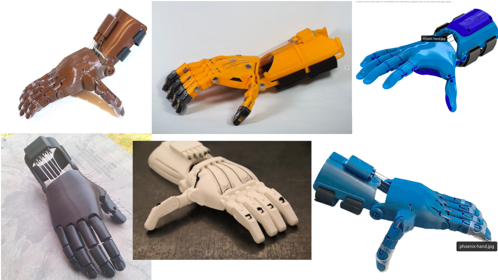

Figura 1 - Exemplos de próteses e dispositivos associados ao fabrico aditivo em contexto protésico.

Fonte: produção própria, a partir de imagens publicadas na página digital Enabling the Future, nas páginas Wrist Powered e Introducing the New 3D Printed Kinetic Hand Design (consultadas em 2 de julho de 2026). https://enablingthefuture.org/wrist-powered/; [**https://enablingthefuture.org/2020/11/13/introducing-the-new-3d-printed-kinetic-hand-design/**](https://enablingthefuture.org/2020/11/13/introducing-the-new-3d-printed-kinetic-hand-design/)

Nesta investigação, «prótese de membro superior» designa a categoria geral em que o estudo se inscreve; «Modelo paramétrico» refere-se ao conjunto de variáveis, relações e restrições que gera a forma; «geometria exportada» designa o ficheiro resultante nos formatos *Stereolithography* (STL) ou *3D Manufacturing Format* (3MF); «plataforma *web*» identifica a aplicação que coordena parâmetros, visualização, dados e sugestões; e «protótipo físico» corresponde à peça impressa. A parametrização consiste na definição dessas relações, a configuração corresponde à escolha de valores e a personalização individual exige dados da própria pessoa. Os perfis populacionais usados neste estudo fornecem referências iniciais, mas não equivalem a uma adaptação anatómica individual.

O *design* industrial desempenha uma função de mediação entre a tecnologia, as decisões de projeto e a experiência humana. Esta investigação examina essa mediação através de um protótipo técnico desenvolvido e discutido segundo uma abordagem de *Research Through Design*.

## 1.2 Problema de investigação

Apesar da expansão do fabrico aditivo e da partilha de modelos abertos, ainda existe uma lacuna na articulação entre dados antropométricos, regras geométricas, configuração digital e preparação para o fabrico. Muitos modelos de próteses continuam a depender de escalonamento uniforme, ajustes manuais e conhecimento tácito, dificultando a identificação da origem dos valores e a avaliação do efeito de cada alteração na geometria.

O problema central deste estudo consiste em compreender de que modo o *design* de produto pode articular a modelação paramétrica, as referências antropométricas, o apoio da inteligência artificial e o fabrico aditivo num fluxo técnico de configuração preliminar de modelos de próteses de membro superior. Nesse fluxo, as decisões, os limites dos modelos e a supervisão humana devem permanecer explícitos.

## 1.3 Objetivos da investigação

### 1.3.1 Objetivo geral

O objetivo geral da atual proposta consiste em produzir conhecimento através da prática de *design*, mediante o desenvolvimento e a avaliação técnica de um sistema paramétrico apoiado por inteligência artificial para a configuração preliminar de modelos de mão protésica destinados ao fabrico aditivo.

### 1.3.2 Objetivos específicos

Para concretizar este objetivo, a investigação procura:

\- Analisar o papel do *design* industrial na articulação entre requisitos humanos, decisões técnicas e condições de fabrico;

\- Organizar dados antropométricos provenientes de diferentes fontes, preservando a caracterização da população de origem, o protocolo de medição, a unidade, a medida estatística e as limitações associadas aos dados;

\- Adaptar modelos abertos de mão protésica a uma estrutura paramétrica explícita em OpenSCAD;

\- Desenvolver uma plataforma *web* que integre a configuração e visualização de modelos protésicos paramétricos, a gestão das diferentes versões geradas, a exportação dos respetivos modelos 3D e a sua preparação para impressão 3D;

\- Delimitar o papel da inteligência artificial na sugestão inicial de parâmetros, distinguindo-o das regras geométricas e das decisões humanas;

\- Avaliar a coerência técnica do percurso entre dados, parâmetros, geometria digital e protótipos físicos;

\- Identificar os limites da solução e as condições necessárias para avaliações clínicas, funcionais e de utilização posteriores.

A investigação procura responder às seguintes perguntas:

1\. Como o *design* de produto, métodos paramétricos e inteligência artificial podem melhorar a personalização, o conforto e a adequação funcional de próteses, mantendo a acessibilidade e o controlo sobre as decisões de projeto?

2\. Quais metodologias e ferramentas validam a eficácia, a usabilidade, a durabilidade e a possibilidade de reproduzir os resultados de próteses impressas em 3D?

3\. Como é que o *design* industrial concilia requisitos anatómicos, funcionais, ergonómicos, estéticos e simbólicos, promovendo a aceitação, a dignidade e a autonomia?

## 1.4 Abordagem metodológica geral

O projeto adota uma metodologia aplicada, baseada em *Research Through Design*, que reconhece o ato de projetar como forma de gerar conhecimento. A metodologia compreende diferentes fases - conceptual, metodológica e empírica -, articuladas pelo modelo *Double Diamond* através de ciclos iterativos de exploração, definição, desenvolvimento e avaliação.

Na fase conceptual, procede-se à revisão crítica da literatura e das plataformas, consolidando o quadro teórico e os requisitos técnicos. A fase metodológica define a arquitetura do sistema paramétrico apoiado por inteligência artificial e integra dados antropométricos e princípios de *design* para fabrico aditivo. Na fase empírica, concretizam-se a modelação paramétrica, a produção de protótipos por impressão 3D e a avaliação técnica preliminar, sem recurso a dados pessoais, ou envolvimento de participantes.

## 1.5 Estrutura da investigação

A investigação organiza-se em nove capítulos principais. O Capítulo 1 apresenta o enquadramento, o problema, os objetivos, as questões de investigação e a abordagem metodológica geral. O Capítulo 2 desenvolve o enquadramento teórico e o estado da arte. O Capítulo 3 explicita a metodologia de investigação. O Capítulo 4 descreve o desenvolvimento do modelo paramétrico. O Capítulo 5 aborda a plataforma *web* e a integração digital. O Capítulo 6 trata da integração da inteligência artificial. O Capítulo 7 apresenta os princípios de interface e as decisões de interação implementadas. O Capítulo 8 reúne a avaliação e a discussão dos resultados. Por fim, o Capítulo 9 sintetiza as conclusões e os trabalhos futuros.

# Capítulo 2 - Enquadramento Teórico e Estado da Arte

## 2.1 Prótese de membro superior e dispositivos médicos

Uma prótese de membro superior é um dispositivo médico externo que substitui um segmento ausente devido a uma amputação ou a uma deficiência congénita. A sua presença não se limita à restituição formal: recupera funções, facilita atividades diárias, melhora a autonomia e reduz o impacto psicossocial da perda (Fink & Diamond, 2023; Segura et al., 2024).

A perda total ou parcial de um membro superior tem consequências físicas, funcionais, sociais e emocionais profundas. "Perda total" refere-se à ausência completa do membro, enquanto "perda parcial" indica ausência apenas de uma das suas partes.

A mão humana reúne capacidades motoras e sensoriais complexas: o alcance (movimento do membro para tocar ou agarrar objetos), a preensão (ato de segurar objetos), a manipulação fina (habilidade para movimentos precisos), a estabilização (manter objetos ou posições), a coordenação bimanual (uso de ambas as mãos em colaboração) e a exploração táctil (deteção de propriedades dos objetos pelo contacto). A reprodução artificial destas funções continua a constituir um desafio significativo nos dispositivos médicos e na reabilitação. O desenvolvimento e a prescrição de próteses implicam compromissos permanentes entre funcionalidade, peso, robustez, conforto, controlo intuitivo, manutenção e custo.

Nas últimas décadas, o sector evoluiu de soluções predominantemente cosméticas e mecânicas para sistemas com maior sofisticação eletromecânica, integração eletrónica e capacidade de configuração. Persistem, contudo, desafios estruturais, entre os quais o desconforto, a dificuldade de controlo, a ausência de resposta sensorial e as taxas elevadas de abandono. A tensão entre o potencial técnico e os resultados práticos é essencial para compreender o estado atual das próteses de membro superior enquanto dispositivos médicos.

### Tipologias de próteses de membro superior

As próteses de membro superior podem ser classificadas de acordo com a fonte de energia e o mecanismo de controlo em quatro categorias principais: passivas (cosméticas), mecânicas acionadas pelo corpo, mioelétricas (externamente alimentadas) e híbridas. As vantagens e limitações de cada tipo traduzem diferentes equilíbrios entre desempenho funcional, conforto, durabilidade e custo (Brack & Amalu, 2021).

As próteses passivas destinam-se a fins estéticos e ao apoio estático em tarefas simples, sem preensão ativa. Podem ser rígidas ou ajustáveis, permitindo, neste último caso, mover manualmente os dedos ou os terminais. São leves, simples e silenciosas, além de exigirem pouca manutenção. A sua utilidade funcional é limitada, pelo que são preferidas quando a estética é prioritária ou o utilizador procura um dispositivo discreto (Fink & Diamond, 2023; Segura et al., 2024).

### Próteses mecânicas acionadas pelo corpo (*body-powered*)

As próteses mecânicas recorrem a um sistema de arnês e cabos que converte os movimentos do ombro, do tronco ou da cintura escapular em ações do dispositivo terminal, geralmente um gancho ou uma mão mecânica. Estas soluções são tradicionalmente valorizadas pela robustez, pelo comportamento mecânico previsível, pelo menor custo e pela relativa facilidade de manutenção.

A tensão transmitida pelo sistema de cabos proporciona informação propriocetiva[^1] indireta, que pode contribuir para um controlo mais previsível em determinadas tarefas. Estas próteses apresentam, contudo, limitações expressivas: o arnês pode ser desconfortável e restritivo, os padrões de preensão tendem a ser mais limitados e a utilização exige esforço físico contínuo e aprendizagem motora específica (Engdahl et al., 2024; Fink & Diamond, 2023).

### Próteses mioelétricas

As próteses mioelétricas são dispositivos alimentados eletricamente que utilizam sinais eletromiográficos (EMG), captados por elétrodos de superfície aplicados no membro residual. Estes sinais são processados eletronicamente para ativar os motores responsáveis pelo movimento da mão, do punho ou do cotovelo. Comparativamente às soluções mecânicas, apresentam habitualmente maior integração estética, dispensam o arnês e permitem padrões de movimento potencialmente mais sofisticados. Em alguns casos, a sua utilização tem sido associada à redução da dor fantasma e a uma experiência de uso mais aceitável em contextos sociais. Entre as limitações contam-se o maior peso, o custo elevado, a dependência de baterias, a maior sensibilidade à humidade e a interferências, a necessidade de calibração e a ausência de resposta sensorial direta (Bates et al., 2020; Engdahl et al., 2024).

### Sistemas híbridos

As próteses híbridas combinam mecanismos mecânicos e elétricos no mesmo dispositivo. São particularmente frequentes em amputações proximais, como as amputações transumerais ou as desarticulações do ombro, e podem associar, por exemplo, o controlo mecânico do cotovelo ao controlo mioelétrico do terminal. Esta configuração procura aproveitar as vantagens específicas de cada sistema, distribuindo o peso, as exigências funcionais e a complexidade do controlo. Em contrapartida, a aprendizagem, a adaptação e a manutenção podem tornar-se mais exigentes (Segura et al., 2024; Walters et al., 2025).

A Figura 2 representa esta diversidade tipológica através de exemplos de próteses impressas em 3D com diferentes soluções morfológicas e mecânicas, mostrando como as opções de configuração concretizam compromissos distintos entre simplicidade, função e custo.

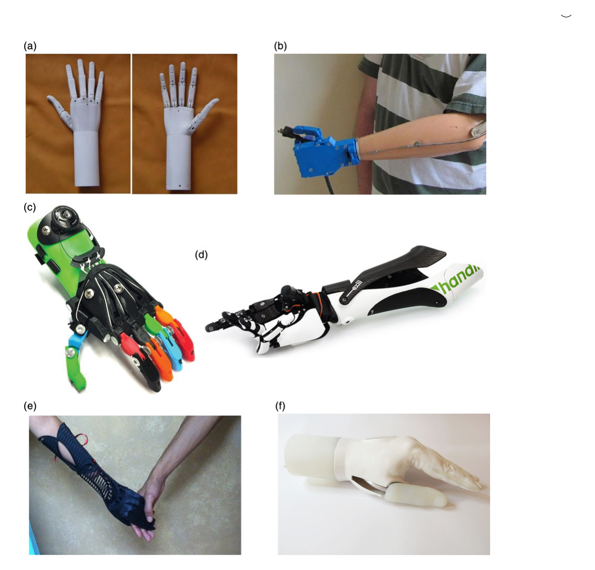

Figura 2 - Exemplos de próteses de membro superior impressas em 3D, ilustrando diversidade tipológica e construtiva.

Reproduzido de (ten Kate et al., 2017). 3D-printed upper limb prostheses: A review. Disability and Rehabilitation: Assistive Technology, 12(3), 300-314. https://doi.org/10.1080/17483107.2016.1253117

### Considerações clínicas e funcionais

A prescrição de uma prótese de membro superior é um processo clínico complexo e centrado no utilizador, conduzido por uma equipa multidisciplinar que integra médicos, técnicos de ortoprotesia, terapeutas e o próprio utilizador. A escolha do dispositivo terminal requer uma avaliação articulada de fatores físicos, funcionais, ocupacionais e psicossociais (Fink & Diamond, 2023; Soyer et al., 2016).

Os fatores físicos abrangem o nível de amputação, o comprimento e a condição do membro residual, a integridade cutânea, a amplitude articular e a força muscular. As amputações mais proximais colocam desafios acrescidos quanto ao controlo e ao peso do sistema protésico.

A escolha da tipologia protésica é significativamente influenciada por fatores individuais como a idade, as comorbilidades, o domínio manual, a literacia técnica, o contexto profissional e as atividades recreativas. Os utilizadores que realizam trabalho manual intensivo ou atuam em ambientes mais exigentes, por exemplo, podem beneficiar de soluções mecânicas mais robustas. Já os contextos profissionais e sociais em que se valorizam mais a integração estética e a diversidade funcional podem favorecer os dispositivos mioelétricos.

A motivação, as expectativas, a imagem corporal, o suporte social e a capacidade cognitiva constituem fatores psicossociais igualmente determinantes. Expectativas irrealistas quanto às capacidades do dispositivo podem resultar em insatisfação, uso intermitente e eventual abandono.

A reabilitação protésica decorre em várias fases: cuidados perioperatórios, preparação pré-protésica, treino com a prótese definitiva e acompanhamento a longo prazo. Nos sistemas mioelétricos, o treino funcional é particularmente relevante, pois requer fortalecimento muscular específico, aprendizagem da produção de sinais consistentes e integração progressiva do dispositivo em tarefas reais. A literatura salienta repetidamente a importância do acompanhamento continuado, da educação do utilizador e do ajuste iterativo do dispositivo ao longo do tempo (Bates et al., 2020; Soyer et al., 2016).

### Medição de resultados e abandono protésico

A avaliação objetiva do sucesso protésico permanece difícil. A escassez de instrumentos padronizados e a heterogeneidade das métricas dificultam a comparação entre estudos, dispositivos e estratégias de reabilitação. Utilizam-se ferramentas de avaliação registadas pelo utilizador, centradas na funcionalidade percebida, na satisfação e na qualidade de vida, assim como testes de desempenho orientados para a destreza, a velocidade de execução e o controlo funcional em tarefas estruturadas (Segura et al., 2024; Soyer et al., 2016).

Apesar da evolução tecnológica, o abandono das próteses de membro superior continua a ter expressão. (Smail et al., 2021) agrupam as razões identificadas sobretudo em duas áreas - conforto e função - e apontam o peso, a temperatura e a transpiração como alguns dos problemas de conforto mais persistentes. (Biddiss et al., 2007) e (Fink & Diamond, 2023), acrescentam que o peso, o conforto, o controlo e o ajuste do encaixe são aspetos relevantes para as prioridades dos utilizadores e para o processo de escolha e acompanhamento da prótese. Estes resultados indicam que a melhoria tecnológica não garante, por si só, a utilização continuada e que as decisões de *design* devem atender à experiência física e funcional do utilizador.

A Figura 3 demonstra a distribuição observada por (Østlie et al., 2011) numa amostra populacional de 224 adultos com amputação adquirida do membro superior. Nesse estudo, 4,5% dos participantes apresentavam rejeição primária da prótese; dos 209 participantes que tinham começado a utilizá-la, 13,4% interromperam posteriormente o seu uso. Estes dados permitem distinguir a rejeição anterior à primeira utilização daquela que ocorre após a adoção inicial do dispositivo.

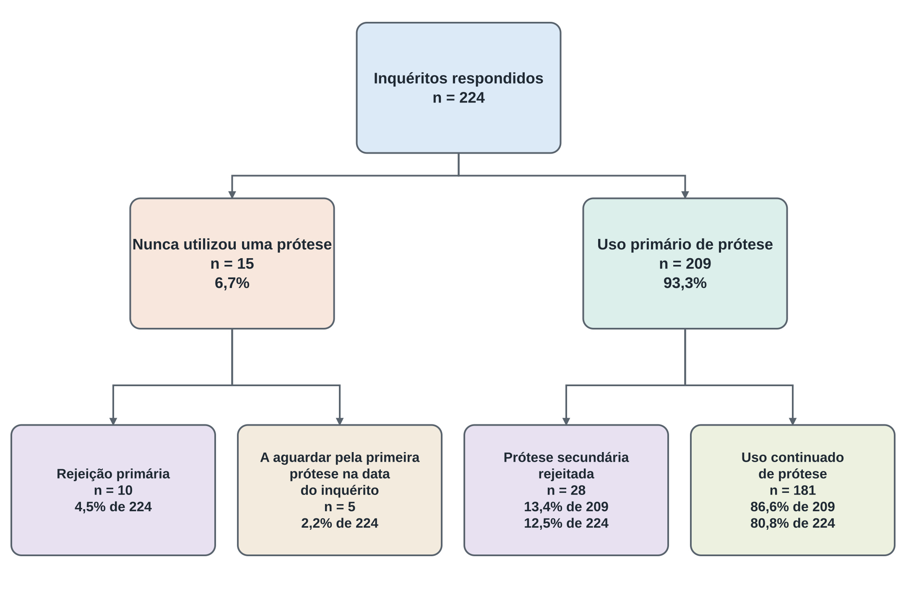

Figura 3 - Utilização continuada, rejeição primária e rejeição secundária de próteses numa amostra de adultos com amputação adquirida do membro superior.

Adaptado da Figura 1 de (Østlie et al., 2012). Prosthesis rejection in acquired major upper-limb amputees: A population-based survey. *Disability and Rehabilitation: Assistive Technology, 7*(4), 294-303. https://doi.org/10.3109/17483107.2011.635405

### Enquadramento regulatório enquanto dispositivo médico

As próteses de membro superior são classificadas como dispositivos médicos e estão sujeitas a regulamentação específica destinada a garantir a segurança, o desempenho e a vigilância durante todo o ciclo de vida. Na União Europeia, este enquadramento é estabelecido pelo (Parlamento Europeu e do Conselho Europeu, 2017), habitualmente designado pela sigla inglesa MDR (*Medical Device Regulation*). Nos termos do artigo 51.º, os dispositivos são integrados nas classes I, IIa, IIb e III, consoante a finalidade prevista e os riscos intrínsecos, de acordo com as regras do Anexo VIII. A classe de uma prótese de membro superior, incluindo uma prótese mioelétrica, não depende, portanto, apenas do tipo de acionamento, mas também das características e da finalidade previstas para o dispositivo. Antes da colocação no mercado, o fabricante deve aplicar o procedimento de avaliação da conformidade correspondente. Os dispositivos considerados conformes ostentam a marcação CE, e nas classes IIa, IIb e III, o procedimento envolve um organismo notificado (Parlamento Europeu e do Conselho Europeu, 2017).

Na análise publicada em 2010 sobre a regulamentação dos dispositivos protésicos nos Estados Unidos, a Food and Drug Administration (FDA) classifica os dispositivos segundo o risco e os controlos necessários para assegurar a segurança e a eficácia. Muitos componentes protésicos eram enquadrados na classe I; a introdução de novas tecnologias ou finalidades podia exigir procedimentos adicionais de avaliação prévia à comercialização e, em determinados casos, dados clínicos. Os requisitos dependiam da finalidade prevista, da tecnologia e dos riscos, não apenas do tipo de acionamento (Resnik et al., 2010).

A demonstração da segurança e do desempenho requer uma avaliação clínica sistemática, testes de biocompatibilidade, avaliação da segurança mecânica e elétrica, validação de *software* e consideração explícita dos fatores humanos e da usabilidade. O comité técnico ISO/TC 168 normaliza aspetos como o desempenho, a segurança, os fatores ambientais e a possibilidade de intercâmbio entre componentes de próteses e ortóteses (International Organization for Standardization, n.d.). Preparada por este comité, a ISO 8549-1:2020 estabelece a terminologia geral do domínio (International Organization for Standardization, 2020). Os fabricantes devem ainda implementar sistemas de vigilância pós-comercialização e recolher dados de uso real durante o ciclo de vida do dispositivo. Esta exigência reforça a natureza regulada e iterativa do domínio, bem como a necessidade de sustentar a sua evolução em evidência (Parlamento Europeu & Conselho da União Europeia, 2017).

## 2.2 *Design* industrial, *design* inclusivo e *design* centrado no utilizador

No contexto da saúde e das tecnologias de apoio, o design industrial é progressivamente reconhecido como uma disciplina de mediação entre as necessidades humanas, os contextos de utilização e os sistemas técnicos regulados.

A literatura revista atribui ao *design* um papel estruturante na promoção da inclusão, da autonomia e da participação social, mediante a articulação da configuração formal dos produtos com a relação entre indivíduos, ambientes, artefactos e sistemas.

Nas tecnologias de apoio, em particular, o *design* é descrito como um mediador da interação entre os utilizadores e o meio envolvente, contribuindo para reduzir barreiras funcionais e sociais e, por conseguinte, para melhorar os resultados de participação e a qualidade de vida (Clarkson & Coleman, 2010; Shah & Robinson, 2006)(Adel et al., 2020)

O *design* inclusivo é também apresentado como um imperativo contemporâneo, orientado para minimizar a exclusão evitável resultante de decisões de projeto que desconsideram a diversidade populacional e as alterações das capacidades ao longo do tempo. Esta perspetiva converge com a responsabilidade dos sistemas de saúde de responder a utilizadores heterogéneos, com diferentes condições físicas, cognitivas e contextuais (Clarkson & Coleman, 2010).

### *Design* industrial em dispositivos médicos

No domínio dos dispositivos médicos, o *design* industrial é uma prática metodológica centrada no utilizador, com uma função colaborativa em equipas multidisciplinares de desenvolvimento. A literatura identifica, porém, uma lacuna estrutural: muitos dispositivos médicos continuam a ser desenvolvidos sobretudo a partir de abordagens de engenharia e de requisitos regulatórios, com participação limitada de profissionais especificamente formados em metodologias de *design* centrado no uso. Esta assimetria favorece soluções tecnicamente robustas, mas nem sempre otimizadas quanto à ergonomia, à usabilidade ou à integração na vida quotidiana (Fisher & Johansen, 2020; Wilke et al., 2020).

Neste contexto, o *design* industrial intervém na conceptualização, na definição dos requisitos de utilização, na tradução das necessidades clínicas em soluções tangíveis e na articulação entre os requisitos regulamentares e a experiência do utilizador (Fisher & Johansen, 2020; Shah & Robinson, 2006).

A posição intermédia do *design* torna-se mais clara quando se considera a multiplicidade de papéis que os profissionais de saúde podem assumir nos processos de desenvolvimento. Além de validarem soluções, podem participar como parceiros empresariais, utilizadores peritos, mediadores entre as áreas clínica e tecnológica, ou profissionais clínicos e investigadores, conforme sintetizado na Tabela 1.

Tabela 1 - Função dos profissionais de saúde no desenvolvimento de dispositivos médicos.

|                                         |                                                                                                                                                         |                                                                                |
|-----------------------------------------|---------------------------------------------------------------------------------------------------------------------------------------------------------|--------------------------------------------------------------------------------|
| **Função**                              | **Contributo no desenvolvimento**                                                                                                                       | **Domínio principal de decisão**                                               |
| Parceiros empresariais                  | Atuam como clientes ou defensores da equipa de *design*, identificam oportunidades, definem especificações e facilitam o acesso a outros intervenientes | Oportunidades de negócio, mercado, concorrência, regulamentação e certificação |
| Utilizadores peritos                    | Fornecem experiência clínica contextualizada e problemas de uso                                                                                         | Experiência do utilizador e adequação funcional                                |
| Mediadores                              | Traduzem linguagem, necessidades e constrangimentos entre equipas                                                                                       | Problemas técnicos, terminologia e entendimento partilhado                     |
| Profissionais clínicos e investigadores | Enquadram cuidados, testes e validação empírica                                                                                                         | Resultados clínicos, ensaios e usabilidade                                     |

Adaptado de (Kaygan & Kaygan, 2025). Clients and carers: Healthcare professionals’ roles in medical device development processes in SMEs. The Design Journal, 28(2), 213-231. https://doi.org/10.1080/14606925.2024.2420152

### *Design* inclusivo e *design* universal

O *design* inclusivo introduz uma mudança conceptual significativa: em vez de considerar a limitação funcional um atributo individual, compreende a exclusão como resultado de desajustes entre as capacidades humanas e os ambientes projetados (Clarkson & Coleman, 2010).

Esta perspetiva aproxima-se dos modelos sociais e relacionais da deficiência ao salientar que a exclusão pode resultar de decisões de projeto que não contemplam a diversidade dos utilizadores (Clarkson & Coleman, 2010).

Enquanto campo de prática e investigação, o *design* inclusivo desenvolveu ferramentas e orientações para apoiar as equipas de projeto na consideração sistemática da diversidade populacional. Entre elas encontram-se estratégias de segmentação, análises de capacidades e critérios de acessibilidade aplicáveis a produtos e sistemas, incluindo tecnologias digitais em saúde (Clarkson & Coleman, 2010).

O *design* universal é frequentemente apresentado como uma abordagem de ampla aplicação no *design* industrial, orientada para a conceção de produtos e ambientes utilizáveis pelo maior número possível de pessoas, sem necessidade de adaptações ou de *design* especializado. Os Sete Princípios do *design* universal foram compilados por um grupo de dez investigadores e profissionais, entre os quais Ron Mace, e publicados em 1997 pelo *Center for Universal Design* da *North Carolina State University*. O quadro abrange uso equitativo, flexibilidade no uso, utilização simples e intuitiva, informação percetível, tolerância ao erro, baixo esforço físico, dimensão e espaço adequados à aproximação e à utilização (Center for Universal Design, 1997).

Na área da saúde, a operacionalização do *design* universal recorre a critérios de usabilidade, funcionalidade, segurança, orientação espacial, compreensão, fatores ambientais, bem-estar e inclusão social (White & Mosca, 2022). Nesta dissertação, esta aplicação é interpretada como um ponto de convergência entre *o design* universal e *o design* inclusivo, uma vez que relaciona a redução de barreiras com a usabilidade e a inclusão.

### *Design* centrado no utilizador e *design* centrado no humano

O *design* centrado no utilizador (*User-Centred Design* - UCD) procura envolver os utilizadores finais em diferentes fases do desenvolvimento, de modo que as suas necessidades, competências e contextos de utilização sejam considerados na definição e na avaliação do produto (Fisher & Johansen, 2020; Shah & Robinson, 2006).

O *design* centrado no humano (*Human-Centred Design* - HCD) alarga esta perspetiva ao integrar dimensões culturais, contextuais e sistémicas. No desenvolvimento de dispositivos médicos, o HCD associa-se a práticas como a etnografia, o *design* participativo, o mapeamento de jornadas (*journey maps*), o mapeamento de *stakeholders* e a avaliação de fatores humanos. A norma IEC 62366-1:2015 estabelece um processo de engenharia de usabilidade para analisar, especificar, desenvolver e avaliar a utilização segura de dispositivos médicos (International Electrotechnical Commission, 2015). Este processo inclui avaliações realizadas durante o desenvolvimento para orientar melhorias, bem como uma avaliação final da interface no contexto de utilização previsto (Fisher & Johansen, 2020; Millet et al., 2018).

A incorporação de fatores humanos é também reforçada por diretivas e normas que exigem a redução dos riscos de uso inadequado e articulam a segurança, a ergonomia e a usabilidade como dimensões indissociáveis do desenvolvimento de dispositivos médicos (Millet et al., 2018).

### *Design* Participativo e *Co-design*

O *design* participativo e o *co-design* aprofundam as abordagens centradas no utilizador ao privilegiar a participação ativa e o envolvimento dos utilizadores no processo de projeto. Nestes modelos, os utilizadores contribuem para definir problemas, gerar soluções e avaliar protótipos (Chapman et al., 2025).

As revisões sistemáticas assinalam a necessidade de descrever os processos de co-design com maior transparência e rigor, de modo a reforçar a sua validade metodológica e eficácia prática. Nas tecnologias de apoio, observa-se uma evolução discursiva dos modelos centrados no utilizador para paradigmas de cocriação, nos quais as experiências dos utilizadores ocupam uma posição central na tomada de decisão (Chapman et al., 2025). Contudo, persistem tensões entre os ideais participativos e os contextos regulatórios altamente estruturados, em que o poder de decisão permanece frequentemente concentrado nos profissionais clínicos e nas equipas técnicas (Chapman et al., 2025; Wilke et al., 2020).

### Metodologias, instrumentos e avaliação

(Shah & Robinson, 2006) demonstram que os utilizadores podem participar no desenvolvimento de tecnologias de saúde durante as fases de definição do conceito, desenvolvimento, teste e implementação. Para esse envolvimento, podem ser utilizados métodos como entrevistas, questionários, testes de usabilidade, simulações, atividades colaborativas de definição e desenvolvimento de soluções e discussões orientadas em grupo.

No domínio hospitalar e dos serviços de saúde, as ferramentas de avaliação baseadas em critérios de *design* universal e de *design* para todos (*Design for All*) recorrem a sistemas de análise multicritério e a listas de verificação estruturadas para aferir os níveis de inclusão (White & Mosca, 2022).

Na seleção de tecnologias de apoio, o modelo *Matching Person and Technology* (MPT) procura relacionar as capacidades e perspetivas da pessoa com uma tecnologia específica e com o ambiente em que esta será utilizada (van Niekerk et al., 2018). A Classificação Internacional de Funcionalidade, Incapacidade e Saúde (ICF), por sua vez, considera a interação entre a condição de saúde e os fatores pessoais e ambientais, que incluem os produtos e as tecnologias (Howard et al., 2022b). No âmbito do *design*, estes enquadramentos mostram que a adequação do dispositivo depende não só das suas características técnicas, mas também da correspondência com as necessidades da pessoa e o seu contexto de utilização.

(Chapman et al., 2025), explicitam as etapas de identificação e seleção dos estudos incluídos na sua revisão, mediante uma adaptação das orientações PRISMA[^2]. Este registo permite compreender a constituição do conjunto de estudos analisados e clarifica a fundamentação bibliográfica utilizada para apoiar decisões de *design*.

### Desafios e lacunas

Os desafios identificados incluem o desfasamento entre os princípios do *design* centrado no utilizador e as condições institucionais em que os dispositivos médicos são desenvolvidos, assim como a necessidade de atender à diversidade de necessidades, competências e contextos de utilização (Fisher & Johansen, 2020; Shah & Robinson, 2006). Na transição da investigação para a aplicação, persistem limitações na evidência disponível e na colaboração entre equipas académicas, industriais e clínicas ao longo do desenvolvimento e da introdução das tecnologias no mercado (Oldfrey et al., 2024).

Estas lacunas demonstram que o *design* industrial de dispositivos médicos não pode ser entendido apenas como uma prática formal ou estética. Trata-se também de uma disciplina estratégica que articula inclusão, regulação, implementação e experiência do utilizador.

## 2.3 Fabrico Aditivo e parametrização no *design* de produto

A convergência entre a modelação paramétrica e o fabrico aditivo (FdA) tem sido amplamente reconhecida como um dos principais vetores de transformação do *design* contemporâneo, sobretudo em contextos que exigem personalização, adaptação morfológica e produção de variantes em pequena escala. A literatura considera estas abordagens complementares: a modelação paramétrica permite gerar múltiplas variações controladas a partir de um modelo-base, enquanto o fabrico aditivo possibilita a materialização de geometrias complexas sem moldes ou ferramentas dedicadas (Lei et al., 2016; Ozdemir et al., 2022; van Stralen, 2018).

A Figura 4 representa esta articulação ao resumir o encadeamento entre a aquisição digital, a modelação/retificação e o fabrico, demonstrando que a personalização depende da integração das várias etapas do fluxo de trabalho.

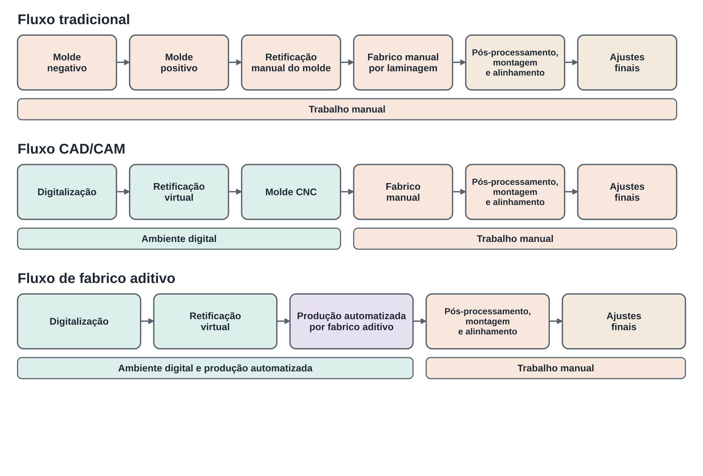

Figura 4 - Comparação entre os fluxos tradicional, CAD/CAM e de fabrico aditivo na produção de dispositivos protésicos.

Adaptado da Figura 1 de (Oldfrey et al., 2024).

Neste enquadramento, a personalização deixa de ser tratada como exceção e torna-se uma estratégia estruturada, operacionalizada por meio de modelos-base parametrizados. Estes modelos preservam uma arquitetura estável e expõem um conjunto limitado de variáveis ajustáveis, frequentemente acessíveis por meio de interfaces digitais ou de configuradores destinados a utilizadores não especialistas (Ozdemir et al., 2022; van Stralen, 2018).

### Modelação Paramétrica e Espaços de Variação

Os modelos paramétricos desempenham duas funções centrais. Por um lado, codificam a lógica geométrica do produto - relações, restrições e regras -, assegurando que as alterações dos valores dos parâmetros geram novas variantes sem comprometer a integridade estrutural nem a coerência funcional. Por outro, permitem explorar espaços de variação extensos, frequentemente descritos como quase contínuos, possibilitando a criação de famílias de produtos ajustáveis mediante a modificação de variáveis dimensionais ou funcionais (Lei et al., 2016; Ozdemir et al., 2022).

No contexto da adaptação ao utilizador, a literatura salienta que a parametrização é particularmente eficaz quando associada a dados mensuráveis, como os dados antropométricos ou as digitalizações tridimensionais.

A definição de parâmetros independentes, como o comprimento e a largura, permite ajustes mais precisos e maior controlo dimensional em intervalos reduzidos, ao contrário do escalonamento uniforme, que pode introduzir desvios significativos. Em aplicações protésicas, esta abordagem revelou maior proximidade às cinemáticas naturais e melhor adequação morfológica do que os modelos ajustados apenas por escala global (Lim et al., 2018).

### Integração com Fabrico Aditivo e *Design for Additive Manufacturing*

A eficácia da personalização depende da integração precoce dos constrangimentos do fabrico aditivo no processo de projeto. A literatura sobre *Design for Additive Manufacturing* (DfAM) sublinha que a incorporação antecipada de limitações do processo - tolerâncias, resistência mecânica, espessuras mínimas, orientação de impressão - reduz as falhas de fabrico e encurta os ciclos iterativos (Chtioui et al., 2023; Wiberg et al., 2019).

A revisão de (Wiberg et al., 2019) organiza os métodos e as ferramentas de apoio ao DfAM segundo as diferentes etapas do processo de desenvolvimento, relacionando o apoio disponível com o momento em que este é necessário.

Esta estrutura reforça a necessidade de ligar sistematicamente as fases de *design* e fabrico, contrariando as abordagens que tratam o fabrico como uma etapa posterior e corretiva (Chtioui et al., 2023; Wiberg et al., 2019).

As tecnologias de fabrico aditivo utilizam materiais e mecanismos de consolidação distintos. A modelação por deposição fundida (FDM) e o fabrico por filamento fundido (FFF) depositam sucessivamente camadas de termoplástico extrudido; a sinterização seletiva a laser (SLS) consolida material em pó; a estereolitografia (SLA) solidifica uma resina líquida por ação da luz. Os processos industriais para metais recorrem frequentemente à fusão em leito de pó. Estas diferenças condicionam a orientação de fabrico, as espessuras mínimas, a necessidade de suportes, o acabamento superficial e o desempenho mecânico. Por esse motivo, a tecnologia deve ser considerada desde a definição do modelo paramétrico, e não apenas no momento da produção (Chtioui et al., 2023; Wiberg et al., 2019).

### Configuradores e Cocriação Digital

A articulação da modelação paramétrica com interfaces digitais possibilita novos modelos de cocriação e produção distribuída.

Os sistemas de configuração em ambiente *web* ou as interfaces baseadas em CAD disponibilizam um conjunto delimitado de parâmetros, através dos quais o utilizador pode ajustar dimensões ou características dentro dos intervalos válidos, frequentemente com *feedback* em tempo real sobre a viabilidade (Ozdemir et al., 2022; van Stralen, 2018)

A Figura 5 apresenta um exemplo desta lógica: a personalização mediada por uma interface, na qual o utilizador atua sobre atributos visuais e formais num espaço de variação previamente estruturado. Este tipo de configurador permite compreender como a cocriação digital pode ser operacionalizada sem exigir o domínio direto de ferramentas CAD complexas.

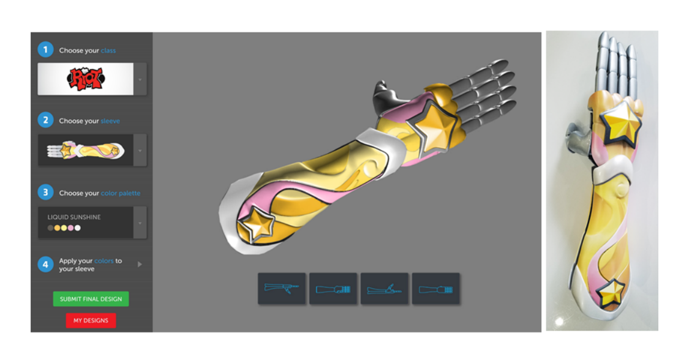

Figura 5 - Exemplo de configurador digital para personalização de uma prótese impressa em 3D.

Reproduzido de (Manero et al., 2019) Implementation of 3D printing technology in the field of prosthetics: Past, present, and future. International Journal of Environmental Research and Public Health, 16, 1641. https://doi.org/10.3390/ijerph16091641

Este modelo “*file-to-factory*”[^3] viabiliza um fluxo digital no qual o ficheiro parametrizado é convertido diretamente em instruções de fabrico. A produção pode ocorrer localmente, através de impressão 3D descentralizada, ou mediante o envio do ficheiro para um serviço externo de fabrico digital. Ao associar a variação digital à produção física, este fluxo apoia estratégias de padronização em massa (*mass customization*) e personalização em massa (*mass personalization*), nas quais diferentes configurações são produzidas a partir de uma estrutura comum.

Contudo, salienta-se que os configuradores eficazes devem limitar o número de parâmetros expostos e fornecer orientações claras sobre os limites válidos, evitando a complexidade excessiva ou escolhas superficiais (Ozdemir et al., 2022).

### Otimização, Geração e Avaliação de Desempenho

Nas famílias de produtos destinadas ao fabrico aditivo, a parametrização pode definir o espaço de personalização através de variáveis dimensionais e dos respetivos intervalos.

Esta abordagem foi aplicada ao projeto de uma família de bombas de deslocamento positivo, designadas no estudo por *finger pumps*, destinadas a equipamentos portáteis de hemodiálise domiciliária (Lei et al., 2015). Neste tipo de bomba, vários elementos mecânicos semelhantes a dedos comprimem sequencialmente uma tubagem flexível, fazendo avançar o fluido sem que este entre em contacto direto com o mecanismo. A configuração estudada integra duas filas destes elementos: uma responsável pela circulação do sangue e outra pela circulação da solução de diálise, ou dialisante. O movimento sequencial é produzido por uma árvore de cames acionada por um motor elétrico.

Para avaliar a personalização desta família de produtos, os autores definiram onze variantes da bomba, dimensionadas para caudais entre 100 e 600 mL/min, em incrementos de 50 mL/min. Cada variante foi otimizada individualmente em função da eficiência energética, do volume ocupado e do custo estimado de fabrico através de sinterização seletiva a laser. O estudo não demonstra que qualquer variação geométrica seja economicamente neutra. Contudo, nas condições analisadas, o custo unitário manteve-se relativamente baixo, mesmo para pequenos volumes de produção, e apresentou uma tendência de estabilização nas variantes de maior caudal, sobretudo entre 450 e 600 mL/min.

Comparativamente com a abordagem de referência, que procurava reduzir os custos através da utilização de componentes comuns entre as diferentes variantes, a otimização individual das onze bombas resultou num aumento médio de 25,02% da eficiência e numa redução média de 26,12% do volume. Estes resultados, circunscritos ao caso analisado e ao modelo de custos adotado, indicam que o fabrico aditivo pode permitir aumentar a variedade de uma família de produtos sem implicar necessariamente um aumento proporcional dos custos.

Nas próteses impressas em 3D, a parametrização permite ajustar dimensões independentemente, como o comprimento e a largura dos componentes, evitando as limitações do escalonamento uniforme (Lim et al., 2018). Nas famílias de produtos destinadas ao fabrico aditivo, a otimização topológica permite gerar geometrias a partir de requisitos e restrições, posteriormente avaliáveis pelo método dos elementos finitos (FEM) e por critérios de custo (Lei et al., 2016). No domínio específico das próteses de membros, (Xu & Qin, 2022) identificam aplicações de *design* generativo que utilizam a otimização topológica para reduzir o peso e FEM para validar o desempenho estrutural. A passagem de parâmetros explicitamente definidos para a geração e avaliação algorítmica de alternativas estabelece uma ligação conceptual com as abordagens de inteligência artificial discutidas nas secções seguintes.

O modelo de personalização explicita um fluxo de decisão em que os parâmetros delimitam as variantes admissíveis e a otimização procura as configurações com melhor desempenho segundo objetivos de eficiência, volume e custo (Lei et al., 2015). O trabalho complementar acrescenta a este fluxo a otimização topológica e a análise por elementos finitos (Lei et al., 2016). Estas abordagens articulam a parametrização, a simulação e a FA numa base quantitativa para a personalização, embora os resultados dependam das funções-objetivo, dos pressupostos de custo e do processo de fabrico adotado.

### Implicações para o *design* industrial

A personalização em escala depende de uma definição controlada do espaço de variação. Os parâmetros de *design*, as relações entre eles e os respetivos constrangimentos delimitam as combinações válidas, que devem ser caracterizadas através de simulação ou experimentação. No âmbito do *design*, esta estrutura permite ampliar a variedade de soluções sem gerar configurações inviáveis ou difíceis de fabricar (Ozdemir et al., 2022).

A qualidade da definição paramétrica assume, assim, um papel estratégico na viabilidade dos sistemas adaptáveis (Ozdemir et al., 2022).

O caso das onze variantes de bombas para hemodiálise, descrito na subsecção anterior, ilustra a possibilidade de articular a diversidade de uma família de produtos com objetivos de eficiência, volume e custo de fabrico (Lei et al., 2015). Para o design industrial, este exemplo evidencia a importância de definir o espaço de personalização e de avaliar os compromissos entre desempenho e custo, sem generalizar os resultados para outros produtos ou processos.

No plano educativo e profissional, recomenda-se a integração do DfAM nos currículos de *design* industrial, promovendo competências que articulem a conceção, a simulação e o fabrico digital num fluxo contínuo (Kandikjan et al., 2022).

## 2.4 Próteses *open source* de membro superior passíveis de impressão 3D

As próteses *open source* de membro superior passíveis de impressão 3D constituem um caso particularmente relevante para esta investigação, pois articulam o fabrico aditivo, a partilha digital de ficheiros, a reprodução distribuída e a adaptação local. Estes modelos circulam frequentemente sob a forma de ficheiros digitais editáveis ou imprimíveis, acompanhados de documentação comunitária, como instruções de fabrico e montagem. A disponibilização de modelos tridimensionais através da Internet favoreceu a formação de comunidades de criadores capazes de reproduzir e avaliar estes dispositivos (Manero et al., 2019). Nas soluções abertas analisadas por (Wendo et al., 2022), a disponibilidade dos ficheiros de desenho e impressão, bem como de instruções claras de fabrico e montagem, constitui um requisito essencial. Estes recursos facilitam a reprodução, o redimensionamento e a adaptação dos dispositivos, mas não garantem, por si só, a qualidade funcional de cada solução, que continua a exigir avaliação.

O projeto e-NABLE exemplifica este movimento e enquadra diretamente vários dos modelos analisados nesta investigação. Na revisão do catálogo e-NABLE, (Wendo et al., 2022) agruparam os dispositivos em duas categorias: modelos de mão e modelos de braço. Todos os modelos de mão incluídos na revisão eram acionados pelo corpo através do movimento de um punho funcional. Entre os modelos de braço analisados, o *Unlimbited Arm v2.1* e o *Kwawu Arm* eram acionados pelo movimento do cotovelo, enquanto o *El Medallo Bionic Arm* utilizava acionamento elétrico controlado por sinais musculares. Para o *design* de próteses de membro superior, esta distinção evidencia a necessidade de relacionar o tipo de dispositivo e o respetivo mecanismo de acionamento com o movimento conservado pela pessoa.

Vários modelos utilizados ou analisados nesta investigação pertencem diretamente a esta linhagem: *Cyborg Beast, Raptor Reloaded, Flexy Hand, Flexy Beast, Paraglider Hand/Flexible Flyer, Phoenix Hand* e *Unlimbited Phoenix Hand*. Estes modelos não devem ser entendidos como objetos isolados, mas como variações de um ecossistema e-NABLE, no qual cada um traduz compromissos distintos entre simplicidade de impressão, facilidade de montagem, robustez, custo, aparência e adequação anatómica. O *Cyborg Beast*, por exemplo, foi descrito como uma mão protésica infantil de baixo custo, acionada pelo punho e ajustável através de procedimentos remotos de medição e escala (Zuniga et al., 2015). Modelos posteriores, como a *Phoenix/Unlimbited Phoenix*, e os seus derivados, como o *Paraglider*, procuram simplificar a montagem, melhorar a manutenção e estabilizar geometrias recorrentes. Para o presente projeto, esta filiação tem uma consequência direta: a integração de modelos e-NABLE numa plataforma paramétrica deve ser entendida como um processo que articula a importação técnica de ficheiros com a explicitação e o controlo de regras geométricas que, nos modelos originais, surgem frequentemente como escalas globais, limites empíricos ou decisões incorporadas no próprio ficheiro.

O Victoria Hand Project constitui uma alternativa complementar ao modelo comunitário e *maker* do e-NABLE. Em vez de depender sobretudo de voluntários dispersos, organiza-se como uma estrutura de prestação de cuidados assente em parcerias locais, formação técnica, fabrico descentralizado e acompanhamento por profissionais ou clínicas parceiras. A sua relevância está na demonstração que a impressão 3D pode ser integrada num modelo de serviço mais estruturado, no qual a criação digital de componentes, a seleção modular, a adaptação de encaixes e a circulação de *feedback* entre os parceiros locais e a equipa central constituem uma infraestrutura de aprendizagem contínua (Dechev et al., 2023). Enquanto o e-NABLE demonstra o potencial da comunidade aberta e da documentação partilhada, o Victoria Hand Project demostra a importância da mediação clínica, da formação e da qualidade controlada em contextos com acesso limitado a serviços de adaptação e acompanhamento protésico.

A evidência disponível obriga, contudo, a uma leitura cautelosa. As revisões sistemáticas sobre próteses de membro superior impressas em 3D indicam resultados promissores, ainda limitados por amostras pequenas, ausência de ensaios controlados, períodos curtos de acompanhamento e heterogeneidade dos instrumentos de avaliação. A literatura existente não demonstra uma superioridade robusta face às próteses convencionais, nem permite concluir sobre os efeitos de longo prazo no conforto, na durabilidade ou na qualidade de vida (Diment et al., 2018). Uma revisão mais recente dos resultados clínicos de próteses impressas em 3D reforça esta cautela. Nos estudos sobre o membro superior, foram relatadas melhorias na preensão global, na destreza manual e na satisfação dos utilizadores; foram também avaliados o conforto, a facilidade de utilização e o uso quotidiano. Contudo, os estudos são geralmente pequenos, metodologicamente heterogéneos e difíceis de comparar entre si (Atallah et al., 2025).

As limitações técnicas são igualmente relevantes para o *design*. Estudos mecânicos sobre membros superiores *open source* mostram que a acessibilidade e o baixo custo coexistem com restrições claras em termos de desempenho, repertório de preensões, resistência, durabilidade e segurança funcional. No caso do Raptor Reloaded, por exemplo, uma mão corporalmente acionada pode ser útil em tarefas simples, mas permanece distante da diversidade de movimentos e preensões de uma mão humana (Cabibihan et al., 2021). Esta constatação não diminui o valor social destes modelos, mas impede a sua apresentação como substitutos clínicos universais. Reforça, antes, a necessidade de os tratar como plataformas de desenvolvimento, aprendizagem e personalização progressiva.

Nesta investigação, o interesse das próteses *open source* impressas em 3D reside precisamente nessa tensão. Modelos como o Flexy Beast, o Paraglider Hand e a Unlimbited Phoenix Hand oferecem bases abertas, documentadas e compatíveis com o fabrico distribuído, mas a sua configuração continua frequentemente dependente de escalonamento, adaptação manual e conhecimento tácito da comunidade. A proposta de um sistema paramétrico apoiado por inteligência artificial situa-se nesse intervalo, procurando transformar modelos abertos em objetos configuráveis mediante regras explícitas, limites dimensionais visíveis, apoio à escolha do modelo e uma ligação mais clara entre dados antropométricos, geometria gerada e critérios de fabrico. O ecossistema e-NABLE e o Victoria Hand Project constituem, assim, antecedentes históricos e referências críticas para compreender o que a plataforma deve preservar, corrigir e tornar mais verificável.

## 2.5 Antropometria aplicada ao *design* protésico

A antropometria constitui um fundamento técnico e metodológico central no *design* protésico, uma vez que a adequação geométrica do dispositivo ao corpo do utilizador condiciona diretamente o conforto, a segurança, o desempenho funcional e a aceitação. Nas próteses de membro superior, é crescente a utilização de processos digitais para captar a geometria corporal, incluindo a digitalização 3D e a fotogrametria. Estes métodos permitem obter medições destinadas à personalização das próteses, ajustar o desenho em *software* e produzir componentes por impressão 3D (Chainando et al., 2025). Nesta investigação, estes passos são organizados numa cadeia de trabalho que compreende a aquisição anatómica, a modelação ou retificação em CAD, o fabrico aditivo e o pós-processamento. Esta cadeia corresponde à organização metodológica adotada no projeto, não a um protocolo único estabelecido pela revisão.

### Da dimensão linear à “forma” como dado de projeto

Historicamente, a antropometria aplicada ao *design* baseou-se em medidas escalares (comprimentos, larguras, perímetros), obtidas com instrumentos como paquímetros, compassos antropométricos e fitas métricas, muitas vezes segundo procedimentos normalizados, como os definidos pela norma ISO 7250-1:2017 (International Organization for Standardization, 2017). No *design* protésico, porém, particularmente nas interfaces corpo-dispositivo, como o encaixe (*socket*), a literatura sublinha o papel determinante da “forma” (shape), pois pequenas variações volumétricas e distribuições de pressão podem causar desconforto, lesões cutâneas e abandono do dispositivo.

Estudos e revisões bibliográficas indicam que o ajuste protésico pode exigir tolerâncias muito reduzidas e que um conjunto limitado de medidas lineares não capta devidamente a complexidade anatómica, as trajetórias de carga e as zonas de alívio (Albin & Molenbroek, 2023; Young et al., 2023).

Verifica-se, por isso, uma valorização crescente de métodos capazes de captar geometria tridimensional de alta resolução e de traduzir essa informação em modelos CAD passíveis de retificação, parametrização e fabrico (Squibb et al., 2024).

Ainda assim, a medição linear permanece indispensável para estruturar o modelo paramétrico, sobretudo quando se pretende definir um conjunto mínimo de entradas robustas e replicáveis. A Figura 6 ilustra este nível fundamental: os marcos anatómicos e os comprimentos de referência que sustentam medições comparáveis da mão.

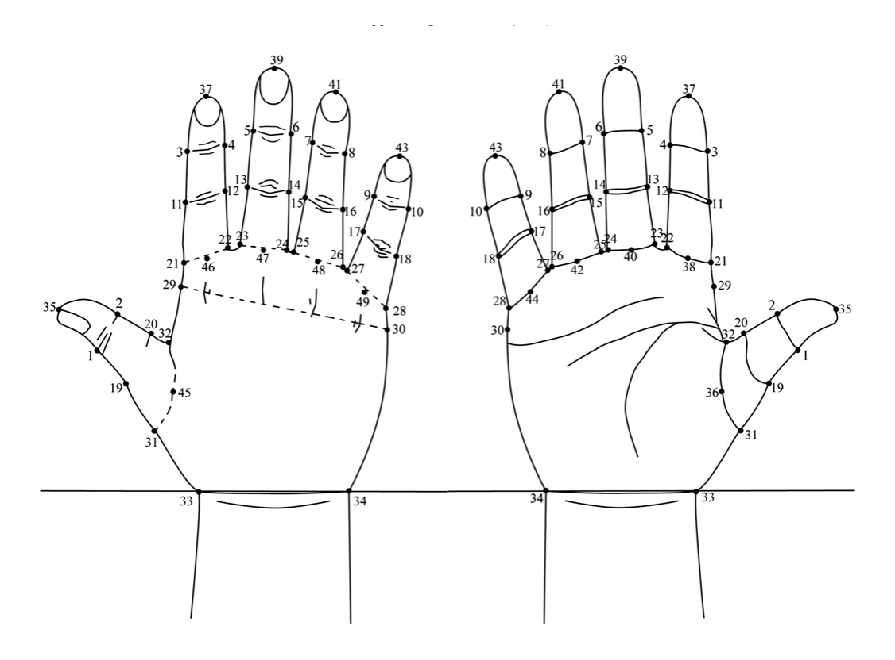

Figura 6 - Marcos anatómicos e medidas de referência da mão para fins de personalização.

Reproduzido de (Yu et al., 2013) 2D and 3D anatomical analyses of hand dimensions for custom-made gloves. Applied Ergonomics, 44, 381-392.

### Métodos de recolha antropométrica em próteses e tecnologias de apoio

A literatura agrupa os métodos de recolha em famílias com potencialidades e limitações específicas para o *design* protésico:

1.  A antropometria manual abrange medições realizadas em posturas normalizadas com instrumentos clínicos e de ergonomia. Mantém-se relevante em contextos de acessibilidade clínica e monitorização simples, por exemplo, na medição de circunferências para acompanhar variações do membro residual. Estas medidas, contudo, podem representar apenas parcialmente as alterações reais de volume, pois dependem da geometria do segmento e da distribuição dos tecidos, o que limita a precisão necessária para decisões de ajuste fino (Ibrahim et al., 2024).

2.  A digitalização ótica 3D capta a geometria superficial do corpo sob a forma de nuvens de pontos ou malhas digitais, posteriormente processadas e convertidas em modelos compatíveis com *software* CAD e processos de fabrico digital, frequentemente através do formato STL. Esta tecnologia facilita os fluxos de personalização e pode ser combinada com processos de automatização, como a correspondência de características anatómicas, reduzindo o trabalho de definição manual. Contudo, a consistência dos resultados pode variar em função da complexidade da forma, sobretudo em geometrias irregulares, como segmentos residuais complexos (Squibb et al., 2024).

3.  A fotogrametria permite reconstruir modelos 3D a partir de fotografias 2D e inclui soluções baseadas em *smartphones*. É considerada um método promissor pela rapidez de captura e pelo potencial de acesso alargado, embora possa exigir mais tempo de processamento e cuidados relativos à iluminação e à cobertura da imagem (Silva et al., 2024).

4.  As imagens médicas, como a tomografia computorizada (CT) ou a ressonância magnética (MRI: *Magnetic Resonance Imaging*), permitem obter a geometria externa e, em alguns casos, informação interna, por exemplo, sobre estruturas ósseas. Esta informação pode sustentar modelos mais ricos e abordagens como a modelação estatística de forma[^4]. Estas técnicas implicam, contudo, maior custo e menor acessibilidade; no caso do CT, é ainda necessário considerar a exposição à radiação e a dependência do contexto hospitalar.

5.  Medições complementares da interface (pressão, termografia, bioimpedância). A literatura salienta que, nas próteses, a adequação não é apenas geométrica, pois depende do comportamento da interface durante o uso. Recorre-se, por isso, a métodos adjuntos que quantificam sinais de ajuste, como a distribuição de pressão e de cisalhamento, as zonas de aquecimento localizado (*thermal hot spots*) e as flutuações de volume do membro residual. Estes métodos permitem relacionar decisões de forma/retificação com desfechos de conforto e segurança, embora sejam descritos, em muitos casos, como ainda experimentais e sujeitos a barreiras à adoção clínica (Ibrahim et al., 2024; Young et al., 2023).

### Interpretação e aplicação de dados antropométricos no projeto

A conversão dos dados antropométricos em critérios de projeto faz-se por diferentes vias analíticas:

\- Dimensionamento estatístico por percentis e avaliação de incompatibilidades dimensionais: método típico no *design* ergonómico para definir dimensões que acomodam uma percentagem da população; aplicado sobretudo a produtos de uso “externo” (por exemplo, cadeiras de rodas e interfaces).

\- Métodos multivariados e aprendizagem estatística: usados quando se trabalha com dados de alta dimensionalidade (malhas, secções, nuvens de pontos), permitindo extrair padrões de retificação ou modos de variação.

\- Modelos preditivos e modelação estatística de forma (SSM): aplicados para reconstruir a geometria a partir de medições reduzidas e inferir relações entre a superfície e a anatomia interna, com análise de componentes principais (PCA)[^5] e regressões como ferramentas frequentes, embora limitados por tamanhos amostrais reduzidos em vários estudos (Sunderland et al., 2024).

No *design* protésico, a aplicação mais crítica incide no encaixe e nas zonas de contacto, onde a geometria captada é submetida a processos de retificação (diferenças propositadas entre o corpo e o dispositivo) e posteriormente validada segundo critérios de conforto e de interface. A literatura considera explicitamente a captura dimensional/geométrica do membro uma etapa decisiva para a qualidade do encaixe (Dickinson et al., 2024; Young et al., 2023).

### Evidência por tipo de dispositivo

Embora os princípios sejam transversais, os estudos analisados distinguem os requisitos e os métodos consoante o tipo de dispositivo:

\- Encaixes protésicos e ortóteses: forte ênfase na digitalização 3D, na análise quantitativa de malhas e na validação com métricas de interface e/ou de simulação por elementos finitos (FEA). Em fluxos digitais de fabrico, verificam-se diferenças geométricas relevantes entre soluções manuais e digitais, reforçando que a digitalização implica uma transformação do próprio processo de ajuste e pode alterar o resultado (Silva et al., 2024).

\- Próteses de membro superior: (Chainando et al., 2025) identificam a tomografia computorizada (CT), os digitalizadores 3D comerciais e a fotogrametria como os três principais métodos digitais de captura. A revisão assinala que estas técnicas permitem obter medições destinadas à personalização, mas também apresentam diferenças de precisão, custo, acessibilidade e requisitos técnicos. No estudo “Comparison of traditional, MRI, and 3D scanning anthropometric measurements in hand prosthesis design.” que comparou medições tradicionais, ressonância magnética e digitalização 3D, (Ciklacandir et al., 2022) não encontraram diferenças estatisticamente significativas entre os métodos. A digitalização 3D apresentou resultados próximos dos obtidos por ressonância magnética e vantagens potenciais relacionadas com o custo, o tempo, a fiabilidade e a repetibilidade.

\- Produtos de apoio definidos por zonas de alcance funcional, como cadeiras de rodas e acessórios: a antropometria é frequentemente operacionalizada como critério de posicionamento e acessibilidade, através de mapeamentos de alcance e de critérios baseados em percentis.

### Limitações, lacunas e recomendações

Apesar dos avanços metodológicos, a literatura identifica limitações recorrentes: amostras pequenas nos estudos aplicados, inconsistências no registo das etapas de retificação e pós-processamento e falta de validação em contexto real e a longo prazo.

A escassez de bases de dados antropométricas normalizadas sobre pessoas com deficiência constitui um problema estrutural particularmente relevante para o *design* inclusivo, pois dificulta as estimativas de acomodação e pode perpetuar desajustes de *design* em populações sub-representadas (Paul et al., 2022).

Como orientação prática, recomenda-se selecionar o método de medição em função da questão de *design* - captura de forma, monitorização de volume ou validação de interface -, assegurar a consistência das medições através da adoção de posturas padronizadas e da marcação coerente dos pontos de referência anatómicos e recorrer a bases de dados antropométricas alinhadas com a população-alvo para definir critérios de acomodação e ajuste (Ibrahim et al., 2024).

No domínio dos exosqueletos, a ASTM F3661-24 distingue o ajuste estático, em posturas padronizadas, do ajuste dinâmico, durante movimentos funcionais, e diferencia ambos do conforto (ASTM International, 2024). Neste projeto, adota-se esta distinção como orientação conceptual para a avaliação futura da interface protésica.

### Estruturação de dados

A antropometria aplicada ao *design* protésico evoluiu para um paradigma digital centrado na captura e interpretação tridimensionais, complementado por métricas de interface que aproximam a medição do desempenho real em uso. Esta abordagem facilita a integração de dados dimensionais, CAD, parametrização e fabrico aditivo e permite desenvolver fluxos de adaptação parcialmente automatizados. A consolidação destas práticas exige, contudo, procedimentos mais padronizados, amostras mais amplas, bases de dados antropométricas representativas e uma identificação clara da origem dos valores utilizados (Paul et al., 2022; Sunderland et al., 2024).

Nesta investigação, esta necessidade foi concretizada através da construção de uma base local consolidada de medidas da mão e do membro superior distal. O Capítulo 4 descreve detalhadamente a seleção das fontes, a extração e normalização dos valores e a sua tradução para parâmetros de projeto. Nesse capítulo, os dados deixam de constituir apenas um enquadramento teórico e passam a integrar a metodologia de desenvolvimento do modelo paramétrico. Os ficheiros da compilação produzida nesta investigação são disponibilizados no Suplemento 1 - Dados antropométricos.

## 2.6 Inteligência Artificial no processo de *design*

A integração da Inteligência Artificial (IA) no *design* adquiriu centralidade com o surgimento de novas ferramentas e a alteração das relações entre criatividade, análise, decisão e automatização. A rápida disseminação do termo «IA» gerou, contudo, alguma imprecisão conceptual. Em muitos contextos, a mesma designação abrange sistemas de previsão, algoritmos de otimização, modelos generativos e interfaces conversacionais, apesar das diferenças entre as respetivas funções e modos de operação. No âmbito de uma investigação em *design* de produto, importa, por isso, começar por uma clarificação introdutória. Este subcapítulo explica, de forma acessível, o que é a IA, como funciona em termos gerais, que formas assume no *design* e por que razão deve ser entendida como um instrumento de apoio sujeito à decisão do designer (Choudhury et al., 2025; Saeidnia & Ausloos, 2024; Yüksel et al., 2023).

A Figura 7 enquadra a IA não como um bloco monolítico, mas como uma camada integrada num fluxo CAD mais amplo, no qual a recolha de dados, a modelação, a otimização e a avaliação permanecem articuladas com a decisão de projeto.

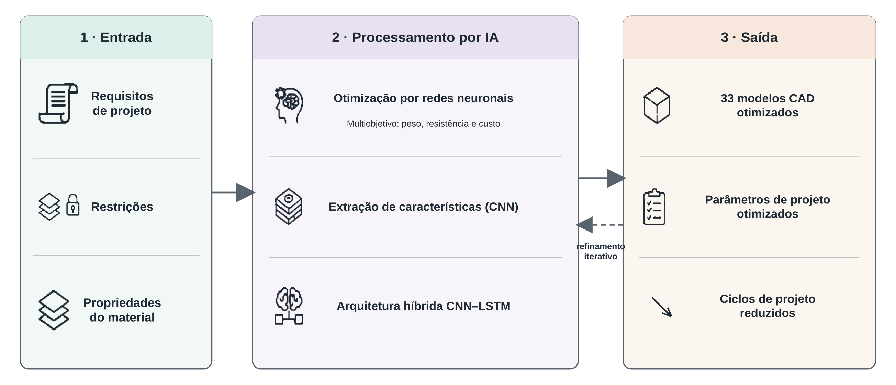

Figura 7 - Enquadramento de um fluxo de CAD apoiado por IA para desenvolvimento de produto.

Adaptado de Menaka, S., Raja, A. W., Ramakrishnan, S., Karthikeswaran, D., Sridar, K., & Sivaranjani, T. (2025). AI-driven computer-aided design (CAD) systems: Leveraging neural networks for optimized engineering product development. International Journal of Applied Mathematics, 38(5s).

### O que é a Inteligência Artificial

Em termos gerais, a IA pode ser entendida como um conjunto de métodos computacionais destinados a executar tarefas que requerem aprendizagem, reconhecimento de padrões, inferência ou geração de respostas com base em dados. Neste contexto, a inferência é o processo pelo qual um sistema aplica a novos dados de entrada os padrões aprendidos durante o treino, produzindo uma classificação, previsão, recomendação ou resposta compatível com esses padrões. Entre as abordagens abrangidas pela IA, a aprendizagem automática permite aos sistemas aprender a partir de dados, identificar padrões e produzir previsões ou decisões sem que cada resposta tenha sido previamente programada (Wang & Hu, 2024). A aplicação destes sistemas permanece delimitada: no *design*, um algoritmo desenvolvido para um problema particular geralmente não se aplica a outros e revela pouca capacidade de adaptação a condições diferentes (Yüksel et al., 2023). Nesta dissertação, o desempenho numa tarefa específica não é, por esse motivo, equiparado a uma capacidade geral de pensamento.

A aprendizagem profunda é um subconjunto da aprendizagem automática, baseado em redes neuronais artificiais[^6] com múltiplas camadas e particularmente adequado ao tratamento de dados complexos, como imagens e texto. A IA generativa, por sua vez, refere-se a modelos capazes de produzir novos conteúdos - por exemplo, texto, imagens, composições formais ou variantes de projeto - com base nos padrões aprendidos. Esta distinção é particularmente importante para o *design*, porque os vários tipos de IA apoiam tarefas diferentes, desde a análise de informação e a previsão de resultados até à otimização de soluções e à produção de alternativas (Khanolkar et al., 2023; Li et al., 2020). No desenvolvimento de produtos, estas técnicas podem, por exemplo, identificar padrões em modelos tridimensionais e gerar novas variantes de forma a partir de requisitos previamente definidos (Krahe et al., 2020).

### Como funciona: dados, treino, inferência e geração

O funcionamento básico da maioria dos sistemas atuais de IA pode ser descrito através de quatro etapas: dados, treino, inferência e, em certos casos, geração. O sistema começa por receber dados de entrada, ou seja, exemplos a partir dos quais pode aprender padrões. Durante o treino, o modelo ajusta os seus parâmetros internos para captar padrões recorrentes nesses dados. Uma vez concluído o treino, realiza inferências sobre novos casos, sob a forma de previsões, classificações, recomendações ou respostas. Nos modelos generativos, acresce a produção de novos conteúdos compatíveis com os padrões aprendidos, em vez da mera classificação ou previsão (Ao et al., 2025; Menaka et al., 2025; Panchal et al., 2019).

Nos modelos de linguagem, o texto é processado em unidades denominadas *tokens*. Cada *token* pode corresponder a uma palavra completa, a parte de uma palavra, a um número ou a um sinal de pontuação. O limite de *tokens* determina a extensão máxima da resposta que o modelo pode produzir, não a sua qualidade ou exatidão. A temperatura é um parâmetro de geração que condiciona a distribuição usada para escolher cada unidade seguinte: valores mais baixos concentram a seleção nas alternativas mais prováveis e tendem a reduzir a variação; valores mais elevados admitem alternativas menos prováveis e tendem a gerar respostas mais diversas. A temperatura não representa confiança, qualidade ou precisão, e o valor zero não garante, por si só, respostas integralmente idênticas.

Esta lógica distingue a IA contemporânea dos sistemas puramente baseados em regras. Nestes últimos, o comportamento é prescrito antecipadamente: se ocorrer determinada condição, executa-se determinada ação. Num sistema treinado com dados, o comportamento emerge, pelo contrário, da exposição a exemplos. Esta diferença explica tanto a sua força como a sua fragilidade. A primeira reside na capacidade de lidar com informação de grande complexidade, diversidade e volume; a segunda decorre da dependência dos dados de treino, que podem conter enviesamentos, simplificações e erros posteriormente reproduzidos pelo sistema (Panchal et al., 2019; Yüksel et al., 2023).

Nos modelos generativos, este processo é particularmente visível. O sistema aprende distribuições de forma, linguagem, composição ou estilo e produz, a partir delas, novas saídas em resposta a condições ou *prompts[^7]*. Pode, assim, criar imagens, textos ou alternativas formais que não existiam previamente naquela forma exata. Um resultado aparentemente coerente pode, ainda assim, ser inadequado, derivativo ou tecnicamente frágil. Esta distinção é decisiva para o design: gerar muitas alternativas não equivale a resolver bem o problema de projeto (Burnap et al., 2019; Choudhury et al., 2025; Li et al., 2021).

### Formas de IA mais relevantes para o *design*

A literatura identifica várias famílias de aplicações da IA com relevância direta para o *design*. Os sistemas de apoio à decisão ajudam a interpretar grandes volumes de informação, comparar alternativas e reduzir a carga cognitiva em problemas com múltiplas variáveis interdependentes. Os algoritmos de otimização, particularmente importantes na engenharia de produto, na parametrização e no fabrico, exploram combinações possíveis e sugerem soluções com melhor desempenho estrutural, funcional ou produtivo. A visão por computador permite interpretar imagens, formas ou padrões visuais, enquanto o processamento de linguagem natural possibilita a interação com sistemas complexos através de descrições semânticas, em vez de comandos técnicos rígidos. A família atualmente mais visível corresponde aos sistemas generativos capazes de produzir texto, imagem, forma ou variantes de projeto em resposta a condições de entrada (Ao et al., 2025; Khanolkar et al., 2023; Wang & Hu, 2024).

No *design* industrial, estas famílias não têm exatamente o mesmo peso. A IA generativa adquiriu especial relevância na exploração conceptual, na comunicação visual e na exploração rápida de alternativas. A otimização e os modelos preditivos assumem maior importância em problemas que envolvem desempenho, simulação, restrições de fabrico ou espaços paramétricos amplos. O processamento de linguagem natural, por sua vez, suscita um interesse crescente enquanto camada de acesso a sistemas mais complexos, sobretudo quando se pretende permitir que utilizadores menos especializados formulem intenções ou restrições sem depender de *software* CAD avançado ou de uma sintaxe demasiado técnica (Ao et al., 2025; Menaka et al., 2025; Wang & Hu, 2024).

### IA ao longo do processo de *design*

A literatura mostra de forma consistente que a IA não atua apenas numa fase isolada do processo de projeto. Nas fases iniciais, pode apoiar a pesquisa, a síntese de informação e o enquadramento do problema, nomeadamente através da identificação de padrões nas necessidades dos utilizadores, em tendências, em dados de mercado ou em requisitos de contexto. Durante a exploração conceptual, pode ampliar o espaço de procura, reduzir a fixação prematura e produzir rapidamente várias alternativas de partida. Na fase de desenvolvimento, pode acelerar a iteração, gerar variantes paramétricas e articular a exploração formal com as restrições técnicas. Posteriormente, pode apoiar a prototipagem, a simulação, a previsão de desempenho e a comparação de opções concorrentes. Pode ainda reforçar a comunicação e a documentação, permitindo produzir mais rapidamente representações de cenários, conceitos e soluções (Khanolkar et al., 2023; Saeidnia & Ausloos, 2024; Verganti et al., 2020).

A eficácia da IA depende da etapa do processo de *design*. Segundo a literatura, o seu valor tende a ser maior em tarefas de exploração divergente, análise extensiva e automatização parcial. As etapas de convergência, enquadramento contextual, decisão ética e validação final exigem, porém, avaliação humana qualificada. Embora a IA possa ampliar o campo de exploração e acelerar a comparação entre alternativas, cabe ao ser humano decidir o que faz sentido desenvolver, para quem, em que contexto e com que consequências (Ao et al., 2025; Choudhury et al., 2025; Virós-i-Martín & Selva, 2021).

### Papel do designer, riscos e necessidade de supervisão humana

A integração da IA no processo de *design* exige uma redefinição do papel do designer, sobretudo quando a geração de alternativas, a análise de dados ou a sugestão de soluções passam a ser parcialmente mediadas por sistemas computacionais. A questão central deixa então de residir na autoria formal e passa a incidir na capacidade de orientar, interpretar e avaliar criticamente os resultados produzidos. A literatura consultada descreve a passagem do designer enquanto gerador exclusivo de forma para um papel mais híbrido, que inclui funções de orientação, curadoria, interpretação e decisão estratégica. A intervenção humana torna-se particularmente exigente na formulação do problema, na definição de critérios, na leitura contextual, na seleção de alternativas e na justificação das decisões. Esta transformação assume especial relevância em domínios sensíveis, nos quais a adequação ao utilizador, a responsabilidade técnica e a aceitação ética exigem supervisão humana qualificada (Figoli et al., 2022; Kadenhe et al., 2025; Virós-i-Martín & Selva, 2021).

É também neste ponto que se concentram os principais riscos. O enviesamento pode ocorrer quando modelos treinados com dados históricos ou desequilibrados reproduzem exclusões, preferências dominantes e padrões culturais pouco representativos. A opacidade decorre da dificuldade de explicar o raciocínio interno de muitos sistemas, mesmo quando estes produzem resultados eficazes, o que compromete a confiança e a responsabilização. Há ainda o risco de erro, que inclui respostas aparentemente coerentes, mas incorretas, simplificações abusivas e sugestões sem fundamento técnico suficiente. Acrescem a dependência excessiva, a homogeneização formal, o enfraquecimento de competências críticas e a incerteza quanto à autoria e à originalidade dos resultados produzidos com apoio algorítmico (Burnap et al., 2019; Panchal et al., 2019; Yüksel et al., 2023).

Por estas razões, a literatura converge na defesa de modelos com supervisão humana explícita. A integração mais robusta da IA não se baseia na autonomia plena, mas em ciclos apoiados, nos quais o sistema acelera a análise, a geração ou a previsão, enquanto o ser humano mantém autoridade sobre os critérios, a validação e as consequências da decisão. Na prática, isto exige preservar mecanismos de controlo, comparar alternativas, explicitar limites, proceder à verificação técnica e manter a capacidade de recusar ou reformular as sugestões produzidas pela máquina. No *design*, a supervisão humana não constitui um complemento opcional, mas a condição que transforma a IA num instrumento ao serviço do projeto, em vez de uma fonte acrítica de soluções aparentes (Ao et al., 2025; Kadenhe et al., 2025; Verganti et al., 2020)

## 2.7 Plataformas digitais e sistemas configuráveis

A evolução recente do desenvolvimento de produto, sobretudo nos contextos da saúde e das tecnologias de apoio, tem sido acompanhada pelo crescimento de plataformas digitais configuráveis e de sistemas participativos orientados para a personalização. A literatura caracteriza-os como infraestruturas sociotécnicas que articulam enquadramentos conceptuais destinados a legitimar e estruturar a participação dos utilizadores, recursos técnicos de personalização (como a parametrização, a modularidade e as interfaces de configuração) e fluxos participativos que traduzem a experiência vivida em requisitos, protótipos e iterações de projeto (Fischer et al., 2004; Howard et al., 2022a; von Hippel & Katz, 2002).

Em domínios como a reabilitação e as tecnologias de apoio, a personalização é frequentemente descrita como uma necessidade funcional, distinta da diferenciação de mercado. A adequação do produto ao utilizador pode ser determinante para a segurança, a usabilidade e a adoção sustentada. O foco do *design* desloca-se, assim, de uma solução «média» para sistemas capazes de acomodar diferenças individuais segundo regras definidas (Fischer et al., 2004; Kerr et al., 2024; Zhu & Zhong, 2025).

### Fundamentos conceptuais: *toolkits*, *meta-design* e *end-user development*.

Uma linha teórica relevante é a dos “*toolkits for user innovation*”, que concebe os sistemas configuráveis como ferramentas coordenadas e acessíveis através das quais parte do trabalho de *design* relacionado com as necessidades dos utilizadores é transferida para estes, enquanto fabricantes e especialistas retêm as tarefas de resolução e produção. É central a distinção entre configuradores, orientados para a seleção de opções, e *toolkits*, destinados ao desenho dentro de um espaço de projeto delimitado. A participação pode, assim, variar entre a escolha de alternativas predefinidas e a criação de configurações num espaço de projeto delimitado, com regras, simulação e avaliação iterativa dos resultados (Franke & Von Hippel, 2003; von Hippel & Katz, 2002).

O *meta-design* aprofunda esta lógica ao defender a participação “em uso” e estabelecer condições técnicas e sociais para que os utilizadores se tornem *co-designers* e o sistema evolua ao longo do tempo. O modelo *Seeding, Evolutionary Growth, and Reseeding* formaliza o processo como uma alternância entre “sementes” iniciais criadas por especialistas, a evolução através do desenvolvimento pelo utilizador e reestruturações periódicas que consolidam as aprendizagens e reorganizam o sistema (Costabile et al., 2007; Fischer et al., 2004).

A Figura 8 apresenta estes fundamentos de forma mais operacional através de um modelo de configuração da participação em *living labs*, que desloca a discussão da participação enquanto princípio abstrato para uma estrutura suscetível de planeamento e configuração deliberados.

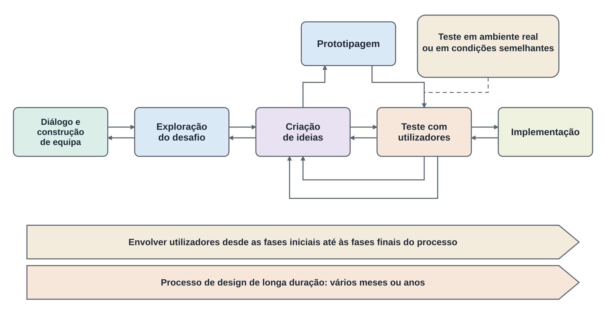

Figura 8 - Modelo de processo para configurar participação em ecossistemas de inovação e cocriação.

Adaptado de (Akasaka et al., 2022). A framework for ‘configuring participation’ in living labs. Design Science, 8, e28. https://doi.org/10.1017/dsj.2022.22 Licença: CC BY 4.0.

A literatura identifica, contudo, o risco de sobrecarga participativa, entendido como a transferência excessiva de trabalho, responsabilidade e poder de decisão para os utilizadores. Para que a participação seja sustentável, este risco exige mecanismos de apoio, curadoria e reutilização (Fischer et al., 2017).

Em paralelo, o conceito de *Software Shaping Workshop* operacionaliza o *meta-design*, uma abordagem que cria condições técnicas e sociais para a participação ativa dos utilizadores finais na adaptação e evolução dos sistemas que utilizam. O *Software Shaping Workshop* funciona, neste enquadramento, como uma “oficina virtual”: um ambiente digital composto por ferramentas familiares, ajustadas à cultura, às práticas e às competências de uma comunidade específica. Em contextos de reabilitação e assistência, este paradigma concretiza-se em sistemas que disponibilizam a cuidadores e terapeutas interfaces do tipo editor, através das quais podem adaptar *scripts*, exercícios e conteúdos sem recorrer a programação especializada e responder, de forma pragmática, às necessidades de personalização (Costabile et al., 2007; Fischer et al., 2017).

A Tabela 2 resume esta passagem do princípio à operação e sistematiza dimensões recorrentes no desenho da participação mediada: quando e quem participa, por que canais, através de que pontos de contacto e com que mecanismos de motivação.

Tabela 2 - Elementos centrais na configuração da participação em sistemas configuráveis.

|                     |                                                                     |
|---------------------|---------------------------------------------------------------------|
| **Elemento**        | **Questão orientadora**                                             |
| Participantes       | Que perfis participam, em que número e com que papel                |
| Formato             | Que canais, espaços e métodos suportam a colaboração                |
| Contacto            | Como se recrutam participantes e como se mantém a relação           |
| Gestão da motivação | Que fatores promovem adesão e que barreiras dificultam continuidade |

Adaptado de (Akasaka et al., 2022),A framework for ‘configuring participation’ in living labs. Design Science, 8, e28. https://doi.org/10.1017/dsj.2022.22 Licença: CC BY 4.0.

### Mecanismos de personalização: modularidade, parametrização e adaptação individualizada

A literatura sintetiza a personalização através de mecanismos recorrentes, que diferem quanto a “quem configura”, “o que é configurável” e “quando se configura”. Pela sua relevância para sistemas protésicos e dispositivos médicos personalizados, destacam-se três mecanismos:

1\. Seleção modular de componentes: a personalização resulta da combinação de módulos interoperáveis, permitindo adaptar a funcionalidade pela recombinação ou substituição dos módulos. A modularidade surge como estratégia para conciliar personalização, reutilização e expansão em ecossistemas de produto (Dechev et al., 2023; Peters & Richter, 2023).

2\. Configuração paramétrica: o utilizador, ou um intermediário clínico, fornece entradas num espaço de parâmetros e o sistema gera automaticamente artefactos de *design*, como ficheiros CAD, com base nesses valores. Este mecanismo é mais adequado quando a personalização depende de atributos mensuráveis, ligando diretamente dados antropométricos e cinemáticos a variáveis de projeto (Kuhl et al., 2021; Zhu & Zhong, 2025).

3\. *Tailoring* por *toolkit*/editor: a personalização ocorre durante o tempo de uso, permitindo editar conteúdos, instruções, rotinas de treino ou componentes informativos associados ao produto, ou serviço. Em saúde, este mecanismo é particularmente relevante em plataformas de reabilitação e de telereabilitação, nas quais a adaptação de exercícios e de objetivos faz parte do cuidado contínuo (Clarkson & Coleman, 2010; Fischer et al., 2017).

A escolha do mecanismo mais adequado depende da distribuição do conhecimento relevante entre utilizadores, designers, profissionais técnicos ou clínicos e sistemas digitais. A modularidade adequa-se a necessidades que possam ser expressas pela combinação de módulos previamente definidos. A parametrização é mais eficaz quando existem dados mensuráveis passíveis de tradução em variáveis de projeto. Os kits de ferramentas são particularmente relevantes quando a adaptação contínua em contexto é crítica e o utilizador ou um intermediário dispõe de conhecimento situado para ajustar o sistema (Peters & Richter, 2023; von Hippel & Katz, 2002; Zhu & Zhong, 2025).

### Fluxos participativos e infraestruturas remotas

O recurso crescente à participação remota e a processos mediados por meios digitais é uma característica transversal nos processos participativos de desenvolvimento de tecnologias de apoio.

A literatura documenta sessões de *co-design* por videoconferência, oficinas *online* e processos de cofabrico à distância, nos quais o ciclo de definição, prototipagem, fabrico e teste inclui o envio de protótipos para experimentação no contexto real do utilizador. Estes modelos são particularmente relevantes nas tecnologias de apoio, em que a avaliação em contexto e a adaptação iterativa são determinantes para a adequação funcional e a aceitação (Thorsen et al., 2024).

A literatura sublinha, no entanto, que a tecnologia, por si só, não é suficiente. A eficácia destes sistemas depende de estruturas de governação, ou seja, da definição clara de quem decide, o que decide e em que momento do processo. Depende também da mediação de clínicos, designers ou técnicos e de mecanismos que permitam gerir a carga de trabalho, a comunicação e a coordenação entre os intervenientes. Nos modelos abertos e distribuídos, a falta de responsabilização clara pode originar incumprimentos de compromissos e atrasos, tornando necessária a definição explícita de regras, expectativas e responsabilidades (Frangos et al., 2016; Hussaini et al., 2023; Kerr et al., 2024)

### Aplicações em saúde, reabilitação e próteses

Em saúde, as plataformas baseadas em *digital twins[^8]* são descritas como sistemas de serviço personalizados que ligam os participantes através da nuvem e integram sensores, parâmetros de movimento e métricas de desempenho. No estudo de Zhu e Zhong, a correspondência entre os modelos e os sinais recolhidos varia consoante o cenário experimental, pelo que os resultados não devem ser generalizados ao movimento humano real. Na personalização de exosqueletos de membro superior impressos em 3D, discutida por Mikołajewski e colaboradores, articulam-se a adaptação do dispositivo, a avaliação funcional e possibilidades de monitorização domiciliária apoiada em modelos virtuais (Mikołajewski et al., 2023; Zhu & Zhong, 2025).

Na reabilitação, as plataformas de *virtual coaching[^9]*, *os serious games[^10]* configuráveis e os modelos de cocriação tecnológica são apresentados como formas de personalizar os tratamentos segundo o estado clínico, os objetivos terapêuticos e o *feedback* do utilizador. As avaliações indicam boa usabilidade e experiência do utilizador quando a participação integra o ciclo de desenvolvimento e abrange a interface, a seleção de exercícios, o ritmo do programa e a mediação por profissionais de saúde (Cole, 2011; Kerr et al., 2024; Seregni et al., 2021).

No contexto protésico e das tecnologias de apoio, sobressai a relevância dos ecossistemas modulares e das cadeias de aprendizagem distribuída. Estudos sobre próteses pediátricas, serviços de reabilitação e modelos como o Victoria Hand Project mostram que a personalização pode conjugar prototipagem iterativa, módulos intercambiáveis, criação digital de encaixes e circulação de comentários entre locais clínicos e equipas centrais de desenvolvimento. A plataforma funciona, neste enquadramento, como interface de configuração e como infraestrutura organizacional de aprendizagem e atualização contínua (Dechev et al., 2023; Howard et al., 2022a; Sims et al., 2017)

Em contextos de baixos recursos, a literatura salienta que a impressão 3D pode ser um facilitador importante, mas apenas produz benefícios quando integrada em infraestruturas de apoio, confiança, manutenção e capacitação técnica. A mera disponibilização de tecnologia de fabrico não garante soluções adequadas, nem uma adoção sustentada. Por conseguinte, os modelos participativos e a mediação local assumem um papel determinante na conversão do potencial técnico em valor real para os utilizadores (Hussaini et al., 2023; Thorsen et al., 2024).

### Limitações e lacunas: sustentabilidade, adoção e equilíbrio entre normalização e improviso

Apesar do potencial das plataformas configuráveis e dos fluxos participativos para apoiar a personalização de dispositivos médicos e tecnologias de apoio, a evidência empírica disponível assenta frequentemente em amostras reduzidas e estudos de caso, o que limita a generalização dos resultados (Frangos et al., 2016; Howard et al., 2022a; Thorsen et al., 2024). A literatura identifica ainda três tensões estruturais.

A primeira tensão prende-se com a sustentabilidade da participação: processos participativos prolongados ou mal distribuídos podem provocar sobrecarga, fadiga e eventual desistência dos utilizadores. São, por isso, necessários mecanismos de apoio, curadoria e redistribuição da carga entre utilizadores, especialistas e intermediários técnicos ou clínicos (Fischer et al., 2017).

A segunda tensão estabelece-se entre normalização e personalização. Em domínios regulamentados, a adaptação individualizada deve preservar o registo da origem das decisões, a segurança e a qualidade, exigências que podem entrar em conflito com os ajustamentos locais necessários para responder a necessidades específicas ou contextuais (Costabile et al., 2007; Fischer et al., 2004).

A terceira tensão prende-se com a adoção e o valor efetivamente realizado. A literatura sobre personalização em massa regista dificuldades recorrentes na conversão e adoção de configuradores. Por analogia, em contextos de saúde e de tecnologias de apoio, a possibilidade de configuração não garante a aceitação se não estiver alinhada com as expectativas e a confiança dos intervenientes e integrada nos serviços existentes (Akasaka et al., 2022; Frangos et al., 2016).

## 2.8 Análise crítica do estado da arte e lacunas identificadas

A análise dos níveis de prontidão tecnológica descritos na literatura torna particularmente visível a distância entre o potencial técnico destas abordagens e a sua consolidação prática. A Figura 9 apresenta a distribuição dos estudos por nível de prontidão tecnológica, ou *Technology Readiness Level* (TRL)[^11], demonstrando que muitos contributos permanecem concentrados em fases ainda afastadas de uma adoção ampla e sustentada.

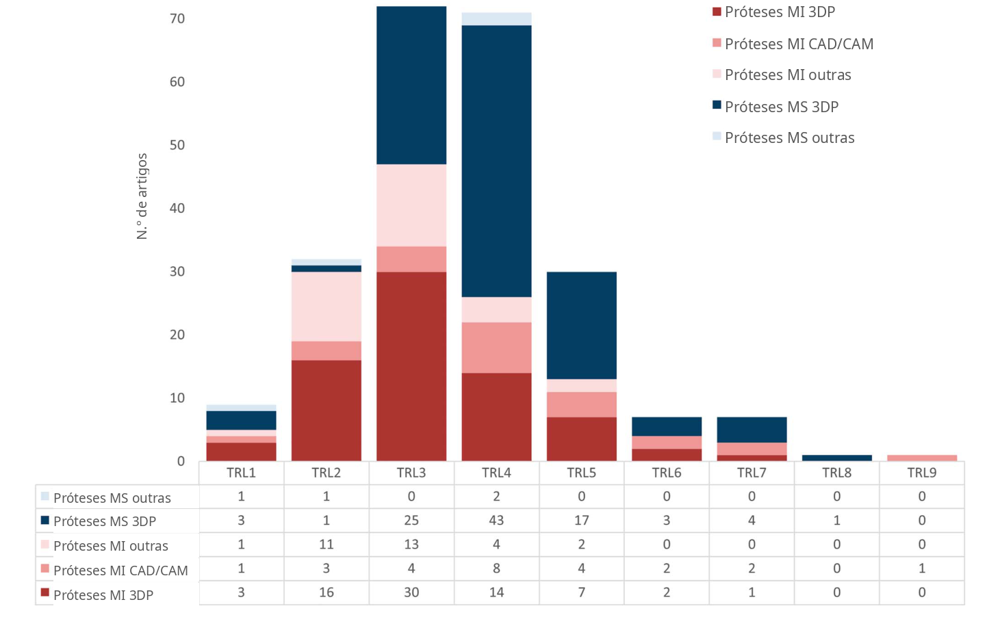

Figura 9 - Número de artigos por nível de prontidão tecnológica (TRL) e categoria de aplicação.

O gráfico distingue as próteses de membro inferior produzidas por impressão 3D (MI 3DP), as próteses de membro inferior desenvolvidas com recurso a CAD/CAM (MI CAD/CAM), outras aplicações de membro inferior (MI outras), as próteses de membro superior produzidas por impressão 3D (MS 3DP) e outras aplicações de membro superior (MS outras).

Adaptado da Figura 10 de (Oldfrey et al., 2024).

Os subcapítulos anteriores mostram avanços técnicos significativos, mas também limitações estruturais persistentes na investigação e no desenvolvimento de próteses e tecnologias de apoio. Entre estas, destaca-se o desfasamento entre o desenvolvimento tecnológico e a respetiva validação empírica. Muitos contributos permanecem em fase de protótipo e são testados em amostras reduzidas, durante períodos curtos, o que limita a demonstração da sua eficácia, segurança e adequação em contextos reais de utilização (Chadwell et al., 2020; Samuelsson et al., 2012; Windrich et al., 2016).

A predominância de estudos com amostras reduzidas, curta duração e validação limitada dificulta a comparação entre soluções, a generalização das conclusões e a tradução de melhorias laboratoriais em benefícios consistentes para a vida quotidiana (Hafner & Sawers, 2016; Jones et al., 2023; Samuelsson et al., 2012)

### Lacuna 1 - Validação empírica limitada e fraca transposição para contextos reais de utilização

A revisão da literatura assinala repetidamente a ausência de estudos comparativos consistentes e de ensaios clínicos que confrontem dispositivos avançados com soluções convencionalmente prescritas, em particular no caso de próteses ativas e externamente alimentadas. Em vários subdomínios, verifica-se uma dependência significativa de protótipos e amostras reduzidas, que limita as inferências sobre eficácia, segurança e valor clínico. Predominam também avaliações laboratoriais e tarefas pouco representativas, incapazes de captar adequadamente o desempenho em contextos reais de utilização, caracterizados pela diversidade de ambientes, objetos manipulados e exigências funcionais (Ghillebert et al., 2019; Samuelsson et al., 2012; Windrich et al., 2016).

Esta lacuna é particularmente relevante, pois a adaptação, a aprendizagem e o eventual abandono de uma prótese decorrem ao longo do tempo e em contextos quotidianos, como o trabalho, a habitação e o espaço público. Quando a evidência disponível assenta em períodos de observação curtos, é difícil compreender as trajetórias de adoção, os padrões de uso e o aparecimento progressivo de problemas de conforto, manutenção ou integração funcional (Chadwell et al., 2020; Samuelsson et al., 2012).

### Lacuna 2 - Desalinhamento entre necessidades identificadas, métricas objetivas e qualidade de vida

Embora incidam em segmentos distintos - (Cordella et al., 2016) no membro superior e (Manz et al., 2022) no membro inferior -, ambas as revisões bibliográficas identificam uma articulação insuficiente entre as necessidades expressas pelos utilizadores (como o conforto, o controlo intuitivo, a aparência e a participação social), os indicadores objetivos habitualmente medidos (incluindo o desempenho em testes funcionais, os parâmetros biomecânicos e as métricas instrumentadas de uso da prótese) e os resultados desejáveis (como a autonomia e a qualidade de vida). As revisões salientam ainda o carácter contextual e interdependente destas necessidades e observam que as medições laboratoriais nem sempre refletem tarefas relevantes do quotidiano, o que contribui para contradições entre resultados subjetivos e objetivos (Cordella et al., 2016; Manz et al., 2022).

A convergência entre os dois domínios tem implicações diretas no *design*. Para orientar as decisões de projeto para benefícios significativos e sustentados, são necessárias métricas ecologicamente válidas e sensíveis às prioridades do utilizador. Melhorias técnicas isoladas podem, por isso, traduzir-se em ganhos limitados na aceitação, na integração funcional ou no uso continuado da prótese (Manz et al., 2022; Samuelsson et al., 2012).

### Lacuna 3 - Persistência de problemas na interface corpo-prótese e no ajuste individualizado

Apesar dos avanços nos componentes técnicos e nos sistemas de controlo, a literatura continua a identificar a interface corpo-prótese como um ponto crítico insuficientemente resolvido. Problemas de ajuste, desconforto, irritação cutânea e dificuldade de adaptação persistem como fatores determinantes de insatisfação e abandono. Nas revisões analisadas, a personalização é frequentemente considerada insuficiente ou metodologicamente frágil. A heterogeneidade das intervenções e o registo incompleto dos processos e resultados dificultam a síntese da evidência (Alluhydan et al., 2023; Baldock et al., 2023; Richardson & Dillon, 2017).

Na avaliação das próteses do membro superior, a literatura assinala a falta de critérios comuns e de medidas especificamente desenvolvidas para esta população, o que limita a produção de dados objetivos e comparáveis sobre a experiência e o desempenho dos dispositivos (Cordella et al., 2016; Jones et al., 2023). No âmbito do *design*, (Chadwell et al., 2020) assinalam que continuam a existir poucos dados objetivos sobre os ajustamentos do dispositivo suscetíveis de aumentar a sua utilidade no ambiente quotidiano do utilizador. A monitorização em contexto real pode complementar as avaliações clínicas e contribuir para o desenvolvimento de dispositivos mais ajustados às necessidades individuais. A aplicação de sensores continua, contudo, condicionada pelo custo, pela autonomia limitada das baterias, pela disponibilidade dos equipamentos e pela formação necessária para recolher e interpretar os dados, o que dificulta a adoção desta prática na atividade clínica corrente.

### Lacuna 4 - Evolução limitada das estratégias de controlo e da interação utilizador-prótese

No caso das próteses do membro superior, algumas revisões apontam para uma evolução limitada das estratégias de controlo em aplicações comerciais, com uma progressão lenta desde as primeiras abordagens desenvolvidas no século XX. Persistem dificuldades relacionadas com a robustez dos sistemas e com a sua transferência de cenários laboratoriais para contextos reais de utilização. Mantêm-se também os desafios associados ao esforço cognitivo, ao tempo de aprendizagem e à inconsistência do desempenho em situações quotidianas (Cordella et al., 2016; Marinelli et al., 2023).

Esta lacuna não é exclusivamente técnica, pois reflete também uma conceptualização ainda insuficiente da interação utilizador-prótese como sistema integrado, no qual o controlo, a informação sensorial, o treino e o contexto de uso devem ser considerados em conjunto (Domínguez-Ruiz et al., 2023; Marinelli et al., 2023).

### Lacuna 5 - Acesso, custo, manutenção e ASSIMETRIAS sistémicas

A acessibilidade constitui um constrangimento central e persistente, tanto em contextos de baixos recursos como em sistemas de saúde mais robustos. As revisões identificam barreiras relacionadas com os custos elevados, a necessidade de formação especializada, os atrasos na prestação de cuidados e as pressões sistémicas que obrigam os utilizadores a negociar intensivamente para obter soluções adequadas. Nos contextos de baixos e médios rendimentos, são ainda destacados problemas de durabilidade e manutenção. Existem compromissos claros, uma vez que as soluções biomecanicamente mais sofisticadas podem ser mais frágeis e difíceis de manter, comprometendo a sustentabilidade do uso (Alluhydan et al., 2023; Andrysek, 2010; Baumann & Maria, 2023).

A inovação pode, assim, agravar as assimetrias de acesso ao criar dependências de infraestrutura, apoio técnico e cadeias de fornecimento indisponíveis para uma parcela significativa da população (Andrysek, 2010; Segura et al., 2024).

### Lacuna 6 - Envolvimento do utilizador e registo metodológico insuficiente

O envolvimento do utilizador continua a constituir uma fragilidade metodológica e ética no desenvolvimento de próteses. A revisão bibliográfica associa os processos pouco ajustados às necessidades individuais dos utilizadores ao abandono dos dispositivos e à dificuldade de responder a prioridades relevantes de uso. Em várias áreas, persiste a ausência de métodos qualitativos sistemáticos para captar a experiência, a aceitação e os fatores de rejeição, mesmo em componentes diretamente relacionados com o conforto, como os revestimentos de interface. Esta limitação reduz a compreensão dos fatores que condicionam a adoção e a continuidade de uso (Marinelli et al., 2023; Richardson & Dillon, 2017; Walters et al., 2025).

A heterogeneidade metodológica e a ausência de critérios comuns de avaliação, nomeadamente escalas partilhadas de utilidade e satisfação, dificultam a síntese dos resultados e a realização de meta-análises. O campo permanece, assim, fragmentado e caracterizado por uma reduzida comparação entre estudos (Cordella et al., 2016; Hafner & Sawers, 2016; Richardson & Dillon, 2017).

### Implicações para esta investigação

Consideradas em conjunto, estas lacunas apontam para abordagens que:

\- Reforcem a ligação entre personalização e validação empírica, através de fluxos integrados de aquisição de dados, geração de variantes e avaliação;

\- Privilegiem avaliações ecologicamente válidas e longitudinais, aproximando as métricas de desempenho dos resultados relacionados com participação, autonomia e qualidade de vida;

\- Tratem a interface corpo-prótese e o conforto como requisitos estruturantes do processo de projeto, e não como ajustes posteriores;

\- Incorporem o envolvimento do utilizador como elemento contínuo, documentável e passível de análise, articulando métodos qualitativos e quantitativos;

\- Considerem a acessibilidade, a manutenção e o contexto de serviço como dimensões constitutivas do problema de *design* (Anderson et al., 2024; Baumann & Maria, 2023; Chadwell et al., 2020)

Estas necessidades excedem, contudo, a evidência que uma prova de conceito técnica pode produzir. A presente investigação adota como unidade de análise o encadeamento entre dados, parâmetros, geometria, interface e materialização preliminar. Não procura, portanto, resolver integralmente as seis lacunas identificadas, mas examinar mecanismos de projeto e condições de verificabilidade capazes de apoiar etapas posteriores de avaliação clínica, funcional e participativa. A Tabela 3 explicita esta delimitação e estabelece o quadro retomado na discussão dos resultados.

Tabela 3 - Correspondência entre lacunas do estado da arte, resposta da investigação e limites de avaliação.

|                                                                                                                                     |                                                                                                                   |                                                                                                                 |                                                                                             |                                                                                                     |
|-------------------------------------------------------------------------------------------------------------------------------------|-------------------------------------------------------------------------------------------------------------------|-----------------------------------------------------------------------------------------------------------------|---------------------------------------------------------------------------------------------|-----------------------------------------------------------------------------------------------------|
| Lacuna do estado da arte                                                                                                            | Requisito selecionado para o estudo                                                                               | Resposta incorporada no protótipo ou no método                                                                  | Evidência prevista                                                                          | Dimensão excluída da avaliação                                                                      |
| Validação empírica limitada e fraca transposição para contextos reais                                                               | Tornar verificável a cadeia técnica, desde a entrada até à geometria e à preparação para o fabrico                | Registo de iterações, casos, parâmetros, exportações, preparação e protótipos físicos                           | Ensaios da plataforma, cenários simulados, medição digital e observação material preliminar | Eficácia, segurança, utilização quotidiana e avaliação longitudinal                                 |
| Desalinhamento entre necessidades, métricas objetivas e qualidade de vida, identificado em revisões dos membros superior e inferior | Distinguir mecanismos de projeto observáveis de efeitos humanos esperados                                         | Matriz entre perguntas, métodos, evidência e limites; separação entre configuração técnica e resultados humanos | Correspondência metodológica e discussão explícita do grau de resposta                      | Preferências, satisfação, participação, autonomia e qualidade de vida                               |
| Problemas persistentes na interface corpo-prótese e no ajuste individualizado                                                       | Relacionar referências antropométricas, parâmetros editáveis e geometria gerada                                   | Regras dimensionais, limites específicos dos modelos e verificação da propagação geométrica                     | Comparação de perfis de ensaio, extensões de malha e materialização de variantes            | Ajuste ao membro residual, pressão de contacto, conforto e adequação anatómica individual           |
| Evolução limitada do controlo e da interação utilizador-prótese                                                                     | Delimitar o controlo humano sobre a configuração digital                                                          | Separação entre sugestão probabilística, regras determinísticas e decisão humana antes da exportação            | Casos de aplicação, rejeição e recuperação de sugestões paramétricas                        | Controlo da prótese em utilização, aprendizagem motora e desempenho funcional                       |
| Barreiras de acesso, custo, manutenção e contexto de serviço                                                                        | Explorar uma arquitetura configurável baseada em tecnologias *web*, modelos abertos e execução local da geometria | Plataforma no navegador, modelos parametrizados e exportação para ferramentas de fabrico aditivo                | Funcionamento técnico dos módulos e preparação de ficheiros em dois ambientes registados    | Custos totais, conectividade, competências, manutenção, implantação e escalabilidade socioeconómica |
| Envolvimento do utilizador e registo metodológico insuficiente                                                                      | Tornar documentáveis as decisões, iterações, falhas e limites do processo                                         | Ciclos de *Research Through Design*, inventário de modelos, protocolos e anexos de suporte                      | Correspondência documentada entre problema observado, decisão, alteração e resultado        | *Co-design*, avaliação de usabilidade e validação com participantes                                 |

O âmbito empírico incide, assim, na verificabilidade técnica e no registo do processo. As dimensões clínicas, experienciais e socioeconómicas permanecem como requisitos sustentados pela literatura e orientações para investigação futura, não sendo resultados antecipados do presente estudo.

# Capítulo 3 - Metodologia de Investigação

## 3.1 Enquadramento metodológico e abordagem *Research Through Design*

A presente investigação, de natureza aplicada, segue o enquadramento de *Research Through Design* (RTD). Nesta abordagem, a conceção, a experimentação, a prototipagem e a reflexão crítica são atividades de investigação através das quais o artefacto permite formular e examinar conhecimento de projeto (Frayling, 1994; Zimmerman et al., 2007). O artefacto central consiste num protótipo de investigação: uma plataforma *web* que articula modelos paramétricos de mão protésica, dados antropométricos, sugestões geradas por IA, visualização tridimensional e exportação para fabrico.

O conhecimento produzido decorre das relações e dos limites identificados durante a construção. A integração de modelos *open source* demonstrou que cada conjunto de modelos assenta em pressupostos dimensionais próprios. Os ensaios de ponta a ponta revelaram falhas que a inspeção isolada dos valores não permitia detetar, enquanto a impressão tornou evidentes condicionantes de orientação, escala, separação de peças e preparação. Por exemplo, nos ensaios de exportação, a disposição montada deixava peças suspensas ou exigia suportes desnecessários. Foram, por isso, criados modos de impressão planos, com assentamento de cada peça em Z=0. O RTD concretiza-se numa sequência explícita de situação problemática, decisão de *design*, artefacto, ensaio, resultado e alteração.

O modelo *Double Diamond* organiza os momentos de descoberta, definição, desenvolvimento e entrega, sem impor uma sequência linear; estrutura a abertura e a convergência dos ciclos, enquanto o RTD enquadra a produção de conhecimento através deles (Design Council, 2007). A Tabela 4 apresenta as iterações técnicas mais relevantes para o argumento da investigação.

Tabela 4 - Ciclos de *Research Through Design* documentados no desenvolvimento.

|                                                |                                                   |                                                                                       |                                                                                   |
|------------------------------------------------|---------------------------------------------------|---------------------------------------------------------------------------------------|-----------------------------------------------------------------------------------|
| **Situação examinada**                         | **Artefacto ou ensaio**                           | **Resultado observado**                                                               | **Decisão incorporada**                                                           |
| Preparação de modelos compostos para impressão | Ensaios de exportação em placa                    | A posição montada originava peças suspensas ou exigia suportes desnecessários         | Criação de modos de impressão planos e assentamento de cada peça em Z=0           |
| Seleção de referência antropométrica           | Ensaios com descrições, unidades e grupos etários | Unidades como «mm» e «cm» podiam ser interpretadas como indicação de sexo masculino   | Análise por palavras completas, reconhecimento multilingue e classificação etária |
| Propagação da largura da palma no Paraglider   | Sugestão de IA, exportação e medição da malha     | Os dedos respondiam ao perfil, mas a palma permanecia na escala interna da biblioteca | Aplicação da escala no ponto de chamada da palma Reborn                           |
| Limite dimensional do UnLimbited Phoenix       | Perfil infantil e exportação                      | Um percurso alternativo aceitava uma escala inferior ao mínimo definido pelo modelo   | Aplicação do intervalo de 100% a 160% nos dois percursos de escala                |
| Definição do lado da mão                       | Cenários repetidos de mão esquerda e direita      | A IA devolvia mão direita em pedidos explícitos de mão esquerda                       | Lateralidade retirada do conjunto sugerível e controlada pela interface           |
| Informação de cor no fabrico                   | Exportação 3MF                                    | O STL não preservava unidades e materiais por peça                                    | Exportação 3MF com unidade em milímetros e materiais derivados das cores          |

A Figura 10 apresenta um precedente interdisciplinar que inclui avaliação clínica e participação de utilizadores. Neste estudo, este exemplo serve de referência para um processo futuro mais amplo, uma vez que essas atividades clínicas e participativas não foram realizadas na presente investigação (da Silva et al., 2018).

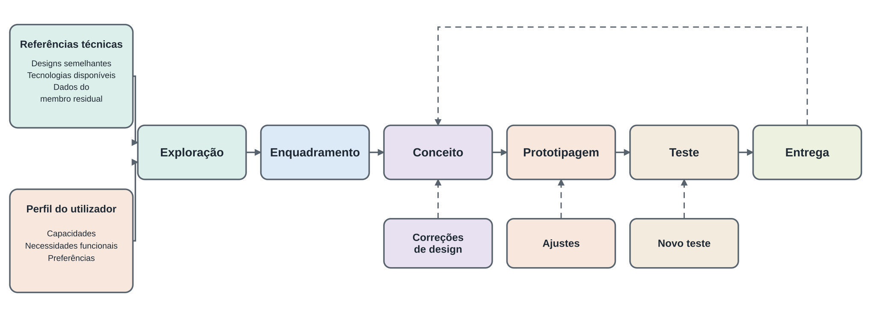

Figura 10 - Processo interdisciplinar de desenvolvimento de uma prótese de membro superior impressa em 3D.

Adaptado de (da Silva et al., 2018). Interdisciplinary-based development of user-friendly customized 3D printed upper limb prosthesis. Comunicação em conferência.

## 3.2 O *design* industrial como prática de investigação

Com base no enquadramento do Capítulo 2, o *design* industrial é operacionalizado como prática de investigação mediante a explicitação e o ensaio das traduções entre fontes antropométricas, parâmetros editáveis, regras geométricas, estados da interface e peças fabricadas. Esta opção relaciona-se com os *designerly ways of knowing*, que reconhecem a experimentação material e a formulação do projeto como modos de produção de conhecimento (Cross, 1982). A unidade de análise é a cadeia de decisões e transformações do protótipo, não a experiência de uma pessoa utilizadora.

O contributo é examinado através da capacidade de localizar a origem de cada valor, observar a sua propagação e documentar falhas e alterações. Não foram avaliados o desempenho clínico nem os efeitos na experiência de pessoas amputadas; neste estudo, a dimensão humana constitui um requisito e um limite ético fundamentado na literatura.

A hipótese principal sustenta que a integração do *design* paramétrico com ferramentas de inteligência artificial permite desenvolver próteses mais adequadas às necessidades anatómicas e funcionais dos utilizadores e tornar o processo de personalização mais acessível e escalável, sobretudo em contextos economicamente desfavorecidos. As hipóteses secundárias aprofundam esta perspetiva ao sugerirem que a combinação de princípios de *design* inclusivo, *Design for Additive Manufacturing* (DfAM) e processos participativos pode melhorar a usabilidade, o conforto e a aceitação, reduzindo simultaneamente a dependência de especialistas.

Estas formulações correspondem às hipóteses aprovadas para o projeto e mantêm-se como orientação geral da investigação. A componente empírica não incluiu participantes, comparação com um processo de referência, implantação em contextos economicamente desfavorecidos ou medição do conforto, da usabilidade e da aceitação. Por esse motivo, as hipóteses não são consideradas integralmente confirmadas, nem rejeitadas. O estudo examina o seu suporte ao nível dos mecanismos de projeto: configuração dimensional, visualização, controlo dos parâmetros, revisão humana das sugestões de IA, geração geométrica e preparação para fabrico. Os efeitos desses mecanismos na experiência e na utilização permanecem por avaliar.

## 3.3 Estrutura metodológica do projeto

A metodologia aprovada compreende três fases interligadas - conceptual, metodológica e empírica -, articuladas por ciclos de divergência e convergência do *Double Diamond*. A fase conceptual abrange a revisão crítica da literatura, a análise de soluções *open source* e a definição dos requisitos. Na fase metodológica, estrutura-se a base antropométrica, integram-se os modelos OpenSCAD e implementam-se a plataforma e o módulo de IA. A fase empírica recorre a cenários simulados, registos de execução, malhas exportadas, perfis de preparação para impressão e protótipos físicos. Os resultados de cada fase são reintegrados no desenvolvimento através dos ciclos de *Research Through Design* apresentados na Tabela 4. As verificações complementares documentadas nos Anexos B e D aprofundam a fase empírica sem alterar o desenho metodológico aprovado.

Tabela 5 - Correspondência entre perguntas, atividades, evidência e limites.

|                                                                                          |                                                                                                                         |                                                                                                                                                                                                                                     |                                                                                                                                                      |
|------------------------------------------------------------------------------------------|-------------------------------------------------------------------------------------------------------------------------|-------------------------------------------------------------------------------------------------------------------------------------------------------------------------------------------------------------------------------------|------------------------------------------------------------------------------------------------------------------------------------------------------|
| Pergunta de investigação                                                                 | Atividades realizadas                                                                                                   | Evidência produzida                                                                                                                                                                                                                 | Dimensões fora da avaliação                                                                                                                          |
| Personalização, conforto, adequação funcional, acessibilidade e controlo sobre o projeto | Definição de parâmetros, implementação da plataforma, cenários de IA, exportação e impressão                            | Regras documentadas, respostas JSON, malhas, correções de escala, opções de controlo e peças físicas                                                                                                                                | Conforto percebido, adequação anatómica individual, desempenho funcional em uso e acessibilidade avaliada com participantes                          |
| Eficácia, usabilidade, durabilidade e possibilidade de reproduzir os resultados          | RTD, ensaios unitários, cenários de ponta a ponta, inspeção geométrica, preparação para impressão e medição dimensional | Registo das iterações, dez testes unitários aprovados, quatro projetos de preparação digital para impressão 3D, doze casos sob condição digital comum, 36 extensões X/Y/Z das malhas e 72 medições físicas das palmas em PLA e PETG | Eficácia protésica, usabilidade com participantes, durabilidade, ensaios mecânicos, estimativa da incerteza de medição e montagem funcional completa |
| Conciliação de requisitos anatómicos, funcionais, ergonómicos, estéticos e simbólicos    | Revisão da literatura, seleção de parâmetros, separação de permissões, visualização e opções de cor                     | Decisões de projeto, grupos de parâmetros, escolhas visuais e exportação 3MF com materiais                                                                                                                                          | Aceitação, dignidade, autonomia quotidiana e avaliação situada dos significados estéticos e simbólicos                                               |

Foram selecionados para comparação o Flexy Beast, o Paraglider Hand e a UnLimbited Phoenix, por constituírem, no momento dos ensaios principais, os três modelos ativos com conjuntos de peças exportáveis e representarem estratégias distintas de transformação: escala inicial com proporções digitais, escala herdada com correções localizadas e escala global limitada por um valor mínimo. O Cyborg Beast foi integrado posteriormente, permanecendo, por isso, como evolução do projeto documentada no Anexo C, sem ter sido acrescentado retroativamente às séries comparativas.

Os quatro perfis de ensaio - child_8, teen_15, adult_28 e elderly_70 - foram escolhidos por abrangerem conjuntos dimensionais diferentes: uma configuração reduzida, duas configurações progressivamente maiores e uma configuração posterior com dimensões inferiores às do adulto. As idades funcionam apenas como identificadores dos cenários. Não constituem a variável independente do ensaio, não representam grupos populacionais, nem sustentam inferências sobre crescimento ou envelhecimento.

Os estados examinados são identificados pela atividade correspondente. Os ensaios iniciais de correspondência e geometria incidiram no estado usado nos ensaios principais, enquanto as séries complementares da plataforma do Anexo B foram executadas num estado posterior e a descrição técnica considera o estado final examinado. A preparação para fabrico do Anexo D incidiu nos projetos de preparação digital para impressão 3D com configuração analisada, identificando autonomamente as versões dos programas usados. Esta separação impede que o estado atual do protótipo seja apresentado como correspondendo exatamente ao estado de todas as execuções preservadas.

Tabela 6 - Métodos, unidades de análise, critérios e localização dos resultados.

|                                                                                       |                                              |                                                                                                                                |                                                                                                |                                                                                                  |
|---------------------------------------------------------------------------------------|----------------------------------------------|--------------------------------------------------------------------------------------------------------------------------------|------------------------------------------------------------------------------------------------|--------------------------------------------------------------------------------------------------|
| **Método ou atividade**                                                               | **Unidade de análise**                       | **Dados e instrumento**                                                                                                        | **Critério de leitura**                                                                        | **Resultado ou localização**                                                                     |
| Ciclo de *Research Through Design*                                                    | Episódio de desenvolvimento                  | Estado, problema observado, alteração e novo ensaio                                                                            | Existência de uma relação explícita entre observação e decisão de projeto                      | Tabelas 5 e 6                                                                                    |
| Verificação técnica da plataforma                                                     | Percurso ou caso definido                    | Ensaios automatizados, estados da interface e ficheiros exportados                                                             | Resultado esperado por caso; dez conclusões previstas na repetição de cada modelo              | Capítulo 8 e Anexo B; critério de repetição parcialmente atingido                                |
| Sugestões de IA                                                                       | Resposta individual e invariantes do esquema | Respostas JSON, metadados, intervalos e relações dimensionais                                                                  | Estrutura válida, campos permitidos, limites e relações declaradas                             | Subcapítulo 8.2; sem estudo estatístico de chamadas reais repetidas                              |
| Inspeção geométrica                                                                   | Malha ou peça digital exportada              | Análise 3MF, trimesh, extensões X/Y/Z, volume, corpos e faces degeneradas                                                      | Descrição das propriedades geométricas e confirmação da propagação; não equivale a resistência | Subcapítulo 8.1.3 e Anexo D                                                                      |
| Série A - projetos de preparação digital para impressão 3D com configuração analisada | Projeto de preparação                        | Quatro projetos, Bambu Studio 01.10.02.76 e PrusaSlicer 2.8.1                                                                  | Geração de trajetórias e de estimativas de tempo, filamento e massa                            | 4 projetos processados; valores não comparáveis diretamente entre equipamentos                   |
| Série B - condição digital comum                                                      | Combinação modelo-perfil                     | Três modelos × quatro perfis; Bambu Lab A1 virtual, PLA, camada 0,20 mm, duas paredes, enchimento de 15% e suportes desligados | Trajetórias e estimativas geradas, com avisos preservados                                      | 12 combinações modelo-perfil processadas; comparação limitada à exigência digital de preparação  |
| Observação dos protótipos existentes                                                  | Peça física identificada                     | Fotografias e registos de material                                                                                             | Existência da peça e observação visual da materialização                                       | Secção 8.1.3; sem inferência dimensional ou mecânica                                             |
| Medição física e montagem                                                             | Palma impressa ou protótipo completo         | Paquímetro; um valor registado em X/Y/Z por palma em PLA e PETG; folha de cinco ciclos de articulação                          | Desvio malha-peça; colisões, fecho e retorno quando aplicáveis                                 | 72 comparações dimensionais no Anexo D; montagem e articulação ainda sem resultados sistemáticos |

O material suplementar entregue com a investigação está organizado na pasta “suplementos”, em quatro conjuntos: Suplemento 1 - Dados antropométricos; Suplemento 2 - Avaliação técnica da plataforma; Suplemento 3 - Parametrização e percurso numérico; e Suplemento 4 - Preparação para impressão e protótipos. O ficheiro guia_dos_suplementos.md descreve o conteúdo de cada conjunto, enquanto o ficheiro manifesto_ficheiros.csv relaciona cada elemento com a respetiva origem e função. A base local consolidada é uma compilação produzida nesta investigação a partir de fontes documentais identificadas e integra o Suplemento 1 - Dados antropométricos. Os três ficheiros CSV permitem consultar os valores e a sua proveniência; os procedimentos de seleção, extração e normalização são descritos no Anexo A.

## 3.4 Métodos de recolha e análise de dados

A recolha conjugou análise documental, comparação de precedentes, inspeção do código, construção paramétrica, cenários automatizados, medição de malhas, preparação para impressão, observação de peças físicas e reflexão sobre cada ciclo. A análise recorreu aos parâmetros e limites declarados no catálogo de modelos, às respostas JSON e aos metadados de execução, às dimensões das malhas exportadas, aos relatórios técnicos de cada modelo, aos ficheiros 3MF, aos quatro projetos com parâmetros de preparação, aos resultados de doze casos sob uma condição digital comum, às fotografias dos protótipos e aos registos de alterações do código.

A preparação para impressão converte a geometria numa sequência de camadas e trajetórias de deposição e define a altura de camada, as paredes, o enchimento, os suportes, as temperaturas e a orientação. A Série A constitui uma verificação técnica complementar da fase empírica aprovada e documenta quatro ficheiros de preparação. Três foram configurados no Bambu Studio 01.10.02.76 para a impressora Bambu Lab A1 - Flexy Beast em PLA e UnLimbited Phoenix em PLA e PETG - e um no PrusaSlicer 2.8.1 para a Prusa MINI - Paraglider Hand em PLA. Os ficheiros preparados no Bambu Studio usam camada de 0,24 mm, duas paredes, enchimento de 15% em grelha e suporte em árvore orgânica; o ficheiro preparado no PrusaSlicer usa camada de 0,20 mm, dois perímetros, enchimento de 15% e suporte desativado. Uma vez que a geometria, o programa, a impressora, o material e as condições não são equivalentes, esta série descreve cada preparação, mas não permite comparar o desempenho entre equipamentos ou materiais.

A Série B complementa essa verificação, sem constituir uma nova metodologia, ao introduzir uma condição digital comum para comparar a exigência de preparação dos três modelos nos quatro perfis. Foram fixados os seguintes elementos: Bambu Lab A1 com bico de 0,4 mm, Bambu PLA Basic, camada de 0,20 mm, duas paredes, enchimento de 15% em grelha e suportes desligados. Manteve-se a orientação exportada e o programa dispôs as peças nas placas. Os doze casos produziram trajetórias e estimativas de tempo, filamento e massa. Os avisos relativos a regiões suspensas foram mantidos como resultados, pois a conclusão do processamento não demonstra que a peça possa ser impressa fisicamente sem rever a orientação ou os suportes.

A análise dimensional incidiu nas palmas isoladas dos mesmos doze casos. A partir das malhas 3MF, extraíram-se 36 extensões exteriores - X, Y e Z -, que descrevem a caixa envolvente da peça. Estes valores não são automaticamente equivalentes a larguras, comprimentos ou espessuras anatómicas, uma vez que as geometrias podem incluir abas, interfaces e margens de montagem. As mesmas extensões foram medidas nas palmas produzidas em PLA e PETG, à temperatura ambiente, perfazendo 72 valores físicos. O desvio dimensional foi calculado entre cada valor físico e a extensão correspondente da malha, no mesmo referencial, e não entre o parâmetro antropométrico e a caixa exterior.

A materialização recorreu a uma Bambu Lab A1 com sistema AMS e a uma Prusa MINI, ambas baseadas em fabrico por filamento fundido. As fotografias confirmam a existência das peças e permitem observar diferenças de escala entre os perfis. Os diagnósticos dos programas e a inspeção geométrica independente aplicam critérios diferentes, pelo que foram conservados separadamente: a aceitação pelo programa de preparação não implica que a malha seja fechada e não contenha faces degeneradas. As medições físicas sustentam a comparação dimensional das palmas nos eixos X, Y e Z. Contudo, a ausência de leituras repetidas, ensaios de carga e registos completos de montagem impede estimar a incerteza de medição e não permite inferir resistência, conforto, segurança ou durabilidade.

O registo dimensional reúne um valor por eixo e por palma, obtido com paquímetro nas extensões X, Y e Z, à temperatura ambiente. Este conjunto permite calcular o desvio entre a malha e a peça, mas não a média, a amplitude entre repetições ou a incerteza associada ao reposicionamento do instrumento. A comparação é, portanto, assumida como descritiva. Apenas seriam necessárias três leituras independentes numa futura caracterização metrológica da dispersão e da incerteza, que não integra o âmbito deste estudo. A montagem sistemática também não foi abrangida pela avaliação; consequentemente, os resultados não são usados para afirmar adequação anatómica ou funcional.

Não são recolhidos dados pessoais ou biométricos de utilizadores reais, utilizando-se exclusivamente conjuntos de dados antropométricos públicos. O âmbito empírico fica, assim, delimitado ao domínio técnico e de desenvolvimento do projeto. Entre estes conjuntos, destaca-se a base local consolidada de medidas da mão e do membro superior distal, usada como infraestrutura intermédia para selecionar, comparar e normalizar medidas relevantes para a parametrização geométrica. A organização dos dados preserva informação sobre o país, a amostra, o tipo de medida, a estatística, a fonte documental e a granularidade dos subconjuntos analisados, explicitando a cobertura e as limitações de cada fonte antes da sua tradução em parâmetros de projeto. Os ficheiros da base integram o Suplemento 1 - Dados antropométricos; a seleção das fontes e o tratamento dos dados são documentados no Anexo A.

Embora o presente estudo não recorra a participantes, a literatura metodológica permite esclarecer a operacionalização de medições lineares e procedimentos de ajuste em contextos aplicados. A Figura 11 constitui um precedente para a tradução de medidas em parâmetros de projeto, não representando um procedimento realizado nesta investigação.

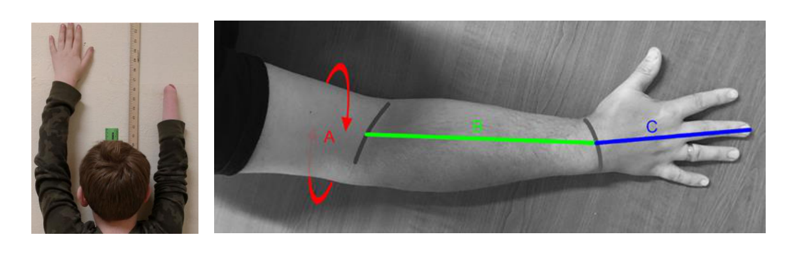

Figura 11 - Exemplo de recolha dimensional para ajuste de prótese impressa em 3D.

Reproduzido de (Shannon et al., 2019). An undergraduate engineering service learning project involving 3D-printed prosthetic hands for children. In American Society for Engineering Education Annual Conference & Exposition Proceedings.

## 3.5 Critérios de avaliação e limitações metodológicas

A avaliação aplica seis critérios principais: conformidade da saída com o esquema; respeito pelos intervalos declarados; preservação das relações dimensionais definidas; aplicação dos valores na geometria; conclusão dos fluxos principais da plataforma; e preparação digital das peças. A cada critério corresponde uma evidência observável: resposta JSON, comparação numérica, malha exportada, estado da interface, ficheiro de projeto ou trajetórias geradas pelo programa de preparação. Na Série A, o critério consistiu na obtenção de trajetórias e estimativas nos quatro projetos de preparação digital para impressão 3D com configuração analisada; na Série B, consistiu na obtenção desses resultados nos doze casos sob a condição comum, mantendo avisos e falhas. A estanquidade, os corpos e as faces degeneradas são descritores geométricos e não critérios de desempenho estrutural.

«Verificação» designa a confirmação de uma condição especificada; «avaliação», a interpretação conjunta dos resultados; e «prova de conceito», o protótipo integrado. O termo «validação clínica» fica reservado a estudos com métodos, profissionais e participantes adequados, ausentes neste trabalho.

Em complemento da avaliação inicial, foram executadas séries de ensaios orientadas para três qualidades relevantes do processo de *design*: a consistência da geração paramétrica, a capacidade de recuperação perante valores ou falhas previsíveis e a acessibilidade técnica da interação. Os ensaios locais decorreram numa instância isolada e com perfis de ensaio, para não alterar os dados de desenvolvimento ou da plataforma pública.

O protocolo, os casos e os resultados completos constam do Anexo B. Estes ensaios avaliam o comportamento técnico do protótipo.

No módulo de IA, os critérios incidem na estrutura da resposta, nos limites e nas relações dimensionais internas. Não existe uma medida individual de referência que permita calcular o erro anatómico. As respostas geradas são sugestões iniciais e podem variar entre execuções; o estudo documenta exemplos e invariantes, sem estimar uma distribuição estatística do comportamento do modelo de linguagem.

As limitações principais são a ausência de participantes, dados clínicos, medições diretas da mão, repetições controladas das medições dimensionais, ensaios biomecânicos, protocolos normalizados de resistência, montagem funcional completa, estudo longitudinal de desgaste e avaliação de usabilidade. Os dados populacionais apresentam diferenças de população, idade, sexo, lateralidade e método de medição. Os casos simulados representam situações de teste e não pessoas. A plataforma é um protótipo de investigação em ambiente de teste, sem certificação como dispositivo médico e sem prontidão demonstrada para utilização clínica. Estas limitações delimitam a força das conclusões, sem invalidar o estudo técnico efetivamente realizado.

# Capítulo 4 - Desenvolvimento do Modelo Paramétrico

Este capítulo aborda um subconjunto delimitado do problema das próteses de membro superior: a adaptação paramétrica de modelos mecânicos passivos de mão destinados à exploração técnica e à prototipagem por fabrico aditivo. O trabalho implementado não abrange atuadores, sensores, fontes de energia, controlo mioelétrico, desenho clínico de encaixes ou avaliação funcional com utilizadores. Estes temas integram o enquadramento geral da literatura, mas não constituem propriedades demonstradas pelo artefacto.

A biblioteca examinada compreende quatro modelos integrados na plataforma: Flexy Beast, Paraglider Hand, UnLimbited Phoenix Hand e Cyborg Beast. Os três primeiros integram a comparação dimensional e os ensaios descritos no Capítulo 8. O Cyborg Beast foi integrado posteriormente e é analisado como evolução do projeto, sem integrar as séries comparativas ou físicas. A Tabela 20 apresenta o inventário dos modelos, incluindo a origem, a licença, a estratégia de escala e a evidência disponível.

A unidade de análise corresponde à relação entre um vetor de parâmetros, a regra geométrica específica de cada modelo e a malha gerada. «Adaptação paramétrica» designa, neste contexto, a capacidade de modificar dimensões segundo as relações e os limites codificados. Não designa ajuste anatómico validado, conforto, eficácia protésica ou segurança clínica.

## 4.1 Definição do problema de *design* e requisitos

A literatura enquadra o desenvolvimento de próteses de membro superior como um problema de elevada complexidade, situado na interseção entre o desempenho biomecânico, a integração corpo-dispositivo e a experiência vivida do utilizador (Cordella et al., 2016; Guo, 2025). Este desafio ultrapassa a replicação formal da mão ou do segmento ausente e implica conceber dispositivos que conciliem funcionalidade, conforto, leveza, funcionamento consistente, controlo compreensível, aceitação estética e custos compatíveis com a produção, a adaptação, a manutenção e o acesso continuado à prótese, num contexto em que continuam a registar-se taxas elevadas de rejeição e abandono.

A literatura associa recorrentemente estas taxas ao desconforto no encaixe, ao peso excessivo, às limitações funcionais, à baixa robustez e a estratégias de controlo pouco intuitivas, revelando uma lacuna persistente entre a capacidade tecnológica dos dispositivos e as necessidades reais de uso (Biddiss & Chau, 2007; Cordella et al., 2016).

A literatura identifica requisitos funcionais, ergonómicos, técnicos, produtivos e psicossociais que devem convergir num dispositivo protésico (Biddiss & Chau, 2007; Brack & Amalu, 2021; Henao et al., 2025; Walker et al., 2020). Neste estudo, contudo, apenas três grupos foram traduzidos em propriedades observáveis do protótipo: dimensões e relações geométricas; preservação de interfaces mecânicas herdadas; e preparação preliminar para fabrico aditivo. O conforto, a usabilidade, a força, a amplitude funcional, a durabilidade, a segurança, a aceitação e a incorporação corporal não foram operacionalizados nem avaliados.

Os requisitos implementados foram formulados como condições de projeto: aceitar um conjunto explícito de entradas; aplicar relações determinísticas; preservar furos, eixos e zonas de montagem quando a geometria varia; manter os valores na gama declarada; permitir isolar e exportar componentes; e tornar visíveis as situações em que um perfil ultrapassa a cobertura do modelo. Estas condições permitem examinar a coerência e o comportamento geométrico, mas não substituem requisitos clínicos ou funcionais.

Neste projeto, os limites de adaptação foram formalizados como relações explícitas entre medidas, componentes e restrições de fabrico. A verificação incidiu sobre a geometria efetivamente gerada, e não apenas sobre o nome do parâmetro ou o intervalo apresentado na interface.

## 4.2 Parâmetros antropométricos e estrutura do modelo

No desenvolvimento de sistemas protésicos personalizados, as medições corporais estabelecem a ligação entre o corpo do utilizador e a configuração geométrica e funcional do modelo paramétrico. Nas próteses de membro superior, estas medições não devem ser tratadas como valores isolados, mas como componentes de um sistema estruturado que descreva a morfologia da mão, dos dedos, do punho e, quando aplicável, do antebraço ou do membro residual. A literatura recente converge em dois pontos: a personalização eficaz depende de medidas anatomicamente relevantes, não de escalonamentos genéricos, e essas medidas devem ser organizadas de modo a alimentar diretamente a lógica do modelo digital (Chatzıoglou et al., 2024; Moreo, 2016; Rodríguez-Vega & Rodríguez-Vega, 2024).

A necessidade de organizar as medições em parâmetros operáveis é particularmente evidente nos modelos digitais do dedo e da mão. A Figura 12 apresenta uma decomposição paramétrica em comprimentos, larguras e secções articulares, explicitando a estrutura dimensional que sustenta a passagem da antropometria à geometria configurável.

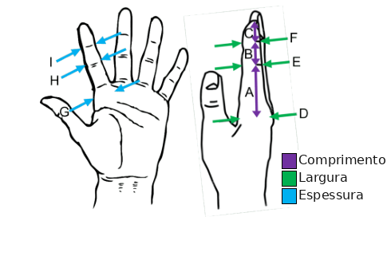

Figura 12 - Parâmetros antropométricos utilizados na modelação paramétrica de dedos protésicos.

Adaptado de (Nini et al., 2024). In 2024 10th IEEE RAS/EMBS International Conference for Biomedical Robotics and Biomechatronics (BioRob). IEEE. https://doi.org/10.1109/BioRob60516.2024.10719909

Os parâmetros antropométricos mais relevantes definem, antes de mais, a estrutura dimensional de base da mão. O comprimento e a largura da mão, bem como o comprimento da palma, constituem descritores dimensionais primários que permitem estabelecer a escala e a organização geral do modelo. Incluem-se ainda parâmetros relativos aos dedos, como os comprimentos segmentares e as proporções entre falanges, além das dimensões do polegar e do punho, essenciais para a funcionalidade e a integração da mão protésica no uso quotidiano (Chatzıoglou et al., 2024; Nag et al., 2003).

Tabela 7 - Principais parâmetros antropométricos da mão e do membro superior relevantes para modelação paramétrica.

|            |                                     |                                   |                                    |
|------------|-------------------------------------|-----------------------------------|------------------------------------|
| **Região** | **Parâmetro**                       | **Definição dimensional**         | **Utilização potencial no modelo** |
| Mão        | Largura da mão                      | Distância entre metacarpos II e V | Definição do volume da palma       |
| Palma      | Comprimento da palma                | Base do dedo médio até ao punho   | Estrutura e proporção da palma     |
| Dedos      | Comprimento dos dedos               | MCP até ponta                     | Dimensionamento funcional          |
| Dedos      | Proporções falângicas               | Relação entre segmentos           | Definição cinemática               |
| Dedos      | Largura/profundidade                | Secção transversal                | Ajuste estrutural e estético       |
| Polegar    | Comprimento e orientação            | Geometria e oposição              | Preensão e usabilidade             |
| Punho      | Largura/profundidade                | Dimensões do punho                | Interface estrutural               |
| Antebraço  | Circunferência/comprimento residual | Medidas do membro residual        | Ajuste do encaixe                  |

### Conjuntos mínimos de parâmetros por nível de amputação

O conjunto mínimo de parâmetros antropométricos varia consoante o nível de amputação, uma vez que as diferentes configurações protésicas requerem graus distintos de detalhe dimensional. A redução do número de medições necessárias torna os processos de personalização mais escaláveis e acessíveis, sobretudo quando os dados são recolhidos fora de contextos clínicos especializados (Moreo, 2016; Romero et al., 2025b).

Tabela 8 - Conjuntos mínimos de parâmetros por nível de amputação.

|                                    |                                                             |
|------------------------------------|-------------------------------------------------------------|
| **Nível de ausência do membro**    | **Conjunto mínimo proposto pela literatura**                |
| Desarticulação do punho            | Largura e profundidade do punho, comprimento da mão         |
| Parcial da mão                     | Comprimento da palma, dimensões dos dedos remanescentes     |
| Dedos (parcial)                    | Comprimento e largura do dedo, proporções falângicas        |
| Mão completa (cosmética/funcional) | Comprimento da mão, largura da palma, comprimento dos dedos |

Esta lógica permite estruturar o sistema paramétrico com base em entradas essenciais e controlar a complexidade inicial do processo sem inviabilizar a geração de uma solução funcional. Deve, contudo, distinguir-se entre parâmetros mínimos de configuração e parâmetros de refinamento. Os primeiros permitem gerar uma instância funcional do modelo; quando existem dados adicionais; os segundos aumentam a especificidade da configuração, afinando a coerência proporcional, a adequação geométrica ou o desempenho cinemático.

### Limitações do redimensionamento proporcional

Uma limitação recorrente das abordagens simplificadas de modelação consiste no redimensionamento proporcional (*uniform scaling*), em que um modelo base é dimensionado proporcionalmente em todas as direções. Esta abordagem é inadequada no contexto antropométrico, pois as dimensões da mão apresentam correlações imperfeitas entre si e não variam uniformemente entre populações, nomeadamente entre sexos e grupos etários. Assim, indivíduos com larguras de mão semelhantes podem ter comprimentos, proporções falângicas ou dimensões do polegar significativamente diferentes. A modelação paramétrica requer, portanto, parâmetros independentes que permitam derivar proporções locais sem pressupor uma homotetia global. As partes da prótese não são, por conseguinte, redimensionadas segundo uma proporção única, nem mantêm invariáveis todas as relações geométricas entre si (Lim et al., 2018; Nag et al., 2003; Rodríguez-Vega & Rodríguez-Vega, 2024).

A Figura 13 evidencia esta limitação ao comparar um modelo uniformemente escalado com outro parametrizado a partir de variáveis independentes. A comparação mostra que a configuração requer o controlo das relações geométricas internas e não se reduz ao simples aumento ou redução do modelo-base.

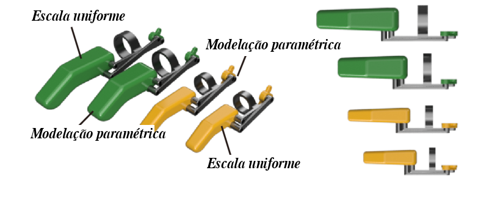

Figura 13 - Comparação entre o escalonamento uniforme e a modelação paramétrica de dedo protésico.

Adaptado de (Lim et al., 2018). Customization of a 3D printed prosthetic finger using parametric modeling. In Proceedings of the ASME 2018 International Design Engineering Technical Conferences and Computers and Information in Engineering Conference. https://doi.org/10.1115/DETC2018-85645

### Métodos de recolha de dados antropométricos

Os dados podem ser recolhidos por diferentes métodos, com implicações diretas na precisão das medições e na sua tradução em parâmetros de projeto. A escolha depende do objetivo da medição: parametrização dimensional básica, reconstrução geométrica fina, desenho do encaixe ou obtenção de relações internas entre superfícies e estruturas ósseas. (Ciklacandir et al., 2022) e (Herbst et al., 2021) demonstram que nenhum método é universalmente superior; a sua adequação varia em função do custo, da acessibilidade e do tipo de dados necessários(Ciklacandir et al., 2022; Herbst et al., 2021).

Tabela 9 - Métodos de recolha de dados antropométricos e suas características.

|                    |                             |                             |                                         |                       |
|--------------------|-----------------------------|-----------------------------|-----------------------------------------|-----------------------|
| **Método**         | **Dados obtidos**           | **Vantagens**               | **Limitações**                          | **Uso principal**     |
| Digitalização 3D   | Geometria superficial       | Elevada precisão, rapidez   | Equipamento e processamento necessários | Encaixe e forma       |
| Imagiologia médica | Estrutura interna e externa | Dados anatómicos detalhados | Alto custo e menor acessibilidade       | Modelação biomecânica |
| Fotogrametria      | Geometria aproximada        | Acessível, potencial remoto | Precisão variável                       | Aquisição preliminar  |

### Bases de dados antropométricas, extração e normalização

A configuração utiliza uma base local em formato longo, na qual cada linha representa uma estatística associada a uma medida e a um grupo, e não uma pessoa. O conjunto reúne fontes populacionais heterogéneas quanto à idade, ao sexo, ao país, à amostra, ao protocolo e às estatísticas disponíveis. Os valores constituem, por isso, referências iniciais, não substitutos da medição individual.

Na modelação, a base permite identificar medidas recorrentes, apoiar a definição de intervalos de configuração e fornecer casos populacionais para examinar a propagação dos parâmetros. A origem documental, a população, a unidade e as notas de qualidade mantêm-se associadas a cada valor, o que permite regressar à fonte quando surgem incompatibilidades.

A extração, a seleção das fontes, a normalização para milímetros, a cobertura populacional e as limitações documentais são apresentadas integralmente no Anexo A. No corpo do capítulo permanecem apenas as regras que influenciam decisões geométricas: as medidas disponíveis, a correspondência com os campos do modelo, o tratamento de ausências e os limites de utilização. Os três ficheiros CSV que sustentam esta descrição são disponibilizados no Suplemento 1 - Dados antropométricos.

A maioria dos dados descreve pessoas sem amputação, pelo que não representa a forma do membro residual, a deformação dos tecidos, nem a interface corpo-dispositivo. Uma referência populacional pode apoiar a configuração inicial, mas a adaptação individual requer medidas diretas, eventual digitalização tridimensional e avaliação própria.

Tabela 10 - Funções e limites da base antropométrica na configuração.

|                                  |                                                        |                                                                                   |
|----------------------------------|--------------------------------------------------------|-----------------------------------------------------------------------------------|
| Função no projeto                | Dados utilizados                                       | Limite de interpretação                                                           |
| Identificar medidas recorrentes  | Designações, regiões corporais e protocolos das fontes | Medidas com o mesmo nome podem usar pontos anatómicos diferentes                  |
| Definir intervalos iniciais      | Médias, dispersões e percentis disponíveis             | Os intervalos populacionais não constituem limites clínicos                       |
| Construir casos de ensaio        | Idade, sexo, país, grupo e estatística                 | O perfil agregado não representa uma pessoa nem assegura correspondência nacional |
| Preencher parâmetros disponíveis | Valores positivos ligados ao mapa canónico do modelo   | Os campos ausentes permanecem por preencher e não devem ser inventados            |

### Correspondência entre perfil populacional e parâmetros do modelo

A plataforma converte as linhas dos CSV em perfis agregados, armazenados na base local da aplicação. No fecho do estudo, existiam 100 perfis: 97 importados em lote, dois por importação CSV e um criado manualmente. A correspondência entre uma descrição e estes perfis é determinística e realiza-se num serviço determinístico de correspondência de perfis.

O algoritmo extrai do texto o sexo e a idade, recorrendo opcionalmente a um modelo de linguagem quando esses campos ficam incompletos. Para cada perfil, calcula uma pontuação: +3 por coincidência de sexo e -3 por conflito explícito; +3 por coincidência da categoria etária e -2 por conflito; até +1,5 pela proximidade numérica da idade; +1,5 quando o país do perfil ocorre literalmente na descrição; +1 para grupos identificados como média, mediana ou percentil 50; e +1 quando o nome do grupo indica medições da mão. A idade representativa de um intervalo corresponde ao seu ponto médio; num intervalo aberto, como «65+», acrescentam-se cinco anos ao limite. O perfil apenas é selecionado se a pontuação atingir 3. Quando o país indicado não consta da base, esse critério não acrescenta pontuação.

Após a seleção, um mapa canónico associa cada parâmetro a um caminho da estrutura antropométrica. As principais ligações incluem palm_breadth_mm a palm.width_mm, palm_length_mm a palm.length_mm, os comprimentos dos cinco dedos aos respetivos campos digits.\*.total_length_mm, os comprimentos proximais a digits.\*.proximal_length_mm e wrist_circumference_mm a wrist.circumference_mm. Apenas são aplicados parâmetros numéricos presentes no modelo e com medida positiva no perfil. Cada valor é arredondado a uma casa decimal e limitado pelo mínimo e máximo declarados. Os campos ausentes são ignorados, permanecendo disponíveis para introdução manual ou sugestão da IA.

Este processo seleciona uma referência inicial, não um equivalente individual. A pontuação é uma regra de correspondência desenvolvida para o protótipo e não representa uma distância antropométrica validada entre populações. No cenário «*girl, 10 years old, ... Japan*», por exemplo, a ausência do Japão leva o algoritmo a usar o sexo, a idade, a proximidade etária e a qualidade do grupo, sem evidência nacional japonesa.

### Estrutura paramétrica e mapeamento de parâmetros

A estrutura do modelo paramétrico organiza os parâmetros de forma hierárquica e relacional, distinguindo-os em primários, derivados, funcionais e construtivos. Esta distinção impede que o modelo seja metodologicamente tratado como um conjunto plano de medidas independentes. Estabelece-se antes uma cadeia de transformação na qual algumas variáveis constituem as principais entradas do utilizador, enquanto outras correspondem às suas consequências geométricas, cinemáticas ou produtivas (Moreo, 2016; Romero et al., 2025b).

Tabela 11 - Estrutura hierárquica dos parâmetros no modelo paramétrico.

|                       |                                           |                       |                                  |
|-----------------------|-------------------------------------------|-----------------------|----------------------------------|
| **Tipo de parâmetro** | **Exemplos**                              | **Função no modelo**  | **Relação com outras variáveis** |
| Derivados             | Proporções das falanges                   | Construção geométrica | Dependentes                      |
| Funcionais            | Amplitude de movimento, posição articular | Desempenho            | Ligação cinemática               |
| Construtivos          | Espessuras, folgas, tolerâncias           | Fabrico               | Ajuste técnico                   |

Estes parâmetros são traduzidos em geometria através de relações explícitas entre as medições e os componentes do modelo.

### OpenSCAD: enquadramento e justificação da escolha

O OpenSCAD é um ambiente livre e *open source* de CAD tridimensional, baseado em ficheiros de *script* e orientado para a criação de geometria sólida, não para a modelação artística de superfícies. O modelo é descrito num ficheiro .scad, escrito numa linguagem própria que o programa interpreta para gerar o sólido correspondente. Em termos geométricos, o OpenSCAD baseia-se numa lógica de *Constructive Solid Geometry* (CSG), em que primitivas como cubos, cilindros, esferas e extrusões são combinadas mediante operações booleanas, transformações e relações hierárquicas entre módulos (Avila et al., 2024; Ghali, 2008).

A natureza programável do OpenSCAD distingue-o dos ambientes CAD convencionais, assentes sobretudo na manipulação gráfica direta. Em muitos sistemas CAD, o utilizador constrói uma sequência de operações num histórico visual e parametriza algumas das suas características. No OpenSCAD, a descrição textual constitui o próprio modelo paramétrico: as variáveis, funções e módulos não são uma camada posterior aplicada à geometria, mas a estrutura que a gera. Para a investigação, esta diferença torna mais explícitas, reexecutáveis e documentáveis as relações entre parâmetros, componentes e restrições, embora implique uma curva de aprendizagem maior e dificuldades conhecidas na navegação código-vista, na validação e na criação de formas orgânicas complexas (Gonzalez Avila, 2024; Trautmann, 2021).

A escolha do OpenSCAD decorre da sua adequação a processos documentados e consistentes de *design* paramétrico. Por ser constituído por texto simples, o ficheiro-fonte pode ser mantido sob controlo de versões, comparado, analisado e reutilizado, facilitando o registo das decisões de modelação e a regeneração de variantes. Esta característica é valorizada no *hardware* científico e *open source*, em que a documentação do processo assume uma importância equivalente à do ficheiro final exportado. O OpenSCAD também pode ser executado por linha de comando, receber valores por parâmetros e exportar automaticamente geometrias para formatos de fabrico digital, como STL ou 3MF, sendo assim compatível com fluxos de geração em lote e configuradores digitais (Machado et al., 2019).

Em segundo lugar, o OpenSCAD adequa-se à arquitetura *web* proposta nesta investigação. A separação entre a definição geométrica e a interface permite manter o ficheiro .scad como núcleo técnico do modelo, enquanto a plataforma apresenta ao utilizador os parâmetros relevantes. Esta lógica foi já explorada em configuradores *web* baseados em OpenSCAD, nos quais utilizadores sem domínio da linguagem podem gerar variantes imprimíveis a partir de modelos parametrizados por designers. A existência de implementações em *WebAssembly*, como o OpenSCAD *Web*, reforça esta escolha ao demonstrar que o motor de geração pode ser executado no navegador e associado a editores, visualizadores 3D e interfaces de personalização, sem exigir a instalação local de *software* CAD completo (Brooks, 2026; Nilsiam & Pearce, 2017)

Em terceiro lugar, o OpenSCAD é particularmente compatível com um fluxo de *design* apoiado por inteligência artificial. Por expressar a geometria em código curto, estruturado e relativamente legível, permite que uma IA sugira valores, explique relações entre variáveis ou proponha alterações ao *script* sem substituir a lógica paramétrica por uma geometria opaca. Trabalhos recentes sobre a geração de modelos 3D a partir de linguagem natural e a automatização do desenho paramétrico mostram que os modelos de linguagem podem atuar sobre *scripts* CAD, embora continuem a exigir revisão humana, verificação dimensional e validação técnica antes de qualquer aplicação produtiva ou clínica (ELhadad et al., 2025; Gonzalez Avila, 2024; Schöfer & Seibel, 2025).

No contexto específico das próteses e das tecnologias de apoio, esta escolha é reforçada por estudos que recorrem à modelação paramétrica para adaptar dedos protésicos, mãos mecânicas acionadas pelo corpo e outros dispositivos de apoio às medidas ou necessidades do utilizador. Estes trabalhos não eliminam a necessidade de ensaios funcionais, avaliação ergonómica ou validação clínica, mas demonstram que a personalização geométrica pode ser estruturada através de parâmetros explícitos e modelos reexecutáveis. Neste projeto, o OpenSCAD é adequado não por resolver isoladamente o problema da prótese personalizada, mas por oferecer uma base transparente para relacionar medidas antropométricas, regras de modelação, interface *web*, sugestões de IA, exportação para fabrico aditivo e revisão humana (Bustamante et al., 2018; Lim et al., 2018; Romani & Levi, 2020).

Tabela 12 - Mapeamento entre parâmetros antropométricos e elementos do modelo.

|                              |                                              |
|------------------------------|----------------------------------------------|
| **Parâmetro antropométrico** | **Efeito geométrico previsto**               |
| Largura da palma             | Volume da palma e espaçamento entre dedos    |
| Comprimento dos dedos        | Geometria das falanges                       |
| Circunferência do antebraço  | Geometria do encaixe                         |
| Largura do punho             | Interface palma-punho                        |
| Proporções falângicas        | Relações cinemáticas dos mecanismos digitais |

Este mapeamento constitui a base da modelação paramétrica ao permitir converter dados antropométricos em configurações geométricas e funcionais. Na prática, a passagem da medição para a geometria não corresponde a uma transposição linear, mas à definição de relações controladas: alguns parâmetros regulam a escala geral, outros determinam proporções locais e outros funcionam como restrições de consistência geométrica, desempenho funcional ou compatibilidade com o processo de fabrico.

Antes de traduzir o modelo para o ambiente de modelação paramétrica, é necessário estabilizar três níveis: os dados de entrada, as relações entre parâmetros e os limites técnicos que condicionam a sua transformação em forma.

Nesta investigação, o subcapítulo 4.2 identifica os parâmetros antropométricos relevantes, a forma como são recolhidos ou inferidos e o modo como se organizam antes de integrarem a estrutura computacional do modelo. Com base nestes elementos, o subcapítulo seguinte mostra como o sistema de entradas, dependências e restrições é formalizado em OpenSCAD como um modelo executável, modular e regenerável.

## 4.3 Modelação paramétrica em OpenSCAD

Nesta investigação, a modelação paramétrica em OpenSCAD corresponde à passagem da estrutura definida no subcapítulo anterior, até então conceptual, para um modelo operacional capaz de traduzir parâmetros, relações e restrições em geometrias configuráveis. Os parâmetros antropométricos selecionados, as relações hierárquicas entre variáveis e os limites de configuração são inscritos em código, de modo que um mesmo conjunto de valores e uma mesma versão do modelo gerem a mesma geometria. A transição para OpenSCAD dá continuidade ao problema de transformar dados corporais e regras de projeto num modelo configurável que preserve a coerência formal e produtiva.

A modelação paramétrica em OpenSCAD é aqui entendida como uma abordagem na qual a geometria resulta de regras explícitas, parâmetros definidos em código e relações de dependência entre componentes, em vez da edição manual isolada de formas. No desenvolvimento de próteses personalizadas de membro superior, esta lógica permite conceber a prótese como um conjunto configurável de variantes, regenerável a partir de novos dados antropométricos, requisitos funcionais e limites de fabrico. Os estudos analisados sobre a aplicação da modelação paramétrica a próteses e sobre a modelação CAD programável associam estas abordagens a uma melhor documentação das decisões, à consistência entre variantes e à automatização dos fluxos de personalização digital (Machado et al., 2019; Moreo, 2016; Romero et al., 2025b)

Ao contrário dos ambientes centrados na manipulação gráfica direta, o OpenSCAD funciona como uma especificação computacional do objeto. Esta característica permite compreender o modelo simultaneamente como resultado geométrico e como estrutura explícita de projeto, na qual ficam registadas as relações entre entradas antropométricas, módulos geométricos, restrições construtivas e decisões formais. A modelação baseada em código articula-se, deste modo, com *Research Through Design*, uma vez que o próprio modelo pode ser lido, analisado, testado e documentado como estrutura de conhecimento técnico e de projeto.

A Figura 14 evidencia a passagem entre a definição paramétrica, o modelo virtual e o protótipo físico. Para esta investigação, o seu valor não reside na replicação da solução apresentada, mas na representação da cadeia que liga a decomposição dimensional do dedo, a modelação computacional e a verificação material, preservando o mesmo tipo de continuidade procurado pelo modelo em OpenSCAD (Nini et al., 2024).

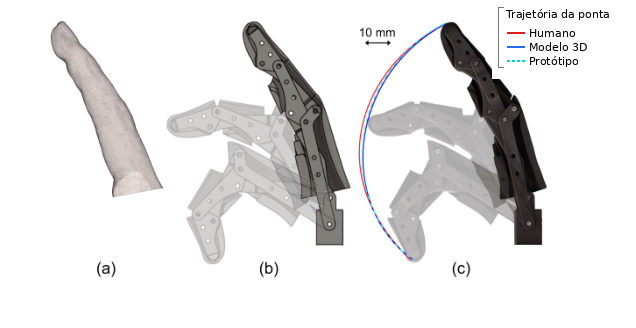

Figura 14 - Relação entre modelo paramétrico digital, prototipagem e verificação de um dedo protésico.

Reproduzido de Nini et al. (2024) Parametric 3D modeling of a customized prosthetic hand finger for additive manufacturing. In 2024 10th IEEE RAS/EMBS International Conference for Biomedical Robotics and Biomechatronics (BioRob).

### 4.3.1 Estrutura técnica, parâmetros e restrições

A organização interna de um modelo paramétrico baseado em OpenSCAD pode ser compreendida como uma arquitetura em camadas.

A primeira camada reúne os dados de entrada provenientes de medições lineares, dados consolidados de referência ou digitalização tridimensional. Na segunda, estes dados são convertidos em parâmetros geométricos derivados, que estabelecem proporções, espessuras, posições articulares e relações entre subcomponentes. A camada funcional define as exigências de mobilidade, montagem ou integração mecânica, enquanto a camada de restrições produtivas enquadra espessuras mínimas, folgas, tolerâncias e limites de fabrico. Esta organização permite controlar a personalização sem comprometer a coerência interna do sistema (Moreo, 2016; Nini et al., 2024; Saldarriaga et al., 2024).

Tabela 13 - Estrutura técnica em camadas de um modelo paramétrico em OpenSCAD para próteses personalizadas.

|                         |                                             |                                          |                                                 |
|-------------------------|---------------------------------------------|------------------------------------------|-------------------------------------------------|
| **Camada**              | **Dados tratados**                          | **Função**                               | **Exemplos**                                    |
| Derivação geométrica    | Parâmetros calculados a partir das entradas | Traduzir medidas em relações formais     | Comprimentos segmentares, espessuras, *offsets* |
| Comportamento funcional | Parâmetros ligados ao uso e ao mecanismo    | Regular movimento, montagem e desempenho | Amplitude articular, espaço para tendões, eixos |
| Restrições produtivas   | Limites de fabrico e consistência           | Garantir fabrico e robustez              | Espessura mínima, folgas, raios mínimos         |

Quando transposta para o ambiente de modelação em OpenSCAD, esta arquitetura tende a concretizar-se em módulos relativamente autónomos. Em vez de concentrar toda a definição geométrica num único bloco de código, o modelo pode ser distribuído por módulos correspondentes à palma, aos dedos, às articulações, às interfaces de fixação ou ao encaixe. Esta modularidade reduz a opacidade do sistema e facilita a regeneração controlada de variantes. Num contexto protésico, permite ainda que as alterações aos parâmetros de entrada se propaguem pelo modelo segundo relações previamente explicitadas e localizáveis, e não de forma arbitrária (Machado et al., 2019; Romero et al., 2025a).

A integração direta de restrições na lógica paramétrica constitui outro aspeto central. Em vez de remeter a compatibilidade com o fabrico aditivo exclusivamente para uma etapa posterior, o modelo pode incorporar desde o início limites mínimos de espessura, folgas entre elementos móveis, margens de tolerância e verificações condicionais que evitem combinações inválidas.

Este princípio é particularmente relevante nas próteses produzidas por fabrico aditivo, em que pequenas alterações dimensionais podem comprometer a montagem, a resistência ou a viabilidade de impressão. Os estudos sobre modelação paramétrica de dedos e encaixes protésicos personalizados mostram que a estabilidade do sistema depende da articulação entre parâmetros antropométricos e restrições construtivas, e não da liberdade de alteração geométrica (Nini et al., 2024; Saldarriaga et al., 2024).

A modelação em OpenSCAD pode articular-se com fluxos de dados mais complexos, incluindo a digitalização tridimensional e a automatização parcial do desenho. Trabalhos como os de (Herbst et al., 2021) e (Saldarriaga et al., 2024) demonstram que a personalização tende a aproximar a medição, a parametrização e o fabrico, reduzindo o intervalo entre a captura anatómica e a geração de modelos prontos para produção. Nesta investigação, essa articulação utiliza a lógica explícita do código como núcleo organizador da integração consistente e documentada de dados, restrições e interfaces de configuração.

### 4.3.2 Análise crítica da abordagem

A adoção do OpenSCAD neste projeto apresenta vantagens metodológicas, sobretudo por explicitar a construção do modelo paramétrico. A sua definição por código facilita a identificação das relações entre variáveis, dependências e restrições, comparativamente com muitos fluxos CAD baseados em operações gráficas. Esta condição favorece a transparência do processo, a análise crítica e a reconstituição das decisões de modelação, qualidades particularmente importantes num trabalho académico em que o modelo paramétrico é simultaneamente um instrumento de produção formal e um objeto de análise (Machado et al., 2019).

Outra vantagem decorre da afinidade entre a modelação baseada em código, a automatização e a partilha aberta. Os estudos analisados indicam que o OpenSCAD é particularmente adequado a fluxos de personalização digital nos quais o modelo é configurado por parâmetros, evitando a edição manual da geometria após cada alteração. Esta característica permite associar o ficheiro-fonte a interfaces *web*, gerar múltiplas variantes segundo regras explícitas e disponibilizar modelos reutilizáveis em comunidades distribuídas. A possibilidade de ajustar o modelo sem editar diretamente o código em cada iteração reforça a sua pertinência em contextos de personalização e fabrico digital (Nilsiam & Pearce, 2017). Num projeto que articula parametrização, interface e apoio computacional, esta característica assume especial relevância.

Esta abordagem apresenta, contudo, limitações importantes. Uma delas é a exigência técnica e conceptual da programação: mesmo num modelo modular e bem estruturado, a edição direta em OpenSCAD requer capacidade para interpretar transformações geométricas, dependências paramétricas e operações booleanas. A utilidade do OpenSCAD aumenta, por isso, quando o sistema é mediado por camadas intermédias de interface ou por procedimentos que exponham apenas os parâmetros necessários à configuração. Outra limitação é de natureza geométrica. A modelação por combinação de sólidos, habitualmente designada por *Constructive Solid Geometry* (CSG), favorece a criação de peças mecânicas, modulares e relativamente discretas, mas tende a ser menos adequada à definição de superfícies orgânicas complexas ou de interfaces anatómicas altamente irregulares, sobretudo quando comparada com ferramentas orientadas para superfícies livres.

Existe ainda uma limitação de interoperabilidade. Os estudos comparativos sobre OpenSCAD sublinham que este ambiente de modelação está fortemente orientado para formatos baseados em malhas, nos quais a geometria é representada por uma aproximação poligonal da superfície, como sucede nos ficheiros STL. Embora favoreça os fluxos de fabrico digital e impressão 3D, esta orientação pode dificultar a integração com certos circuitos CAD industriais ou com ambientes que exijam a preservação completa da informação paramétrica em formatos normalizados (Machado et al., 2019). Tal não invalida a adequação do OpenSCAD ao presente projeto, mas implica que a sua adoção seja entendida como uma escolha situada: muito eficaz na estruturação de um núcleo paramétrico explícito, mas menos adequada quando o objetivo depende da plena continuidade com certos fluxos proprietários de engenharia.

A avaliação da abordagem exige, por fim, que a produção da geometria seja articulada com as etapas subsequentes. Mesmo com uma lógica paramétrica clara e restrições integradas, a confirmação técnica do modelo depende da inspeção durante a preparação para impressão 3D, do controlo dimensional, de eventual simulação estrutural e da observação da peça física.

O valor do OpenSCAD nesta investigação não reside, portanto, numa promessa de automatização total, mas na sua capacidade para fornecer uma infraestrutura técnica clara que articule a personalização antropométrica, a modularidade, as restrições de fabrico e a documentação do processo. A combinação entre explicitação, execução repetida e possibilidade de revisão crítica justifica a sua escolha como base da modelação paramétrica aqui desenvolvida.

### 4.3.3 Relações implementadas nos modelos avaliados

As relações gerais das Tabelas 11 e 12 foram concretizadas de modo distinto em cada família. O estado utilizado nos ensaios principais corresponde ao dicionário do Suplemento 3 - Parametrização e percurso numérico. Uma revisão posterior acrescentou a braçadeira comum do Flexy Beast e relações mais completas do Cyborg Beast. No estado final examinado, uniformizaram-se a organização dos grupos e os nomes dos controlos de lateralidade e disposição, sem alterar as relações geométricas avaliadas. Estes desenvolvimentos posteriores não são retroativamente apresentados como parte dos ensaios concluídos anteriormente. As fórmulas descrevem a implementação e não representam relações anatómicas universais.

Tabela 14 - Síntese das relações implementadas e respetivas limitações.

|                         |                                                                            |                                                                                                                                       |                                                                                                                       |
|-------------------------|----------------------------------------------------------------------------|---------------------------------------------------------------------------------------------------------------------------------------|-----------------------------------------------------------------------------------------------------------------------|
| Modelo                  | Entradas ativas principais                                                 | Transformação implementada                                                                                                            | Limitação que deve acompanhar a leitura                                                                               |
| Flexy Beast             | Largura da palma; comprimentos dos cinco dedos; circunferência do punho    | xScaleFactor = (palm_breadth_mm + 5) / 55; o médio define o multiplicador digital; a braçadeira deriva de circunferência/π mais folga | A largura introduzida alimenta uma fórmula herdada e não coincide diretamente com a extensão transversal da malha     |
| Cyborg Beast            | Largura da palma; comprimentos totais e proximais; circunferência do punho | Escala global pela fórmula Cyborg Beast; curvas calibradas para os segmentos; braçadeira independente da mão                          | As curvas são calibrações da geometria e possuem limites internos; o modelo não integrou a comparação principal       |
| Paraglider Hand         | Largura da palma; comprimentos dos dedos; opções de componentes            | overall_scale = palm_breadth_mm / 66,4; correção overall_scale / 1,25 na palma Reborn; escalas próprias para quatro dedos             | A palma mantém escala uniforme; comprimento e espessura são contextuais; o polegar ainda usa a escala do médio        |
| UnLimbited Phoenix Hand | Largura da palma; comprimentos totais e proximais dos dedos                | HandPerc limitado a 100%-160%; alongamento localizado das zonas sem furos                                                             | Perfis inferiores a 82 mm atingem o limite mínimo; os comprimentos digitais são novamente afetados pela escala global |

O escalonamento uniforme não foi eliminado em todos os modelos, tendo sido mantido quando a arquitetura herdada exigia preservar furos circulares, espaçamentos e componentes montados como conjunto. No Paraglider, esta opção protege a palma e os pinos, enquanto parte dos dedos recebe escalas próprias. No Phoenix, a montagem completa conserva uma escala uniforme, sendo os dedos alongados apenas em faixas sem furos. Como o alongamento antecede a escala global, o comprimento final depende de ambas as operações.

A crítica ao escalonamento proporcional aplica-se, portanto, ao seu uso como substituto de todas as diferenças antropométricas. Uma transformação uniforme local pode constituir uma restrição mecânica legítima, desde que o texto identifique o que preserva, o que não adapta e de que modo afeta as restantes dimensões.

Os parâmetros de lateralidade constituem uma classe separada. No estado final examinado, os quatro modelos registados usam o campo booleano mirrored; a anterior designação *LeftRight* do *Phoenix* foi eliminada. Estes campos desempenham o papel *laterality*, ficam fora do pedido de sugestões e são descartados caso surjam na resposta da IA. A regra geométrica permanece determinística e independente do texto gerado pelo modelo de linguagem.

### 4.3.4 Dicionário operacional de parâmetros

Para clarificar a relação entre os dados, a configuração paramétrica e a geometria, foram consolidados os parâmetros numéricos com influência antropométrica, geométrica ou mecânica nos três modelos comparados. Apresentada na Tabela 15, esta consolidação corresponde ao dicionário de parâmetros da versão da plataforma utilizada nos ensaios principais. Salvo indicação específica, os valores são expressos em milímetros; quando aplicável, a tabela assinala percentagens ou proporções sem unidade. Os valores iniciais correspondem à configuração de referência do modelo, enquanto os intervalos definem os limites de implementação adotados na plataforma, com função técnica e paramétrica.

O Suplemento 3 - Parametrização e percurso numérico apresenta a versão integral do dicionário de parâmetros e preserva as 42 declarações numéricas na sua forma desagregada. Inclui o incremento, o grupo funcional, a designação e a descrição em português, a função determinística e a indicação de exclusão dos processos de sugestão por IA. No corpo do texto, a tabela agrupa apenas as variáveis com a mesma origem, intervalo e transformação, para manter legível a comparação.

Tabela 15 - Dicionário operacional dos parâmetros numéricos dos modelos avaliados.

|                                                                                     |                                                                |                   |                                          |                                                                                     |
|-------------------------------------------------------------------------------------|----------------------------------------------------------------|-------------------|------------------------------------------|-------------------------------------------------------------------------------------|
| Modelo e parâmetro                                                                  | Significado e origem                                           | Inicial           | Intervalo; incremento                    | Regra ou efeito geométrico                                                          |
| Flexy Beast - palm_breadth_mm                                                       | Largura metacarpal; palm.width_mm                              | 83                | 55-110; 1                                | Escala uniforme: xScaleFactor = (valor + 5) / 55                                    |
| Flexy Beast - middle_finger_length_mm                                               | Dobra MCP à ponta do dedo médio; digits.middle.total_length_mm | 72                | 40-120; 1                                | Comprimento mestre: fingerLength = valor / (37 × xScaleFactor)                      |
| Flexy Beast - index_finger_length_mm; ring_finger_length_mm                         | Comprimento total do indicador e anelar                        | 68; 68            | 40-120; 1                                | Proporção de cada dedo relativamente ao médio                                       |
| Flexy Beast - pinky_finger_length_mm; thumb_length_mm                               | Comprimento total do mindinho e polegar                        | 55; 65            | 30-100; 1; 35-100; 1                     | Proporção local relativamente ao dedo médio                                         |
| Flexy Beast - joint_dia; joint_thick                                                | Diâmetro do furo e espessura da ranhura da junta flexível      | 7; 4              | 4-10; 0,5; 1-6; 0,5                      | Dimensionam furos, ranhuras e conectores flexíveis; não são medidas corporais       |
| Flexy Beast - gauntlet_width_mm; gauntlet_length_mm; gauntlet_wall_mm               | Largura, comprimento e parede da braçadeira                    | 60; 108; 3        | 40-90; 1; 70-150; 1; 2-5; 0,5            | Escala e espessura da braçadeira; a largura pode derivar do punho com folga         |
| Flexy Beast - gauntlet_pos_adjust; strap_splay_adjust                               | Ajuste longitudinal e afastamento das abas                     | 0; 0              | −25-25; 1; −8-8; 0,5                     | Correções locais de posição e compatibilidade; introdução manual                    |
| Flexy Beast - wrist_pin_dia; wrist_pin_clearance                                    | Diâmetro do pino do punho e folga de rotação                   | 7; 0,35           | 3-8; 0,5; 0,10-0,80; 0,05                | Dimensionam a interface articulada entre palma e braçadeira                         |
| Paraglider - palm_breadth_mm                                                        | Largura metacarpal; palm.width_mm                              | 83                | 55-110; 1                                | overall_scale = valor / 66,4; palma escalada uniformemente                          |
| Paraglider - palm_length_mm; palm_thickness_mm                                      | Comprimento e espessura da palma                               | 95; 32            | 60-140; 1; 18-50; 1                      | Informação contextual para a IA; não deforma independentemente a palma              |
| Paraglider - index_finger_length_mm; middle_finger_length_mm; ring_finger_length_mm | Comprimentos totais do indicador, médio e anelar               | 68; 72; 68        | 40-120; 1                                | Escalas próprias dos dedos; o médio define a escala-base digital                    |
| Paraglider - pinky_finger_length_mm; thumb_length_mm                                | Comprimentos totais do mindinho e polegar                      | 55; 65            | 30-100; 1; 35-100; 1                     | O mindinho recebe escala própria; o polegar acompanha a escala-base                 |
| Paraglider - string_channel_scale; elastic_channel_scale                            | Escala relativa dos canais de tração e de elástico             | 0,9; 0,9          | 0,50-1,00; 0,05; 0,50-1,50; 0,05         | Razões adimensionais aplicadas aos canais mecânicos                                 |
| Paraglider - ARM_HandLen; ARM_ForearmLen; ARM_BicepCircum; ARM_CuffLength           | Mão, antebraço, circunferência do braço e braçadeira           | 135; 140; 160; 65 | 135-230; 120-315; 110-350; 65-90; inc. 1 | Dimensionam a extensão opcional do braço; não entraram na comparação da mão         |
| Paraglider - ARM_PinHoleDia                                                         | Diâmetro dos furos das articulações do braço                   | 3                 | 3-6; 1                                   | Interface mecânica da extensão opcional do braço                                    |
| UnLimbited Phoenix - palm_breadth_mm                                                | Largura metacarpal; palm.width_mm                              | 82                | 82-131; 1                                | HandPerc = valor / 82 × 100, limitado a 100%-160%                                   |
| UnLimbited Phoenix - HandPerc_override                                              | Substituição manual da percentagem de escala                   | 0                 | 0-160; 1                                 | Zero deriva a escala; valores positivos continuam sujeitos ao limite mínimo de 100% |
| UnLimbited Phoenix - index\_; middle\_; ring\_; pinky_finger_length_mm              | Comprimentos totais dos quatro dedos                           | 72 cada           | 55-115; 1                                | Alongamento dos segmentos, preservando a circularidade dos furos                    |
| UnLimbited Phoenix - index\_; middle\_; ring\_; pinky_base_length_mm                | Comprimentos dos segmentos proximais                           | 31 cada           | 18-55; 1                                 | Divide o comprimento total entre segmento proximal e ponta                          |
| UnLimbited Phoenix - thumb_length_mm; thumb_base_length_mm                          | Comprimento total e proximal do polegar                        | 72; 31            | 45-80; 1; 18-50; 1                       | Alongamento do polegar e divisão proximal-distal                                    |

O dicionário organiza os parâmetros em três categorias: antropométricos, derivados e mecânicos. Os parâmetros antropométricos correspondem a medidas diretas ou referências populacionais; os derivados transformam essas entradas segundo as fórmulas definidas no modelo; os mecânicos representam escolhas de projeto, folgas ou interfaces, sem correspondência direta com características anatómicas. Os parâmetros booleanos de visibilidade, cores, disposição para impressão e lateralidade permanecem no ficheiro de configuração completo, mas não integram a Tabela 15, por não constituírem grandezas numéricas.

O Anexo C complementa o dicionário utilizado nos ensaios principais, reunindo as adaptações posteriores, as relações internas do Cyborg Beast, os valores confirmáveis de folga e espessura, as exceções à escala uniforme e os campos que ainda não produzem uma transformação geométrica própria. Distingue valores diretos, derivados, fixos e contextuais e assinala expressamente as propriedades que não podem ser confirmadas pelos ficheiros examinados.

### 4.3.5 Exemplo numérico completo: perfil infantil no Flexy Beast

Este exemplo mostra concretamente a passagem de um perfil de ensaio para o vetor de medidas aceite pela plataforma e para a geometria resultante no modelo Flexy Beast. A Tabela 16 apresenta um percurso integral preservado na série de ensaios. Para isolar a transformação geométrica, a análise centra-se no conjunto de medidas aplicado ao modelo, não na nacionalidade declarada nem na escolha da referência populacional. O perfil de ensaio correspondia a um rapaz de oito anos, 26 kg, 128 cm de altura, do Brasil e com mãos pequenas. Uma vez que a base utilizada não contém uma população brasileira, este caso deve ser entendido como uma demonstração do funcionamento do esquema de dados e da transformação paramétrica, e não como confirmação da adequação antropométrica à população indicada. O exemplo demonstra como os parâmetros aceites pela estrutura da plataforma são convertidos em geometria mensurável.

Tabela 16 - Exemplo da transformação das medidas antropométricas em geometria digital no Flexy Beast.

|                              |                                                                  |                                                                |
|------------------------------|------------------------------------------------------------------|----------------------------------------------------------------|
| Etapa                        | Operação ou evidência                                            | Valor obtido                                                   |
| 1.Vetor aplicado             | Palma; indicador; médio; anelar; mindinho; polegar               | 64; 57; 60; 57; 46; 50 mm                                      |
| 2\. Verificação pelo esquema | Comparação com os intervalos da Tabela 15                        | Seis valores nos intervalos; sem limitação                     |
| 3\. Escala global            | xScaleFactor = (64 + 5) / 55                                     | 1,254545                                                       |
| 4\. Multiplicador mestre     | fingerLength = 60 / (37 × 1,254545)                              | 1,292597                                                       |
| 5\. Proporções digitais      | Indicador/60; médio/60; anelar/60; mindinho/60; polegar/60       | 0,950000; 1,000000; 0,950000; 0,766667; 0,833333               |
| 6\. Parâmetros mecânicos     | joint_dia; joint_thick; braçadeira L × C × parede; wrist_pin_dia | 5 mm; 2 mm; 47 × 80 × 2 mm; 5 mm; dentro dos limites           |
| 7\. Malha da palma           | Caixa XYZ; volume; faces; estanquidade                           | 97,385 × 80,103 × 37,123 mm; 51,381 cm³; 11.186 faces; fechada |
| 8\. Proximal do dedo médio   | Caixa XYZ; volume; faces; estanquidade                           | 37,451 × 14,913 × 14,775 mm; 5,225 cm³; 888 faces; fechada     |
| 9\. Distal do dedo médio     | Caixa XYZ; faces; estanquidade                                   | 52,183 × 14,913 × 22,697 mm; 1.198 faces; aberta               |

A ponta do dedo médio apresenta uma geometria aberta porque a configuração adotada reserva uma cavidade para a inserção da almofada de aderência. Neste caso, a ausência de estanquidade deve ser interpretada em função da intenção construtiva da peça, não como uma falha automática de exportação. A palma e o segmento proximal, em contraste, foram identificados como sólidos fechados.

O percurso evidencia também que o valor de 64 mm atribuído à largura da palma constitui um parâmetro de cálculo, não uma dimensão final direta da caixa envolvente. Este valor alimenta a fórmula herdada do Cyborg Beast e gera uma escala global aplicada a uma geometria-base; por essa razão, a caixa envolvente transversal medida no modelo resultante foi de 80,103 mm. A diferença decorre da transformação implementada e indica que a correspondência entre a designação antropométrica do parâmetro e a dimensão final da peça deve ser calibrada antes de qualquer afirmação sobre o ajuste anatómico.

Os registos dos parâmetros, as malhas, o percurso de transformação e o dicionário completo integram o Suplemento 3 - Parametrização e percurso numérico.

Os exemplos complementares do Anexo C mostram duas dependências adicionais não abrangidas por este percurso. No Paraglider, o comprimento do polegar ainda depende de relações internas do modelo, não de uma escala própria plenamente isolada. No Phoenix, a escala global volta a multiplicar comprimentos definidos localmente, o que exige cautela na leitura direta da relação entre o parâmetro antropométrico e a dimensão final da geometria.

## 4.4 Iterações e decisões de projeto

A evolução dos modelos foi documentada com base em momentos de revisão nos quais uma configuração, uma malha ou uma montagem tornou visível uma limitação e conduziu a uma alteração específica. A Tabela 17 resume os momentos de revisão que mais influenciaram a estrutura paramétrica. As alterações posteriores ao fecho da comparação principal são apresentadas como desenvolvimento subsequente, não como resultados atribuídos retroativamente aos ensaios anteriores.

Tabela 17 - Cronologia das principais iterações paramétricas.

|                                                                                                                                                 |                                                                                                                                        |                                                                                                                                             |
|-------------------------------------------------------------------------------------------------------------------------------------------------|----------------------------------------------------------------------------------------------------------------------------------------|---------------------------------------------------------------------------------------------------------------------------------------------|
| Problema observado                                                                                                                              | Decisão introduzida                                                                                                                    | Aprendizagem de projeto                                                                                                                     |
| Ficheiros Paraglider dispersos e nomes incompatíveis com a plataforma                                                                           | Consolidação da família num modelo com componentes e duas palmas                                                                       | Integrar um modelo aberto exige declarar dependências, variantes e campos comuns antes de expor parâmetros                                  |
| A palma Reborn permanecia próxima do tamanho médio, apesar da variação do parâmetro de largura da palma.                                        | Identificação e compensação do fator de escala 1,25 preservado no módulo importado do modelo original em OpenSCAD.                     | A resposta de um controlo não pode ser inferida apenas pela sua designação; deve ser confirmada na malha gerada.                            |
| No Phoenix, um percurso alternativo de escala permitia contornar o limite mínimo definido para a mão.                                           | Aplicação do mesmo intervalo de 100% a 160% aos percursos que conduzem à escala global da mão.                                         | Limites equivalentes devem atuar sobre todos os percursos que conduzem à mesma transformação geométrica.                                    |
| A IA alterava a lateralidade, apesar de esta corresponder a uma decisão binária e crítica do projeto.                                           | Transferência da lateralidade para a interface determinística e exclusão deste parâmetro dos processos de sugestão por IA.             | Decisões inequívocas e críticas devem permanecer sob controlo determinístico da plataforma.                                                 |
| O Cyborg Beast apresentava ausência de controlo independente dos segmentos digitais e desalinhamentos nas articulações.                         | Calibração do alcance dos dedos, divisão entre segmentos proximais e distais e reposicionamento sobre os eixos MCP e PIP.              | A adaptação paramétrica deve preservar as interfaces articulares enquanto altera o alcance dos segmentos.                                   |
| O componente de fixação ao punho estava desligado da circunferência do punho, e o polegar não mantinha uma correspondência dimensional estável. | Dimensionamento do componente de fixação a partir da circunferência do punho, assentamento automático no pino e calibração do polegar. | Mão, punho e antebraço não devem depender de uma única escala global                                                                        |
| Os dedos do Phoenix eram constituídos por malhas fixas, com pouca margem para variação paramétrica local.                                       | Divisão das colunas estruturais e alongamento apenas das faixas sem furos.                                                             | Modelos baseados em malhas podem receber variação local quando as zonas funcionais são isoladas.                                            |
| O componente de fixação do Flexy não tinha ligação direta à medida do punho.                                                                    | Adoção do componente de fixação comum do Cyborg e associação à circunferência do punho.                                                | Uma gramática comum deve ligar a mesma medida corporal a funções equivalentes entre modelos.                                                |
| Grupos e nomes de controlos equivalentes variavam entre modelos.                                                                                | Reorganização da ordem dos controlos e normalização parcial das designações funcionais equivalentes.                                   | A coerência da interface beneficia de nomes comuns para decisões equivalentes, sem eliminar diferenças geométricas legítimas entre modelos. |

Destes momentos de revisão resultaram quatro conclusões circunscritas. A integração de um modelo aberto exige a análise das variáveis em cada ficheiro, não apenas dos controlos apresentados. A preservação de uma interface mecânica pode justificar uma escala uniforme local ou um alongamento seletivo. Um intervalo declarado na interface não dispensa a verificação da própria transformação geométrica. Por fim, a equivalência nominal entre uma medida e um parâmetro deve ser confirmada na malha, uma vez que fórmulas herdadas e escalas sucessivas podem alterar a dimensão final.

A iteração funcionou, assim, como instrumento de investigação através do *design*: cada falha alterou a compreensão do objeto configurável e conduziu a uma regra mais explícita. O resultado não é uma metodologia universal de personalização protésica, mas um conjunto documentado de decisões para integrar modelos heterogéneos, preservar as suas interfaces e tornar visíveis os respetivos limites.

# Capítulo 5 - Plataforma *Web* e Integração Digital

## 5.1 Enquadramento conceptual e perfis de utilizador

A plataforma *web* desenvolvida neste projeto estabelece a mediação entre o modelo paramétrico, os dados de entrada e a configuração digital da mão protésica. A versão pública está disponível em https://handfab.pedrocandeias.net/.

Os ensaios principais e a série complementar de interface incidiram sobre estados anteriores da plataforma. Mantém-se esta separação temporal porque a plataforma continuou a evoluir depois dos ensaios, nomeadamente quanto à organização e à nomenclatura dos controlos, sem que essas alterações posteriores possam ser apresentadas como parte dos resultados anteriores.

No contexto do *Design* e Desenvolvimento de Produto, a plataforma não constitui um fim autónomo, mas organiza a passagem entre intenção, dados, parâmetros, forma visualizada e ficheiro destinado ao fabrico. A interface expõe uma parte controlada do espaço de variação, evitando que a configuração dependa da edição direta do código OpenSCAD. Esta interpretação é coerente com os estudos sobre personalização digital e personalização em massa, nos quais os configuradores são descritos como sistemas capazes de disponibilizar variação sem comprometer as relações do modelo-base (Ozdemir et al., 2022; van Stralen, 2018).

Em termos funcionais, a plataforma foi concebida para suportar um processo progressivo de configuração, em que a definição geométrica articula a recolha de dados, a seleção do modelo, o ajustamento de parâmetros, a visualização do resultado e a eventual exportação para prototipagem. Esta organização reúne num único percurso de projeto etapas anteriormente dispersas, mas não permite concluir que pessoas sem formação técnica consigam executá-lo com menor esforço.

O sistema disponibiliza controlos paramétricos, pré-visualização tridimensional e gestão de configurações, dispensando o contacto direto com a estrutura interna do ficheiro OpenSCAD. Neste capítulo, esta característica é descrita como uma decisão de interface; a facilidade de aprendizagem e a redução efetiva da dependência técnica permanecem por avaliar com participantes.

Esta opção aproxima-se de abordagens recentes em plataformas de personalização de próteses, nas quais a interface torna observável, configurável e progressivamente verificável um processo que, de outro modo, permaneceria dependente de *software* especializado ou de mediação exclusivamente técnica (Peixoto et al., 2025).

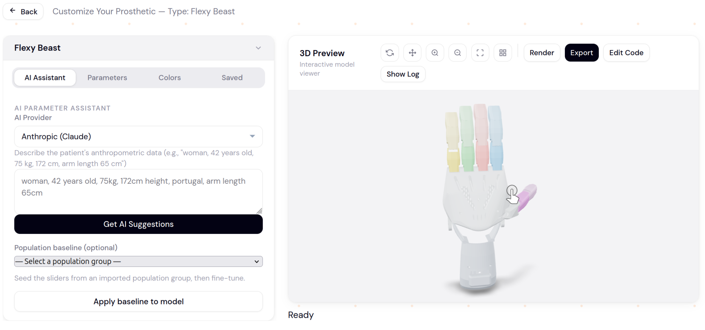

Figura 15 - Fluxo geral de produção personalizada de próteses a partir de plataforma *web* - HandFab.

Fonte: produção de Pedro Candeias. (2026).

A plataforma funciona como uma infraestrutura de mediação entre componentes técnicos, utilizadores e intervenientes especializados. A configuração é entendida como um processo distribuído, no qual os vários intervenientes participam com diferentes graus de responsabilidade, conhecimento e controlo.

No contexto das próteses personalizadas, o resultado pode depender da articulação entre o utilizador final, o designer, o técnico ou o clínico, assim como de condicionantes produtivas e critérios de validação. A plataforma procura oferecer uma infraestrutura digital que acomode esta pluralidade de agentes sem comprometer a consistência técnica da configuração paramétrica nem transferir indevidamente a responsabilidade para o utilizador menos especializado (Bai et al., 2024; Quintero et al., 2018).

A definição dos perfis de utilizador é uma decisão estruturante no desenho da plataforma, pois determina a distribuição de responsabilidades, permissões e formas de intervenção no processo de personalização. O sistema organiza-se em três perfis principais: administrador, técnico e utilizador.

O perfil de administrador assegura a gestão global da plataforma, incluindo a criação de contas, a definição de permissões e a supervisão do ecossistema de configurações e da base de dados antropométricos. O perfil técnico destina-se a profissionais intermédios, como técnicos de ortoprotesia, clínicos ou operadores especializados, aos quais permite criar, editar e acompanhar configurações próprias e, quando aplicável, aceder às configurações dos utilizadores que acompanham. O perfil de utilizador corresponde ao nível mais restrito e centra-se na consulta das suas configurações, no acompanhamento do processo e nas interações delimitadas pelo sistema.

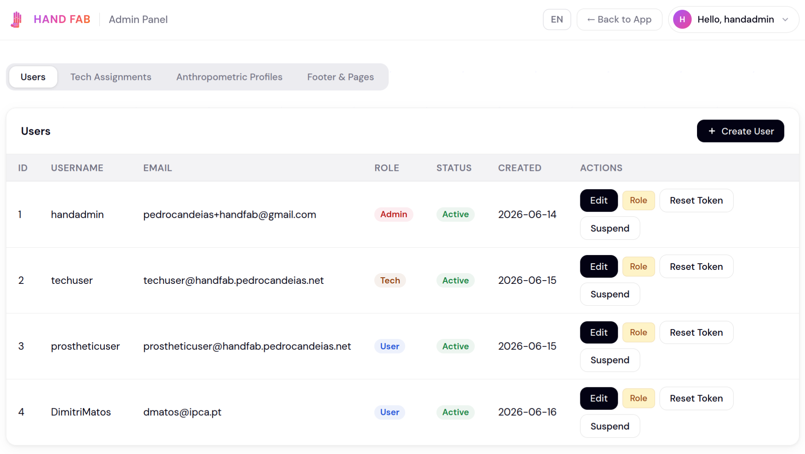Figura 16 - Painel de configuração dos perfis de utilizador na plataforma HandFab.

Fonte: produção de Pedro Candeias. (2026).

Esta segmentação concretiza uma lógica de controlo de acesso baseada em papéis, que procura equilibrar autonomia, segurança e responsabilidade distribuída mediante a definição clara dos limites de intervenção de cada perfil. A diferenciação determina diretamente o modo como a plataforma enquadra a configuração.

Ao reservar determinados parâmetros, decisões ou operações aos perfis técnicos, o sistema reconhece que alguns aspetos da configuração exigem acesso condicionado. Em domínios sensíveis, como o das próteses, a interface deve conferir visibilidade ao processo e delimitar o campo de ação segundo critérios de supervisão e segurança. A literatura sobre interfaces clínicas e interação em próteses inteligentes assinala a necessidade de distinguir a participação informada do utilizador do controlo técnico supervisionado. Esta distinção procura evitar tanto a opacidade excessiva como a transferência imprudente de responsabilidade para agentes sem formação específica (Bai et al., 2024; Quintero et al., 2018).

O enquadramento conceptual articula três objetivos: tornar a lógica paramétrica operável em ambiente *web*, estruturar a configuração como uma sequência explícita e distribuir o acesso segundo papéis diferenciados. A plataforma implementa estas condições e permite conservar estados do processo, embora a compreensão da sequência e a adequação dos papéis permaneçam por avaliar. A arquitetura apresentada no subcapítulo seguinte assenta nesta articulação entre configuração, interface e responsabilidades.

## 5.2 Arquitetura geral do sistema

O sistema organiza-se numa estrutura em camadas, distinguindo interface, configuração, cálculo geométrico, visualização, persistência e serviços externos. Esta estrutura permite operar num ambiente web um modelo paramétrico tecnicamente exigente sem concentrar a interação, o cálculo, o armazenamento e o controlo de acesso no mesmo componente. A Tabela 18 apresenta o fluxo completo antes da descrição de cada tecnologia.

Tabela 18 - Fluxo de dados e responsabilidades da plataforma.

|           |                                         |                                                             |                                                                                               |
|-----------|-----------------------------------------|-------------------------------------------------------------|-----------------------------------------------------------------------------------------------|
| **Etapa** | **Componente**                          | **Entrada e saída**                                         | **Responsabilidade**                                                                          |
| 1         | Interface *web*                         | Modelo, perfil e valores alterados                          | Recolher escolhas, apresentar limites e manter o estado da configuração                       |
| 2         | Configuração do modelo                  | catálogo de modelos                                         | Declarar parâmetros, tipos, intervalos, etiquetas, dependências e campos excluídos da IA      |
| 3         | Serviço de IA no servidor               | Descrição, esquema e referência populacional; resposta JSON | Intermediar a chamada ao fornecedor e devolver sugestões; não gera geometria                  |
| 4         | *Web Worker*                            | Código OpenSCAD e valores                                   | Executar o cálculo fora da tarefa principal da interface                                      |
| 5         | OpenSCAD em *WebAssembly*               | *Script* e dependências; saída OFF, STL ou 3MF              | Gerar a geometria no navegador segundo regras determinísticas                                 |
| 6         | Conversão para GLB e model-viewer       | Geometria OFF ou 3MF                                        | Apresentar a pré-visualização tridimensional e as cores por peça                              |
| 7         | Exportação                              | Malha STL ou pacote 3MF                                     | Assentar peças em Z=0, preservar milímetros no 3MF e disponibilizar ficheiros para preparação |
| 8         | Programa de preparação e impressora FFF | STL/3MF, perfil de impressão e filamento                    | Definir camadas, orientação, suportes e trajetórias; produzir o protótipo físico              |
| 9         | Servidor Express e SQLite               | Utilizadores, configurações e relações de acesso            | Autenticar, aplicar permissões e guardar estados da configuração                              |

A Figura 17 representa a arquitetura implementada e as fronteiras entre o navegador, o servidor, o fornecedor externo de IA e o fabrico. A geometria é calculada no navegador; a autenticação, os dados e os pedidos de IA passam pelo servidor; a preparação para impressão ocorre fora da plataforma.

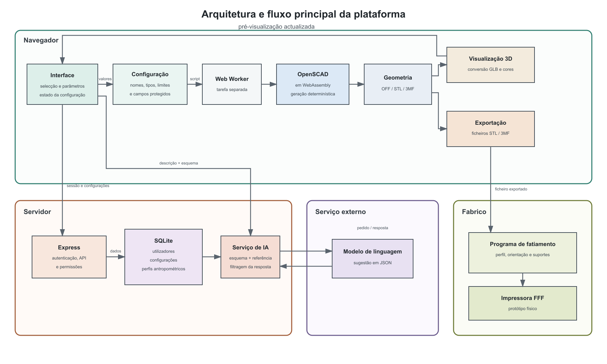

Figura 17 - Arquitetura da plataforma e fronteiras entre navegador, servidor, serviço externo de IA e preparação do fabrico.

Fonte: produção Pedro Candeias. (2026).

A Figura 18 complementa o diagrama de arquitetura com a sequência operacional do sistema, desde a interpretação do perfil até à geração da geometria. No servidor, o perfil do utilizador, ou a descrição introduzida, é associado a uma referência antropométrica, com base na qual a IA externa sugere valores iniciais condicionados pelo esquema do modelo. O servidor filtra a resposta, e a configuração apenas é aplicada após revisão humana. Em seguida, a geometria é gerada de forma determinística no OpenSCAD executado no navegador, permanecendo a exportação dependente de uma decisão posterior à pré-visualização.

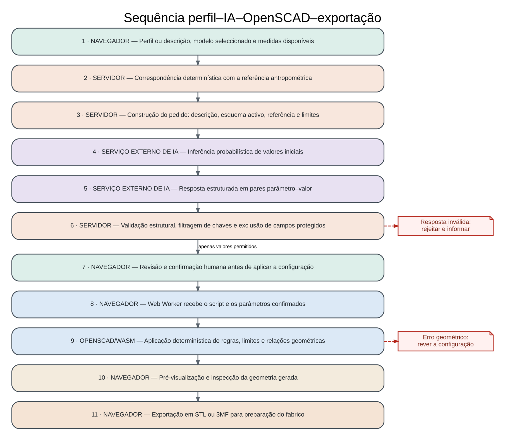

Figura 18 - Sequência de dados e decisões, desde o perfil ou descrição, até à sugestão, confirmação, geração determinística e exportação.

Fonte: produção Pedro Candeias. (2026).

A Tabela 19 identifica o estado técnico necessário para interpretar o artefacto sem transformar esta investigação numa descrição exaustiva da implementação. Os estados e componentes são registados por condicionarem a leitura dos ensaios.

Tabela 19 - Componentes, estados e limites do protótipo examinado.

|                          |                                                                                              |                                                                                     |                                                                                                                                                  |
|--------------------------|----------------------------------------------------------------------------------------------|-------------------------------------------------------------------------------------|--------------------------------------------------------------------------------------------------------------------------------------------------|
| **Elemento do percurso** | **Implementação e estado examinado**                                                         | **Função no processo de** ***design***                                              | ****Alcance da verificação****                                                                                                                   |
| Protótipo HandFab        | Estado final examinado; ensaios principais e complementares realizados em estados anteriores | Reunir configuração, pré-visualização, conservação de variantes e exportação        | A evolução do protótipo impede atribuir retroativamente funções novas aos ensaios anteriores                                                     |
| Interface no navegador   | Aplicação *web* com visualizador tridimensional                                              | Tornar visível a relação entre parâmetros, forma e decisão de exportar              | Chromium e Firefox produziram o mesmo resultado no caso comparado; WebKit permaneceu inconclusivo; não foi demonstrada compatibilidade universal |
| Geração geométrica       | OpenSCAD executado em *WebAssembly* num *Web Worker*                                         | Aplicar as relações paramétricas e produzir a geometria sem instalação local de CAD | O tempo e a conclusão dependem do modelo e dos recursos do equipamento                                                                           |
| Servidor e acesso        | Node.js 22.14.0, Express 4.18.3 e autenticação por perfis                                    | Guardar contas e configurações e intermediar os pedidos externos                    | O funcionamento foi examinado em casos delimitados                                                                                               |
| Dados guardados          | SQLite integrado no Node.js                                                                  | Conservar perfis, configurações e relações de atribuição                            | Adequado ao protótipo examinado                                                                                                                  |
| Serviço externo de IA    | Anthropic ou OpenAI, selecionável; claude-sonnet-4-6 nos ensaios                             | Sugerir valores iniciais condicionados pelo modelo ativo                            | Depende da disponibilidade externa e da qualidade do pedido; não gera nem aprova a geometria                                                     |

A distribuição da informação segue a mesma separação de responsabilidades. O navegador conserva o estado corrente da configuração, executa o modelo OpenSCAD e prepara a pré-visualização e os ficheiros para exportação. O servidor armazena contas, perfis e configurações e recebe também os pedidos de sugestão.

O fornecedor de IA recebe a descrição introduzida, o identificador e o esquema do modelo, os valores correntes e, quando exista, a referência populacional selecionada. Não recebe os ficheiros OpenSCAD, a malha gerada nem o ficheiro final de fabrico. Esta delimitação distingue as decisões locais das armazenadas no servidor e das dependentes de serviços externos, sem expor pormenores internos de integração irrelevantes para o objetivo da investigação.

Os estados de espera e de falha foram tratados como parte do percurso. Durante a produção, é apresentado um estado de processamento. Um novo pedido de pré-visualização termina o cálculo anterior, e cada geração ou exportação tem um limite temporal de 120 segundos. Uma falha da IA não impede a configuração manual; uma resposta inválida conserva o último estado válido; uma falha de geração impede a obtenção do ficheiro até existir nova geometria válida. Os ensaios complementares confirmaram a recuperação após uma falha de geração, mas revelaram também controlos incompletos de tipos e de valores fora do intervalo. Estes resultados são discutidos no Capítulo 8 e no Anexo B. Não foram executados ensaios de acessos simultâneos nem de desempenho sob carga.

A Figura 19 apresenta um precedente de arquitetura de produção personalizada que articula a digitalização, o processamento de dados, a adaptação CAD e o fabrico aditivo numa cadeia integrada de desenvolvimento e produção. No presente projeto, essa continuidade é transferida para uma plataforma *web* e para modelos OpenSCAD executados localmente (Górski et al., 2022).

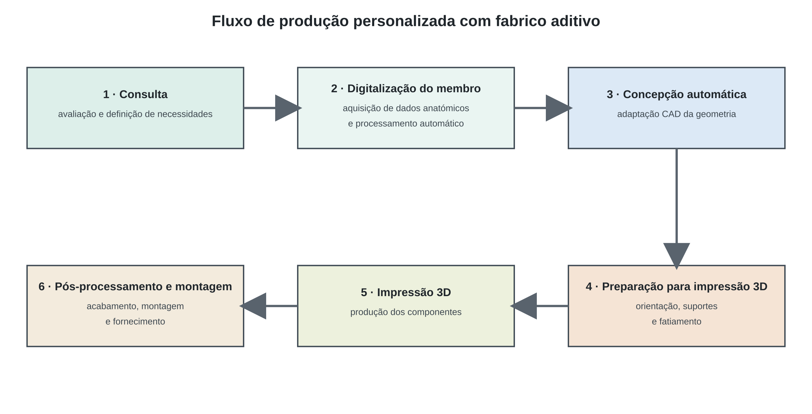

Figura 19 - Fluxo geral de produção personalizada de próteses a partir de digitalização, CAD adaptativo e fabrico aditivo.

Adaptado de (Górski et al., 2022) Automated design and rapid manufacturing of low-cost customized upper limb prostheses. Journal of Physics: Conference Series, 2198, 012040. https://doi.org/10.1088/1742-6596/2198/1/012040 - Licença: CC BY 3.0.

No navegador do utilizador, a aplicação integra os componentes responsáveis pela interface, pela recolha e edição de parâmetros, pela gestão do estado da sessão e pela visualização local dos modelos. No servidor, um serviço desenvolvido em Node.js, com recurso à infraestrutura Express.js, disponibiliza ficheiros estáticos, processa pedidos à interface de programação de aplicações (*Application Programming Interface* - API), autentica utilizadores, aplica permissões e comunica com a camada de persistência. Esta distribuição de responsabilidades evita a dependência de processamento remoto contínuo em todas as operações da interface e impede a exposição direta no cliente de tarefas sensíveis, como a gestão de utilizadores, o controlo de acessos e a comunicação com serviços externos. A arquitetura não se limita, portanto, a uma divisão técnica entre cliente e servidor: contém a complexidade e delimita explicitamente as responsabilidades.

A camada de persistência assenta numa base de dados *SQLite*, que armazena contas de utilizador, configurações guardadas, relações de atribuição técnica e *tokens* de autenticação. A escolha decorre do caráter de protótipo funcional que o sistema assume nesta fase da investigação e privilegia uma arquitetura tecnicamente contida, portátil e com manutenção acessível. As configurações paramétricas são armazenadas como estruturas *JSON* associadas a um modelo e a um utilizador, o que permite preservar diferentes instâncias, recuperá-las posteriormente e compará-las enquanto estados distintos do processo de projeto. A base de dados constitui o repositório administrativo e sustenta a continuidade do processo, a gestão prática de versões e o acompanhamento das variantes produzidas.

A arquitetura da solução transfere a renderização geométrica do servidor para o navegador, onde o cálculo e a geração da geometria tridimensional decorrem localmente por meio de uma versão do OpenSCAD compilada para *WebAssembly*, tecnologia que permite executar código de elevado desempenho em ambiente *web*. O processo é executado num *Web Worker*, ou seja, numa tarefa separada da interface principal, para que a geração do modelo não bloqueie a interação do utilizador com a plataforma. Esta opção reduz a carga computacional do servidor e a dependência de um serviço remoto de renderização, além de favorecer uma interação mais imediata durante a edição paramétrica. Mantém-se, contudo, uma fronteira clara: o servidor assegura a autenticação, o armazenamento, a gestão de configurações e a intermediação de chamadas a serviços de inteligência artificial, enquanto o cliente assume a computação geométrica intensiva. A arquitetura é, assim, híbrida: centraliza as funções de controlo e persistência, e distribui localmente a geração formal do modelo.

O controlo de acesso, baseado em autenticação por *JSON Web Token* (JWT), distingue os perfis de administrador, técnico e utilizador. Na presente investigação, estes mecanismos são relevantes como suporte da distribuição de papéis e da conservação das configurações, não como contributo autónomo para a segurança informática. Os ensaios confirmam a autenticação, as permissões e a recuperação de configurações nos casos documentados. A sua pertinência para o projeto consiste em impedir que todas as decisões e operações sejam apresentadas indistintamente a todos os perfis (Bai et al., 2024; Quintero et al., 2018).

## 5.3 Integração OpenSCAD via *WebAssembly* (WASM)

A integração do OpenSCAD por meio de *WebAssembly* permite executar localmente, no navegador, um modelo paramétrico baseado em código. A geometria é gerada no próprio ambiente do utilizador, sem depender de um servidor externo que calcule, ou devolva, o modelo tridimensional, sempre que os parâmetros são alterados. O OpenSCAD define a geometria a partir de instruções, parâmetros e relações explícitas, enquanto o *WebAssembly* (WASM) permite executar esse núcleo no ambiente *web*. Nesta investigação, esta articulação preserva a lógica do modelo e disponibiliza os seus controlos através da interface, sem demonstrar, por si só, acessibilidade ou facilidade de utilização (Machado et al., 2019; Nilsiam & Pearce, 2017).

Em termos operacionais, a integração articula três elementos: os ficheiros .scad, formato de *script* utilizado pelo OpenSCAD para definir modelos geométricos por código; os parâmetros introduzidos ou ajustados na interface; e o ambiente de execução em *WebAssembly*. Quando o utilizador altera uma configuração, a plataforma envia os valores atualizados para um *Web Worker*, que os aplica ao modelo em OpenSCAD e gera a geometria tridimensional correspondente. O resultado é devolvido ao visualizador no navegador, permitindo observar os efeitos das alterações sem recorrer a *software* CAD instalado localmente. Este fluxo liga diretamente a edição paramétrica, o cálculo geométrico e a resposta visual, permitindo documentar, verificar e analisar o processo na plataforma.

Do ponto de vista metodológico, esta solução preserva o estatuto do modelo paramétrico como especificação explícita, e não como caixa negra geométrica. A plataforma não substitui o OpenSCAD por uma representação simplificada desligada do código, mas torna o próprio núcleo algorítmico operável em ambiente *web*. A integração reduz ainda a distância entre modelação e interação, permitindo que a exploração formal decorra num contexto mais observável e iterativo. O utilizador não necessita de dominar a sintaxe do OpenSCAD para beneficiar da estrutura paramétrica do modelo, embora essa estrutura permaneça a base efetiva da geometria apresentada. A plataforma funciona, neste sentido, como camada intermédia entre a disciplina técnica do código e a experiência configurável descrita na literatura sobre configuradores e sistemas de personalização digital (Nilsiam & Pearce, 2017; Ozdemir et al., 2022).

O *Web Worker* separa o cálculo da tarefa principal da interface. Nos casos observados, esta opção manteve os controlos disponíveis durante a geração e permitiu terminar um cálculo anterior quando era iniciada uma nova pré-visualização. Não foram medidos os tempos percebidos nem a estabilidade em diferentes equipamentos. A geração permanece no navegador, enquanto o servidor assegura a autenticação, a persistência e a mediação com serviços externos.

No contexto da investigação, esta integração aproxima a modelação baseada em código da sua utilização numa plataforma *web*. A literatura sobre OpenSCAD sublinha a afinidade desta ferramenta com fluxos consistentes, configuradores digitais e partilha de modelos paramétricos em ambientes abertos, embora frequentemente fora de contextos protésicos e clínicos (Machado et al., 2019; Nilsiam & Pearce, 2017). No presente projeto, a adoção de WASM reúne, na mesma infraestrutura, a transparência do modelo paramétrico, o acompanhamento das interações e a atualização iterativa da geometria.

Esta solução implica um compromisso de projeto. O desempenho depende da complexidade do modelo, dos valores escolhidos e dos recursos do equipamento, o que pode prolongar a espera ou interromper a geração. O valor demonstrado não reside num desempenho superior ao do CAD instalado, mas na possibilidade de relacionar, no mesmo percurso, os parâmetros, a forma visualizada e a exportação a partir de um núcleo geométrico explícito.

A Figura 20 documenta a relação entre o código OpenSCAD apresentado na plataforma e a geometria tridimensional gerada a partir da configuração ativa.

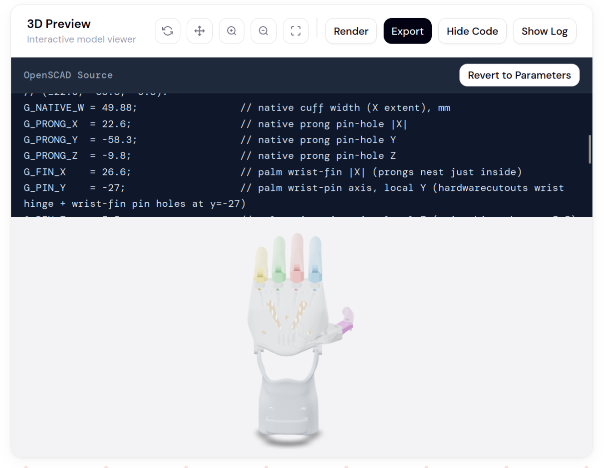

Figura 20 - Visualização do código OpenSCAD e da geometria correspondente na plataforma HandFab.

Fonte: produção Pedro Candeias. (2026).

## 5.4 Estrutura funcional da plataforma

A estrutura funcional da plataforma compreende módulos interligados que suportam o ciclo de configuração paramétrica: seleção do modelo, introdução e edição de parâmetros, visualização tridimensional, sugestões apoiadas por IA, gestão de configurações e administração multiutilizador. As funções distribuem-se segundo a sequência projetada para o processo, cuja clareza para diferentes perfis não foi avaliada com participantes.

Em vez de expor o utilizador a um ambiente indiferenciado de opções, a plataforma distribui o trabalho por etapas e componentes com funções distintas. Esta organização é coerente com a literatura sobre configuradores digitais, segundo a qual a eficácia da personalização depende, em grande medida, da clareza com que o sistema delimita o espaço de ação disponível e articula *o feedback* com a decisão (Ozdemir et al., 2022; Peixoto et al., 2025).

A Figura 21 apresenta um precedente particularmente próximo desta lógica: uma ferramenta paramétrica dirigida a terapeutas ocupacionais, na qual se podem configurar múltiplas variantes de produto através do ajustamento de dimensões, materiais e pesos. A sua pertinência para esta investigação decorre da demonstração de que a parametrização ganha valor quando mediada por uma interface destinada a profissionais que não são necessariamente especialistas em modelação CAD.

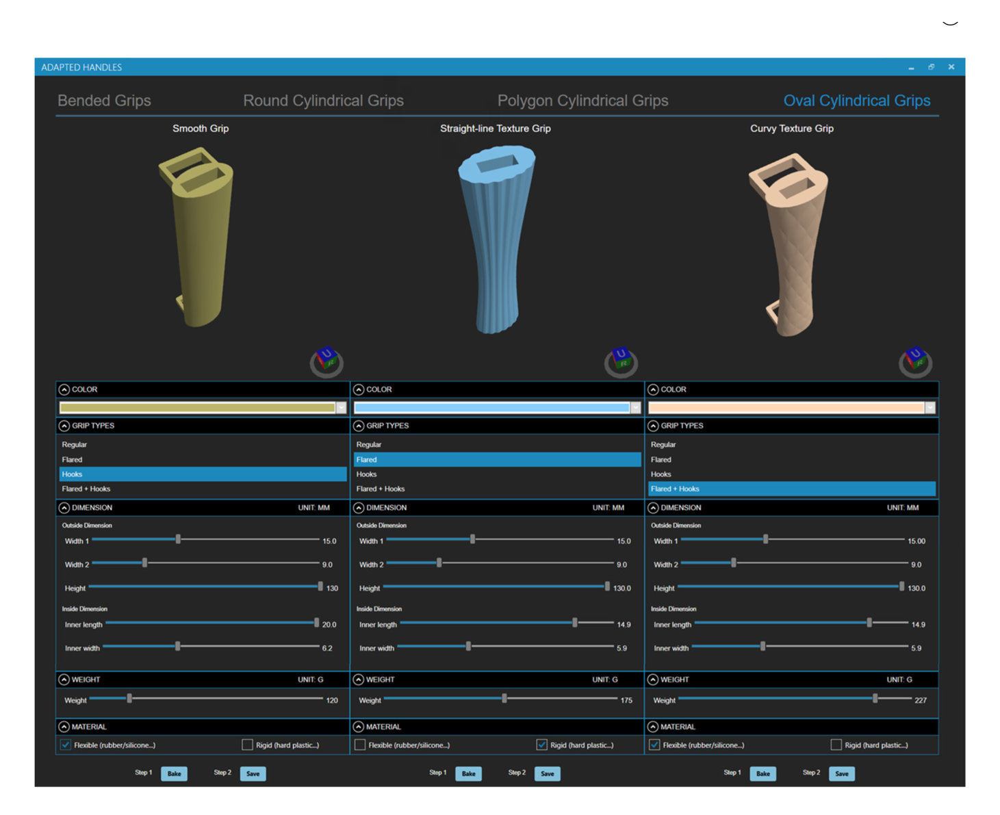

Figura 21 - Ferramenta paramétrica para configuração de ajudas técnicas com variação de dimensões, materiais e peso.

Reproduzido de (Li & Aflatoony, 2025) Parametric design and three-dimensional printing: Enabling occupational therapists to develop custom hand grips. Disability and Rehabilitation: Assistive Technology, 20(6), 1829-1837. https://doi.org/10.1080/17483107.2025.2483953

As vistas da Figura 22 documentam a seleção do modelo e os diferentes grupos de controlos disponibilizados pela interface de configuração.

|                                                                                                                  |                                                                                                                  |
|------------------------------------------------------------------------------------------------------------------|------------------------------------------------------------------------------------------------------------------|
| 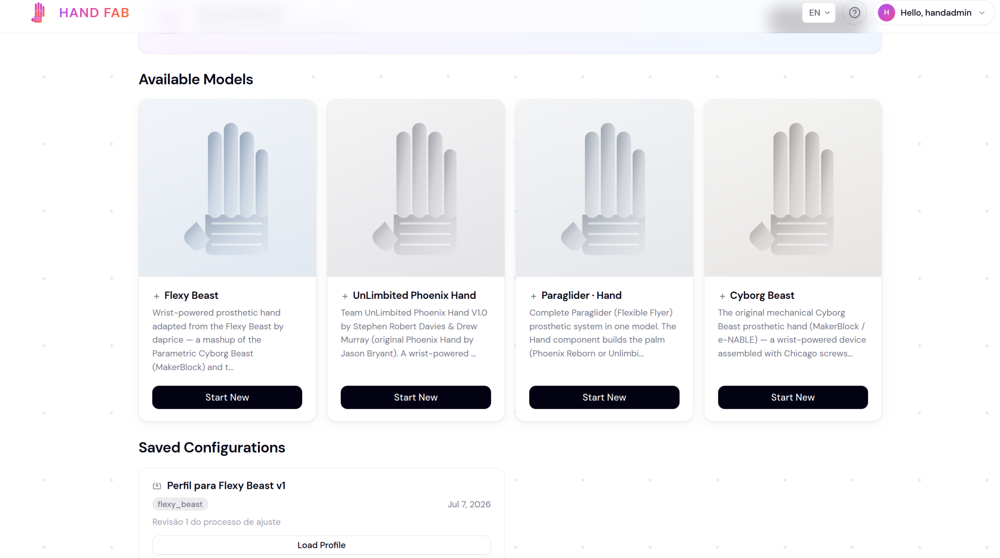 | 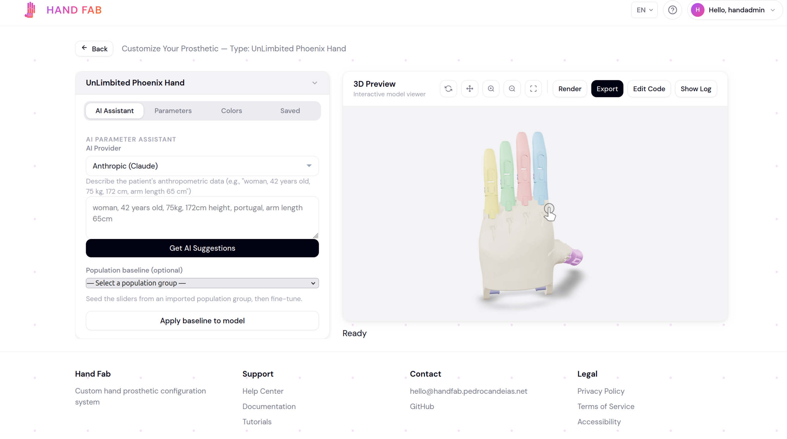 |
| 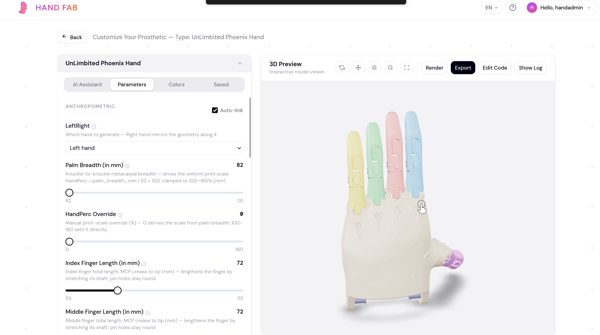 | 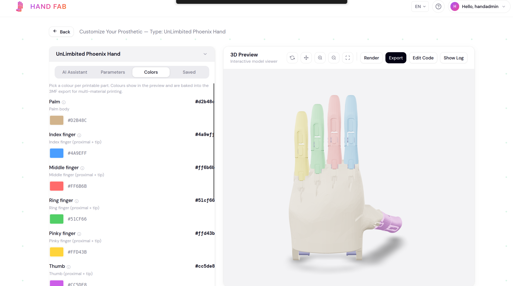 |

Figura 22 - Interface de seleção, configuração paramétrica e materiais da plataforma HandFab.

Fonte: produção Pedro Candeias. (2026).

O módulo de seleção de modelos constitui o ponto de entrada do sistema. Cada modelo é descrito por um ficheiro de configuração que inclui o identificador, a descrição, o ficheiro OpenSCAD associado e a lista de parâmetros editáveis. Com base nessa estrutura, a interface gera os controlos correspondentes, como campos numéricos, seletores, caixas de seleção e campos de texto. Esta opção permite acomodar famílias distintas sem exigir o desenho manual de um ecrã exclusivo para cada modelo. Funcionalmente, o módulo converte a biblioteca e os respetivos parâmetros num conjunto visível de decisões de configuração.

O núcleo operativo da plataforma reside na articulação entre o módulo de edição paramétrica e o módulo de visualização 3D. Quando os parâmetros são alterados, o sistema recompõe o código, aciona a renderização local e apresenta ao utilizador a geometria atualizada. Esta ligação direta entre edição e pré-visualização é funcionalmente decisiva, pois permite observar de imediato as consequências formais da manipulação de variáveis abstratas. As funções de reposição dos valores por defeito, atualização incremental e exportação de ficheiros STL ou 3MF estendem esta utilidade para além da experimentação visual e aproximam a plataforma de um ambiente de prototipagem e preparação para fabrico. A literatura sobre interfaces de configuração em contexto protésico sugere que a legibilidade do processo melhora quando o utilizador consegue relacionar a ação, a consequência geométrica e a possibilidade de validação no mesmo circuito de interação (Peixoto et al., 2025; Quintero et al., 2018).

Sobre esta base funciona o módulo de apoio por inteligência artificial, que acrescenta uma camada de mediação sem substituir a lógica principal da configuração. A partir de uma descrição livre do utilizador ou de medidas antropométricas parciais, a interface constrói dinamicamente um pedido que inclui o esquema atual do modelo selecionado: nomes dos parâmetros, legendas, tipos, limites mínimos e máximos e valores correntes. O pedido é enviado ao servidor através de uma rota autenticada, que serve de intermediário entre a plataforma e o serviço externo de IA. A resposta esperada consiste num objeto JSON simples, composto apenas por pares parâmetro-valor. A aplicação aceita exclusivamente chaves existentes no esquema, descarta parâmetros desconhecidos e aplica os valores resultantes aos controlos antes de acionar uma nova renderização em OpenSCAD/*WebAssembly*.

Esta arquitetura corrige uma fragilidade de um estado anterior, no qual o pedido à IA permanecia associado a um modelo já removido e podia devolver nomes de parâmetros inexistentes. Ao condicionar a sugestão ao esquema atual, a IA passa a operar sobre os mesmos campos usados pela interface e pelo modelo OpenSCAD. O módulo propõe apenas um ponto de partida editável: a IA permanece um apoio sob controlo humano e não gera autonomamente a prótese.

A evolução posterior do módulo acrescentou uma referência opcional baseada em dados populacionais. Quando a interface envia a descrição do utilizador e o identificador do modelo, o servidor procura o perfil antropométrico populacional com a melhor pontuação segundo o sexo, a idade aproximada e o país, projetando depois as médias desse perfil nos parâmetros disponíveis no modelo ativo. O bloco de referência é anexado ao pedido enviado à IA, orientando a sugestão sem se sobrepor às medições fornecidas pelo utilizador. Esta solução articula três formas de introdução de dados: a seleção manual de um perfil populacional, a importação de perfis antropométricos e a sugestão apoiada por IA.

As Figuras 23 e 24 documentam esta componente. A primeira apresenta a lista de perfis antropométricos populacionais e os campos utilizados para os filtrar, importar, editar ou eliminar. A segunda mostra a estrutura destinada à adição ou edição de um perfil, distinguindo a identificação do conjunto de dados, as medidas da mão e as medidas do membro residual. Estas vistas documentam as funções disponíveis no protótipo, mas não demonstram a qualidade nem a representatividade dos dados importados.

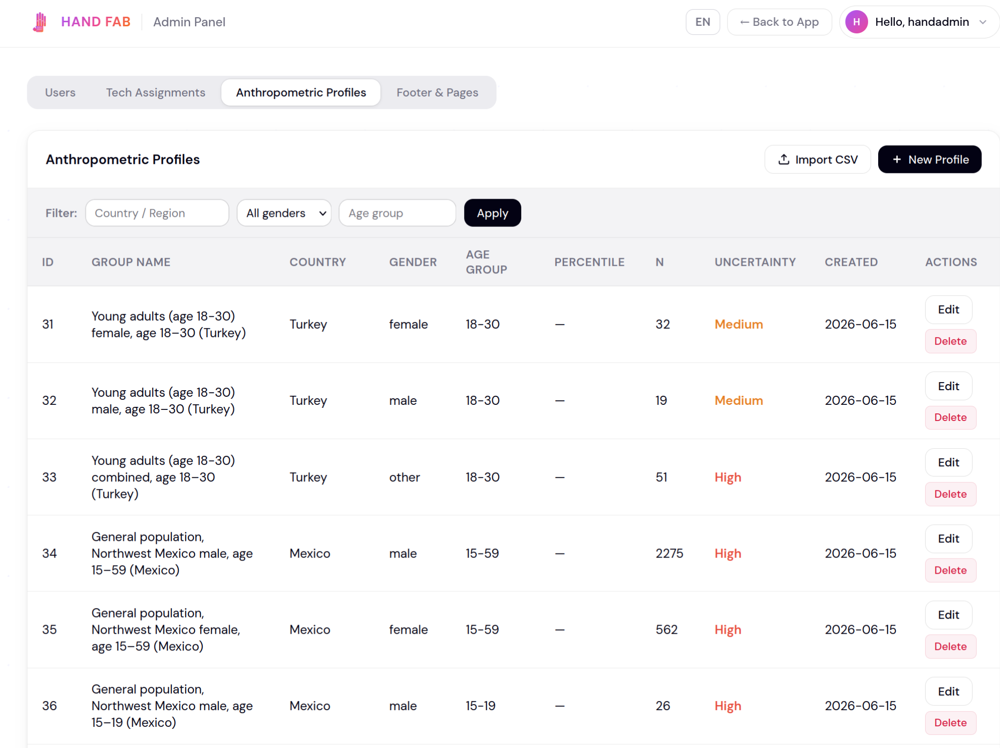

Figura 23 - Perfis antropométricos populacionais disponíveis na plataforma HandFab.

Fonte: produção Pedro Candeias. (2026).

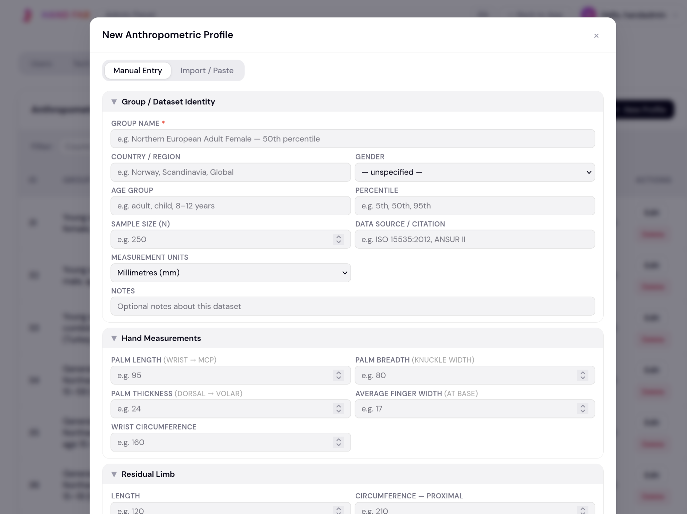

Figura 24 - Campos de identificação, contexto e medição para adição ou edição de perfis antropométricos na plataforma HandFab.

Fonte: produção Pedro Candeias. (2026)

O módulo de gestão de configurações permite nomear, guardar, recuperar, atualizar e eliminar instâncias, uma possibilidade particularmente relevante num processo iterativo em que diferentes variantes podem corresponder a hipóteses sucessivas ou a estados finais. A configuração deixa, assim, de constituir um ato momentâneo e passa a integrar uma sequência acumulativa, na qual diferentes estados podem ser recuperados e comparados. Este módulo fornece, portanto, a estrutura funcional necessária para acompanhar o processo ao longo do tempo.

O módulo administrativo suporta a criação de contas de utilizador, a diferenciação de permissões e a atribuição de utilizadores a técnicos, permitindo representar diferentes níveis de intervenção no protótipo. Os resultados funcionais disponíveis são discutidos no subcapítulo 8.1 e no Anexo B.

A biblioteca reúne quatro famílias integradas na plataforma, cada uma com parâmetros, dependências, limites e modos de visualização próprios: Flexy Beast, UnLimbited Phoenix Hand, Paraglider Hand e Cyborg Beast. Os ensaios dimensionais comparativos abrangem os três primeiros; o Cyborg Beast foi integrado posteriormente e não está incluído nas séries comparativas.

Tabela 20 - Modelos integrados na plataforma e respetiva avaliação.

|                           |                                                                                                            |                                                                              |                                                               |                                                                                                           |
|---------------------------|------------------------------------------------------------------------------------------------------------|------------------------------------------------------------------------------|---------------------------------------------------------------|-----------------------------------------------------------------------------------------------------------|
| Modelo                    | Origem e licença                                                                                           | Parâmetros configuráveis                                                     | Mecanismo de escala implementado                              | Ensaios e evidência no estudo                                                                             |
| Flexy Beast               | Adaptação do Flexy-Beast de Daprice, combinação do Parametric Cyborg Beast e do Flexy Hand; CC BY-SA 4.0,  | 51 declarações; 15 numéricas: palma, dedos, articulações, braçadeira e pinos | (largura da palma + 5) / 55; dedos independentes              | Dimensional, IA, exportação, malha, ficheiro de preparação para a Bambu Lab A1, Prusa Mini e série física |
| Paraglider/Flexible Flyer | M. Mendenhall (2020), CC BY-SA 4.0; dependências CC BY 3.0 e CC BY-NC-SA 4.0                               | 42 declarações; 15 numéricas: palma, dedos, canais e braço                   | Palma uniforme para preservar furos; dedos independentes      | Dimensional, IA, exportação, malha, ficheiro de preparação para Bambu Lab A1, Prusa MINI e série física   |
| UnLimbited Phoenix V1.0   | UnLimbited/e-NABLE; CC BY-NC-SA 4.0                                                                        | 31 declarações; 12 numéricas: palma, escala e segmentos digitais             | Referência de 82 mm; escala uniforme limitada a 100%-160%     | Dimensional, IA, exportação, malha e ficheiro de preparação para a Bambu Lab A1                           |
| Cyborg Beast              | MakerBlock/e-NABLE; CC BY-NC-SA 3.0                                                                        | 50 declarações; 17 numéricas: palma, dedos, punho, braçadeira e pino         | (largura da palma + 5) / 55; segmentos digitais independentes | Integração e renderização; excluído da comparação e das séries físicas                                    |

Na documentação original, o Flexy Beast é descrito como uma combinação do Parametric Cyborg Beast, de MakerBlock, com o Flexy Hand, de Steve Wood/Gyrobot. Deste último, herda as juntas flexíveis que substituem os parafusos e os elásticos de retorno presentes em modelos anteriores. A fonte recomenda Filaflex ou silicone moldado para essas juntas e prevê almofadas removíveis de silicone nos dedos para aumentar a aderência. A arquitetura material combina, assim, componentes estruturais rígidos com elementos flexíveis funcionalmente diferenciados.

As contagens da Tabela 20 correspondem às entradas registadas nos catálogos de modelos da versão da plataforma utilizada nos ensaios principais. O total inclui seletores, opções de visualização e controlos não geométricos; a contagem numérica identifica os campos do tipo number, sem pressupor que todos correspondam a medidas antropométricas.

A integração consistiu na tradução de cada modelo para uma interface comum de parâmetros, preservando as restrições mecânicas específicas. A presença de um modelo na plataforma confirma a sua integração técnica.

No caso do modelo Paraglider Hand, também conhecido como Flexible Flyer, a integração partiu de uma mão mecânica acionada pelo corpo, derivada da linhagem Phoenix e UnLimbited. O principal desafio consistiu em alinhar a lógica original do modelo com os nomes canónicos usados pelo sistema. A largura metacarpal passou a controlar a palma, enquanto os dedos foram associados a comprimentos digitais independentes, dado que a largura da palma e o comprimento dos dedos não variam necessariamente na mesma proporção. A palma teve, porém, de manter um escalonamento uniforme, uma vez que os furos cilíndricos para pinos metálicos não podem ser deformados em elipses sem comprometer a montagem. Por esse motivo, certas medidas, como o comprimento e a espessura da palma, foram mantidas como informação contextual para a IA e para o perfil antropométrico, mas não foram usadas como transformações geométricas ativas nesse modelo.

A integração do Paraglider revelou limitações práticas da execução de OpenSCAD em *WebAssembly*. Alguns ficheiros originais recorriam a construções sintáticas não suportadas pela versão compilada para navegador, o que impediu a definição de módulos durante a renderização. Foi necessário manter cópias corrigidas dos ficheiros, preservar a origem do modelo e controlar explicitamente as dependências carregadas no sistema virtual de ficheiros do navegador. A compatibilidade *web* depende, portanto, tanto da qualidade geométrica do modelo como da organização das bibliotecas, dos ficheiros importados e das variantes de sintaxe no fluxo digital.

O trabalho realizado sobre modelos do tipo Cyborg Beast/Flexy Hand teve uma função complementar. Estes modelos serviram de base exploratória ao teste de uma reparametrização mais ampla, na qual a geometria original foi reorganizada em torno de medidas antropométricas da palma, dos dedos, do punho e do membro residual. A versão antropométrica resultante não foi tratada como uma simples escala global: incorporou comprimentos digitais, espessuras estruturais, canais internos, parâmetros de *hardware* e dimensões de encaixe derivadas de medidas do antebraço. Esta experiência clarificou a diferença entre adaptar um modelo existente mediante multiplicadores gerais e reconstruir a sua lógica dimensional em torno de uma estrutura antropométrica coerente. Embora determinados modelos tenham permanecido como material de desenvolvimento e comparação, contribuíram para estabilizar a taxonomia de parâmetros que a plataforma passou a exigir aos modelos ativos.

Estes casos mostram que a expansão da plataforma depende menos da quantidade de modelos disponíveis do que da existência de uma gramática comum de integração. A integração de cada nova prótese no sistema exige identificar os parâmetros antropométricos relevantes, determinar quais podem alterar a geometria sem quebrar interfaces mecânicas e declarar essas relações de forma compreensível para a interface, o módulo de visualização tridimensional e a camada de IA. A biblioteca de modelos constitui, assim, um campo de validação técnica da própria arquitetura: a heterogeneidade dos modelos integrados torna mais clara a necessidade de separar dados antropométricos, regras geométricas, restrições de fabrico e sugestões apoiadas.

## 5.5 Gestão de parâmetros, versões e expansão

O controlo dos parâmetros é uma condição central para transformar um modelo paramétrico num sistema configurável e persistente. Os ficheiros de configuração descrevem cada parâmetro pelo nome, tipo, valor inicial, limites, incrementos e grupo temático, ligando o código OpenSCAD ao espaço de alteração apresentado na interface. Metodologicamente, esta estrutura aproxima-se da lógica dos configuradores e da personalização em massa, nos quais uma arquitetura de base integra características variáveis e informação sobre o modo como podem ser modificadas (Ozdemir et al., 2022).

A descrição dos parâmetros em estruturas independentes do código geométrico principal permite identificar as variáveis editáveis, os seus intervalos e a sua articulação com a interface. Permite também adaptar os parâmetros à estrutura do sistema, adicionando-os, removendo-os ou ajustando-os sem reescrever toda a lógica de interação. A gestão de parâmetros funciona como uma camada intermédia entre a definição geométrica e a experiência de uso, mantendo o modelo tecnicamente explícito sem exigir contacto direto com a sintaxe interna.

Neste estágio do projeto, a gestão de versões concretiza-se sobretudo no armazenamento de configurações. A plataforma conserva diferentes conjuntos de parâmetros associados ao mesmo modelo, com identificação, notas descritivas e associação a um utilizador. Embora seja mais simples do que os sistemas completos de gestão de versões usados no desenvolvimento de *software*, esta solução permite acompanhar a configuração ao longo do tempo, preservar variantes e comparar estados sucessivos. Cada configuração registada constitui uma instância documentada do processo, passível de recuperação e comparação, o que se torna relevante quando a configuração resulta de uma sequência de aproximações, testes e correções.

A persistência destas configurações em estruturas JSON associadas a modelos e utilizadores assegura a continuidade entre interação, revisão e reutilização. A configuração deixa de estar limitada ao estado temporário da sessão, uma vez que o sistema preserva um registo das configurações realizadas. Torna-se, assim, possível retomar soluções anteriores, documentar alternativas exploradas e preparar comparações futuras entre versões. Coerente com o carácter experimental da plataforma, esta forma prática de gestão de versões ainda não pretende substituir mecanismos mais sofisticados de gestão de revisões, mas fornece uma base suficiente para acompanhar iterativamente o desenvolvimento e analisar de forma reflexiva o processo.

Quanto à expansão, a separação entre modelos, parâmetros, interface, autenticação e persistência permite acrescentar modelos OpenSCAD sem redesenhar todo o percurso. Nos sistemas de personalização, a arquitetura de base deve identificar as características variáveis e o modo como podem ser modificadas; os parâmetros, as respetivas dependências e os constrangimentos delimitam depois o espaço de soluções válidas (Ozdemir et al., 2022). Na plataforma HandFab, a integração do Paraglider, do UnLimbited Phoenix, do Flexy Beast e do Cyborg Beast demonstrou que é necessário declarar parâmetros, limites, dependências e modos de visualização e, em alguns casos, corrigir incompatibilidades ou preservar interfaces mecânicas herdadas. A expansão correspondeu a uma adaptação de *design* controlada, na qual a lógica geométrica e mecânica de cada modelo foi traduzida para a arquitetura configurável da plataforma, e não a uma importação automática de geometrias.

Esta lógica continua limitada pelas condições do protótipo. A persistência em SQLite não foi ensaiada em condições de utilização intensiva ou de acessos simultâneos, e a geração local depende dos recursos do equipamento e da complexidade geométrica. A integração de novas funções e modelos exige, por isso, uma nova verificação do percurso, dos limites apresentados e dos ficheiros exportados.

O contributo deste capítulo reside no desenho de um percurso integrado entre dados, configuração, visualização e preparação para fabrico. A arquitetura torna explícito onde cada transformação ocorre e permite conservar variantes do processo. Os ensaios sustentam o funcionamento técnico nas condições documentadas; não demonstram prontidão de produto, facilidade de utilização, redução de carga cognitiva, segurança clínica ou funcionamento em escala.

# Capítulo 6 - Integração da Inteligência Artificial

## 6.1 Papel da IA no sistema proposto

No sistema desenvolvido, a IA desempenha uma função distinta da predominante nos estudos sobre próteses de membro superior. Em vez de interpretar biosinais, reconhecer gestos ou controlar o dispositivo, o modelo de linguagem sugere valores iniciais para uma configuração geométrica já formalizada (Cordella et al., 2016; Marinelli et al., 2023; Peerdeman et al., 2011).

Esta aplicação responde à fragmentação entre referências antropométricas, modelos paramétricos e interfaces de configuração. A plataforma reúne estes componentes, mas não atribui à IA a geração da geometria, a seleção autónoma do dispositivo ou a validação do resultado. Os precedentes de modelação ajustável e os métodos orientados por dados sustentam esta articulação, sem constituírem equivalentes diretos do sistema implementado (Gu et al., 2024; Romero et al., 2025b; Saldarriaga et al., 2024).

O fluxo compreende três camadas. A camada determinística identifica a idade e o sexo quando explicitamente descritos, procura uma referência populacional disponível, seleciona o esquema do modelo ativo e preserva decisões fixadas na interface, como a lateralidade. Na camada probabilística, o modelo de linguagem recebe a descrição textual e o contexto paramétrico e propõe valores para os campos autorizados. A última camada interpreta o objeto JSON, confronta os campos com o modelo selecionado, apresenta os valores na interface e permite revê-los antes da geração geométrica.

A IA não produz a geometria. Após a aceitação ou correção da configuração, o OpenSCAD executa relações geométricas previamente codificadas e gera a forma correspondente. Esta separação permite identificar a origem de cada decisão: os dados e as regras definem o espaço de configuração, a IA propõe um ponto de partida e o designer ou técnico decide se a proposta deve ser mantida, alterada ou rejeitada.

Os testes complementares mostraram que a terceira camada ainda não aplica uniformemente todas as restrições. A lateralidade permaneceu protegida, mas foi detetado um valor numérico acima do intervalo sem que se impedisse a sua passagem para o estado interno da aplicação. Neste capítulo, os limites declarados são, por isso, tratados como restrições pretendidas e parcialmente verificadas, não como garantia integral. A discussão ética geral permanece no subcapítulo 2.6; o presente capítulo aborda a concretização desses princípios e os limites observados.

## 6.2 IA na parametrização, personalização e apoio à decisão

À luz das distinções estabelecidas nos Capítulos 2 e 4, a personalização apoiada por IA não corresponde a uma variação livre da forma. No protótipo, consiste na proposta de valores para parâmetros previamente definidos, com relações geométricas, intervalos e campos protegidos. A independência entre as dimensões dos dedos e a insuficiência do escalonamento uniforme fundamentam o espaço paramétrico; não constituem decisões do modelo de linguagem (Lim et al., 2018; Romero et al., 2025b; Saldarriaga et al., 2024).

Esta lógica é operacionalizada em dois objetos distintos. O primeiro consiste num vetor numérico de parâmetros geométricos, consumido diretamente pela interface e pelos modelos OpenSCAD. O segundo fornece à IA um contexto semântico que descreve a origem das medições, os campos em falta, a incerteza, os valores atípicos, as tolerâncias, os componentes de montagem selecionados e as notas sobre parâmetros derivados. Esta separação evita confundir o cálculo geométrico com o raciocínio apoiado: os parâmetros numéricos alimentam o modelo, enquanto o contexto semântico ajuda a IA a explicar, ponderar ou sugerir ajustes, sem substituir as regras determinísticas que geram a geometria.

No protótipo implementado, esta separação concretiza-se na construção dinâmica do pedido enviado ao modelo de linguagem. O pedido inclui a descrição livre do utilizador, o esquema do modelo selecionado, os nomes exatos dos parâmetros, as respetivas legendas, os tipos de dados, os limites declarados e os valores correntes. Quando existe correspondência com um perfil populacional importado, são também incluídas, como referência explícita, as médias desse grupo. Determina-se ainda que a resposta contenha apenas um objeto JSON, sem texto adicional, e excluem-se os campos de lateralidade e cor.

As legendas influenciam a sugestão ao explicarem ao modelo de linguagem a função de cada parâmetro. Nos parâmetros antropométricos, identificam a medida e a unidade. Nos componentes mecânicos, como folgas, diâmetros ou elementos de montagem, uma sugestão só tem fundamento determinístico se existir uma regra codificada. Na ausência dessa regra, o valor resulta do intervalo, da legenda, do valor corrente e da inferência do modelo de linguagem, devendo ser entendido como uma proposta inicial sujeita a confirmação técnica, e não como um cálculo de engenharia.

A correspondência com os perfis populacionais obedece também a uma regra explícita. O sistema atribui maior peso à coincidência de sexo e grupo etário, considerando ainda a proximidade da idade e, quando existe no texto, a referência ao país. A presença de medidas da mão e de estatísticas centrais constitui um critério secundário. Um perfil só é selecionado quando se atinge a pontuação mínima; caso contrário, o pedido é enviado sem referência populacional e a sugestão é assinalada como não apoiada por essa base. Mesmo quando há correspondência, os dados populacionais são uma aproximação e não substituem medidas individuais.

Neste enquadramento, a IA pode interpretar descrições incompletas, propor valores iniciais para campos autorizados e preencher lacunas com o apoio das referências disponíveis. Não pode escolher autonomamente o modelo protésico, definir a lateralidade, ultrapassar deliberadamente os limites do modelo, confirmar a adequação anatómica ou clínica, gerar a forma final, nem aprovar a exportação ou o fabrico. Estas decisões continuam a depender das regras do sistema e da intervenção humana.

Nesta investigação, a designação «modelo» tem dois sentidos técnicos distintos: o modelo de linguagem responsável pela sugestão paramétrica e o modelo CAD paramétrico ao qual essa sugestão é aplicada. Para evitar ambiguidade metodológica, a Tabela 21 explicita a configuração de IA efetivamente implementada no protótipo e a sua relação com os modelos paramétricos disponibilizados na plataforma.

Tabela 21 - Especificação técnica dos modelos de IA e da estrutura da sugestão paramétrica.

|                                                 |                                                                                                                                                                                                                                              |
|-------------------------------------------------|----------------------------------------------------------------------------------------------------------------------------------------------------------------------------------------------------------------------------------------------|
| **Elemento**                                    | **Especificação no protótipo**                                                                                                                                                                                                               |
| Função da IA                                    | Sugestão inicial de parâmetros antropométricos e geométricos a partir de descrições em linguagem natural; não gera autonomamente a geometria final nem valida clinicamente a prótese.                                                        |
| Ponto de integração                             | POST /api/ai/suggest, através de chamada autenticada e limitada por frequência, com as chaves de API mantidas no servidor.                                                                                                                   |
| Fornecedor e modelo usados na avaliação inicial | Anthropic, com o modelo claude-sonnet-4-6, definido como opção predefinida no servidor do protótipo.                                                                                                                                         |
| Modelo alternativo disponibilizado              | OpenAI, com o modelo gpt-4, acessível através do mesmo percurso de sugestão paramétrica.                                                                                                                                                     |
| Seleção do fornecedor                           | A interface permite escolher entre Anthropic (Claude) e OpenAI (GPT-4); o pedido enviado ao servidor identifica o fornecedor.                                                                                                                |
| Condições da chamada avaliada                   | Resposta limitada a 1024 *tokens*; o código não fixa a temperatura na chamada ao claude-sonnet-4-6, pelo que fica em vigor a configuração do fornecedor. O percurso OpenAI fixa a temperatura em 0,7, mas não integra a avaliação reportada. |
| Estrutura da resposta                           | Objeto JSON simples no formato parâmetro-valor. A lateralidade é ignorada e os campos desconhecidos não são aplicados. Os testes revelaram que a verificação de tipos e intervalos ainda não é uniforme em todos os percursos de submissão.  |
| Enquadramento dos dados                         | O pedido inclui o esquema do modelo, limites mínimos e máximos, valores correntes, legendas dos parâmetros e, quando disponível, médias de perfis antropométricos populacionais.                                                             |
| Estados examinados                              | A avaliação inicial incidiu sobre o estado usado nos ensaios principais. A série complementar de controlo da interface e dos dados submetidos foi executada num estado posterior.                                                            |
| Modelos CAD abrangidos                          | Flexy Beast, Paraglider Hand, UnLimbited Phoenix e Cyborg Beast estavam registados; a avaliação dimensional e de geração repetida abrangeu os três primeiros.                                                                                |

Neste estudo, «apoio à decisão» tem um alcance operacional restrito: produzir uma configuração inicial editável e explicitar os dados considerados. Não foi implementada qualquer função objetivo nem uma comparação automática da robustez, do peso, da montagem ou da adequação anatómica. O processo é, por isso, designado como sugestão inicial condicionada, e não como otimização. Os valores são aceites, corrigidos ou rejeitados fora do modelo de linguagem, antes da geração e da exportação da geometria.

## 6.3 Avaliação das sugestões paramétricas apoiadas por IA

A avaliação desta componente verifica a coerência das sugestões perante o esquema e os intervalos de referência adotados. O termo «antropométrica» descreve a origem dos campos e das referências, mas não implica a confirmação anatómica individual. Os resultados são apresentados no Capítulo 8; este subcapítulo permanece dedicado ao protocolo.

A avaliação utilizou o fornecedor Anthropic e o modelo claude-sonnet-4-6. A resposta estava limitada a 1024 *tokens* e o código não fixava a temperatura. O pedido incluía a descrição do cenário, o identificador do modelo, os nomes exatos dos parâmetros, os respetivos tipos, limites e valores correntes, etiquetas explicativas e, quando existia correspondência, uma referência populacional. Exigia ainda um objeto JSON com pares parâmetro-valor. Foram conservados o modelo utilizado, as condições da chamada, as descrições submetidas, as respostas e as decisões de correção relevantes.

Foram utilizados cinco perfis baseados em indicadores demográficos e três cenários de ausência unilateral com diferentes níveis de detalhe: medidas completas da mão contralateral, uma medida direta e uma descrição demográfica. Uma bateria complementar reuniu 15 cenários construídos a partir de descrições vagas, comparativas, multilingues ou sem medidas. Para examinar a lateralidade, foram também arquivadas 12 execuções anteriores à correção, correspondentes a pedidos de mão esquerda e direita repetidos quatro vezes. Os cenários representam descrições hipotéticas suscetíveis de serem submetidas ao sistema.

Os critérios foram a interpretação do JSON, a pertença das chaves ao esquema, a inclusão dos valores nos intervalos, a preservação das medidas fornecidas, a ordem relativa dos dedos definida no protocolo, a diferenciação da resposta em função da idade e do sexo quando a base continha uma referência compatível e a propagação dos valores para a geometria. Países ausentes da base, como Brasil, Japão e Alemanha, foram usados para testar a resposta a uma cobertura incompleta. Nestes casos, o país não sustenta uma correspondência nacional: o mecanismo seleciona o perfil disponível com a melhor pontuação noutros atributos ou prossegue sem referência quando não é atingida a pontuação mínima.

Numa série complementar de ensaios, foram utilizadas respostas de IA simuladas e previamente controladas. Como não contactou um modelo de linguagem, esta série não mede a variação, a consistência entre repetições nem a precisão da IA. Permitiu observar o comportamento da plataforma perante uma resposta válida, JSON inválido, campos de lateralidade, valores fora do intervalo e uma nova tentativa após erro. A lateralidade foi preservada e uma resposta inválida não alterou o último estado válido. Em contrapartida, o ensaio detetou um valor acima do máximo, mas este permaneceu no estado interno; através de um pedido direto, foi também aceite texto num campo definido como numérico. Estes dois casos são registados como fragilidades de controlo, e não como respostas válidas.

A cadeia inclui operações determinísticas e uma operação gerada por um modelo de linguagem, conforme sintetizado na Tabela 22.

Tabela 22 - Distribuição de tarefas entre regras, IA e supervisão humana.

|                                              |                                                                                                              |                                                                                                                   |
|----------------------------------------------|--------------------------------------------------------------------------------------------------------------|-------------------------------------------------------------------------------------------------------------------|
| **Tarefa**                                   | **Mecanismo**                                                                                                | **Resultado**                                                                                                     |
| Identificar sexo e idade explícitos          | Analisador de texto e, quando faltam campos, extração opcional por claude-haiku-4-5-20251001 a temperatura 0 | Atributos para procurar uma referência populacional                                                               |
| Escolher o perfil disponível mais próximo    | Pontuação por sexo, grupo etário, idade e país, com critérios secundários de qualidade                       | Referência quantitativa; não corresponde a diagnóstico nem a correspondência nacional garantida                   |
| Sugerir campos em falta                      | claude-sonnet-4-6                                                                                            | Ponto de partida sujeito a alterações entre execuções                                                             |
| Declarar tipos e limites                     | Ficheiro de configuração do modelo                                                                           | Intervalos e tipos disponíveis para a interface, para o pedido e para a verificação                               |
| Verificar a resposta antes da aplicação      | Interpretação do *JSON* e confronto com o modelo ativo                                                       | Campos desconhecidos e lateralidade excluídos; controlo de tipos e intervalos ainda incompleto no estado avaliado |
| Definir lateralidade                         | Controlo da interface com a função laterality                                                                | Escolha fixa excluída das sugestões                                                                               |
| Gerar a geometria                            | Regras OpenSCAD executadas em *WebAssembly*                                                                  | Forma determinística para um mesmo conjunto de parâmetros e estado do código                                      |
| Aceitar, corrigir ou rejeitar a configuração | Designer ou técnico responsável                                                                              | Decisão humana antes da exportação e de qualquer utilização posterior                                             |

O protocolo não mede a exatidão clínica da IA, pois não existe uma referência individual para cada cenário. Também não compara fornecedores, modelos de linguagem, temperaturas ou estratégias de pedido. Uma vez que utilizou respostas simuladas, a série complementar de ensaios também não permite retirar conclusões sobre a estabilidade do claude-sonnet-4-6. A interpretação restringe-se ao comportamento observado nas execuções iniciais e à resposta da plataforma nos casos de controlo documentados. Os resultados consolidados são apresentados no Capítulo 8, e a matriz integral de casos consta do Anexo B.

## 6.4 Ajuste, verificação e limitações éticas e técnicas

Na interpretação das saídas do sistema, distinguem-se três estados: a sugestão produzida pelo modelo de linguagem, a configuração aceite ou corrigida na interface e o resultado submetido a verificação geométrica e de fabrico. A passagem entre estes estados não demonstra ajuste anatómico, conforto, segurança estrutural ou validade clínica.

Entre os riscos técnicos relevantes encontram-se respostas plausíveis para perfis pouco representados, campos sem fundamento suficiente e combinações que parecem respeitar parâmetros isolados, mas falham na geometria completa. O estado avaliado reduz parte destes riscos através do esquema ativo, da exclusão de campos desconhecidos, do controlo determinístico da lateralidade e da inspeção posterior da malha. Contudo, os testes demonstraram que não basta declarar um intervalo: a mesma verificação deve atuar antes de o valor entrar no estado da aplicação, ser guardado ou seguir para a geração geométrica. As salvaguardas existentes permitem localizar alguns erros, mas não garantem a adequação do resultado (Panchal et al., 2019; Yüksel et al., 2023).

A Figura 25 sintetiza a tensão entre os desafios de compreensão das decisões e os princípios de IA responsável. No contexto desta investigação, mostra que a responsabilidade depende não só do desempenho preditivo, mas também de condições como a transparência, a possibilidade de examinar as decisões, a privacidade, a justiça e a prestação de contas. Estes princípios sustentam a opção por uma IA de apoio, limitada por regras e sujeita a revisão humana (Barredo Arrieta et al., 2020).

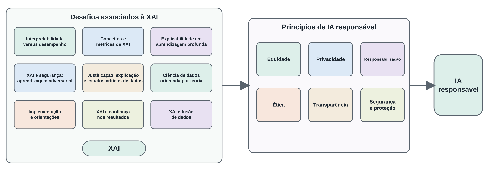

Figura 25 - Relação entre desafios de compreensão das decisões e princípios de IA responsável.

Adaptado de (Barredo Arrieta et al., 2020) Explainable Artificial Intelligence (XAI): Concepts, taxonomies, opportunities and challenges toward responsible AI. Information Fusion, 58, 82-115. https://doi.org/10.1016/j.inffus.2019.12.012

No plano ético, a arquitetura examinada recorre a referências antropométricas não clínicas e a cenários simulados, mantém as chaves dos fornecedores no servidor e diferencia os acessos. Permanecem por implementar ou avaliar a apresentação sistemática da origem das referências, a comunicação da incerteza, a minimização de dados num eventual uso com pessoas e a compreensão dos avisos pelos diferentes perfis. Estes requisitos correspondem às dimensões de transparência, privacidade e prestação de contas sintetizadas na Figura 25 (Barredo Arrieta et al., 2020).

Consequentemente, a evidência permite avaliar a integração e as salvaguardas técnicas da IA, mas não autoriza classificá-la como autoridade clínica nem como mecanismo autónomo de personalização. A qualidade das sugestões continua condicionada pela cobertura dos dados, pelo esquema do modelo e pela verificação das geometrias produzidas.

# Capítulo 7 - Princípios de Interface e Decisões de Interação

## 7.1 Estratégia de interação e decisões de UI/UX

A interface estrutura o fluxo implementado em seis operações: selecionar um modelo, introduzir ou obter valores iniciais, ajustar parâmetros, gerar e observar a geometria, guardar a configuração e exportar ficheiros. Esta sequência torna visíveis, sob a forma de tarefas, os elementos da arquitetura técnica; a facilidade da sua utilização não foi avaliada com participantes.

A composição é modular e orientada por tarefa. A seleção do modelo determina o esquema ativo, enquanto os controlos apresentam os parâmetros editáveis e os respetivos intervalos. A pré-visualização mostra a geometria efetivamente produzida, e as ações de guardar, recuperar e exportar preservam estados distintos. Esta organização procura manter uma relação identificável entre valor, ação e consequência formal (Colombo et al., 2015; Peixoto et al., 2025).

O espaço de configuração apresentado não é ilimitado: a interface expõe apenas os campos declarados para o modelo, apresenta os intervalos existentes e exclui decisões como a lateralidade do pedido enviado à IA. Esta contenção orienta a configuração, mas não garante, por si só, que todos os percursos de submissão respeitem as mesmas regras. Os testes complementares mostraram que um valor acima do intervalo podia permanecer no estado interno da aplicação e que um campo numérico podia receber texto por meio de um pedido direto. O controlo visual deve, portanto, ser acompanhado pela verificação do valor antes de este ser aplicado, guardado ou enviado para a geometria.

A pré-visualização é calculada localmente pelo OpenSCAD em *WebAssembly*. O *Web Worker* separa esta execução da tarefa principal da interface, evitando o seu bloqueio direto durante o cálculo. Não foram medidos o tempo percebido, a compreensão dos estados nem a qualidade da interação (Alili et al., 2023; Quintero et al., 2018).

A avaliação de acessibilidade conjugou uma verificação automática de oito estados do percurso autenticado com uma verificação manual complementar. A análise automática identificou contraste insuficiente, ausência de associação programática entre alguns rótulos e controlos, elementos interativos aninhados e falta de nome acessível num elemento de seleção. Na grelha manual, sete das doze verificações foram classificadas como conformes e cinco como não conformes. O percurso com o Orca revelou limitações na ordem e na descrição dos campos; com ampliação a 400%, a interface permaneceu apenas parcialmente utilizável; e o visualizador tridimensional não apresentou uma alternativa textual reconhecível. A classificação manual do contraste como conforme não elimina as ocorrências detetadas automaticamente. Estes resultados permitem localizar decisões de interface a rever, mas não demonstram a experiência de pessoas com diferentes capacidades nem a conformidade global com as WCAG 2.2.

Este subcapítulo descreve a especificação do projeto, as funções disponíveis e os limites já observados. A clareza, a carga cognitiva, a aprendizagem, a acessibilidade percebida e a adequação aos diferentes perfis permanecem por avaliar futuramente com participantes.

## 7.2 Papéis previstos e distribuição de decisões

Os fundamentos da participação e da distribuição de autoridade foram discutidos no subcapítulo 2.7. Na implementação, correspondem a três perfis de acesso - administrador, técnico e utilizador - cuja adequação às práticas profissionais ainda não foi avaliada.

O administrador gere contas, permissões e relações de atribuição. O perfil técnico pode criar, editar, guardar e acompanhar as configurações sob a sua responsabilidade. Ao utilizador cabem a consulta, a visualização e o acompanhamento das configurações que lhe estão associadas. Esta distribuição descreve as permissões do protótipo, não competências clínicas verificadas.

Os parâmetros apresentados dependem do modelo ativo e do perfil de acesso. O esquema limita os valores geométricos editáveis, a interface controla a lateralidade e a aceitação de sugestões permanece uma ação distinta da sua geração. A plataforma não implementa decisões clínicas sobre encaixe, tolerância dos tecidos ou adequação funcional.

Esta separação materializa uma colaboração assimétrica, na qual o perfil técnico dispõe de maior capacidade de intervenção e o utilizador final acompanha o processo. Não foram medidos os efeitos desta distribuição na compreensão, na confiança, na rapidez ou na qualidade da decisão (Bai et al., 2024; Colombo et al., 2015; Quintero et al., 2018).

A Figura 26 evidencia a importância de analisar a utilização concreta do dispositivo, para além da sua configuração digital. A avaliação com utilizadores permite identificar problemas de ajuste ao corpo, modo de ativação, conforto e adequação funcional, aspetos dificilmente avaliáveis apenas através do modelo digital. Nesta investigação, a imagem constitui uma referência metodológica: embora a plataforma possa tornar o processo mais claro e configurável, a validação futura continua a depender da observação do uso em contexto real (da Silva et al., 2018).

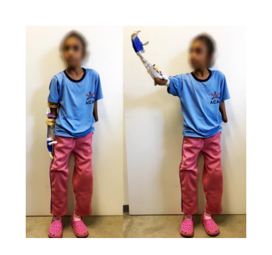

Figura 26 - Exemplo publicado de teste de uma prótese impressa em 3D com um utilizador.

Reproduzido de (da Silva et al., 2018) Interdisciplinary-based development of user-friendly customized 3D printed upper limb prosthesis. Comunicação em conferência.

## 7.3 Mediação do processo de *design* e reflexão crítica

No protótipo, a mediação fundamentada no Capítulo 2 torna-se observável na sequência entre a leitura dos dados, a proposta de valores, a geração da geometria, a revisão e a exportação. A interface não acrescenta uma nova teoria da personalização, mas materializa decisões sobre o que é apresentado, alterado, guardado ou reservado.

Esta função concretiza-se através de quatro mecanismos: a exposição seletiva dos parâmetros, a apresentação dos respetivos limites, a diferenciação de permissões e a separação visual entre sugestão, configuração e geometria gerada. Em conjunto, permitem examinar parte da relação entre valor, controlo e resultado, mas também condicionam o conjunto de alternativas que pode ser explorado (Bai et al., 2024; Peixoto et al., 2025).

Esta condição impede que a interface seja considerada neutra. Um valor apresentado como sugestão pode adquirir aparência de validade, mesmo quando resulta de uma referência populacional incompleta ou de uma saída probabilística. A origem, a incerteza e o estatuto de cada valor devem, por isso, permanecer visíveis; o estado avaliado implementa apenas parte dessa comunicação.

A separação entre sugestão, configuração e geometria é uma decisão de projeto observável. Perante uma resposta de IA inválida, o sistema preservou o último estado válido e permitiu uma nova tentativa, demonstrando capacidade de recuperação nesse percurso. Contudo, a aplicação de um valor acima do intervalo revelou que a reversibilidade e a limitação do espaço paramétrico ainda não estão asseguradas em todos os percursos de submissão. Deste resultado decorre a necessidade de manter a coerência das mensagens, dos limites e das regras para além dos controlos visíveis da interface.

A evidência disponível permite descrever a organização das decisões, identificar as salvaguardas incorporadas e localizar barreiras técnicas de acessibilidade. Não permite concluir que os diferentes perfis compreendem os limites, tomam melhores decisões ou utilizam a plataforma com menor esforço. Estas questões exigem a observação de tarefas com participantes.

O contributo desta camada de interface é, portanto, tornar operacional e discutível a distribuição de informação e controlo no fluxo técnico. A responsabilidade pela adequação da configuração e a validação do dispositivo permanecem fora da interface e do alcance demonstrado pelo estudo.

# Capítulo 8 - Avaliação e Discussão

## 8.1 Estratégia e critérios de avaliação

A avaliação abrangeu quatro níveis: o funcionamento dos componentes da plataforma, a coerência das sugestões de IA, a propagação dos parâmetros para a geometria e a passagem dos ficheiros para preparação e impressão. Os critérios foram definidos no subcapítulo 3.5. Os resultados demonstram condições técnicas específicas e não equivalem a uma avaliação clínica, funcional ou da experiência de utilização.

### 8.1.1 Verificação técnica da plataforma

O funcionamento da plataforma foi examinado através das funções que sustentam o percurso entre os dados antropométricos, a configuração, a visualização e a preparação para fabrico. A Tabela 23 sintetiza a evidência observada e explicita a sua relevância para o processo de projeto, bem como os respetivos limites. Os comandos, as datas de execução e os identificadores internos dos testes são conservados no Suplemento 2 - Avaliação técnica da plataforma.

Tabela 23 - Evidência do funcionamento da plataforma no processo de projeto.

|                                          |                                                                                                                                         |                                                                                                      |                                                                                                |
|------------------------------------------|-----------------------------------------------------------------------------------------------------------------------------------------|------------------------------------------------------------------------------------------------------|------------------------------------------------------------------------------------------------|
| Função examinada                         | Evidência observada                                                                                                                     | Relevância para o processo de projeto                                                                | Limite de interpretação                                                                        |
| Correspondência entre descrição e perfil | As descrições de ensaio foram relacionadas com referências populacionais segundo sexo, idade, grupo etário e disponibilidade geográfica | Permite introduzir uma referência antropométrica inicial no percurso de configuração                 | A referência é populacional, não individual, e não demonstra adequação anatómica               |
| Seleção de modelos                       | Quatro modelos com parâmetros próprios podem ser selecionados e configurados na mesma interface                                         | Demonstra que a plataforma acomoda famílias geométricas com regras distintas num percurso comum      | Apenas três modelos integram a comparação dimensional principal                                |
| Base antropométrica                      | A aplicação reúne 100 perfis agregados por população, sexo, idade e tipo de estatística                                                 | Disponibiliza referências mensuráveis para iniciar ou contextualizar decisões paramétricas           | A cobertura geográfica e etária é desigual e os perfis não substituem medições diretas         |
| Conservação de configurações             | Perfis, valores paramétricos e configurações podem ser guardados e recuperados                                                          | Permite retomar, documentar e comparar variantes ao longo do processo de projeto                     | Não foram avaliados utilização intensiva, acessos simultâneos ou práticas reais de colaboração |
| Visualização e exportação                | As configurações examinadas produziram pré-visualizações tridimensionais e ficheiros STL e 3MF                                          | Mantém continuidade entre alteração de parâmetros, observação da geometria e preparação para fabrico | A exportação não garante a impressão, montagem, segurança ou adequação clínica                 |
| Sugestão apoiada por IA                  | A descrição e a referência antropométrica podem originar uma proposta inicial de valores, posteriormente editável                       | Apoia a exploração preliminar sem retirar ao utilizador o controlo da configuração                   | Depende de serviços externos e não decide nem valida a geometria final                         |

Estes resultados confirmam a existência e a integração dos componentes examinados. Não demonstram o desempenho sob carga, a segurança integral, a compatibilidade com todos os navegadores nem a utilização autónoma por pessoas sem formação técnica.

### 8.1.2 Avaliação complementar da consistência da criação, recuperação e acessibilidade

Para verificar a consistência da geração, cada modelo foi exportado repetidamente sem alterar os valores dos parâmetros. Foram concluídas sete exportações do Flexy Beast, cinco do Paraglider Hand e cinco da UnLimbited Phoenix. Em cada modelo, todas as exportações concluídas geraram ficheiros exatamente iguais ao nível dos dados binários, ou seja, com a mesma sequência de zeros e uns que constitui o respetivo conteúdo digital, e mantiveram as mesmas dimensões e métricas geométricas. O critério previamente definido exigia dez exportações concluídas por modelo. Como algumas tentativas foram interrompidas por bloqueios e tempos-limite no ambiente de ensaio, o resultado é parcial. A evidência sustenta a consistência das exportações concluídas, mas não permite considerar cumprido o critério estabelecido para a totalidade das repetições.

A mesma configuração da UnLimbited Phoenix gerou resultados idênticos no Chromium e no Firefox. Uma primeira tentativa com WebKit foi invalidada por uma opção de arranque que o próprio instrumento de ensaio aplicou incorretamente. Corrigida essa configuração, o navegador iniciou, mas o percurso foi interrompido na autenticação, antes de chegar à geração da geometria. A compatibilidade com WebKit permanece, por isso, inconclusiva, e a falha não é classificada como incompatibilidade da plataforma.

Os cenários de recuperação abrangeram valores nos limites, dados inválidos, ausência de cobertura populacional direta, incompatibilidade entre perfil e modelo, indisponibilidade do serviço de IA, falha de renderização e tentativa de exportação sem geometria. Na maioria dos percursos, os dados inválidos foram rejeitados, o último estado válido foi preservado ou foi possível efetuar uma nova tentativa. Identificaram-se, contudo, duas fragilidades relevantes para o *design* do controlo. Uma sugestão simulada de IA acima do limite era detetável pelo esquema, mas chegou a ser aplicada ao valor interno. Além disso, a interface rejeitou texto num campo numérico, enquanto o pedido direto à plataforma aceitou o mesmo tipo de valor. Estes resultados mostram que a proteção não deve depender apenas do controlo visual e que as mesmas regras têm de ser aplicadas antes de qualquer valor ser guardado ou enviado para a geometria.

A auditoria automática de acessibilidade examinou oito estados do percurso local autenticado e identificou quatro categorias de barreiras: contraste de cor insuficiente, ausência de associação programática entre etiquetas textuais e controlos, inserção de elementos interativos dentro de outros elementos interativos e falta de nome acessível num elemento de seleção.

A página pública não autenticada não apresentou violações automáticas nos elementos examinados, embora tenha incluído uma verificação inconclusiva e não represente os percursos internos. Na verificação manual complementar, sete das doze verificações foram classificadas como conformes e cinco como não conformes. O percurso com o Orca revelou problemas na ordenação e na descrição dos campos. A interface foi apenas parcialmente utilizável com ampliação a 400%, e o visualizador tridimensional não disponibilizou uma alternativa textual reconhecível. A classificação manual do contraste como conforme não invalida as ocorrências automáticas. Os resultados, considerados em conjunto, definem prioridades concretas de revisão, mas não demonstram conformidade global com as WCAG 2.2 nem a acessibilidade percebida pelos utilizadores.

No âmbito do *Design* Industrial, estas séries de ensaios proporcionam três aprendizagens para o desenvolvimento do artefacto. A consistência dos resultados depende de regras geométricas explícitas e de condições de execução suficientemente estáveis. A robustez requer coerência dos limites e das mensagens em todas as etapas do fluxo. Por sua vez, a acessibilidade deve ser tratada como uma qualidade verificável da interface, e não apenas como uma intenção inclusiva. O Anexo B conserva a matriz de casos, os resultados por execução e a ficha técnica mínima necessária à sua revisão crítica.

### 8.1.3 Preparação para impressão e protótipos físicos

A evidência de fabrico inclui 116 ficheiros 3MF gerados para três modelos e quatro perfis de ensaio, quatro projetos com parâmetros de preparação e fotografias de peças físicas. Os 116 ficheiros correspondem a exportações digitais distribuídas por placas combinadas e peças individuais, e não a 116 impressões físicas. Os quatro projetos de preparação digital para impressão 3D cuja configuração foi analisada são entregues no Suplemento 4 - Preparação para impressão e protótipos. Cada projeto identifica um perfil de 15 anos, o material configurado e a impressora utilizada. A série documenta cada projeto individualmente e não pressupõe que as respetivas condições sejam comparáveis.

Tabela 24 - Projetos de preparação digital para impressão 3D com configuração analisada.

|                             |                                       |                                                                                                                                                                                           |                                                                                                         |
|-----------------------------|---------------------------------------|-------------------------------------------------------------------------------------------------------------------------------------------------------------------------------------------|---------------------------------------------------------------------------------------------------------|
| Modelo e cenário            | Impressora e programa                 | Parâmetros principais                                                                                                                                                                     | Evidência observada                                                                                     |
| Flexy Beast, 15 anos        | Bambu Lab A1, Bambu Studio 1.10.02.76 | Camada 0,24 mm; duas paredes; enchimento 15% em grelha; suporte em árvore; aba 5 mm; objetos atribuídos ao extrusor PLA                                                                   | Dez segmentos digitais importados; programa regista 0 arestas corrigidas e 0 faces degeneradas          |
| UnLimbited Phoenix, 15 anos | Bambu Lab A1, Bambu Studio 1.10.02.76 | Dois ficheiros de preparação com camada de 0,24 mm, duas paredes e 15% de enchimento: peças atribuídas, respetivamente, a PLA e a Bambu PETG Basic; no PETG, bico a 255 °C e mesa a 70 °C | Oito conjuntos de peças em cada ficheiro; o programa regista 0 arestas corrigidas e 0 faces degeneradas |
| Paraglider Hand, 15 anos    | Prusa MINI, PrusaSlicer 2.8.1         | Camada 0,20 mm; duas paredes; enchimento 15% em grelha; PLA; bico 0,4 mm; mesa 60 °C; suporte e aba desativados                                                                           | Projeto 3MF com configuração da impressora, do filamento e da placa                                     |

Os quatro ficheiros de preparação da Série A foram novamente processados com as definições neles conservadas, tendo sido geradas trajetórias e estimativas em todos os casos. O Flexy Beast em PLA apresentou 2 h 21 min 50 s e 56,51 g; o UnLimbited Phoenix, 5 h 12 min 44 s e 123,52 g em PLA e 5 h 51 min 52 s e 117,54 g em PETG; o Paraglider, 2 h 32 min 11 s e 37,96 g em PLA. Estes valores são estimativas dos programas, não medições de impressões reais. Como os ficheiros usam condições distintas, não permitem concluir que determinado modelo, material, programa ou equipamento seja mais rápido ou económico.

Na Série B, as doze combinações entre três modelos e quatro perfis foram processadas numa condição digital comum: Bambu Lab A1, PLA, camada de 0,20 mm, duas paredes, enchimento de 15% em grelha e suportes desligados. Foram geradas trajetórias e estimativas nas 12 combinações modelo-perfil. Os tempos variaram entre 4 h 22 min 47 s, no Paraglider child_8, e 12 h 34 min 14 s, no Flexy Beast adult_28; nos mesmos casos, as massas estimadas variaram entre 50,07 g e 169,15 g. O programa assinalou regiões suspensas nos quatro casos Flexy Beast e no Paraglider elderly_70. Estes avisos mostram que a comparação digital não dispensa a revisão da orientação e dos suportes antes da impressão.

A comparação dimensional reuniu 36 extensões X, Y e Z das palmas exportadas e 72 valores medidos nas peças correspondentes, metade em PLA e metade em PETG. No modelo UnLimbited Phoenix, a largura de entrada e a extensão X da malha ficaram próximas; no Flexy Beast e no Paraglider, a extensão exterior inclui interfaces e margens decorrentes da geometria-base. A diferença entre o parâmetro e a caixa exterior descreve, assim, a transformação decorrente do projeto e não é tratada como erro. Nas peças físicas, todos os valores ficaram abaixo das extensões das malhas: os desvios percentuais variaram entre −0,321% e −0,274% em PLA e entre −0,425% e −0,369% em PETG. O Anexo D apresenta os resultados completos e a compatibilidade delimitada com as orientações de escala. A existência de uma única leitura registada por eixo não permite quantificar a dispersão ou a incerteza de medição.

Foram produzidos exemplares em PLA e PETG, e as configurações analisadas identificam o material atribuído às peças preparadas. Na UnLimbited Phoenix, a configuração PETG atribui os oito conjuntos de peças ao perfil Bambu PETG Basic. As medições permitem comparar de forma emparelhada as dimensões das palmas produzidas nos dois materiais: nos exemplares registados, o PETG apresentou desvios negativos ligeiramente superiores aos do PLA. Sem leituras repetidas ou uma série experimental destinada a isolar o efeito do material, esta diferença não deve ser generalizada como taxa própria de contração. Também não se retiram conclusões sobre a resistência, a fragilidade ou a durabilidade relativas do PLA e do PETG sem ensaios mecânicos comparáveis.

Embora a documentação de origem do Flexy Beast preveja juntas em filamento flexível ou silicone moldado, não foram produzidas juntas flexíveis nem almofadas de silicone para os dedos. Os exemplares rígidos em PLA ou PETG não substituem esses componentes. Não foram, por conseguinte, avaliados o comportamento elástico das juntas, o retorno dos dedos, a aderência das almofadas ou a influência desses elementos na montagem e no funcionamento do dispositivo.

A utilização da Bambu Lab A1 e da Prusa MINI documenta a execução do fluxo em dois ambientes de fabrico, mas não constitui uma comparação entre equipamentos. Os modelos, os programas de preparação para impressão e parte das definições usadas diferem entre os projetos, sem que nenhuma geometria equivalente tenha sido repetida nas duas impressoras sob condições controladas. Não é, portanto, possível isolar o efeito da impressora, comparar a qualidade ou a velocidade, nem concluir que o fluxo exige dois equipamentos.

Uma avaliação complementar examinou as malhas geradas a partir do perfil antropométrico de ensaio de 8 anos. Foram considerados o fecho da superfície, o carácter múltiplo da geometria, o número de corpos e as faces de área nula. A Tabela 25 mostra que a aceitação da preparação pelo programa não implica que a malha de origem seja um sólido fechado sem defeitos.

Tabela 25 - Inspeção computacional das malhas geradas para um perfil antropométrico de 8 anos.

|                             |       |                  |               |             |                                                                                |
|-----------------------------|-------|------------------|---------------|-------------|--------------------------------------------------------------------------------|
| Modelo e peça               | Fecho | Múltiplos corpos | N.º de corpos | Faces nulas | Interpretação                                                                  |
| Flexy Beast, palma          | Sim   | Sim              | 1             | 0           | Malha fechada segundo os critérios usados                                      |
| Flexy Beast, dedo médio     | Sim   | Sim              | 3             | 0           | Três corpos fechados, coerentes com a construção segmentada                    |
| Paraglider Hand, palma      | Sim   | Sim              | 1             | 142         | A preparação pode aceitar a peça, mas a malha contém faces degeneradas         |
| Paraglider Hand, dedo médio | Não   | Sim              | 4             | 26          | Requer inspeção ou reparação antes de uma conclusão sobre qualidade geométrica |
| UnLimbited Phoenix, palma   | Não   | Não              | 5             | 6           | A malha original contém descontinuidades que o redimensionamento não elimina   |

Nos ficheiros de preparação configurados para a Bambu Lab A1, o diagnóstico do Bambu Studio regista zero arestas corrigidas e zero faces degeneradas nas peças importadas. Este indicador refere-se apenas aos ficheiros concretos examinados e resulta de um procedimento diferente do utilizado na inspeção computacional da Tabela 25. A diferença entre os registos deve ser mantida, pois nenhum dos resultados permite concluir que todas as variantes de cada modelo possuem a mesma qualidade de malha.

O registo fotográfico complementa os dados de preparação e a inspeção das malhas, documentando as peças efetivamente produzidas, a organização dos componentes e os estados preliminares de montagem. Não substitui medições dimensionais, ensaios mecânicos ou avaliações com utilizadores.

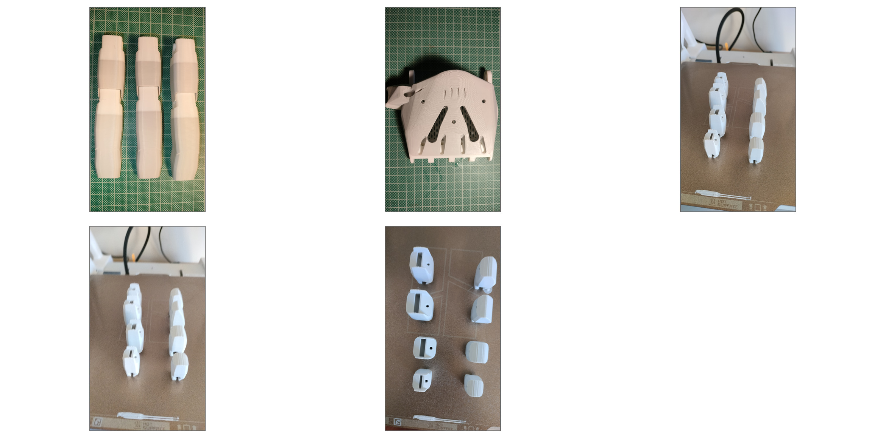

Figura 27 - Componentes impressos e estados preliminares de montagem: segmentos digitais articulados, palma e elementos separados. O painel documenta a materialização das geometrias e a compatibilidade visual entre componentes.

Fonte: produção Pedro Candeias. (2026).

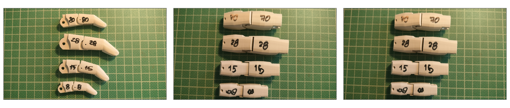

Figura 28 - Séries físicas de segmentos identificados pelos perfis de ensaio de 8, 15, 28 e 70 anos. À esquerda apresenta-se a série Paraglider Hand; ao centro e à direita, duas vistas da série Flexy Beast. As diferenças visíveis documentam a variação dimensional.

Fonte: produção Pedro Candeias. (2026).

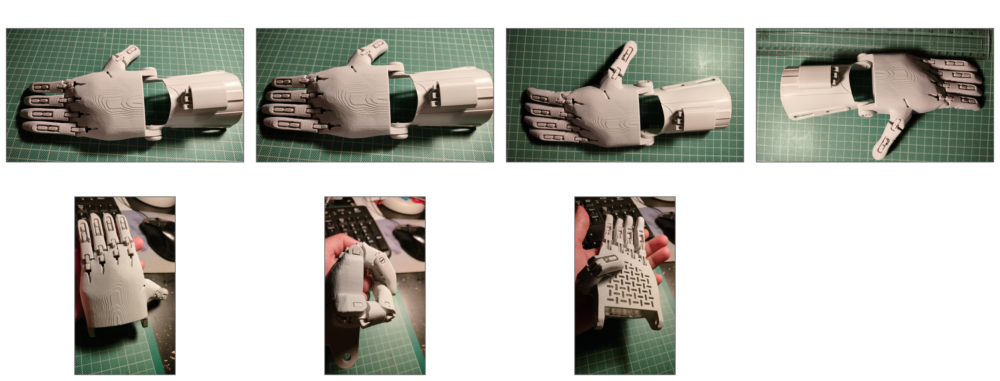

Figura 29 - UnLimbited Phoenix configurada para o perfil de ensaio de 15 anos, apresentada em sete vistas da montagem física. As imagens documentam a reunião dos componentes e a mobilidade manual observável das articulações, sem equivaler a um protocolo de funcionamento, preensão ou utilização protésica.

Fonte: produção Pedro Candeias. (2026).

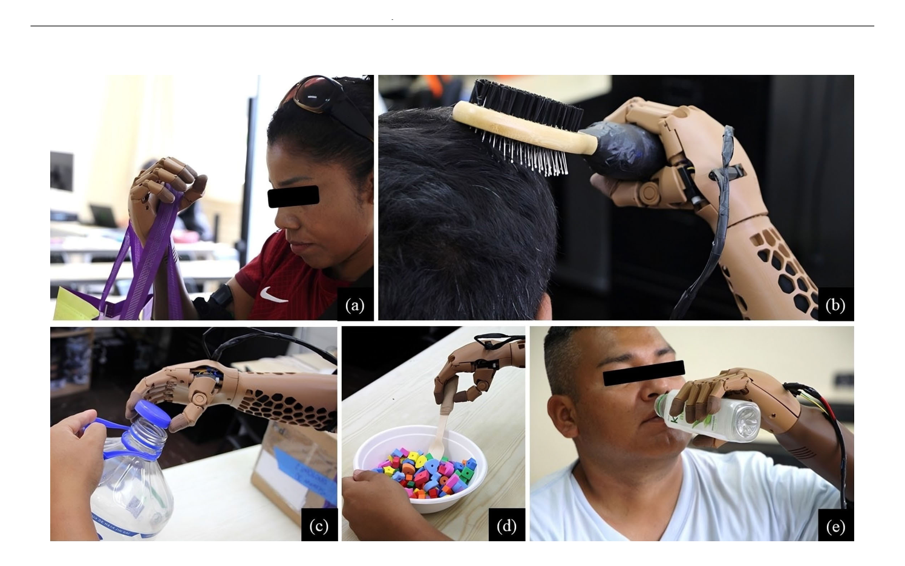

Figura 30 - Tarefas funcionais usadas em avaliação de prótese personalizada de membro superior.

Reproduzido da Figura 10 de (Romero et al., 2025a). An Affordable AI-Driven and 3D-Printed Personalized Myoelectric Prosthesis: Design, Development, and Assessment. IEEE Access, 13, 139631-139649. https://doi.org/10.1109/ACCESS.2025.3596475

## 8.2 Avaliação da coerência das sugestões de IA

O primeiro conjunto experimental incidiu sobre cinco perfis de ensaio, construídos a partir da idade, do sexo, da altura, do peso, do país, do comprimento do braço e da constituição física. Como não incluíam medições diretas da mão, avaliou-se a conformidade das respostas com o esquema, os intervalos e as relações dimensionais internas definidas. O ensaio examina o fluxo perante informação incompleta, mas não permite concluir que as dimensões correspondam à mão de uma pessoa concreta ou que a plataforma seja fácil de usar por pessoas sem formação técnica.

Nas cinco execuções documentadas, a IA produziu JSON válido, utilizou parâmetros existentes, respeitou os intervalos definidos no modelo e manteve a ordenação prevista entre os comprimentos dos dedos. Como Brasil, Japão e Alemanha não estão representados na base local, a indicação desses países não permitiu estabelecer uma correspondência populacional direta. Nesses casos, a seleção do perfil de referência passou a depender dos restantes atributos disponíveis e dos critérios de prioridade definidos no sistema. Esta limitação impede que a indicação do país seja interpretada como uma adaptação antropométrica à população nacional mencionada.

Tabela 26 - Descrições submetidas nos cenários de avaliação da IA.

|                                                |                                                           |                                                                                                                                                                         |                                                                                            |
|------------------------------------------------|-----------------------------------------------------------|-------------------------------------------------------------------------------------------------------------------------------------------------------------------------|--------------------------------------------------------------------------------------------|
| **Conjunto experimental**                      | **Tipo de perfil criado**                                 | **Descrição submetida**                                                                                                                                                 | **Finalidade da verificação**                                                              |
| Ensaio 1 - indicadores populacionais indiretos | Adulto masculino com dados demográficos e regionais       | *man, 28 years old, 82 kg, 180 cm height, Brazil, arm length 70 cm*                                                                                                     | Testar a inferência paramétrica sem medições diretas da mão                                |
| Ensaio 1 - indicadores populacionais indiretos | Criança do sexo feminino, com estrutura corporal pequena  | *girl, 10 years old, 32 kg, 138 cm height, Japan, small frame*                                                                                                          | Examinar a redução das dimensões e dos componentes mecânicos perante uma idade inferior    |
| Ensaio 1 - indicadores populacionais indiretos | Mulher idosa com dados demográficos e regionais           | *woman, 65 years old, 68 kg, 160 cm height, Nigeria, arm length 62 cm*                                                                                                  | Comparar os parâmetros com os limites do modelo num perfil adulto feminino e sénior        |
| Ensaio 1 - indicadores populacionais indiretos | Adulto masculino com indicação qualitativa de mãos largas | *man, 50 years old, 95 kg, 175 cm height, Germany, broad hands, arm length 66 cm*                                                                                       | Verificar a resposta do sistema a uma característica anatómica descrita qualitativamente   |
| Ensaio 1 - indicadores populacionais indiretos | Adolescente masculino alto e magro                        | *teenage boy, 15 years old, 60 kg, 168 cm height, India, slim build, arm length 67 cm*                                                                                  | Testar a fronteira entre perfil pediátrico e dimensões próximas de adulto                  |
| Ensaio 2 - amputação unilateral                | Perfil com medições completas da mão intacta              | Medições completas da mão esquerda intacta: palma 84 mm; indicador 72 mm; médio 78 mm; anelar 75 mm; mínimo 58 mm; polegar 64 mm; prótese necessária para a mão direita | Confirmar a preservação dos valores fornecidos e a geração contralateral                   |
| Ensaio 2 - amputação unilateral                | Perfil com dados demográficos e uma medição direta        | Homem, 40 anos; mão direita intacta; largura da palma 90 mm; prótese necessária para a mão esquerda                                                                     | Confirmar a manutenção da medida fornecida e a estimativa proporcional dos campos em falta |
| Ensaio 2 - amputação unilateral                | Perfil apenas demográfico                                 | Mulher, 30 anos, asiática oriental, 158 cm; prótese necessária para a mão direita                                                                                       | Verificar a adaptação do sistema quando não existem medições diretas da mão                |

  
Fonte: produção Pedro Candeias (2026), a partir dos pedidos, metadados e cenários conservados no Suplemento 2 - Avaliação técnica da plataforma. A coluna apresenta a descrição do caso de ensaio enviada no pedido; o pedido completo incluía o esquema atual do modelo, os intervalos permitidos e a instrução de devolver apenas JSON válido.

A leitura dos registos revela respostas distintas em função do grau de detalhe da descrição submetida. Nos perfis adultos, os valores sugeridos mantiveram-se nos intervalos usados pelo sistema. No perfil infantil, foram reduzidos os comprimentos e os parâmetros das articulações flexíveis. Este comportamento corresponde às instruções presentes nas legendas do esquema, mas não demonstra um ajuste anatómico. No perfil adolescente, uma regra preliminar assinalou a palma como excessiva. A comparação posterior com o intervalo de referência usado no ensaio revelou que o limite do teste era demasiado rígido. A regra foi corrigida, mas a ausência de uma medição individual impede que a sugestão seja classificada como exata.

O segundo conjunto experimental avaliou três cenários de ausência unilateral com diferentes graus de informação. Quando foram fornecidas medições completas da mão intacta, a resposta registada preservou esses valores. No caso parcial, manteve-se a largura da palma declarada e preencheram-se os restantes comprimentos. Nos ensaios baseados em indicadores demográficos, a IA devolveu o conjunto de parâmetros requerido. Estes resultados descrevem as respostas observadas, mas não permitem concluir que os valores estimados sejam anatomicamente corretos.

A lateralidade foi examinada num ensaio separado, composto por 12 pedidos repetidos. Onze produziram respostas interpretáveis e um não gerou uma resposta analisável. Nos sete pedidos de mão esquerda com resposta válida, a lateralidade foi incorretamente indicada como mão direita; nos quatro pedidos de mão direita, a indicação foi mantida corretamente. Perante este resultado, a lateralidade foi retirada do conjunto de parâmetros sugeridos pela IA e transferida para um controlo determinístico da interface. Após esta alteração, as nove execuções subsequentes omitiram o campo de lateralidade, incluindo um cenário em que a descrição textual entrava em conflito com a escolha efetuada na interface.

Tabela 27 - Síntese da avaliação das sugestões de IA.

|                                   |                                                                                                                              |                                                                                                                              |
|-----------------------------------|------------------------------------------------------------------------------------------------------------------------------|------------------------------------------------------------------------------------------------------------------------------|
| **Eixo avaliado**                 | **Resultado observado**                                                                                                      | **Interpretação**                                                                                                            |
| Conformidade com o esquema        | Respostas interpretáveis, campos previstos e valores dentro dos limites definidos                                            | O esquema de parâmetros reduziu a ocorrência de sugestões inválidas                                                          |
| Relações dimensionais internas    | Dedo médio mais longo, dedo mínimo mais curto e polegar inferior ao dedo médio nos casos arquivados                          | As relações definidas no protocolo foram respeitadas; o resultado não equivale a adequação anatómica individual              |
| Descrições com medições completas | Medições fornecidas mantidas sem alteração                                                                                   | A IA preservou os valores diretamente declarados.                                                                            |
| Descrições com uma medição direta | Campos em falta estimados a partir da medida fornecida                                                                       | A resposta registada combinou o dado explícito com referências populacionais.                                                |
| Descrições apenas demográficas    | Conjunto completo de parâmetros dentro dos intervalos                                                                        | Nos casos examinados, o fluxo gerou um ponto de partida que requer confirmação por medição ou por um profissional competente |
| Lateralidade antes da correção    | 0/7 respostas corretas para pedidos de mão esquerda; 4 respostas corretas nos 4 pedidos de mão direita; uma falha de análise | A IA não oferecia comportamento aceitável neste parâmetro                                                                    |
| Lateralidade após a correção      | Campo omitido em 9/9 execuções                                                                                               | A escolha passou a ser determinística e independente da resposta da IA                                                       |

A série complementar de ensaios reuniu 15 cenários construídos a partir de descrições vagas, comparativas, em diferentes línguas, sem medidas ou com valores fora dos limites definidos. Os registos preservam as descrições submetidas e as respostas obtidas, mas o estudo não reuniu repetições suficientes para estimar estatisticamente a estabilidade do modelo de linguagem. Em algumas execuções, foram sugeridos parâmetros de *hardware*; noutras, esses parâmetros mantiveram os valores já definidos. A conclusão limita-se, portanto, à conformidade dos casos registados e à importância das salvaguardas determinísticas. Descrições equivalentes podem originar valores numéricos ou conjuntos de campos distintos, pelo que cada sugestão exige revisão antes de ser aplicada.

## 8.3 Verificação geométrica entre modelos

A verificação geométrica testou se os valores sugeridos eram transferidos para a malha exportada em três modelos ativos da plataforma: Flexy Beast, Paraglider Hand e UnLimbited Phoenix. Para cada modelo, comparou-se um valor de referência por omissão com três perfis de ensaio: criança, mulher adulta e homem adulto. As execuções documentadas devolveram valores dentro dos intervalos definidos. O ensaio incide sobre a resposta dimensional das geometrias, sem avaliar o ajuste ao corpo, o conforto, a função ou a segurança.

Tabela 28 - Modelos e mecanismos de escala avaliados.

|                    |                                                      |                                           |                                                              |
|--------------------|------------------------------------------------------|-------------------------------------------|--------------------------------------------------------------|
| Modelo             | Entradas antropométricas principais                  | Mecanismo de escala                       | Implicação observada                                         |
| Flexy Beast        | Largura da palma e comprimentos dos cinco dedos      | Escalas independentes para palma e dedos  | Aceitou os valores inferiores usados no ensaio               |
| Paraglider Hand    | Palma e dedos, com parâmetros adicionais de contexto | Escala geral da palma e ajustes por dedo  | Respondeu aos três perfis após a correção da escala da palma |
| UnLimbited Phoenix | Largura da palma                                     | Escala uniforme limitada por valor mínimo | Impediu reduções abaixo do limite definido no modelo         |

Nota: o fator de escala corresponde à divisão da maior dimensão da palma exportada pela dimensão correspondente da configuração de referência. Um valor de 1,000 indica igualdade; valores inferiores indicam redução e valores superiores, aumento relativamente à referência.

Os resultados mostraram respostas semelhantes do Flexy Beast e do Paraglider Hand aos mesmos perfis, mediante a redução ou o aumento da maior dimensão da palma. No perfil infantil, os fatores de escala foram de 0,761 e 0,747 relativamente à configuração de referência; na mulher adulta, de 0,932 e 0,928; e no homem adulto, de 1,148 e 1,157. No Phoenix, o limite mínimo impediu a redução da largura da palma abaixo de cerca de 82 mm e manteve os perfis pequenos no tamanho mínimo previsto pelo modelo.

Tabela 29 - Fator de escala da maior dimensão da palma exportada relativamente à configuração de referência.

|                     |             |                 |                       |
|---------------------|-------------|-----------------|-----------------------|
| Perfil              | Flexy Beast | Paraglider Hand | UnLimbited Phoenix    |
| Valor de referência | 1,000       | 1,000           | 1,000                 |
| Criança             | 0,761       | 0,747           | 1,000 após a correção |
| Mulher adulta       | 0,932       | 0,928           | 1,000                 |
| Homem adulto        | 1,148       | 1,157           | 1,171                 |

Antes da correção, um percurso alternativo do Phoenix produziu um fator de escala de 0,760 no perfil infantil. O valor foi rejeitado por ultrapassar o limite mínimo declarado para o modelo, pelo que não integra a Tabela 29 como resultado aceite.

Esta verificação revelou três fragilidades técnicas que a análise numérica isolada não permitia detetar. A primeira encontrava-se no mecanismo de correspondência populacional: a análise inicial do sexo e da idade era demasiado frágil, podendo certas abreviaturas presentes no texto de entrada ser interpretadas incorretamente e confundir unidades de medida com a indicação do sexo masculino.

A correção consistiu numa análise mais robusta do texto de entrada, capaz de reconhecer termos em diferentes línguas, respeitar fronteiras de palavra e classificar os grupos etários de forma mais fiável.

A segunda fragilidade foi identificada no modelo Paraglider. A dimensão da palma da mão protésica não respondia corretamente aos valores sugeridos, pois permanecia associada a uma escala interna herdada da biblioteca original. A correção consistiu em reaplicar a escala no ponto do código responsável pela geração dessa geometria. A terceira fragilidade surgiu no modelo UnLimbited Phoenix: um parâmetro alternativo permitia ultrapassar o limite mínimo de escala definido para o modelo. A correção consistiu em aplicar o mesmo limite também a esse percurso alternativo de geração.

A avaliação das sugestões deve prosseguir para além da resposta em JSON. A malha exportada e a preparação para impressão podem revelar dependências internas, limites de escala, problemas de espessura, folgas insuficientes e heranças de código não detetadas na análise numérica. Os modelos integrados responderam de forma distinta aos mesmos perfis: o Flexy Beast aceitou a redução usada no ensaio; após a correção, o Paraglider passou a propagar a escala para a palma; e o Phoenix manteve o limite dimensional da biblioteca original. A seleção de um modelo para uma pessoa concreta exige critérios e dados que este ensaio não avaliou.

## 8.4 Discussão dos resultados face aos objetivos

Face aos objetivos, os resultados sustentam a integração técnica do *design* paramétrico, dos dados antropométricos, da interface *web* e da IA num protótipo de investigação. A informação textual pode dar origem a um conjunto inicial de parâmetros editáveis e visualizáveis, desde que os valores sejam limitados pelo esquema, confirmados na geometria e revistos por uma pessoa competente. O estudo não mediu se este fluxo reduz o esforço, o tempo, o custo ou a dependência de especialistas.

A avaliação delimita o papel da IA: uma resposta isolada não constitui uma prescrição; não existe uma medição clínica individual que permita calcular o erro anatómico; e a lateralidade mostrou que os parâmetros críticos devem permanecer sujeitos a regras determinísticas. A verificação geométrica identificou limites específicos de cada modelo. As peças físicas confirmaram que as configurações selecionadas podiam ser preparadas e produzidas nas condições registadas, enquanto a medição das palmas quantificou a diferença dimensional face às malhas. Estes resultados não sustentam conclusões sobre ajuste, montagem completa, resistência, conforto ou uso continuado.

A literatura sobre próteses de membro superior associa as razões de abandono sobretudo a problemas de conforto e função, incluindo o peso, a temperatura e a transpiração (Smail et al., 2021). (Biddiss et al., 2007) identificam o peso, o conforto e o controlo como prioridades expressas pelos utilizadores, enquanto (Fink & Diamond, 2023) destacam o ajuste do encaixe, o controlo, o peso, a facilidade de reparação e a estética entre os aspetos a considerar na escolha e no acompanhamento da prótese. Nesta investigação, estas preocupações foram convertidas em requisitos de referência para o processo de *design*. A configuração dimensional, a visualização, a escolha formal e cromática, a edição dos parâmetros e a possibilidade de aceitar, alterar ou rejeitar sugestões de IA respondem concretamente a esses requisitos. Os ensaios confirmaram a presença e o funcionamento técnico destes mecanismos, mas não mediram os seus efeitos no conforto percebido, na aceitação ou na utilização continuada.

No plano técnico, demonstrou-se a capacidade de configurar dimensões, controlar parâmetros, gerar e exportar geometrias e preparar variantes para fabrico. Observou-se a materialização das peças e compararam-se as dimensões X, Y e Z das palmas com as malhas. Dado existir uma leitura por eixo e por peça, a interpretação dimensional permanece descritiva e não inclui uma estimativa da incerteza; a montagem e a articulação também ficaram fora do âmbito avaliado. O conforto, a usabilidade com participantes, a adequação funcional em utilização, a aceitação, a dignidade e a autonomia são efeitos potencialmente decorrentes das decisões de projeto e cuja relevância é sustentada pela literatura, mas que ainda não foram confirmados junto de utilizadores.

O principal resultado metodológico é a sequência de controlo constituída pelo esquema de parâmetros, limites, filtragem de campos, referência populacional, execução em OpenSCAD/*WebAssembly*, exportação, preparação e impressão. As correções da correspondência populacional, da escala e da lateralidade mostram que o conhecimento sobre o projeto resultou da construção, do ensaio e da reformulação do artefacto, em coerência com *Research Through Design*. Esta sequência permite localizar falhas técnicas e explicitar os limites da evidência produzida.

A comparação com as lacunas sintetizadas na Tabela 3 delimita a interpretação do funcionamento do protótipo e evita que este seja entendido como uma resposta indistinta a problemas de natureza clínica, experiencial e socioeconómica. A Tabela 30 retoma o mesmo quadro e confronta cada requisito selecionado com os resultados observados.

Tabela 30 - Discussão dos resultados face às lacunas selecionadas do estado da arte.

|                                                                   |                                                                                                                                                           |                                                                                                                                                                                                                                                                                                                                                                                                                                                                                      |                                                                                                      |
|-------------------------------------------------------------------|-----------------------------------------------------------------------------------------------------------------------------------------------------------|--------------------------------------------------------------------------------------------------------------------------------------------------------------------------------------------------------------------------------------------------------------------------------------------------------------------------------------------------------------------------------------------------------------------------------------------------------------------------------------|------------------------------------------------------------------------------------------------------|
| Lacuna e requisito selecionado                                    | Evidência obtida                                                                                                                                          | Interpretação face ao estado da arte                                                                                                                                                                                                                                                                                                                                                                                                                                                 | Aspetos não avaliados                                                                                |
| Validação empírica: tornar verificável a cadeia técnica           | Casos funcionais da plataforma, cenários simulados, exportações, medições digitais e físicas, preparação para impressão e registo fotográfico             | O estudo documenta a relação entre dados de entrada, decisões de *design* e artefacto produzido, mantendo-se no domínio de uma avaliação técnica preliminar. Esta delimitação é coerente com a literatura sobre próteses do membro superior, que identifica a predominância de demonstrações de viabilidade, amostras reduzidas, métodos de avaliação heterogéneos e escassez de dados sobre utilização quotidiana (Chadwell et al., 2020; Diment et al., 2018; Jones et al., 2023). | Não demonstra eficácia, segurança, utilização quotidiana ou evolução longitudinal                    |
| Necessidades e métricas: separar mecanismos de efeitos humanos    | As matrizes metodológicas e a discussão distinguem funcionamento técnico, comparação dimensional das palmas e efeitos humanos não medidos                 | A separação evita usar indicadores internos como substitutos de conforto, satisfação ou qualidade de vida, respondendo ao desalinhamento discutido em revisões sobre próteses dos membros superior e inferior (Cordella et al., 2016; Manz et al., 2022)                                                                                                                                                                                                                             | Não estabelece relações empíricas entre medidas objetivas, experiência e qualidade de vida           |
| Interface corpo-prótese: relacionar dados, parâmetros e geometria | As configurações propagaram dimensões de modo específico por modelo e revelaram limites no Paraglider e no Phoenix                                        | O protótipo explicita parte da tradução dimensional que antecede o ajuste, mas não resolve os problemas de encaixe e conforto salientados por (Alluhydan et al., 2023)), (Baldock et al., 2023) e (Richardson & Dillon, 2017)                                                                                                                                                                                                                                                        | Sem medição do membro residual, contacto, pressão, conforto ou adequação anatómica individual.       |
| Controlo e interação: preservar decisão humana na configuração    | A lateralidade passou para controlo determinístico; sugestões inválidas puderam ser rejeitadas ou recuperadas; a exportação permaneceu uma decisão humana | O resultado delimita a interação com o configurador, sem constituir avanço nas estratégias de controlo da prótese discutidas por (Domínguez-Ruiz et al., 2023) e (Marinelli et al., 2023)                                                                                                                                                                                                                                                                                            | Não avalia aprendizagem, esforço cognitivo, controlo em uso ou desempenho funcional                  |
| Acesso e manutenção: explorar uma arquitetura *web* e aberta      | A plataforma executou a geração no navegador, conservou configurações e preparou ficheiros em ambientes de fabrico registados                             | A arquitetura reduz algumas dependências de *software* no percurso examinado, mas não demonstra redução de custos ou melhoria de acesso nos contextos descritos por (Andrysek, 2010), (Baumann & Maria, 2023) e (Segura et al., 2024)                                                                                                                                                                                                                                                | Não foram avaliados custos totais, conectividade, competências, reparação, manutenção ou implantação |
| Participação e registo: documentar decisões e iterações           | O estudo conserva versões, protocolos, falhas, correções, inventários e anexos ligados aos ciclos de *Research Through Design*                            | A documentação torna o percurso passível de revisão, mas não substitui o envolvimento de utilizadores. (Walker et al., 2020) recomendam metodologias qualitativas e maior consulta ou *co-design* para integrar as perspetivas e os contextos de utilização no desenvolvimento de próteses do membro superior.                                                                                                                                                                       | Não houve *co-design*, teste de usabilidade, entrevistas ou observação com participantes             |

# Capítulo 9 - Conclusões e Trabalhos Futuros

## 9.1 Resposta ao problema e às perguntas de investigação

A investigação desenvolveu um protótipo de plataforma para configurar modelos de prótese de membro superior a partir de parâmetros, referências antropométricas, sugestões de IA, execução de OpenSCAD no navegador e exportação para fabrico aditivo. A avaliação sustenta o funcionamento técnico deste fluxo nas condições registadas.

Primeira pergunta de investigação: «Como o *design* de produto, métodos paramétricos e inteligência artificial podem melhorar a personalização, o conforto e a adequação funcional de próteses, mantendo a acessibilidade e o controlo sobre as decisões de projeto?»

O *design* paramétrico e a IA apoiaram parcialmente a personalização, com funções distintas no processo de configuração. O esquema paramétrico definiu nomes, tipos, intervalos e valores correntes; a IA propôs conjuntos iniciais de parâmetros; as regras determinísticas controlaram a lateralidade e a geração geométrica; a decisão final permaneceu sob responsabilidade humana. A alteração controlada das dimensões, a visualização do modelo e a revisão das sugestões constituíram mecanismos orientados para o ajuste, a acessibilidade do processo e o controlo das decisões de projeto.

Segunda pergunta de investigação: «Quais metodologias e ferramentas validam a eficácia, a usabilidade, a durabilidade e a possibilidade de reproduzir os resultados de próteses impressas em 3D?»

A combinação de ciclos de *Research Through Design*, ensaios unitários, cenários simulados, inspeção de respostas JSON, medição de malhas, exportação, preparação para impressão 3D, observação e medição de peças físicas permitiu avaliar parcialmente a coerência e a consistência técnica de diferentes etapas do processo. A Série de ensaios B acrescentou uma comparação digital numa condição comum; a análise dimensional reuniu 36 extensões X/Y/Z das malhas e 72 medições das palmas impressas em PLA e PETG. Estes métodos não avaliaram, contudo, a eficácia protésica, a usabilidade com participantes ou a durabilidade. A comparação dimensional permanece descritiva e não estima a incerteza de medição.

Terceira pergunta de investigação: «Como é que o *design* industrial concilia requisitos anatómicos, funcionais, ergonómicos, estéticos e simbólicos, promovendo a aceitação, a dignidade e a autonomia?»

O *design* industrial conciliou parcialmente os requisitos anatómicos, funcionais, ergonómicos, estéticos e simbólicos mediante a organização dos parâmetros, a definição de permissões, a apresentação da geometria, as opções formais e cromáticas e a sequência entre configuração, visualização, exportação e preparação para fabrico. A manutenção do controlo humano e a possibilidade de aceitar, alterar ou rejeitar sugestões foram decisões orientadas para a participação, a autonomia e a dignidade do utilizador. Contudo, a aceitação da solução, a experiência de dignidade e o impacto na autonomia quotidiana não foram observados junto de utilizadores.

Tabela 31 - Síntese dos resultados e das limitações face às perguntas de investigação.

|                                                                                 |                                                                                                                                      |                                                                                                                |                                                                              |
|---------------------------------------------------------------------------------|--------------------------------------------------------------------------------------------------------------------------------------|----------------------------------------------------------------------------------------------------------------|------------------------------------------------------------------------------|
| Pergunta                                                                        | Aspetos sustentados pelos resultados                                                                                                 | Não avaliada empiricamente                                                                                     | Remetida para investigação futura                                            |
| Personalização, conforto, adequação funcional, acessibilidade e controlo        | Configuração dimensional, visualização, supervisão humana e preparação de variantes                                                  | Conforto percebido, ajuste individual, adequação funcional em uso e facilidade de utilização por participantes | Ajuste a utilizadores específicos, tarefas funcionais e estudo de utilização |
| Eficácia, usabilidade, durabilidade e possibilidade de reproduzir os resultados | Coerência do percurso, repetição técnica, preparação digital e comparação dimensional descritiva entre malhas e palmas em PLA e PETG | Eficácia protésica, usabilidade com participantes, resistência, desgaste, durabilidade e incerteza de medição  | Montagem, ensaios mecânicos delimitados e avaliação com participantes        |
| Requisitos anatómicos, funcionais, ergonómicos, estéticos e simbólicos          | Organização paramétrica, controlo humano, visualização e opções formais e cromáticas                                                 | Aceitação, experiência de dignidade e impacto na autonomia quotidiana                                          | Investigação participativa e avaliação situada com os grupos previstos       |

A hipótese principal recebeu apoio parcial quanto aos mecanismos de projeto: a integração produziu um fluxo capaz de configurar, gerar, exportar e preparar variantes dos modelos estudados. Os dados não permitem concluir que essas variantes sejam mais adequadas do ponto de vista anatómico ou funcional, nem que o processo seja efetivamente mais acessível ou escalável em contextos economicamente desfavorecidos. Quanto às hipóteses secundárias, os princípios de *design* inclusivo e DfAM estão presentes nas decisões relativas à interface, à parametrização e ao fabrico, mas não foi realizado um processo participativo. Por conseguinte, as hipóteses aprovadas permanecem parcialmente examinadas, não sendo apresentadas como integralmente confirmadas ou rejeitadas.

## 9.2 Contributos da investigação

O contributo para o domínio do projeto consiste no protótipo integrado e na definição do respetivo fluxo: seleção do modelo, introdução ou sugestão de parâmetros, visualização, exportação e preparação para fabrico. A separação entre parâmetros antropométricos, parâmetros geométricos, escolhas de apresentação e lateralidade explicita a distribuição das decisões.

O contributo técnico consiste na integração de modelos OpenSCAD com uma configuração comum, execução no navegador, exportação STL/3MF, base antropométrica local e apoio de IA limitado pelo esquema ativo. As correções introduzidas no mecanismo de correspondência, na escala da palma no Paraglider, no limite mínimo no Phoenix e na lateralidade evidenciam problemas concretos e as soluções adotadas.

O contributo metodológico consiste na documentação dos ciclos de *Research Through Design*, registando, em cada ciclo, o problema identificado, o estado da solução desenvolvida, o ensaio realizado, os resultados obtidos e as alterações introduzidas em resposta a esses resultados. A análise sucessiva da resposta numérica, da geometria exportada, do projeto de preparação para impressão e da peça física revelou falhas que permaneceriam ocultas se a avaliação incidisse apenas sobre uma destas etapas.

O contributo para o conhecimento em *design* industrial traduz-se em duas conclusões delimitadas. A personalização paramétrica depende da correspondência explícita entre fonte antropométrica, nome do parâmetro, regra geométrica e resultado material. Por sua vez, a IA é útil como apoio à configuração inicial quando as decisões críticas são protegidas por regras, limites e supervisão humana. Estas conclusões decorrem do protótipo e dos casos estudados; a sua transferência para outros modelos ou regiões corporais requer nova implementação e nova avaliação.

## 9.3 Limitações

Os casos de teste são simulados e não incluem participantes, medições clínicas ou dados individuais de uma pessoa amputada. Por esse motivo, os valores sugeridos foram comparados com esquemas e referências populacionais, sem que se calculasse o erro face a um membro superior específico. A base antropométrica combina populações, idades, sexos, lados medidos e protocolos distintos; alguns países mencionados nos cenários não se encontram nela representados.

Os registos da IA correspondem a conjuntos finitos de execuções e a estados específicos do código. Não foi realizado um estudo estatístico com amostras extensas para cada cenário. O estado final da plataforma foi inspecionado e os dez ensaios unitários disponíveis foram concluídos.

A avaliação do fabrico combina quatro projetos de preparação digital para impressão 3D com configuração analisada, doze casos sob uma condição digital comum, inspeção das malhas, setenta e duas medições dimensionais e registo fotográfico das peças existentes. O consumo de filamento e a massa são estimativas dos programas, não medições reais. Os valores dimensionais foram registados uma única vez por eixo e por peça, pelo que não permitem calcular a dispersão entre leituras nem a incerteza de medição. Também não foram realizados ensaios de carga, desgaste, conforto, segurança, montagem funcional completa ou utilização prolongada.

O estudo examinou em profundidade três modelos ativos. O Cyborg Beast está registado na plataforma, mas não integra a comparação geométrica principal. Os resultados relativos ao Flexy Beast, Paraglider Hand e UnLimbited Phoenix dependem das bibliotecas, dos intervalos e dos mecanismos de escala de cada modelo.

## 9.4 Trabalho futuro

A comparação dimensional realizada poderá ser aprofundada em trabalho futuro. Os valores introduzidos no sistema, as extensões X/Y/Z das malhas e um valor físico por eixo para as palmas em PLA e PETG encontram-se registados no Anexo D. Para calcular a média, a amplitude e a incerteza associada à repetição da medição com o paquímetro, deverão ser efetuadas três leituras independentes por eixo. Esta extensão não é necessária para a comparação descritiva nem para as conclusões apresentadas nesta investigação. As medições físicas incidiram nos extremos geométricos das peças, pelo que esses pontos não devem ser interpretados como pontos anatómicos sem que se demonstre a sua equivalência com referências corporais.

Um trabalho futuro sobre a consistência das respostas do modelo de linguagem poderá executar cada cenário várias vezes e registar o modelo utilizado, as condições de geração, a resposta completa, os erros, os campos omitidos e a taxa de cumprimento de cada regra. Esta análise permitiria caracterizar a dispersão entre execuções, mas não é necessária para as conclusões delimitadas apresentadas nesta investigação. Independentemente dessa série de ensaios, a interface deverá apresentar a referência populacional utilizada, os dados em falta e avisos sempre que uma dimensão estimada fique fora do intervalo admissível do modelo escolhido. A validação do esquema JSON deverá ocorrer no servidor antes de a sugestão ser disponibilizada na interface.

Outra linha de trabalho futuro deverá incidir separadamente nos protocolos de montagem e nos ensaios mecânicos. A folha do Anexo D permite iniciar a análise da compatibilidade dos componentes e das colisões, bem como realizar cinco ciclos de articulação nos protótipos completos. As comparações de materiais e impressoras exigem corpos de prova ou componentes equivalentes, condições controladas e medições próprias; a carga, a fadiga e o desgaste requerem procedimentos adequados ao uso previsto. No Flexy Beast, esta etapa deverá incluir a produção e a caracterização das juntas em filamento flexível ou silicone, bem como a verificação do retorno dos dedos e da aderência das almofadas previstas no modelo original. Só depois desta caracterização deverá avançar uma avaliação com participantes e profissionais, mediante um enquadramento ético e clínico apropriado.

Uma terceira linha de trabalho futuro deverá estudar a interface com os grupos de utilizadores previstos. As tarefas, os erros, o tempo, a compreensão das sugestões, a confiança e a distribuição de responsabilidade deverão ser avaliados com pessoas amputadas, designers, técnicos e profissionais de saúde. Esta etapa permitirá verificar se o fluxo facilita a configuração e se os avisos e controlos apoiam decisões informadas.

Por fim, a integração de novas regiões corporais deve começar pela definição de requisitos, dados, parâmetros e limites específicos. A arquitetura de configuração oferece uma base possível, mas ainda não demonstra que o sistema funcione para dispositivos destinados ao pé, à perna ou ao braço.

# Referências Bibliográficas

Adel, E., Khmais, Z., Omar, H., & Abdelaziz, L. (2020). *Progress in Polyethylene Terephthalate Recycling*. In Progress in Polyethylene Terephthalate Recycling. Nova Science Publishers. <https://hal.archives-ouvertes.fr/hal-02953197>

Akasaka, F., Mitake, Y., Watanabe, K., & Shimomura, Y. (2022). A framework for 'configuring participation' in living labs. Design Science, 8, https://doi.org/10.1017/dsj.2022.22

Albin, T., & Molenbroek, J. (2023). Introduction to the Special Issue, Anthropometry in Design. SAGE Publications Inc. https://doi.org/10.1177/10648046231168448

Alili, A., Nalam, V., Li, M., Liu, M., Feng, J., Si, J., & Huang, H. (2023). A Novel Framework to Facilitate User Preferred Tuning for a Robotic Knee Prosthesis. IEEE Transactions on Neural Systems and Rehabilitation Engineering, 31, 895-903. https://doi.org/10.1109/TNSRE.2023.3236217

Alluhydan, K., Siddiqui, M. I. H., & Elkanani, H. (2023). Functionality and Comfort Design of Lower-Limb Prosthetics: A Review. Journal of Disability Research, 2(3), 10-23. https://doi.org/10.57197/JDR-2023-0031

Anacleto Filho, P. C., da Silva, L., Mattos, D., Pombeiro, A., Castellucci, H. I., Colim, A., Carneiro, P., & Arezes, P. (2023). Establishing an anthropometric database: A case for the Portuguese working population. International Journal of Industrial Ergonomics, 97, https://doi.org/10.1016/j.ergon.2023.103473

Anderson, C. B., Fatone, S., & Christiansen, C. L. (2024). A Narrative Review of Prosthesis Design Decision Making After Lower-Limb Amputation for Developing Shared Decision-Making Resources. Springer Science and Business Media B.V. https://doi.org/10.1007/s40141-024-00432-y

Andrysek, J. (2010). Lower-limb prosthetic technologies in the developing world: A review of literature from 1994-2010. https://doi.org/10.3109/03093646.2010.520060

Ao, Y., Li, S., & Duan, H. (2025). Artificial Intelligence-Aided Design (AIAD) for Structures and Engineering: A State-of-the-Art Review and Future Perspectives. Springer Science and Business Media B.V. https://doi.org/10.1007/s11831-025-10264-1

ASTM International. (2024). Standard guide for assessing fit accommodation of exoskeletons for manufacturers and designers. ASTM International. https://doi.org/10.1520/F3661-24

Atallah, H., Qufabz, T., Naeem, R., Bakhsh, H. R., Ferriero, G., Varga, D., Derkács, E., & Molics, B. (2025). The Current State of 3D-Printed Prostheses Clinical Outcomes: A Systematic Review. Multidisciplinary Digital Publishing Institute (MDPI). https://doi.org/10.3390/jfb16100370

Avila, J. F. G., Pietrzak, T., Girouard, A., & Casiez, G. (2024). Understanding the Challenges of OpenSCAD Users for 3D Printing. In Conference on Human Factors in Computing Systems - Proceedings. Association for Computing Machinery. https://doi.org/10.1145/3613904.3642566

Bai, X., Yuan, J., Liu, M., Huang, H., & Feng, J. (2024). Human factors considerations of Interaction between wearers and intelligent lower-limb prostheses: a prospective discussion. BioMed Central Ltd. https://doi.org/10.1186/s12984-024-01475-x

Baldock, M., Pickard, N., Prince, M., Kirkwood, S., Chadwell, A., Howard, D., Dickinson, A., Kenney, L., Gill, N., & Curtin, S. (2023). Adjustable prosthetic sockets: a systematic review of industrial and research design characteristics and their justifications. BioMed Central Ltd. https://doi.org/10.1186/s12984-023-01270-0

Barredo Arrieta, A., Díaz-Rodríguez, N., Del Ser, J., Bennetot, A., Tabik, S., Barbado, A., Garcia, S., Gil-Lopez, S., Molina, D., Benjamins, R., Chatila, R., & Herrera, F. (2020). Explainable Artificial Intelligence (XAI): Concepts, taxonomies, opportunities and challenges toward responsible AI. Information Fusion, 58, 82-115. https://doi.org/10.1016/j.inffus.2019.12.012

Bates, T. J., Fergason, J. R., & Pierrie, S. N. (2020). Technological Advances in Prosthesis Design and Rehabilitation Following Upper Extremity Limb Loss. Springer. https://doi.org/10.1007/s12178-020-09656-6

Baumann, Mearch and Development Academy. https://doi.org/10.37868/sei.v5i1.id185

Ciklacandir, S., Yilmaz, M., Ozmert, O. S., Sahin, A. M., & Mihcin, S. (2022). Comparison of Traditional, MRI, and 3D Scanning Anthropometric Measurements in Hand Prosthesis Design. In TIPTEKNO 2022 - Medical Technologies Congress, Proceedings. Institute of Electrical and Electronics Engineers Inc. https://doi.org/10.1109/TIPTEKNO56568.2022.9960218

Clarkson, J., & Coleman, R. (2010). Inclusive design. https://doi.org/10.1080/09544821003693689

Cole, E. (2011). Patient-Centered Design: Interface Personalization for Individuals with Brain Injury. In C. Stephanidis (Ed.), Universal Access in Human-Computer Interaction. Users Diversity (pp. 291-300). Springer Berlin Heidelberg. https://doi.org/10.1007/978-3-642-21663-3_31

Colombo, G., Facoetti, G., Rizzi, C., & Vitali, A. (2015). Low cost hand-tracking devices to design customized medical devices. In Lecture Notes in Computer Science (including subseries Lecture Notes in Artificial Intelligence and Lecture Notes in Bioinformatics) (pp. 351-360). Springer Verlag. https://doi.org/10.1007/978-3-319-21067-436

Cordella, F., Ciancio, A. L., Sacchetti, R., Davalli, A., Cutti, A. G., Guglielmelli, E., & Zollo, L. (2016). Literature review on needs of upper limb prosthesis users. Frontiers Media S.A. https://doi.org/10.3389/fnins.2016.00209

Costabile, M. F., Fogli, D., Lanzilotti, R., Marcante, A., Mussio, P., Parasiliti Provenza, L., & Piccinno, A. (2007). Meta-design to Face Co-evolution and Communication Gaps Between Users and Designers. In Universal Access in Human-Computer Interaction. Coping with Diversity (pp. 46-55). Springer Berlin Heidelberg. https://doi.org/10.1007/978-3-540-73279-2_6

Cross, N. (1982). Designerly ways of knowing. Design Studies, 3(4), 221-227. https://doi.org/10.1016/0142-694X(82)90040-0

da Silva, L. A., Medola, F. O., Rodrigues, O. V., Rodrigues, A. C. T., & Sandnes, F. E. (2018). Interdisciplinary-Based Development of User-Friendly Customized 3D Printed Upper Limb Prosthesis. In Advances in Usability, User Experience and Assistive Technology (pp. 899-908). Springer International Publishing. https://doi.org/10.1007/978-3-319-94947-5_88

daprice. (n.d.). Flexy Beast. GitHub. https://github.com/daprice/Flexy-Beast

Dechev, N., Knights, K., Arklie, K., Martindale, M., & Peirone, M. (2023). Accessible prosthetic arms: Victoria Hand Project and the impact of 3D printing. Canadian Prosthetics and Orthotics Journal, 6(2), https://doi.org/10.33137/cpoj.v6i2.42142

Delft University of Technology. (n.d.). DINED: 1D anthropometric database. https://dined.io.tudelft.nl/en/database/tool

Design Council. (2007). Eleven lessons: Managing design in eleven global brands: A study of the design process. Design Council. https://www.designcouncil.org.uk/fileadmin/uploads/dc/Documents/ElevenLessons_Design_Council%2520%25282%2529.pdf

Dickinson, A. S., Steer, J. W., Rossides, C., Diment, L. E., Mbithi, F. M., Bramley, J. L., Hannett, D., Blinova, J., Tankard, Z., & Worsley, P. R. (2024). Insights into the spectrum of transtibial prosthetic socket design from expert clinicians and their digital records. Frontiers in Rehabilitation Sciences, 5, https://doi.org/10.3389/fresc.2024.1354069

Diment, L. E., Thompson, M. S., & Bergmann, J. H. M. (2018). Three-dimensional printed upper-limb prostheses lack randomised controlled trials: A systematic review. Prosthetics and Orthotics International, 42(1), 7-13. https://doi.org/10.1177/0309364617704803

Domínguez-Ruiz, A., López-Caudana, E. O., Lugo-González, E., Espinosa-García, F. J., Ambrocio-Delgado, R., García, U. D., López-Gutiérrez, R., Alfaro-Ponce, M., & Ponce, P. (2023). Low limb prostheses and complex human prosthetic interaction: A systematic literature review. Frontiers Media S.A. https://doi.org/10.3389/frobt.2023.1032748

ELhadad, N., Aboulhassan, A., & Hassan, Y. M. I. (2025). LLM-based 3D Model Generation of MHE for OpenSCAD. https://doi.org/10.1016/j.procs.2026.01.077

Engdahl, S. M., Gonzalez, M. A., Lee, C., & Gates, D. H. (2024). Perspectives on the comparative benefits of body-powered and myoelectric upper limb prostheses. Journal of NeuroEngineering and Rehabilitation, 21(1), https://doi.org/10.1186/s12984-024-01436-4

Figoli, F. A., Mattioli, F., & Rampino, L. (2022). AI in design idea development: A workshop on creativity and human-AI collaboration. In Proceedings of DRS. Design Research Society. https://doi.org/10.21606/drs.2022.414

Fink, C., & Diamond, Y. (2023). Prosthesis Options and Management in Upper Extremity Amputation. Operative Techniques in Orthopaedics, 33(3), https://doi.org/10.1016/j.oto.2023.101061

Fischer, G., Giaccardi, E., Ye, Y., Sutcliffe, A. G., & Mehandjiev, N. (2004). Meta-Design: A Manifesto for End-User Development. Communications of the ACM, 47(9), 33-37. https://doi.org/10.1145/1015864.1015884

Fischer, G., Fogli, D., & Piccinno, A. (2017). Revisiting and broadening the meta-design framework for end-user development. In New Perspectives in End-User Development (pp. 61-97). Springer International Publishing. https://doi.org/10.1007/978-3-319-60291-2_4

Fisher, M., & Johansen, E. (2020). Human-centered design for medical devices and diagnostics in global health. Global Health Innovation, 3(1), 1-15. https://doi.org/10.15641/ghi.v3i1.762

Frangos, M., Pearce, J. M., Brastaviceanu, T., Mahmoud, A. A., & Khalid, A. (2016). Democratising design in scientific innovation: application of an open value network to open source hardware design. SSRN Electronic Journal, https://doi.org/10.2139/ssrn.3331281

Franke, N., & Von Hippel, E. (2003). Satisfying heterogeneous user needs via innovation toolkits: The case of Apache security software. Research Policy, 32(7), 1199-1215. https://doi.org/10.1016/S0048-7333(03)00049-0

Frayling, C. (1994). Research in art and design. Royal College of Art Research Papers, 1(1),

Ghali, S. (2008). Introduction to Geometric Computing. https://doi.org/10.1007/978-1-84800-115-2

Ghillebert, J., De Pauw, K., De Bock, S., Flynn, L., Geeroms, J., Tassignon, B., Roelands, B., Lefeber, D., Vanderborght, B., & Meeusen, R. (2019). Guidelines and Recommendations to Investigate the Efficacy of a Lower-Limb Prosthetic Device: A Systematic Review. IEEE Transactions on Medical Robotics and Bionics, 1(4), 279-296. https://doi.org/10.1109/TMRB.2019.2949855

Gonzalez Avila, J. F. (2024). Facilitating Programming-Based 3D Computer-Aided Design Using Bidirectional Programming \[Thesis\]. Université de Lille; Carleton University. https://hal.science/tel-04635570

Gordon, C. C., Churchill, T., Clauser, C. E., Bradtmiller, B., McConville, J. T., Tebbetts, I., & Walker, R. A. (1989). 1988 anthropometric survey of U.S. Army personnel: Methods and summary statistics. U.S. Army Natick Research, Development and Engineering Center. https://mreed.umtri.umich.edu/mreed/downloads/anthro/ansur/Gordon_1989.pdf

Gordon, C. C., Blackwell, C. L., Bradtmiller, B., Parham, J. L., Barrientos, P., Paquette, S. P., Corner, B. D., Carson, J. M., Venezia, J. C., Rockwell, B. M., Mucher, M., & Kristensen, S. (2014). 2012 anthropometric survey of U.S. Army personnel: Methods and summary statistics. U.S. Army Natick Soldier Research, Development and Engineering Center. https://apps.dtic.mil/sti/pdfs/ADA611869.pdf

Gu, Y., He, L., Zeng, H., Li, J., Zhang, N., Zhang, X., & Liu, T. (2024). A Data-Driven Design Framework for Structural Optimization to Enhance Wearing Adaptability of Prosthetic Hands. IEEE Transactions on Neural Systems and Rehabilitation Engineering, 32, 2621-2632. https://doi.org/10.1109/TNSRE.2024.3430070

Guo, M. (2025). Human-Centered Design Strategies for Prosthetics Based on User Needs. Interdisciplinary Humanities and Communication Studies, 1(5), https://doi.org/10.61173/qb2xnn62

Górski, F., Zawadzki, P., Wichniarek, R., Kuczko, W., Słupińska, S., & Żukowska, M. (2022). Automated Design and Rapid Manufacturing of Low-Cost Customized Upper Limb Prostheses. In Journal of Physics: Conference Series. Institute of Physics. https://doi.org/10.1088/1742-6596/2198/1/012040

Hafner, B. J., & Sawers, A. B. (2016). Issues affecting the level of prosthetics research evidence: Secondary analysis of a systematic review. SAGE Publications Inc. https://doi.org/10.1177/0309364614550264

Henao, S. C., Cuartas-Escobar, S., Salazar-Salgado, S., & Posada-Borrero, A. M. (2025). Upper-limb prosthetic requirements from the healthcare providers, end-users and relatives' perspectives. Journal of Hand Therapy, 39(1), 147-155. https://doi.org/10.1016/j.jht.2025.04.006

Herbst, Y., Polinsky, S., Fischer, A., Medan, Y., Schneor, R., Kahn, J., & Wolf, A. (2021). Scan-Driven Fully-Automated Pipeline for a Personalized, 3D Printed Low-Cost Prosthetic Hand. In 2021 IEEE 17th International Conference on Automation Science and Engineering (CASE) (pp. 183-188). IEEE. https://doi.org/10.1109/CASE49439.2021.9551456

Howard, J., Tasker, L. H., Fisher, Z., & Tree, J. (2022a). Assessing the use of co-design to produce bespoke assistive technology solutions within a current healthcare service: a service evaluation. Disability and Rehabilitation: Assistive Technology, 19(1), 42-51. https://doi.org/10.1080/17483107.2022.2060355

Howard, J., Fisher, Z., Kemp, A., Lindsay, S., Tasker, L., & Tree, J. (2022b). Exploring the barriers to using assistive technology for individuals with chronic conditions: a meta-synthesis review Authors. https://doi.org/10.1080/17483107.2020.1788181

Hu, H., Li, Z., Yan, J., Wang, X., Xiao, H., Duan, J., & Zheng, L. (2007). Anthropometric measurement of the Chinese elderly living in the Beijing area. International Journal of Industrial Ergonomics, 37(4), 303-311. https://doi.org/10.1016/j.ergon.2006.11.006

Hussaini, A., Kyberd, P., Mulindwa, B., Ssekitoleko, R., Keeble, W., Kenney, L., & Howard, D. (2023). 3D Printing in LMICs: Functional Design for Upper Limb Prosthetics in Uganda. Prosthesis, 5(1), 130-147. https://doi.org/10.3390/prosthesis5010011

Ibiwari, B., Emmanuel Osemeke, B., Dakuro Progress, V., Khadija, A., & Patience Chikere, O. (2025). Hand anthropometric measurement and grip strength for basketball and volleyball players in higher institutions in Port Harcourt metropolis. International Journal of Science Academic Research, 6(8), 10513-10517. http://www.scienceijsar.com

Ibrahim, M. T., Hashim, N. A., Abd Razak, N. A., Abu Osman, N. A., Gholizadeh, H., & Astuti, S. D. (2024). Techniques for Measuring the Fluctuation of Residual Lower Limb Volume in Clinical Practices: A Systematic Review of the Past Four Decades. Multidisciplinary Digital Publishing Institute (MDPI). https://doi.org/10.3390/app14062594

International Electrotechnical Commission. (2015). Medical devices - Part 1: Application of usability engineering to medical devices (IEC 62366-1:2015). International Electrotechnical Commission. https://webstore.iec.ch/en/publication/21863

International Organization for Standardization. (2017). Basic human body measurements for technological design - Part 1: Body measurement definitions and landmarks. ISO. https://www.iso.org/standard/65246.html

International Organization for Standardization. (2020). Prosthetics and orthotics - Vocabulary - Part 1: General terms for external limb prostheses and external orthoses. ISO. https://www.iso.org/standard/79495.html

International Organization for Standardization. (n.d.). ISO/TC 168 - Prosthetics and orthotics. https://www.iso.org/committee/53630.html

Jones, H., Chadwell, A., & Dyson, M. (2023). Evidencing the effectiveness of upper limb prostheses: a multi-stakeholder perspective on study requirements. Frontiers Media SA. https://doi.org/10.3389/frhs.2023.1213752

Kadenhe, N., Al Musleh, M., & Lompot, A. (2025). Human-AI Co-Design and Co-Creation: A Review of Emerging Approaches, Challenges, and Future Directions. In Proceedings of the AAAI Symposium Series (pp. 265-270). Association for the Advancement of Artificial Intelligence (AAAI). https://doi.org/10.1609/aaaiss.v6i1.36061

Kandikjan, T., Djokikj, J., Mircheski, I., & Angeleska, E. (2022). Integrating parametric design and additive manufacturing knowledge in industrial design education. In Materials Today: Proceedings (pp. 687-693). Elsevier Ltd. https://doi.org/10.1016/j.matpr.2022.10.124

Kaygan, H., & Kaygan, P. (2025). Clients and carers: Healthcare professionals’ roles in medical device development processes in SMEs. Design Journal, 28(2), 213-231. https://doi.org/10.1080/14606925.2024.2420152

Kerr, A., Grealy, M., Slachetka, M., Wodu, C. O., Sweeney, G., Boyd, F., Colville, D., & Rowe, P. (2024). A Participatory Model for Cocreating Accessible Rehabilitation Technology for Stroke Survivors: User-Centered Design Approach. JMIR Rehabilitation and Assistive Technologies, 11, https://doi.org/10.2196/57227

Khanolkar, P. M., Vrolijk, A., & Olechowski, A. (2023). Mapping artificial intelligence-based methods to engineering design stages: a focused literature review. Cambridge University Press. https://doi.org/10.1017/S0890060423000203

Krahe, C., Bräunche, A., Jacob, A., Stricker, N., & Lanza, G. (2020). Deep Learning for Automated Product Design. In Procedia CIRP (pp. 3-8). Elsevier B.V. https://doi.org/10.1016/j.procir.2020.01.135

Kuhl, J., Ding, A., Ngo, N. T., Braschkat, A., Fiehler, J., & Krause, D. (2021). Design of Personalized Devices-The Tradeoff between Individual Value and Personalization Workload. Applied Sciences (Switzerland), 11(1), 1-21. https://doi.org/10.3390/app11010241

Lei, N., Moon, S. K., & Rosen, D. W. (2015). Redefining product family design for additive manufacturing. In C. Weber, S. Husung, M. Cantamessa, G. Cascini, D. Marjanović, & S. Graziosi (Eds.), DS 80-4: Proceedings of the 20th International Conference on Engineering Design (ICED 15), Vol. 4: Design for X, Design to X (pp. 267-278). The Design Society. https://iced.designsociety.org/publication/37778/redefining_product_family_design_for_additive_manufacturing

Lei, N., Yao, X., Moon, S. K., & Bi, G. (2016). An additive manufacturing process model for product family design. Journal of Engineering Design, 27(11), 751-767. https://doi.org/10.1080/09544828.2016.1228101

Li, H., Brockmöller, T., Gembarski, P. C., & Lachmayer, R. (2020). An investigation of a generative parametric design approach for a robust solution development. In Proceedings of the Design Society: DESIGN Conference (pp. 315-324). Cambridge University Press. https://doi.org/10.1017/dsd.2020.273

Li, X., Demirel, H. O., Goldstein, M. H., & Sha, Z. (2021). Exploring Generative Design Thinking for Engineering Design and Design Education. In 2021 ASEE Midwest Section Conference Proceedings. ASEE Conferences. https://doi.org/10.18260/1-2-1125.1153-38349

Li, M., & Aflatoony, L. (2025). Parametric design and three-dimensional printing: enabling Occupational therapists to develop custom hand grips. Disability and Rehabilitation: Assistive Technology, 20(6), 1829-1837. https://doi.org/10.1080/17483107.2025.2483953

Lim, D., Georgiou, T., Bhardwaj, A., O’Connell, G. D., & Agogino, A. M. (2018). Customization of a 3D printed prosthetic finger using parametric modeling. In Proceedings of the ASME Design Engineering Technical Conference. American Society of Mechanical Engineers (ASME). https://doi.org/10.1115/DETC2018-85645

Machado, F., Malpica, N., & Borromeo, S. (2019). Parametric CAD modeling for open source scientific hardware: Comparing OpenSCAD and FreeCAD Python scripts. PLoS ONE, 14(12), https://doi.org/10.1371/journal.pone.0225795

Manero, A., Smith, P., Sparkman, J., Dombrowski, M., Courbin, D., Kester, A., Womack, I., & Chi, A. (2019). Implementation of 3D printing technology in the field of prosthetics: Past, present, and future. International Journal of Environmental Research and Public Health, 16(9), https://doi.org/10.3390/ijerph16091641

Manz, S., Valette, R., Damonte, F., Avanci Gaudio, L., Gonzalez-Vargas, J., Sartori, M., Dosen, S., & Rietman, J. (2022). A review of user needs to drive the development of lower limb prostheses. BioMed Central Ltd. https://doi.org/10.1186/s12984-022-01097-1

Marinelli, A., Boccardo, N., Tessari, F., Di Domenico, D., Caserta, G., Canepa, M., Gini, G., Barresi, G., Laffranchi, M., De Michieli, L., & Semprini, M. (2023). Active upper limb prostheses: a review on current state and upcoming breakthroughs. Institute of Physics. https://doi.org/10.1088/2516-1091/acac57

Menaka, S., Raja, W. A., Ramakrishnan, S., Karthikeswaran, D., Sridar, K., & Sivaranjani, T. (2025). AI-driven computer-aided design (CAD) systems: Leveraging neural networks for optimized engineering product development. International Journal of Applied Mathematics, 38(5s), 676-688. https://doi.org/10.12732/ijam.v38i5s.341

Mikołajewski, D., Rojek, I., Kotlarz, P., Dorożyński, J., & Kopowski, J. (2023). Personalization of the 3D-Printed Upper Limb Exoskeleton Design-Mechanical and IT Aspects. Applied Sciences (Switzerland), 13(12), 7236. https://doi.org/10.3390/app13127236

Millet, A., Abi Akle, A., & Legardeur, J. (2018). Human centred criteria for healthcare design. In 25e colloque des Sciences de la Conception et de l'Innovation (CONFERE 2018). https://hal.science/hal-01938985v1

Mistarihi, M. Z. (2020). A data set on anthropometric measurements and degree of discomfort of physically disabled workers for ergonomic requirements in work space design. Data in Brief, 30, https://doi.org/10.1016/j.dib.2020.105420

Moreo, M. (2016). Parametric design of a 3D printable hand prosthesis for children in developing countries \[Thesis\]. Delft University of Technology. https://repository.tudelft.nl/record/uuid:0932fda8-512c-4ddb-8865-897ae704c535

Nag, A., Nag, P. K., & Desai, H. (2003). Hand anthropometry of Indian women. Indian Journal of Medical Research, 117, 260-269.

Nilsiam, Y., & Pearce, J. M. (2017). Free and open source 3-d model customizer for websites to democratize design with openscad. Designs, 1(1), 1-15. https://doi.org/10.3390/designs1010005

Nini, L., Ceccarelli, A., Tagliamonte, N. L., Zollo, L., & Taffoni, F. (2024). Parametric 3D Modeling of a Customized Prosthetic Hand Finger for Additive Manufacturing. In Proceedings of the IEEE RAS and EMBS International Conference on Biomedical Robotics and Biomechatronics (pp. 1328-1333). IEEE Computer Society. https://doi.org/10.1109/BioRob60516.2024.10719909

Oldfrey, B. M., Morgado Ramirez, D. Z., Miodownik, M., Wassall, M., Ramstrand, N., Wong, M. S., Danemayer, J., Dickinson, A., Kenney, L., Nester, C., Lemaire, E., Gholizadeth, H., Diment, L. E., Donovan-Hall, M. K., & Holloway, C. (2024). A scoping review of digital fabrication techniques applied to prosthetics and orthotics: Part 1 of 2-Prosthetics. Wolters Kluwer Health. https://doi.org/10.1097/PXR.0000000000000351

Ozdemir, M., Verlinden, J., & Cascini, G. (2022). Design methodology for mass personalisation enabled by digital manufacturing. Design Science, 8, https://doi.org/10.1017/dsj.2022.3

Panchal, J. H., Fuge, M., Liu, Y., Missoum, S., & Tucker, C. (2019). Guest Editorial. American Society of Mechanical Engineers (ASME). https://doi.org/10.1115/1.4044690

Parlamento Europeu e do Conselho Europeu. (2017). Regulamento (UE) 2017/745 do Parlamento Europeu e do Conselho, de 5 de abril de 2017, relativo aos dispositivos médicos, que altera a Diretiva 2001/83/CE, o Regulamento (CE) n.º 178/2002 e o Regulamento (CE) n.º 1223/2009 e que revoga as Diretivas 90/385/CEE e 93/42/CEE do Conselho.

Paul, G., Steffan, I. T., Itoh, N., Bowman, R., & Bradtmiller, B. (2022). Design for All - Design for Disabled: How important is anthropometry? Work, 73(s1), S57-S65. https://doi.org/10.3233/WOR-211106

Peerdeman, B., Boere, D., Witteveen, H., tVeld, R. H. I., Hermens, H., Stramigioli, S., Rietman, H., Veltink, P., & Misra, S. (2011). Myoelectric forearm prostheses: State of the art from a user-centered perspective. Journal of Rehabilitation Research and Development, 48(6), 719-737. https://doi.org/10.1682/JRRD.2010.08.0161

Peixoto, S., Martins, N., Miranda, D., Matos, D., & Carvalho, V. (2025). The Design Process in the Development of an Online Platform for Personalizing Wearable Prostheses: A Preliminary Approach. Designs, 9(2), https://doi.org/10.3390/designs9020039

Peters, C., & Richter, P. (2023). Individualizing Patient Pathways through Modularization: Design and Evaluation of Healthcare-Specific Modularization Parameters. In Proceedings of the 56th Hawaii International Conference on System Sciences. Hawaii International Conference on System Sciences. https://doi.org/10.24251/hicss.2023.130

Quintero, D., Reznick, E., Lambert, D. J., Rezazadeh, S., Gray, L., & Gregg, R. D. (2018). Intuitive Clinician Control Interface for a Powered Knee-Ankle Prosthesis: A Case Study. IEEE Journal of Translational Engineering in Health and Medicine, 6, https://doi.org/10.1109/JTEHM.2018.2880199

Resnik, L., Klinger, S. L., Krauthamer, V., & Barnabe, K. (2010). U.S. Food and Drug Administration regulation of prosthetic research, development, and testing. Journal of Prosthetics and Orthotics, 22(2), 121-126. https://doi.org/10.1097/JPO.0b013e3181d427b7

Richardson, A., & Dillon, M. P. (2017). User experience of transtibial prosthetic liners: A systematic review. SAGE Publications Inc. https://doi.org/10.1177/0309364616631343

Rodríguez-Vega, G., & Rodríguez-Vega, D. A. (2024). Normative data for the anthropometric hand dimensions of the Mexican population. European Public and Social Innovation Review, 9, https://doi.org/10.31637/epsir-2024-932

Romani, A., & Levi, M. (2020). Parametric Design for Online User Customization of 3D Printed Assistive Technology for Rheumatic Diseases. In Lecture Notes in Computer Science (including subseries Lecture Notes in Artificial Intelligence and Lecture Notes in Bioinformatics) (pp. 174-182). Springer Science and Business Media Deutschland GmbH. https://doi.org/10.1007/978-3-030-58468-9_14

Romero, E., Garcia, J. G., Parra, M., Caballa, S., Saldarriaga, A. M., Luque, E. F., Rodriguez, D. J., Abarca, V. E., & Elias, D. A. (2025a). An Affordable AI-Driven and 3D-Printed Personalized Myoelectric Prosthesis: Design, Development, and Assessment. IEEE Access, 13, 139631-139649. https://doi.org/10.1109/ACCESS.2025.3596475

Romero, R. C. D. S., Kliftom Amorim Costa, Reis, P. H. R. G., & Vimieiro, C. B. S. (2025b). Development of Parametric Prostheses for Different Levels of Human Hand Amputations Manufactured Through Additive Manufacturing. Applied Sciences (Switzerland), 15(8), https://doi.org/10.3390/app15084467

Saeidnia, H. R., & Ausloos, M. (2024). Integrating Artificial Intelligence into Design Thinking: A Comprehensive Examination of the Principles and Potentialities of AI for Design Thinking Framework. InfoScience Trends, 1(2), 1-9. https://doi.org/10.61186/ist.202401.01.09

Saldarriaga, A. M., Romero, E., Abarca, V. E., & Elias, D. A. (2024). A Parametric Design Approach for Affordable Customized 3D Socket for Transradial Upper Limb Prostheses. In 10th 2024 International Conference on Control, Decision and Information Technologies, CoDIT 2024 (pp. 745-750). Institute of Electrical and Electronics Engineers Inc. https://doi.org/10.1109/CoDIT62066.2024.10708382

Samuelsson, K. A. M., Töytäri, O., Salminen, A. L., & Brandt, Å. (2012). Effects of lower limb prosthesis on activity, participation, and quality of life: A systematic review. https://doi.org/10.1177/0309364611432794

Schöfer, F., & Seibel, A. (2025). Augmented design automation: Leveraging parametric designs using large language models. In Proceedings of the Design Society (pp. 671-680). Cambridge University Press. https://doi.org/10.1017/pds.2025.10081

Segura, D., Romero, E., Abarca, V. E., & Elias, D. A. (2024). Upper Limb Prostheses by the Level of Amputation: A Systematic Review. Multidisciplinary Digital Publishing Institute (MDPI). https://doi.org/10.3390/prosthesis6020022

Seregni, A., Tricomi, E., Tropea, P., Del Pino, R., Gómez-Esteban, J. C., Gabilondo, I., Díez-Cirarda, M., Schlieter, H., Gand, K., & Corbo, M. (2021). Virtual Coaching for Rehabilitation: The Participatory Design Experience of the vCare Project. Frontiers in Public Health, 9, https://doi.org/10.3389/fpubh.2021.748307

Shah, S. G. S., & Robinson, I. (2006). User involvement in healthcare technology development and assessment: Structured literature review. International Journal of Health Care Quality Assurance, 19(6), 498-513. https://doi.org/10.1108/09526860610687619

Shannon, M., Kellam, M., Guthrie, M., Boleneus, J., Stewart, J., Donald, C., & Richter, P. E. (2019). An Undergraduate Engineering Service Learning Project Involving 3D-Printed Prosthetic Hands for Children. https://doi.org/10.18260/1-2--32085

Silva, R., Silva, B., Fernandes, C., Morouço, P., Alves, N., & Veloso, A. (2024). A Review on 3D Scanners Studies for Producing Customized Orthoses. Multidisciplinary Digital Publishing Institute (MDPI). https://doi.org/10.3390/s24051373

Sims, T., Cranny, A., Metcalf, C., Chappell, P., & Donovan-Hall, M. (2017). Participatory design of pediatric upper limb prostheses: Qualitative methods and prototyping. International Journal of Technology Assessment in Health Care, 33(6), 629-637. https://doi.org/10.1017/S0266462317000836

Smail, L. C., Neal, C., Wilkins, C., & Packham, T. L. (2021). Comfort and function remain key factors in upper limb prosthetic abandonment: findings of a scoping review. Taylor and Francis Ltd. https://doi.org/10.1080/17483107.2020.1738567

Soyer, K., Unver, B., Tamer, S., & Ulger, O. (2016). The importance of rehabilitation concerning upper extremity amputees: A systematic review. Professional Medical Publications. https://doi.org/10.12669/pjms.325.9922

Squibb, C. O., Madigan, M. L., & Philen, M. K. (2024). A high precision laser scanning system for measuring shape and volume of transtibial amputee residual limbs: Design and validation. PLoS ONE, 19(7 Julyl), https://doi.org/10.1371/journal.pone.0301619

Sunderland, F., Sobey, A., Bramley, J., Steer, J., Al-Dirini, R., Metcalf, C., Worsley, P. R., & Dickinson, A. (2024). OpenLimbTT, a Transtibial Residual Limb Shape Model for Prosthetics Simulation and Design: creating a statistical anatomic model using sparse data. medRxiv. https://doi.org/10.1101/2024.11.27.24317622

ten Kate, J., Smit, G., & Breedveld, P. (2017). 3D-printed upper limb prostheses: a review. Taylor and Francis Ltd. https://doi.org/10.1080/17483107.2016.1253117

Thorsen, R., Cugnod, D., Ramella, M., Converti, R. M., & Ferrarin, M. (2024). From patient to maker - a workflow including people with cerebral palsy in co-creating assistive devices using 3D printing technologies. Disability and Rehabilitation: Assistive Technology, 19(4), 1358-1368. https://doi.org/10.1080/17483107.2023.2177754

Trautmann, L. (2021). Product customization and generative design. Multidiszciplináris tudományok, 11(4), 87-95. https://doi.org/10.35925/j.multi.2021.4.10

van Niekerk, K., Dada, S., Tönsing, K., & Boshoff, K. (2018). Factors Perceived by Rehabilitation Professionals to Influence the Provision of Assistive Technology to Children: A Systematic Review. Physical and Occupational Therapy in Pediatrics, 38(2), 168-189. https://doi.org/10.1080/01942638.2017.1337661

van Stralen, M. (2018). Mass Customization: a critical perspective on parametric design, digital fabrication and design democratization. In Blucher Design Proceedings (pp. 142-149). Editora Blucher. https://doi.org/10.5151/sigradi2018-1770

Verganti, R., Vendraminelli, L., & Iansiti, M. (2020). Innovation and Design in the Age of Artificial Intelligence. Journal of Product Innovation Management, 37(3), 212-227. https://doi.org/10.1111/jpim.12523

Virós-i-Martín, A., & Selva, D. (2021). A Framework to Study Human-AI Collaborative Design Space Exploration. In Volume 6: 33rd International Conference on Design Theory and Methodology (DTM). American Society of Mechanical Engineers. https://doi.org/10.1115/DETC2021-67619

von Hippel, E., & Katz, R. (2002). Shifting innovation to users via toolkits. Management Science, 48(7), 821-833. https://doi.org/10.1287/mnsc.48.7.821.2817

Walker, M. J., Goddard, E., Stephens-Fripp, B., & Alici, G. (2020). Towards Including End-Users in the Design of Prosthetic Hands: Ethical Analysis of a Survey of Australians with Upper-Limb Difference. Science and Engineering Ethics, 26(2), 981-1007. https://doi.org/10.1007/s11948-019-00168-2

Walters, S., Seminati, E., Metcalfe, B., Bailey, N. Y., & Pegg, E. C. (2025). Demystifying upper limb hybrid prostheses-a scoping review. Frontiers Media SA. https://doi.org/10.3389/fresc.2025.1610336

Wang, X., & Hu, B. (2024). Machine Learning Algorithms for Improved Product Design User Experience. IEEE Access, 12, 112810-112821. https://doi.org/10.1109/ACCESS.2024.3442085

Wendo, K., Barbier, O., Bollen, X., Schubert, T., Lejeune, T., Raucent, B., & Olszewski, R. (2022). Open-Source 3D Printing in the Prosthetic Field-The Case of Upper Limb Prostheses: A Review. MDPI. https://doi.org/10.3390/machines10060413

White, J., & Mosca, E. I. (2022). Developing Innovative Solutions for Universal Design in Healthcare and Other Sectors. In Studies in Health Technology and Informatics (pp. 340-347). IOS Press BV. https://doi.org/10.3233/SHTI220858

Wiberg, A., Persson, J., & Ölvander, J. (2019). Design for additive manufacturing - a review of available design methods and software. Emerald Group Holdings Ltd. https://doi.org/10.1108/RPJ-10-2018-0262

Wilke, H., Badke-Schaub, P., & Thoring, K. (2020). The healthcare design dilemma: Perils of a technology-driven design process for medical products. In Proceedings of the Design Society: DESIGN Conference (pp. 2217-2226). Cambridge University Press. https://doi.org/10.1017/dsd.2020.133

Windrich, M., Grimmer, M., Christ, O., Rinderknecht, S., & Beckerle, P. (2016). Active lower limb prosthetics: A systematic review of design issues and solutions. BioMed Central Ltd. https://doi.org/10.1186/s12938-016-0284-9

Xu, K., & Qin, S. F. (2022). 3D Printing, Limb Prosthetics and Generative Design: A Scoping Review. In 2022 27th International Conference on Automation and Computing: Smart Systems and Manufacturing, ICAC 2022. Institute of Electrical and Electronics Engineers Inc. https://doi.org/10.1109/ICAC55051.2022.9911138

Young, P. R., Hebert, J. S., Marasco, P. D., Carey, J. P., & Schofield, J. S. (2023). Advances in the measurement of prosthetic socket interface mechanics: a review of technology, techniques, and a 20-year update. Taylor and Francis Ltd. https://doi.org/10.1080/17434440.2023.2244418

Yu, A., Yick, K. L., Ng, S. P., & Yip, J. (2013). 2D and 3D anatomical analyses of hand dimensions for custom-made gloves. Applied Ergonomics, 44(3), 381-392. https://doi.org/10.1016/j.apergo.2012.10.001

Yüksel, N., Börklü, H. R., Sezer, H. K., & Canyurt, O. E. (2023). Review of artificial intelligence applications in engineering design perspective. Elsevier Ltd. https://doi.org/10.1016/j.engappai.2022.105697

Zhu, Z., & Zhong, R. Y. (2025). A digital twin enabled wearable device for customized healthcare. Digital Twin, 2, 17. https://doi.org/10.12688/digitaltwin.17717.3

Zimmerman, J., Forlizzi, J., & Evenson, S. (2007). Research through design as a method for interaction design research in HCI. In Proceedings of the SIGCHI Conference on Human Factors in Computing Systems (pp. 493-502). Association for Computing Machinery (ACM). https://doi.org/10.1145/1240624.1240704

Zuniga, J., Katsavelis, D., Peck, J., Stollberg, J., Petrykowski, M., Carson, A., & Fernandez, C. (2015). Cyborg beast: A low-cost 3d-printed prosthetic hand for children with upper-limb differences. BMC Research Notes, 8(1), https://doi.org/10.1186/s13104-015-0971-9

Østlie, K., Skjeldal, O. H., Garfelt, B., & Magnus, P. (2011). Adult acquired major upper limb amputation in Norway: Prevalence, demographic features and amputation specific features. A population-based survey. Disability and Rehabilitation, 33(17-18), 1636-1649. https://doi.org/10.3109/09638288.2010.541973

Østlie, K., Lesjø, I. M., Franklin, R. J., Garfelt, B., Skjeldal, O. H., & Magnus, P. (2012). Prosthesis rejection in acquired major upper-limb amputees: A population-based survey. Disability and Rehabilitation: Assistive Technology, 7(4), 294-303. https://doi.org/10.3109/17483107.2011.635405. F., & Maria, M. (2023). Improving access to prosthetic limbs in Germany: An explorative review. Prosthetics and Orthotics International, 47(5), 486-493. https://doi.org/10.1097/PXR.0000000000000254

Biddiss, E., Beaton, D., & Chau, T. (2007). Consumer design priorities for upper limb prosthetics. Disability and Rehabilitation: Assistive Technology, 2(6), 346-357. https://doi.org/10.1080/17483100701714733

Biddiss, E., & Chau, T. (2007). Upper limb prosthesis use and abandonment: A survey of the last 25 years. https://doi.org/10.1080/03093640600994581

Brack, R., & Amalu, E. H. (2021). A review of technology, materials and R&D challenges of upper limb prosthesis for improved user suitability. Reed Elsevier India Pvt. Ltd. https://doi.org/10.1016/j.jor.2020.12.009

Brooks, C. (2026). OpenSCAD Web. GitHub. https://github.com/CameronBrooks11/openscad-web

Burnap, A., Hauser, J. R., & Timoshenko, A. (2019). Design and Evaluation of Product Aesthetics: A Human-Machine Hybrid Approach. SSRN Electronic Journal, https://doi.org/10.2139/ssrn.3421771

Bustamante, M., Vega-Centeno, R., Sánchez, M., & Mio, R. (2018). A parametric 3D-printed body-powered hand prosthesis based on the four-bar linkage mechanism. In Proceedings - 2018 IEEE 18th International Conference on Bioinformatics and Bioengineering, BIBE 2018 (pp. 79-85). Institute of Electrical and Electronics Engineers Inc. https://doi.org/10.1109/BIBE.2018.00022

Cabibihan, J. J., Alkhatib, F., Mudassir, M., Lambert, L. A., Al-Kwifi, O. S., Diab, K., & Mahdi, E. (2021). Suitability of the Openly Accessible 3D Printed Prosthetic Hands for War-Wounded Children. Frontiers in Robotics and AI, 7, https://doi.org/10.3389/frobt.2020.594196

Center for Universal Design. (1997). The principles of universal design (Version 2.0). North Carolina State University. https://design.ncsu.edu/research/center-for-universal-design/

Chadwell, A., Diment, L., Micó-Amigo, M., Morgado Ramírez, D. Z., Dickinson, A., Granat, M., Kenney, L., Kheng, S., Sobuh, M., Ssekitoleko, R., & Worsley, P. (2020). Technology for monitoring everyday prosthesis use: A systematic review. BioMed Central. https://doi.org/10.1186/s12984-020-00711-4

Chainando, N., Martawidjaja, M., Darius, R. A., Yahya, L. C., Yemima, S., Tan, W. S., Harito, C., Chandra, R. C., Andhini, G. K., Putra, K. B., Lumban Tobing, C. C., Syafi’i, M., & Syafrudin, M. (2025). Applying 3D Scanning and Printing Techniques to Produce Upper Limb Prostheses: Bibliometric Analysis and Scoping Review. Multidisciplinary Digital Publishing Institute (MDPI). https://doi.org/10.3390/prosthesis7020026

Chapman, K., Allen, C., & Kendall, E. (2025). Methods for Co-designing Health Communication Initiatives with People with Disability: A Scoping Review. Journal of Health Communication, 30(1-3), 120-132. https://doi.org/10.1080/10810730.2025.2462679

Chatzıoglou, G. N., Pınar, Y., & Govsa, F. (2024). Biometric analysis hand parameters in young adults for prosthetic hand and ergonomic product applications. Anatomy and Cell Biology, 57(2), 172-182. https://doi.org/10.5115/acb.23.310

Choudhury, M. M., Eisenbart, B., & Kuys, B. (2025). Artificial intelligence (AI) in the design process - a review and analysis on generative AI perspectives. In Proceedings of the Design Society (pp. 631-640). Cambridge University Press. https://doi.org/10.1017/pds.2025.10077

Chtioui, N., Gaha, R., & Benamara, A. (2023). Design for additive manufacturing: Review and framework proposal. Research and Development Academy. https://doi.org/10.37868/sei.v5i1.id185

Ciklacandir, S., Yilmaz, M., Ozmert, O. S., Sahin, A. M., & Mihcin, S. (2022). Comparison of Traditional, MRI, and 3D Scanning Anthropometric Measurements in Hand Prosthesis Design. In TIPTEKNO 2022 - Medical Technologies Congress, Proceedings. Institute of Electrical and Electronics Engineers Inc. https://doi.org/10.1109/TIPTEKNO56568.2022.9960218

Clarkson, J., & Coleman, R. (2010). Inclusive design. https://doi.org/10.1080/09544821003693689

Cole, E. (2011). Patient-Centered Design: Interface Personalization for Individuals with Brain Injury. In C. Stephanidis (Ed.), Universal Access in Human-Computer Interaction. Users Diversity (pp. 291-300). Springer Berlin Heidelberg. https://doi.org/10.1007/978-3-642-21663-3_31

Colombo, G., Facoetti, G., Rizzi, C., & Vitali, A. (2015). Low cost hand-tracking devices to design customized medical devices. In Lecture Notes in Computer Science (including subseries Lecture Notes in Artificial Intelligence and Lecture Notes in Bioinformatics) (pp. 351-360). Springer Verlag. https://doi.org/10.1007/978-3-319-21067-436

Cordella, F., Ciancio, A. L., Sacchetti, R., Davalli, A., Cutti, A. G., Guglielmelli, E., & Zollo, L. (2016). Literature review on needs of upper limb prosthesis users. Frontiers Media S.A. https://doi.org/10.3389/fnins.2016.00209

Costabile, M. F., Fogli, D., Lanzilotti, R., Marcante, A., Mussio, P., Parasiliti Provenza, L., & Piccinno, A. (2007). Meta-design to Face Co-evolution and Communication Gaps Between Users and Designers. In Universal Access in Human-Computer Interaction. Coping with Diversity (pp. 46-55). Springer Berlin Heidelberg. https://doi.org/10.1007/978-3-540-73279-2_6

Cross, N. (1982). Designerly ways of knowing. Design Studies, 3(4), 221-227. https://doi.org/10.1016/0142-694X(82)90040-0

da Silva, L. A., Medola, F. O., Rodrigues, O. V., Rodrigues, A. C. T., & Sandnes, F. E. (2018). Interdisciplinary-Based Development of User-Friendly Customized 3D Printed Upper Limb Prosthesis. In Advances in Usability, User Experience and Assistive Technology (pp. 899-908). Springer International Publishing. https://doi.org/10.1007/978-3-319-94947-5_88

daprice. (n.d.). Flexy Beast. GitHub. https://github.com/daprice/Flexy-Beast

Dechev, N., Knights, K., Arklie, K., Martindale, M., & Peirone, M. (2023). Accessible prosthetic arms: Victoria Hand Project and the impact of 3D printing. Canadian Prosthetics and Orthotics Journal, 6(2), https://doi.org/10.33137/cpoj.v6i2.42142

Delft University of Technology. (n.d.). DINED: 1D anthropometric database. https://dined.io.tudelft.nl/en/database/tool

Design Council. (2007). Eleven lessons: Managing design in eleven global brands: A study of the design process. Design Council. https://www.designcouncil.org.uk/fileadmin/uploads/dc/Documents/ElevenLessons_Design_Council%2520%25282%2529.pdf

Dickinson, A. S., Steer, J. W., Rossides, C., Diment, L. E., Mbithi, F. M., Bramley, J. L., Hannett, D., Blinova, J., Tankard, Z., & Worsley, P. R. (2024). Insights into the spectrum of transtibial prosthetic socket design from expert clinicians and their digital records. Frontiers in Rehabilitation Sciences, 5, https://doi.org/10.3389/fresc.2024.1354069

Diment, L. E., Thompson, M. S., & Bergmann, J. H. M. (2018). Three-dimensional printed upper-limb prostheses lack randomised controlled trials: A systematic review. Prosthetics and Orthotics International, 42(1), 7-13. https://doi.org/10.1177/0309364617704803

Domínguez-Ruiz, A., López-Caudana, E. O., Lugo-González, E., Espinosa-García, F. J., Ambrocio-Delgado, R., García, U. D., López-Gutiérrez, R., Alfaro-Ponce, M., & Ponce, P. (2023). Low limb prostheses and complex human prosthetic interaction: A systematic literature review. Frontiers Media S.A. https://doi.org/10.3389/frobt.2023.1032748

ELhadad, N., Aboulhassan, A., & Hassan, Y. M. I. (2025). LLM-based 3D Model Generation of MHE for OpenSCAD. https://doi.org/10.1016/j.procs.2026.01.077

Engdahl, S. M., Gonzalez, M. A., Lee, C., & Gates, D. H. (2024). Perspectives on the comparative benefits of body-powered and myoelectric upper limb prostheses. Journal of NeuroEngineering and Rehabilitation, 21(1), https://doi.org/10.1186/s12984-024-01436-4

Figoli, F. A., Mattioli, F., & Rampino, L. (2022). AI in design idea development: A workshop on creativity and human-AI collaboration. In Proceedings of DRS. Design Research Society. https://doi.org/10.21606/drs.2022.414

Fink, C., & Diamond, Y. (2023). Prosthesis Options and Management in Upper Extremity Amputation. Operative Techniques in Orthopaedics, 33(3), https://doi.org/10.1016/j.oto.2023.101061

Fischer, G., Giaccardi, E., Ye, Y., Sutcliffe, A. G., & Mehandjiev, N. (2004). Meta-Design: A Manifesto for End-User Development. Communications of the ACM, 47(9), 33-37. https://doi.org/10.1145/1015864.1015884

Fischer, G., Fogli, D., & Piccinno, A. (2017). Revisiting and broadening the meta-design framework for end-user development. In New Perspectives in End-User Development (pp. 61-97). Springer International Publishing. https://doi.org/10.1007/978-3-319-60291-2_4

Fisher, M., & Johansen, E. (2020). Human-centered design for medical devices and diagnostics in global health. Global Health Innovation, 3(1), 1-15. https://doi.org/10.15641/ghi.v3i1.762

Frangos, M., Pearce, J. M., Brastaviceanu, T., Mahmoud, A. A., & Khalid, A. (2016). Democratising design in scientific innovation: application of an open value network to open source hardware design. SSRN Electronic Journal, https://doi.org/10.2139/ssrn.3331281

Franke, N., & Von Hippel, E. (2003). Satisfying heterogeneous user needs via innovation toolkits: The case of Apache security software. Research Policy, 32(7), 1199-1215. https://doi.org/10.1016/S0048-7333(03)00049-0

Frayling, C. (1994). Research in art and design. Royal College of Art Research Papers, 1(1),

Ghali, S. (2008). Introduction to Geometric Computing. https://doi.org/10.1007/978-1-84800-115-2

Ghillebert, J., De Pauw, K., De Bock, S., Flynn, L., Geeroms, J., Tassignon, B., Roelands, B., Lefeber, D., Vanderborght, B., & Meeusen, R. (2019). Guidelines and Recommendations to Investigate the Efficacy of a Lower-Limb Prosthetic Device: A Systematic Review. IEEE Transactions on Medical Robotics and Bionics, 1(4), 279-296. https://doi.org/10.1109/TMRB.2019.2949855

Gonzalez Avila, J. F. (2024). Facilitating Programming-Based 3D Computer-Aided Design Using Bidirectional Programming \[Thesis\]. Université de Lille; Carleton University. https://hal.science/tel-04635570

Gordon, C. C., Churchill, T., Clauser, C. E., Bradtmiller, B., McConville, J. T., Tebbetts, I., & Walker, R. A. (1989). 1988 anthropometric survey of U.S. Army personnel: Methods and summary statistics. U.S. Army Natick Research, Development and Engineering Center. https://mreed.umtri.umich.edu/mreed/downloads/anthro/ansur/Gordon_1989.pdf

Gordon, C. C., Blackwell, C. L., Bradtmiller, B., Parham, J. L., Barrientos, P., Paquette, S. P., Corner, B. D., Carson, J. M., Venezia, J. C., Rockwell, B. M., Mucher, M., & Kristensen, S. (2014). 2012 anthropometric survey of U.S. Army personnel: Methods and summary statistics. U.S. Army Natick Soldier Research, Development and Engineering Center. https://apps.dtic.mil/sti/pdfs/ADA611869.pdf

Gu, Y., He, L., Zeng, H., Li, J., Zhang, N., Zhang, X., & Liu, T. (2024). A Data-Driven Design Framework for Structural Optimization to Enhance Wearing Adaptability of Prosthetic Hands. IEEE Transactions on Neural Systems and Rehabilitation Engineering, 32, 2621-2632. https://doi.org/10.1109/TNSRE.2024.3430070

Guo, M. (2025). Human-Centered Design Strategies for Prosthetics Based on User Needs. Interdisciplinary Humanities and Communication Studies, 1(5), https://doi.org/10.61173/qb2xnn62

Górski, F., Zawadzki, P., Wichniarek, R., Kuczko, W., Słupińska, S., & Żukowska, M. (2022). Automated Design and Rapid Manufacturing of Low-Cost Customized Upper Limb Prostheses. In Journal of Physics: Conference Series. Institute of Physics. https://doi.org/10.1088/1742-6596/2198/1/012040

Hafner, B. J., & Sawers, A. B. (2016). Issues affecting the level of prosthetics research evidence: Secondary analysis of a systematic review. SAGE Publications Inc. https://doi.org/10.1177/0309364614550264

Henao, S. C., Cuartas-Escobar, S., Salazar-Salgado, S., & Posada-Borrero, A. M. (2025). Upper-limb prosthetic requirements from the healthcare providers, end-users and relatives' perspectives. Journal of Hand Therapy, 39(1), 147-155. https://doi.org/10.1016/j.jht.2025.04.006

Herbst, Y., Polinsky, S., Fischer, A., Medan, Y., Schneor, R., Kahn, J., & Wolf, A. (2021). Scan-Driven Fully-Automated Pipeline for a Personalized, 3D Printed Low-Cost Prosthetic Hand. In 2021 IEEE 17th International Conference on Automation Science and Engineering (CASE) (pp. 183-188). IEEE. https://doi.org/10.1109/CASE49439.2021.9551456

Howard, J., Tasker, L. H., Fisher, Z., & Tree, J. (2022a). Assessing the use of co-design to produce bespoke assistive technology solutions within a current healthcare service: a service evaluation. Disability and Rehabilitation: Assistive Technology, 19(1), 42-51. https://doi.org/10.1080/17483107.2022.2060355

Howard, J., Fisher, Z., Kemp, A., Lindsay, S., Tasker, L., & Tree, J. (2022b). Exploring the barriers to using assistive technology for individuals with chronic conditions: a meta-synthesis review Authors. https://doi.org/10.1080/17483107.2020.1788181

Hu, H., Li, Z., Yan, J., Wang, X., Xiao, H., Duan, J., & Zheng, L. (2007). Anthropometric measurement of the Chinese elderly living in the Beijing area. International Journal of Industrial Ergonomics, 37(4), 303-311. https://doi.org/10.1016/j.ergon.2006.11.006

Hussaini, A., Kyberd, P., Mulindwa, B., Ssekitoleko, R., Keeble, W., Kenney, L., & Howard, D. (2023). 3D Printing in LMICs: Functional Design for Upper Limb Prosthetics in Uganda. Prosthesis, 5(1), 130-147. https://doi.org/10.3390/prosthesis5010011

Ibiwari, B., Emmanuel Osemeke, B., Dakuro Progress, V., Khadija, A., & Patience Chikere, O. (2025). Hand anthropometric measurement and grip strength for basketball and volleyball players in higher institutions in Port Harcourt metropolis. International Journal of Science Academic Research, 6(8), 10513-10517. http://www.scienceijsar.com

Ibrahim, M. T., Hashim, N. A., Abd Razak, N. A., Abu Osman, N. A., Gholizadeh, H., & Astuti, S. D. (2024). Techniques for Measuring the Fluctuation of Residual Lower Limb Volume in Clinical Practices: A Systematic Review of the Past Four Decades. Multidisciplinary Digital Publishing Institute (MDPI). https://doi.org/10.3390/app14062594

International Electrotechnical Commission. (2015). Medical devices - Part 1: Application of usability engineering to medical devices (IEC 62366-1:2015). International Electrotechnical Commission. https://webstore.iec.ch/en/publication/21863

International Organization for Standardization. (2017). Basic human body measurements for technological design - Part 1: Body measurement definitions and landmarks. ISO. https://www.iso.org/standard/65246.html

International Organization for Standardization. (2020). Prosthetics and orthotics - Vocabulary - Part 1: General terms for external limb prostheses and external orthoses. ISO. https://www.iso.org/standard/79495.html

International Organization for Standardization. (n.d.). ISO/TC 168 - Prosthetics and orthotics. https://www.iso.org/committee/53630.html

Jones, H., Chadwell, A., & Dyson, M. (2023). Evidencing the effectiveness of upper limb prostheses: a multi-stakeholder perspective on study requirements. Frontiers Media SA. https://doi.org/10.3389/frhs.2023.1213752

Kadenhe, N., Al Musleh, M., & Lompot, A. (2025). Human-AI Co-Design and Co-Creation: A Review of Emerging Approaches, Challenges, and Future Directions. In Proceedings of the AAAI Symposium Series (pp. 265-270). Association for the Advancement of Artificial Intelligence (AAAI). https://doi.org/10.1609/aaaiss.v6i1.36061

Kandikjan, T., Djokikj, J., Mircheski, I., & Angeleska, E. (2022). Integrating parametric design and additive manufacturing knowledge in industrial design education. In Materials Today: Proceedings (pp. 687-693). Elsevier Ltd. https://doi.org/10.1016/j.matpr.2022.10.124

Kaygan, H., & Kaygan, P. (2025). Clients and carers: Healthcare professionals’ roles in medical device development processes in SMEs. Design Journal, 28(2), 213-231. https://doi.org/10.1080/14606925.2024.2420152

Kerr, A., Grealy, M., Slachetka, M., Wodu, C. O., Sweeney, G., Boyd, F., Colville, D., & Rowe, P. (2024). A Participatory Model for Cocreating Accessible Rehabilitation Technology for Stroke Survivors: User-Centered Design Approach. JMIR Rehabilitation and Assistive Technologies, 11, https://doi.org/10.2196/57227

Khanolkar, P. M., Vrolijk, A., & Olechowski, A. (2023). Mapping artificial intelligence-based methods to engineering design stages: a focused literature review. Cambridge University Press. https://doi.org/10.1017/S0890060423000203

Krahe, C., Bräunche, A., Jacob, A., Stricker, N., & Lanza, G. (2020). Deep Learning for Automated Product Design. In Procedia CIRP (pp. 3-8). Elsevier B.V. https://doi.org/10.1016/j.procir.2020.01.135

Kuhl, J., Ding, A., Ngo, N. T., Braschkat, A., Fiehler, J., & Krause, D. (2021). Design of Personalized Devices-The Tradeoff between Individual Value and Personalization Workload. Applied Sciences (Switzerland), 11(1), 1-21. https://doi.org/10.3390/app11010241

Lei, N., Moon, S. K., & Rosen, D. W. (2015). Redefining product family design for additive manufacturing. In C. Weber, S. Husung, M. Cantamessa, G. Cascini, D. Marjanović, & S. Graziosi (Eds.), DS 80-4: Proceedings of the 20th International Conference on Engineering Design (ICED 15), Vol. 4: Design for X, Design to X (pp. 267-278). The Design Society. https://iced.designsociety.org/publication/37778/redefining_product_family_design_for_additive_manufacturing

Lei, N., Yao, X., Moon, S. K., & Bi, G. (2016). An additive manufacturing process model for product family design. Journal of Engineering Design, 27(11), 751-767. https://doi.org/10.1080/09544828.2016.1228101

Li, H., Brockmöller, T., Gembarski, P. C., & Lachmayer, R. (2020). An investigation of a generative parametric design approach for a robust solution development. In Proceedings of the Design Society: DESIGN Conference (pp. 315-324). Cambridge University Press. https://doi.org/10.1017/dsd.2020.273

Li, X., Demirel, H. O., Goldstein, M. H., & Sha, Z. (2021). Exploring Generative Design Thinking for Engineering Design and Design Education. In 2021 ASEE Midwest Section Conference Proceedings. ASEE Conferences. https://doi.org/10.18260/1-2-1125.1153-38349

Li, M., & Aflatoony, L. (2025). Parametric design and three-dimensional printing: enabling Occupational therapists to develop custom hand grips. Disability and Rehabilitation: Assistive Technology, 20(6), 1829-1837. https://doi.org/10.1080/17483107.2025.2483953

Lim, D., Georgiou, T., Bhardwaj, A., O’Connell, G. D., & Agogino, A. M. (2018). Customization of a 3D printed prosthetic finger using parametric modeling. In Proceedings of the ASME Design Engineering Technical Conference. American Society of Mechanical Engineers (ASME). https://doi.org/10.1115/DETC2018-85645

Machado, F., Malpica, N., & Borromeo, S. (2019). Parametric CAD modeling for open source scientific hardware: Comparing OpenSCAD and FreeCAD Python scripts. PLoS ONE, 14(12), https://doi.org/10.1371/journal.pone.0225795

Manero, A., Smith, P., Sparkman, J., Dombrowski, M., Courbin, D., Kester, A., Womack, I., & Chi, A. (2019). Implementation of 3D printing technology in the field of prosthetics: Past, present, and future. International Journal of Environmental Research and Public Health, 16(9), https://doi.org/10.3390/ijerph16091641

Manz, S., Valette, R., Damonte, F., Avanci Gaudio, L., Gonzalez-Vargas, J., Sartori, M., Dosen, S., & Rietman, J. (2022). A review of user needs to drive the development of lower limb prostheses. BioMed Central Ltd. https://doi.org/10.1186/s12984-022-01097-1

Marinelli, A., Boccardo, N., Tessari, F., Di Domenico, D., Caserta, G., Canepa, M., Gini, G., Barresi, G., Laffranchi, M., De Michieli, L., & Semprini, M. (2023). Active upper limb prostheses: a review on current state and upcoming breakthroughs. Institute of Physics. https://doi.org/10.1088/2516-1091/acac57

Menaka, S., Raja, W. A., Ramakrishnan, S., Karthikeswaran, D., Sridar, K., & Sivaranjani, T. (2025). AI-driven computer-aided design (CAD) systems: Leveraging neural networks for optimized engineering product development. International Journal of Applied Mathematics, 38(5s), 676-688. https://doi.org/10.12732/ijam.v38i5s.341

Mikołajewski, D., Rojek, I., Kotlarz, P., Dorożyński, J., & Kopowski, J. (2023). Personalization of the 3D-Printed Upper Limb Exoskeleton Design-Mechanical and IT Aspects. Applied Sciences (Switzerland), 13(12), 7236. https://doi.org/10.3390/app13127236

Millet, A., Abi Akle, A., & Legardeur, J. (2018). Human centred criteria for healthcare design. In 25e colloque des Sciences de la Conception et de l'Innovation (CONFERE 2018). https://hal.science/hal-01938985v1

Mistarihi, M. Z. (2020). A data set on anthropometric measurements and degree of discomfort of physically disabled workers for ergonomic requirements in work space design. Data in Brief, 30, https://doi.org/10.1016/j.dib.2020.105420

Moreo, M. (2016). Parametric design of a 3D printable hand prosthesis for children in developing countries \[Thesis\]. Delft University of Technology. https://repository.tudelft.nl/record/uuid:0932fda8-512c-4ddb-8865-897ae704c535

Nag, A., Nag, P. K., & Desai, H. (2003). Hand anthropometry of Indian women. Indian Journal of Medical Research, 117, 260-269.

Nilsiam, Y., & Pearce, J. M. (2017). Free and open source 3-d model customizer for websites to democratize design with openscad. Designs, 1(1), 1-15. https://doi.org/10.3390/designs1010005

Nini, L., Ceccarelli, A., Tagliamonte, N. L., Zollo, L., & Taffoni, F. (2024). Parametric 3D Modeling of a Customized Prosthetic Hand Finger for Additive Manufacturing. In Proceedings of the IEEE RAS and EMBS International Conference on Biomedical Robotics and Biomechatronics (pp. 1328-1333). IEEE Computer Society. https://doi.org/10.1109/BioRob60516.2024.10719909

Oldfrey, B. M., Morgado Ramirez, D. Z., Miodownik, M., Wassall, M., Ramstrand, N., Wong, M. S., Danemayer, J., Dickinson, A., Kenney, L., Nester, C., Lemaire, E., Gholizadeth, H., Diment, L. E., Donovan-Hall, M. K., & Holloway, C. (2024). A scoping review of digital fabrication techniques applied to prosthetics and orthotics: Part 1 of 2-Prosthetics. Wolters Kluwer Health. https://doi.org/10.1097/PXR.0000000000000351

Ozdemir, M., Verlinden, J., & Cascini, G. (2022). Design methodology for mass personalisation enabled by digital manufacturing. Design Science, 8, https://doi.org/10.1017/dsj.2022.3

Panchal, J. H., Fuge, M., Liu, Y., Missoum, S., & Tucker, C. (2019). Guest Editorial. American Society of Mechanical Engineers (ASME). https://doi.org/10.1115/1.4044690

Parlamento Europeu e do Conselho Europeu. (2017). Regulamento (UE) 2017/745 do Parlamento Europeu e do Conselho, de 5 de abril de 2017, relativo aos dispositivos médicos, que altera a Diretiva 2001/83/CE, o Regulamento (CE) n.º 178/2002 e o Regulamento (CE) n.º 1223/2009 e que revoga as Diretivas 90/385/CEE e 93/42/CEE do Conselho.

Paul, G., Steffan, I. T., Itoh, N., Bowman, R., & Bradtmiller, B. (2022). Design for All - Design for Disabled: How important is anthropometry? Work, 73(s1), S57-S65. https://doi.org/10.3233/WOR-211106

Peerdeman, B., Boere, D., Witteveen, H., tVeld, R. H. I., Hermens, H., Stramigioli, S., Rietman, H., Veltink, P., & Misra, S. (2011). Myoelectric forearm prostheses: State of the art from a user-centered perspective. Journal of Rehabilitation Research and Development, 48(6), 719-737. https://doi.org/10.1682/JRRD.2010.08.0161

Peixoto, S., Martins, N., Miranda, D., Matos, D., & Carvalho, V. (2025). The Design Process in the Development of an Online Platform for Personalizing Wearable Prostheses: A Preliminary Approach. Designs, 9(2), https://doi.org/10.3390/designs9020039

Peters, C., & Richter, P. (2023). Individualizing Patient Pathways through Modularization: Design and Evaluation of Healthcare-Specific Modularization Parameters. In Proceedings of the 56th Hawaii International Conference on System Sciences. Hawaii International Conference on System Sciences. https://doi.org/10.24251/hicss.2023.130

Quintero, D., Reznick, E., Lambert, D. J., Rezazadeh, S., Gray, L., & Gregg, R. D. (2018). Intuitive Clinician Control Interface for a Powered Knee-Ankle Prosthesis: A Case Study. IEEE Journal of Translational Engineering in Health and Medicine, 6, https://doi.org/10.1109/JTEHM.2018.2880199

Resnik, L., Klinger, S. L., Krauthamer, V., & Barnabe, K. (2010). U.S. Food and Drug Administration regulation of prosthetic research, development, and testing. Journal of Prosthetics and Orthotics, 22(2), 121-126. https://doi.org/10.1097/JPO.0b013e3181d427b7

Richardson, A., & Dillon, M. P. (2017). User experience of transtibial prosthetic liners: A systematic review. SAGE Publications Inc. https://doi.org/10.1177/0309364616631343

Rodríguez-Vega, G., & Rodríguez-Vega, D. A. (2024). Normative data for the anthropometric hand dimensions of the Mexican population. European Public and Social Innovation Review, 9, https://doi.org/10.31637/epsir-2024-932

Romani, A., & Levi, M. (2020). Parametric Design for Online User Customization of 3D Printed Assistive Technology for Rheumatic Diseases. In Lecture Notes in Computer Science (including subseries Lecture Notes in Artificial Intelligence and Lecture Notes in Bioinformatics) (pp. 174-182). Springer Science and Business Media Deutschland GmbH. https://doi.org/10.1007/978-3-030-58468-9_14

Romero, E., Garcia, J. G., Parra, M., Caballa, S., Saldarriaga, A. M., Luque, E. F., Rodriguez, D. J., Abarca, V. E., & Elias, D. A. (2025a). An Affordable AI-Driven and 3D-Printed Personalized Myoelectric Prosthesis: Design, Development, and Assessment. IEEE Access, 13, 139631-139649. https://doi.org/10.1109/ACCESS.2025.3596475

Romero, R. C. D. S., Kliftom Amorim Costa, Reis, P. H. R. G., & Vimieiro, C. B. S. (2025b). Development of Parametric Prostheses for Different Levels of Human Hand Amputations Manufactured Through Additive Manufacturing. Applied Sciences (Switzerland), 15(8), https://doi.org/10.3390/app15084467

Saeidnia, H. R., & Ausloos, M. (2024). Integrating Artificial Intelligence into Design Thinking: A Comprehensive Examination of the Principles and Potentialities of AI for Design Thinking Framework. InfoScience Trends, 1(2), 1-9. https://doi.org/10.61186/ist.202401.01.09

Saldarriaga, A. M., Romero, E., Abarca, V. E., & Elias, D. A. (2024). A Parametric Design Approach for Affordable Customized 3D Socket for Transradial Upper Limb Prostheses. In 10th 2024 International Conference on Control, Decision and Information Technologies, CoDIT 2024 (pp. 745-750). Institute of Electrical and Electronics Engineers Inc. https://doi.org/10.1109/CoDIT62066.2024.10708382

Samuelsson, K. A. M., Töytäri, O., Salminen, A. L., & Brandt, Å. (2012). Effects of lower limb prosthesis on activity, participation, and quality of life: A systematic review. https://doi.org/10.1177/0309364611432794

Schöfer, F., & Seibel, A. (2025). Augmented design automation: Leveraging parametric designs using large language models. In Proceedings of the Design Society (pp. 671-680). Cambridge University Press. https://doi.org/10.1017/pds.2025.10081

Segura, D., Romero, E., Abarca, V. E., & Elias, D. A. (2024). Upper Limb Prostheses by the Level of Amputation: A Systematic Review. Multidisciplinary Digital Publishing Institute (MDPI). https://doi.org/10.3390/prosthesis6020022

Seregni, A., Tricomi, E., Tropea, P., Del Pino, R., Gómez-Esteban, J. C., Gabilondo, I., Díez-Cirarda, M., Schlieter, H., Gand, K., & Corbo, M. (2021). Virtual Coaching for Rehabilitation: The Participatory Design Experience of the vCare Project. Frontiers in Public Health, 9, https://doi.org/10.3389/fpubh.2021.748307

Shah, S. G. S., & Robinson, I. (2006). User involvement in healthcare technology development and assessment: Structured literature review. International Journal of Health Care Quality Assurance, 19(6), 498-513. https://doi.org/10.1108/09526860610687619

Shannon, M., Kellam, M., Guthrie, M., Boleneus, J., Stewart, J., Donald, C., & Richter, P. E. (2019). An Undergraduate Engineering Service Learning Project Involving 3D-Printed Prosthetic Hands for Children. https://doi.org/10.18260/1-2--32085

Silva, R., Silva, B., Fernandes, C., Morouço, P., Alves, N., & Veloso, A. (2024). A Review on 3D Scanners Studies for Producing Customized Orthoses. Multidisciplinary Digital Publishing Institute (MDPI). https://doi.org/10.3390/s24051373

Sims, T., Cranny, A., Metcalf, C., Chappell, P., & Donovan-Hall, M. (2017). Participatory design of pediatric upper limb prostheses: Qualitative methods and prototyping. International Journal of Technology Assessment in Health Care, 33(6), 629-637. https://doi.org/10.1017/S0266462317000836

Smail, L. C., Neal, C., Wilkins, C., & Packham, T. L. (2021). Comfort and function remain key factors in upper limb prosthetic abandonment: findings of a scoping review. Taylor and Francis Ltd. https://doi.org/10.1080/17483107.2020.1738567

Soyer, K., Unver, B., Tamer, S., & Ulger, O. (2016). The importance of rehabilitation concerning upper extremity amputees: A systematic review. Professional Medical Publications. https://doi.org/10.12669/pjms.325.9922

Squibb, C. O., Madigan, M. L., & Philen, M. K. (2024). A high precision laser scanning system for measuring shape and volume of transtibial amputee residual limbs: Design and validation. PLoS ONE, 19(7 Julyl), https://doi.org/10.1371/journal.pone.0301619

Sunderland, F., Sobey, A., Bramley, J., Steer, J., Al-Dirini, R., Metcalf, C., Worsley, P. R., & Dickinson, A. (2024). OpenLimbTT, a Transtibial Residual Limb Shape Model for Prosthetics Simulation and Design: creating a statistical anatomic model using sparse data. medRxiv. https://doi.org/10.1101/2024.11.27.24317622

ten Kate, J., Smit, G., & Breedveld, P. (2017). 3D-printed upper limb prostheses: a review. Taylor and Francis Ltd. https://doi.org/10.1080/17483107.2016.1253117

Thorsen, R., Cugnod, D., Ramella, M., Converti, R. M., & Ferrarin, M. (2024). From patient to maker - a workflow including people with cerebral palsy in co-creating assistive devices using 3D printing technologies. Disability and Rehabilitation: Assistive Technology, 19(4), 1358-1368. https://doi.org/10.1080/17483107.2023.2177754

Trautmann, L. (2021). Product customization and generative design. Multidiszciplináris tudományok, 11(4), 87-95. https://doi.org/10.35925/j.multi.2021.4.10

van Niekerk, K., Dada, S., Tönsing, K., & Boshoff, K. (2018). Factors Perceived by Rehabilitation Professionals to Influence the Provision of Assistive Technology to Children: A Systematic Review. Physical and Occupational Therapy in Pediatrics, 38(2), 168-189. https://doi.org/10.1080/01942638.2017.1337661

van Stralen, M. (2018). Mass Customization: a critical perspective on parametric design, digital fabrication and design democratization. In Blucher Design Proceedings (pp. 142-149). Editora Blucher. https://doi.org/10.5151/sigradi2018-1770

Verganti, R., Vendraminelli, L., & Iansiti, M. (2020). Innovation and Design in the Age of Artificial Intelligence. Journal of Product Innovation Management, 37(3), 212-227. https://doi.org/10.1111/jpim.12523

Virós-i-Martín, A., & Selva, D. (2021). A Framework to Study Human-AI Collaborative Design Space Exploration. In Volume 6: 33rd International Conference on Design Theory and Methodology (DTM). American Society of Mechanical Engineers. https://doi.org/10.1115/DETC2021-67619

von Hippel, E., & Katz, R. (2002). Shifting innovation to users via toolkits. Management Science, 48(7), 821-833. https://doi.org/10.1287/mnsc.48.7.821.2817

Walker, M. J., Goddard, E., Stephens-Fripp, B., & Alici, G. (2020). Towards Including End-Users in the Design of Prosthetic Hands: Ethical Analysis of a Survey of Australians with Upper-Limb Difference. Science and Engineering Ethics, 26(2), 981-1007. https://doi.org/10.1007/s11948-019-00168-2

Walters, S., Seminati, E., Metcalfe, B., Bailey, N. Y., & Pegg, E. C. (2025). Demystifying upper limb hybrid prostheses-a scoping review. Frontiers Media SA. https://doi.org/10.3389/fresc.2025.1610336

Wang, X., & Hu, B. (2024). Machine Learning Algorithms for Improved Product Design User Experience. IEEE Access, 12, 112810-112821. https://doi.org/10.1109/ACCESS.2024.3442085

Wendo, K., Barbier, O., Bollen, X., Schubert, T., Lejeune, T., Raucent, B., & Olszewski, R. (2022). Open-Source 3D Printing in the Prosthetic Field-The Case of Upper Limb Prostheses: A Review. MDPI. https://doi.org/10.3390/machines10060413

White, J., & Mosca, E. I. (2022). Developing Innovative Solutions for Universal Design in Healthcare and Other Sectors. In Studies in Health Technology and Informatics (pp. 340-347). IOS Press BV. https://doi.org/10.3233/SHTI220858

Wiberg, A., Persson, J., & Ölvander, J. (2019). Design for additive manufacturing - a review of available design methods and software. Emerald Group Holdings Ltd. https://doi.org/10.1108/RPJ-10-2018-0262

Wilke, H., Badke-Schaub, P., & Thoring, K. (2020). The healthcare design dilemma: Perils of a technology-driven design process for medical products. In Proceedings of the Design Society: DESIGN Conference (pp. 2217-2226). Cambridge University Press. https://doi.org/10.1017/dsd.2020.133

Windrich, M., Grimmer, M., Christ, O., Rinderknecht, S., & Beckerle, P. (2016). Active lower limb prosthetics: A systematic review of design issues and solutions. BioMed Central Ltd. https://doi.org/10.1186/s12938-016-0284-9

Xu, K., & Qin, S. F. (2022). 3D Printing, Limb Prosthetics and Generative Design: A Scoping Review. In 2022 27th International Conference on Automation and Computing: Smart Systems and Manufacturing, ICAC 2022. Institute of Electrical and Electronics Engineers Inc. https://doi.org/10.1109/ICAC55051.2022.9911138

Young, P. R., Hebert, J. S., Marasco, P. D., Carey, J. P., & Schofield, J. S. (2023). Advances in the measurement of prosthetic socket interface mechanics: a review of technology, techniques, and a 20-year update. Taylor and Francis Ltd. https://doi.org/10.1080/17434440.2023.2244418

Yu, A., Yick, K. L., Ng, S. P., & Yip, J. (2013). 2D and 3D anatomical analyses of hand dimensions for custom-made gloves. Applied Ergonomics, 44(3), 381-392. https://doi.org/10.1016/j.apergo.2012.10.001

Yüksel, N., Börklü, H. R., Sezer, H. K., & Canyurt, O. E. (2023). Review of artificial intelligence applications in engineering design perspective. Elsevier Ltd. https://doi.org/10.1016/j.engappai.2022.105697

Zhu, Z., & Zhong, R. Y. (2025). A digital twin enabled wearable device for customized healthcare. Digital Twin, 2, 17. https://doi.org/10.12688/digitaltwin.17717.3

Zimmerman, J., Forlizzi, J., & Evenson, S. (2007). Research through design as a method for interaction design research in HCI. In Proceedings of the SIGCHI Conference on Human Factors in Computing Systems (pp. 493-502). Association for Computing Machinery (ACM). https://doi.org/10.1145/1240624.1240704

Zuniga, J., Katsavelis, D., Peck, J., Stollberg, J., Petrykowski, M., Carson, A., & Fernandez, C. (2015). Cyborg beast: A low-cost 3d-printed prosthetic hand for children with upper-limb differences. BMC Research Notes, 8(1), https://doi.org/10.1186/s13104-015-0971-9

Østlie, K., Skjeldal, O. H., Garfelt, B., & Magnus, P. (2011). Adult acquired major upper limb amputation in Norway: Prevalence, demographic features and amputation specific features. A population-based survey. Disability and Rehabilitation, 33(17-18), 1636-1649. https://doi.org/10.3109/09638288.2010.541973

Østlie, K., Lesjø, I. M., Franklin, R. J., Garfelt, B., Skjeldal, O. H., & Magnus, P. (2012). Prosthesis rejection in acquired major upper-limb amputees: A population-based survey. Disability and Rehabilitation: Assistive Technology, 7(4), 294-303. https://doi.org/10.3109/17483107.2011.635405

# Anexo A - Metodologia de extração e codificação de dados antropométricos

# Índice do Anexo A

A.1 Contexto e Objectivo [150](#anchor-544)

A.2 Estratégia de Pesquisa Bibliográfica [150](#anchor-545)

A.2.1 Pesquisa *bibliográfica orientada* [150](#anchor-546)

*A.2.2 Base ANSUR 1988* [151](#anchor-547)

A.3 Critérios de Inclusão e Exclusão de Estudos[151](#anchor-548)

A.3.1 Critérios de inclusão [151](#anchor-549)

A.3.2 Critérios de exclusão [151](#anchor-550)

A.4 Processo de Extração de Dados [152](#anchor-551)

A.4.1 Leitura dos PDFs e localização das tabelas [152](#anchor-552)

A.4.2 Identificação das unidades e conversão [152](#anchor-553)

A.4.3 Decomposição em linhas atómicas [152](#anchor-554)

A.4.4 Registo fiel do contexto da medição [153](#anchor-555)

A.5 Decisões por Estudo [153](#anchor-556)

A.5.1 ANSUR 1988 - EUA, militares (Gordon et al., 1989) [153](#anchor-557)

A.5.2 Turquia - jovens adultos (Chatzioglou et al., 2024) [154](#anchor-558)

A.5.3 México - população geral (Rodríguez-Vega & Rodríguez-Vega, 2024) [154](#anchor-559)

A.5.4 Índia - mulheres trabalhadoras (Nag et al., 2003) [154](#anchor-560)

A.5.5 Portugal - trabalhadores industriais (Anacleto Filho et al., 2023) [154](#anchor-561)

A.5.6 Nigéria - atletas universitários (Ibiwari et al., 2025) [155](#anchor-562)

A.5.7 Jordânia - trabalhadores com deficiência (Mistarihi, 2020) [155](#anchor-563)

A.5.8 EUA - dedo indicador (Lim et al., 2018) [156](#anchor-564)

A.5.9 Estudo excluído: Moreo (2016) [156](#anchor-565)

A.5.10 EUA - militares ANSUR II (Gordon et al., 2014) [156](#anchor-566)

A.5.11 Países Baixos - DINED (TU Delft) [157](#anchor-567)

A.5.12 China - idosos de Pequim [157](#anchor-568)

A.5.13 Estudo excluído: reconstrução corporal 3D a partir de fotografias ortogonais [158](#anchor-569)

A.6 Estrutura do CSV e esquema de dados [158](#anchor-570)

A.6.1 Campos [158](#anchor-571)

A.6.2 Formato longo (*long format*) [159](#anchor-572)

A.7 Controlo de Qualidade dos Dados [159](#anchor-573)

A.7.1 Marcação *inline* de limitações [159](#anchor-574)

A.7.2 Verificação de unidades [160](#anchor-575)

A.7.3 Ligação à fonte [160](#anchor-576)

A.8 Escrita do Código de Geração [160](#anchor-577)

A.8.1 Correspondência entre os CSV e os parâmetros da plataforma [160](#anchor-578)

A.9 Resultado Final [161](#anchor-579)

A.10 Cobertura Global da Base de Dados e Lacunas [162](#anchor-580)

A.10.1 O que está coberto [162](#anchor-581)

A.10.1.1. Cobertura geográfica [162](#anchor-582)

A.10.1.2. Cobertura etária [162](#anchor-583)

A.10.1.3. Cobertura estatística [163](#anchor-584)

A.10.2 Onde a cobertura falha [164](#anchor-585)

A.10.2.1. Lacunas geográficas [164](#anchor-586)

A.10.2.2. Lacunas demográficas [164](#anchor-587)

A.10.2.3. Limitações qualitativas dos dados existentes [165](#anchor-588)

A.10.3 PRIORIDADES identificadas para expansão futura [166](#anchor-589)

A.10.3.1. Prioridade alta [166](#anchor-590)

A.10.3.2. Prioridade média [166](#anchor-591)

A.10.3.3. Pertinência direta para o tema da tese [166](#anchor-592)

Tabela A.1 - Campos, tipos e descrição do esquema de dados antropométricos. [158](#anchor-593)

Tabela A.2 - Síntese dos conjuntos de dados antropométricos consolidados. [161](#anchor-594)

Tabela A.3 - Cobertura geográfica da base de dados da mão. [162](#anchor-595)

Tabela A.4 - Cobertura etária da base de dados da mão. [162](#anchor-596)

Tabela A.5 - Indicadores estatísticos disponíveis por fonte. [163](#anchor-597)

## A.1 Contexto e Objetivo

O desenvolvimento de um gerador paramétrico de próteses de membro superior requer dados antropométricos da mão humana suficientemente variados para abranger diferentes populações, sexos e grupos etários. Este processo teve como objetivo construir uma base de dados estruturada em formato CSV para servir de entrada direta ao modelo paramétrico, reunindo medições reais extraídas de literatura científica publicada e de relatórios técnicos de antropometria militar.

Foram produzidos três conjuntos de dados complementares em formato CSV, disponibilizados no Suplemento 1 - Dados antropométricos:

\- Conjunto ANSUR completo - 2.726 linhas de dados, 47 dimensões corporais do estudo ANSUR 1988 (Gordon et al., 1989), população militar norte-americana

\- Subconjunto ANSUR mão-braço - 696 linhas de dados, restrito às medições da mão, antebraço e braço

\- Conjunto de dados da mão proveniente de várias populações - 1.790 linhas, provenientes de fontes e subconjuntos populacionais de nove países

## A.2 Estratégia de Pesquisa Bibliográfica

### A.2.1 Pesquisa bibliográfica orientada

A pesquisa de literatura recorreu a consultas bibliográficas orientadas por questões e a ferramentas de apoio à revisão e triagem, com o objetivo de identificar estudos de antropometria da mão que apresentassem dados primários tabelados. As questões-chave incidiam nas seguintes variações:

"*hand anthropometry normative data population study percentiles*" "*hand dimensions measurement ergonomics working population*" "*anthropometric survey finger length breadth caliper*"

As listas de referências obtidas foram guardadas localmente em pastas organizadas por capítulo da tese. Os ficheiros de trabalho, as citações e as listas bibliográficas foram cruzados com a coleção local de PDFs para identificar lacunas.

### A.2.2 Base ANSUR 1988

O relatório final do levantamento ANSUR 1988 (Gordon et al., 1989) descreve 25.811 pessoas sujeitas à triagem inicial, das quais 8.997 foram selecionadas para medições mais completas. A base de trabalho usada nas estatísticas publicadas reúne 2.208 mulheres e 1.774 homens, num total de 3.982 participantes, selecionados para refletir a composição demográfica do Exército em junho de 1988. Os ficheiros produzidos neste projeto codificam tabelas disponíveis numa compilação local de excertos do relatório intercalar de março de 1989. Os diferentes totais correspondem a etapas distintas do levantamento e não devem ser somados. Para cada dimensão e por sexo, as tabelas codificadas apresentam a média, o desvio-padrão, percentis, o mínimo e o máximo.

## A.3 Critérios de Inclusão e Exclusão de Estudos

A inclusão ou exclusão dos dados de cada estudo identificado na base CSV obedeceu a critérios explícitos.

### A.3.1 Critérios de inclusão

Foram incluídos os estudos que satisfaziam simultaneamente as seguintes condições:

1\. Dados primários - o estudo apresenta medições recolhidas pelos seus próprios autores sobre participantes reais, não reutilizando tabelas de terceiros sem transformação.

2\. Dimensões da mão ou do membro superior - pelo menos uma medição refere-se à mão, dedos, palma, antebraço ou punho.

3\. Estatística descritiva legível - a tabela do artigo fornece, no mínimo, a média. A presença de desvio-padrão e/ou percentis constituía um critério de preferência.

4\. Identificação clara da população - o artigo especifica país, sexo, dimensão amostral e método de medição.

### A.3.2 Critérios de exclusão

Um estudo foi excluído nas seguintes situações:

\- Dados secundários sem valor acrescentado - por exemplo, o trabalho de Moreo (2016) apresenta valores percentílicos de comprimento de dedo extraídos da base de dados DINED (TU Delft, n=965 crianças neerlandesas), sem recolha própria. A Tabela 21 desse trabalho serve apenas para validar as escolhas de *design* do protótipo, não constituindo uma fonte primária codificável de forma independente.

\- Artigos de engenharia sem tabelas antropométricas - estudos centrados em materiais, análise de elementos finitos ou fabrico aditivo que referenciam dimensões da mão apenas de forma incidental e sem estatística descritiva.

\- Dimensões não da mão em estudos mistos - medições de outras regiões corporais presentes no mesmo artigo foram excluídas se não existia uma razão direta para a prótese de mão (exceção: comprimento cotovelo-ponta dos dedos, incluído por ser relevante para o encaixe do *socket*).

## A.4 Processo de Extração de Dados

### A.4.1 Leitura dos PDFs e localização das tabelas

Cada artigo foi lido integralmente, com especial atenção às secções de *Methods*, para identificar o instrumento de medição, a mão medida e a posição do participante, e de *Results*, para localizar as tabelas com estatística descritiva. A página exata de cada tabela foi registada no campo sourcepage do CSV.

Quando um artigo apresentava medições em mais de uma tabela (por exemplo, comprimentos numa tabela e larguras noutra), cada tabela era processada separadamente.

### A.4.2 Identificação das unidades e conversão

Os artigos consultados apresentam medições em milímetros (mm), centímetros (cm) ou, no caso do ANSUR, em polegadas (in). O CSV armazena simultaneamente os três sistemas (valuemm, valuecm, valuein), calculados a partir de uma única unidade-fonte:

\- Se o artigo reporta em mm: valuecm = valuemm / 10; valuein = valuecm / 2.54

\- Se o artigo reporta em cm: valuemm = valuecm × 10; valuein = valuecm / 2.54

\- Se o artigo reporta em in: valuecm = valuein × 2,54; valuemm = valuein × 25,4

Esta redundância dispensa a realização de conversões em tempo de execução pelo modelo paramétrico.

### A.4.3 Decomposição em linhas atómicas

Cada valor estatístico extraído das tabelas originais foi registado numa linha independente do CSV. Para uma mesma dimensão, população e sexo, são assim criadas tantas linhas quantos os indicadores estatísticos disponíveis. Se, por exemplo, um artigo apresenta a média, o desvio-padrão, o P5, o P50 e o P95, estes dados dão origem a cinco linhas distintas: uma com o campo stattype definido como mean, outra como stddev e três como percentile. Nestas últimas, o campo percentile identifica o percentil correspondente.

A organização em formato longo (**long format**) permite filtrar, comparar e agregar os dados segundo diferentes combinações de variáveis, sem reorganização prévia da estrutura do ficheiro.

### A.4.4 Registo do contexto da medição

Para cada estudo, o campo measurementmethodnote regista informações sobre:

\- O instrumento utilizado (e.g., "paquímetro digital Vernier 200 mm, resolução 0,01 mm")

\- A mão medida (direita/esquerda/dominante)

\- A posição da mão durante a medição (estendida e plana, em posição de repouso, sentado)

\- O ponto de referência do comprimento (e.g., "da prega palmar proximal à ponta do dedo")

Esta informação é crítica, pois diferentes estudos podem definir a mesma dimensão segundo protocolos distintos. O “comprimento da mão”, por exemplo, pode ser medido desde a prega do punho até à ponta do dedo médio (Rodríguez-Vega & Rodríguez-Vega, 2024) ou desde o processo estilóide - uma proeminência óssea palpável na região distal do punho, usada como marco anatómico de referência - até à mesma ponta (Anacleto Filho et al., 2023), o que produz valores que não são diretamente comparáveis.

## A.5 Decisões por Estudo

### A.5.1 ANSUR 1988 - EUA, militares (Gordon et al., 1989)

Fonte: compilação local de excertos do relatório intercalar de março de 1989, da qual foram codificadas 47 dimensões corporais, separadas por sexo (n=2.208 mulheres; n=1.774 homens). O enquadramento amostral foi conferido no relatório final de setembro de 1989 (Gordon et al., 1989). Este relatório distingue as 8.997 pessoas selecionadas para medições mais completas da base de trabalho de 3.982 participantes usada nas estatísticas publicadas. As dimensões da mão e do membro superior incluem comprimento e largura da mão, comprimentos dos dedos, circunferência do pulso e comprimento do antebraço.

Decisão: inclusão das 47 tabelas legíveis codificadas no *script*. A dimensão amostral, a amplitude dos indicadores estatísticos e a descrição do levantamento fazem desta fonte uma referência central da base de dados, sem que constitua uma norma universal para outras populações.

A auditoria ao documento de origem identificou oito células anómalas: seis casos corresponderam a normalizações ou correções e dois valores foram preservados com advertência. Esta contagem substitui a formulação anterior, que referia de forma imprecisa «sete correções».

Cinco valores em centímetros foram corrigidos com base na coluna em polegadas ou na sequência estatística da tabela: 74,93 para 71,93 cm; 35,55 para 53,55 cm; 507,19 para 207,19 cm; 1143,33 para 114,33 cm; e 35,31 para 25,31 cm. O sexto caso consistiu na normalização da impressão «59397» para 59,97 in, apenas para efeitos de apresentação, uma vez que o valor correspondente em centímetros já se encontrava correto.

Foram mantidos dois valores, embora assinalados como incertos: o mínimo feminino de 11,70 cm e o desvio-padrão masculino de 0,52 cm, este último por divergir da conversão sugerida pela coluna em polegadas. A descrição de cada ocorrência no campo dataqualitynote permite distinguir os valores corrigidos, os valores normalizados para apresentação e os valores preservados com advertência.

### A.5.2 Turquia - jovens adultos (Chatzıoglou et al., 2024)

Fonte: Anatomy & Cell Biology, 57:172-182. n=51 (32F, 19M), idade 18-30, Izmir e Istanbul. Método fotoantropométrico com ImageJ (conversão de píxeis para milímetros com fator de calibração 0,08618 ×). Comprimentos dos cinco dedos da mão direita, por sexo e amostra total, Tabela 1.

Decisão: inclusão. Trata-se do primeiro estudo de fotoantropometria da mão na base de dados; o método está rigorosamente documentado ea o artigo foi publicado numa revista indexada com revisão por pares. Os valores mínimo e máximo, sem percentis, foram codificados como stattype = min e max.

### A.5.3 México - população geral (Rodríguez-Vega & Rodríguez-Vega, 2024)

Fonte: European Public & Social Innovation Review, 9:1-15. n=2.837 (2.275M, 562F), Noroeste do México, idade 15-59. Quatro dimensões: comprimento da mão (HL), comprimento da palma (PL), largura da mão (HB) e diâmetro de preensão (HGD). Tabela 3 (amostra geral) e Tabela 4 (oito grupos etários: 15-19, 20-24, …, 50-54).

Decisão: inclusão, com marcação de qualidade nos subgrupos de pequena dimensão. A desagregação por grupo etário, única na base de dados, é relevante para a modelação por faixa etária. Na Tabela 4, foram detetados dois casos problemáticos: o subgrupo feminino 50-54 tem n=3 (SD = 0,00 reportado para HB, provavelmente por arredondamento) e o subgrupo feminino 45-49 tem n=10. Ambos foram incluídos e marcados no campo dataqualitynote.

### A.5.4 Índia - mulheres trabalhadoras (Nag et al., 2003)

Fonte: Indian Journal of Medical Research, 117:260-269. n=95 mulheres, trabalhadores informais (indústria de bidis, agarbattis e vestuário), Ahmedabad. 51 dimensões da mão direita em cinco tabelas (comprimentos, larguras, circunferências, profundidades, extensões e folgas), com P5, P50 e P95 reportados.

Decisão: inclusão total. Este é o estudo com maior detalhe sobre as dimensões da mão na base de dados e o único que apresenta dados de profundidade e circunferência por articulação. A restrição a mulheres e a uma população laboral informal específica encontra-se documentada na coluna population.

### A.5.5 Portugal - trabalhadores industriais (Anacleto Filho et al., 2023)

Fonte: International Journal of Industrial Ergonomics, 97:103473. n=343 (169M, 174F),

Trabalhadores industriais do Norte de Portugal, 2021. Das 27 dimensões corporais, apenas duas dizem respeito à mão: comprimento da mão e largura da mão (metacarpal II-V). Tabela 3, P5, P50, P95 por sexo.

Decisão: inclusão. Apesar de disponibilizar apenas duas dimensões da mão, é a única fonte de dados antropométricos da mão para população portuguesa adulta identificada na literatura, o que justifica a sua inclusão na contextualização nacional da investigação.

Nota metodológica: O estudo mediu o lado esquerdo devido a limitações das instalações, facto registado em measurementmethodnote.

### A.5.6 Nigéria - atletas universitários (Ibiwari et al., 2025)

Fonte: International Journal of Science Academic Research, 6(8):10513-10517. n=80: basquetebol (n=41: 21M, 20F) e voleibol (n=39: 20M, 19F), Universidade de Port Harcourt, idade 19-30. Quatro dimensões da mão direita por desporto e sexo: comprimento da mão, largura da mão, comprimento palmar e comprimento do 3.º dígito. Tabelas 3 e 4.

Decisão: inclusão com marcação de subgrupo desportivo. Dois subgrupos apresentam um desvio-padrão atipicamente elevado, como sucede com o comprimento da mão no voleibol masculino (SD = 37,49 mm), o que sugere a presença de valores atípicos na amostra original. Estes casos foram assinalados com uma nota de qualidade, mas os valores foram preservados por provirem de tabelas publicadas.

Nota: A população de atletas não é representativa da população geral; os valores refletem uma seleção fisicamente ativa, potencialmente com mãos de dimensões superiores à média.

### A.5.7 Jordânia - trabalhadores com deficiência (Mistarihi, 2020)

Fonte: Data in Brief, 30:105420. n=40 trabalhadores com deficiência física, governorate de Irbid, Jordânia, idade 20-40. Sexos combinados (sem desagregação por sexo em Tabela 4). Comprimento da mão (mm) e comprimento cotovelo-ponta dos dedos (cm) com P5 e P95 na Tabela 4; largura da mão (cm, média apenas) a partir da Figura 2.

Decisão: inclusão parcial. A dimensão amostral reduzida (n=40) e a ausência de desagregação por sexo limitam a utilidade direta dos dados. Contudo, este é o único estudo com dados de uma população do Médio Oriente e de uma população com deficiência, o que justifica a sua inclusão por razões de representatividade demográfica. A largura da mão (apenas média, sem SD, retirada de um diagrama de figura e não de uma tabela) foi incluída com marcação explícita de qualidade.

### A.5.8 EUA - dedo indicador (Lim et al., 2018)

Fonte: trabalho académico da UC Berkeley. n=50 adultos, idade 18-30. O estudo reporta duas dimensões do dedo indicador (D2): comprimento MCP-ponta (média=90,9 mm) e largura na articulação PIP (média=16,9 mm). São disponibilizadas médias, sem desvio-padrão ou percentis.

Decisão: inclusão limitada. A ausência de desvio-padrão e de percentis reduz significativamente a utilidade estatística. O estudo foi incluído por incidir especificamente na personalização de próteses de dedo e apresentar valores de referência para o *design* de um dedo indicador protésico, diretamente relevantes para o objetivo desta investigação. O coeficiente de determinação R² = 0,18 entre o comprimento e a largura do dedo é registado como indicador de correlação fraca.

### A.5.9 Estudo excluído: (Moreo, 2016)

O trabalho de Moreo (2016), uma dissertação de mestrado sobre *o design* paramétrico de uma prótese de mão para crianças, foi lido na íntegra (55 páginas). A Tabela 21 apresenta valores percentílicos do comprimento dos dedos por grupo etário, extraídos da base de dados DINED (TU Delft, n=965 crianças neerlandesas), sem recolha primária por parte da autora. A sua inclusão duplicaria uma fonte secundária sem ligação direta ao estudo DINED original. Decisão: excluído.

### A.5.10 EUA - militares ANSUR II (Gordon et al., 2014)

Fonte: Relatório técnico NATICK/TR-15/007, U.S. Army Natick Soldier Research, Development and Engineering Center (Gordon et al., 2014). n=6.068 militares ativos (4.082M, 1.986F), idade 17-58, grande diversidade étnica. Os dados brutos individuais foram disponibilizados em acesso público em 2017 (licença CC BY 4.0). As estatísticas foram calculadas a partir dos CSV individuais, usando Python sem dependências externas, para permitir a regeneração exata pelo mesmo procedimento.

Decisão: inclusão total. É o maior conjunto de dados individuais de antropometria da mão disponível publicamente. A disponibilidade de dados brutos individuais, em vez de apenas tabelas sumárias, permitiu calcular os 11 indicadores de cada dimensão (média, SD, mínimo, máximo, P5, P10, P25, P50, P75, P90, P95). Foram codificadas sete medições: comprimento da mão, largura da mão (metacarpal), circunferência da mão, comprimento da palma, circunferência do pulso, comprimento antebraço-ponta do dedo médio e comprimento antebraço-centro de preensão.

Nota: A medição wristheight foi excluída - corresponde à distância do chão ao pulso em posição de pé, uma dimensão postural e não uma medição da mão.

### A.5.11 Países Baixos - DINED (TU Delft)

Fonte: DINED, base de dados antropométrica disponibilizada pela Delft University of Technology (TU Delft) (Delft University of Technology, n.d.). Os dados utilizados foram extraídos da interface 1D de três conjuntos distintos. Os anos integrados nos respetivos identificadores distinguem os conjuntos e não constituem uma data de publicação única da base:

\- kima1993: crianças neerlandesas, idades 2-12 (grupos por ano), por sexo e combinado; 8 medições da mão por grupo etário.

\- geron1998: idosos neerlandeses, idades 50-80+ (bandas de 5 anos), por sexo e combinado; 5 medições da mão.

\- dined2004: adultos neerlandeses, grupos etários 20-30, 31-60, 60+, por sexo e combinado; 6-7 medições da mão.

Os dados foram extraídos do HTML da interface *web* (padrões id="mean{col}{row}" / id="sd{col}{row}"), através do mapeamento dos índices de coluna para combinações (*sub-dataset*, sexo, grupo etário) e dos índices de linha para nomes de medição.

Decisão: inclusão total (três *sub-datasets*). Na captura utilizada foram recolhidas apenas médias e desvios-padrão; não foram transcritos percentis. O grupo combinado 20-60 do dined2004 foi excluído por ser redundante relativamente aos grupos 20-30 e 31-60. Trata-se do primeiro *dataset* pediátrico e do *dataset* de idosos com maior granularidade da base de dados.

### A.5.12 China - idosos de Pequim

Fonte: estudo antropométrico realizado em Pequim (Hu et al., 2007). n=108 (58F, 50M), idade 65-85, residentes na área de Pequim, recrutados por conveniência entre reformados. Medições com paquímetro deslizante e paquímetro de pontas, segundo a norma chinesa GB/T 5703-1999 (equivalente à ISO 7250:1996). Tabela 1 (média e desvio-padrão) e Tabela 2 (P1, P5, P50, P95, P99).

Decisão: inclusão parcial de cinco medições de mão/antebraço: largura da mão no metacarpal, largura máxima da mão, comprimento da mão, comprimento do dedo e comprimento antebraço-ponta dos dedos. P5, P50 e P95 foram codificados a partir da Tabela 2. A medição "*Finger length*" usa a designação do padrão GB/T 5703 sem especificar o dígito; assume-se o dedo médio, conforme documentado em dataqualitynote.

Nota de cobertura: Primeira fonte de dados de idosos chineses e, simultaneamente, única fonte da Ásia Oriental na base de dados, após se ter verificado que uma referência alternativa inicialmente identificada não era verificável.

### A.5.13 Estudo excluído: reconstrução corporal 3D a partir de fotografias ortogonais

Fonte: artigo metodológico sobre reconstrução de modelos corporais 3D a partir de fotografias ortogonais, publicado no International Journal of Industrial Ergonomics, usando deformação de forma livre (FFD).

Decisão: excluído. O artigo não constitui um estudo de antropometria populacional, uma vez que apresenta um método de modelação validado num único sujeito. A figura de validação compara os valores do modelo com os do participante real em 22 dimensões, não constituindo estatística descritiva de uma amostra. Não apresenta média, desvio-padrão nem percentis de uma população. Seria metodologicamente incorreto incluir o comprimento da mão do sujeito de validação (17 cm, lido do gráfico).

## A.6 Estrutura do CSV e esquema de dados

### A.6.1 Campos

Tabela A.1 - Campos, tipos e descrição do esquema de dados antropométricos.

|                       |          |                                                                         |
|-----------------------|----------|-------------------------------------------------------------------------|
| **Campo**             | **Tipo** | **Descrição**                                                           |
| sourcedocument        | *string* | Título abreviado do artigo ou relatório fonte                           |
| sourcepage            | *int*    | Página da tabela de origem no documento                                 |
| sourcecitation        | *string* | Citação completa em estilo APA                                          |
| measurementname       | *string* | Nome da dimensão, incluindo especificações de método quando relevante   |
| bodyregion            | *string* | Região corporal (*hand, forearm, upperarm, lowerlimb, torso, head*)     |
| measurementmethodnote | *string* | Instrumento, mão medida, posição e protocolo de medição                 |
| population            | *string* | Descrição da população (e.g., "*Young adults (age 18-30)*")             |
| country               | *string* | País de recolha dos dados                                               |
| sex                   | *string* | *male, female ou combined*                                              |
| agegroup              | *string* | Intervalo etário da (sub)amostra                                        |
| samplesize            | *int*    | Número de participantes na (sub)amostra                                 |
| stattype              | *string* | Tipo de estatística: *mean, stddev, percentile, min, max*               |
| percentile            | *string* | Valor do percentil (5, 10, 25, 50, 75, 90, 95) - vazio se não aplicável |
| valuecm               | *float*  | Valor em centímetros                                                    |
| valuemm               | *float*  | Valor em milímetros                                                     |
| valuein               | *float*  | Valor em polegadas (calculado automaticamente)                          |
| dataqualitynote       | *string* | Notas sobre limitações, artefactos ou incertezas do valor               |

### A.6.2 Formato longo (*long format*)

A adoção do formato longo - uma linha por estatística, em vez de uma linha por dimensão com colunas mean, sd, p5, etc. - permite:

\- Filtrar facilmente por tipo de estatística sem tratamento especial de colunas opcionais

\- Incluir estudos que reportam apenas subconjuntos de estatísticas (e.g., apenas média, sem percentis) sem introduzir células vazias em colunas estruturais

\- Acrescentar novos tipos de estatística, por exemplo, intervalos de confiança, sem alterar o esquema de dados

Este formato implica a repetição dos campos de identificação (país, sexo, dimensão) em cada linha, o que é aceitável dado o volume total de dados.

## A.7 Controlo de Qualidade dos Dados

### A.7.1 Marcação *inline* de limitações

O campo dataqualitynote é preenchido sempre que se verifica uma das seguintes situações:

\- Valor extraído de uma figura (diagrama ou gráfico) em vez de uma tabela

\- Subgrupo com n ≤ 10

\- Desvio-padrão ausente ou atipicamente elevado

\- Valor estimado a partir de estatísticas adjacentes por ilegibilidade da tabela

\- Correlação fraca entre variáveis reportada pelo próprio estudo

\- Inconsistência tipográfica no documento original, corrigida com nota

### A.7.2 Verificação de unidades

Todos os valores foram verificados quanto à coerência da ordem de grandeza. Por exemplo, o comprimento de uma mão adulta reportado em centímetros deve situar-se entre 15 e 22 cm; antes da codificação, qualquer valor fora deste intervalo foi confrontado com o artigo original.

### A.7.3 Ligação à fonte

Cada linha do CSV contém a citação completa (sourcecitation) e o número exato da página (sourcepage), o que permite verificar diretamente qualquer valor na fonte primária, sem recorrer a metadados externos.

## A.8 Escrita do Código de Geração

Os dados foram codificados por dois procedimentos Python independentes:

\- Procedimento ANSUR - gera o conjunto completo e o subconjunto mão-braço a partir de dicionários Python incorporados, um por tabela do relatório ANSUR

\- Procedimento de integração dos dados - gera o conjunto de dados da mão a partir de secções correspondentes às fontes e aos subconjuntos incluídos

A incorporação dos dados no código mantém cada valor junto da respetiva citação e nota metodológica, permite regenerar o CSV mediante a execução do *script* pelo mesmo procedimento e torna as alterações visíveis no histórico de versões, no contexto da fonte modificada.

O *script* aplica automaticamente as conversões de unidades, calcula valuein a partir de valuecm e valida que nenhuma linha é emitida sem que pelo menos uma das colunas valuemm ou valuecm esteja preenchida.

### A.8.1 Correspondência entre os CSV e os parâmetros da plataforma

Os CSV não são enviados diretamente para o modelo OpenSCAD nem constituem registos individuais. O importador agrega as linhas estatísticas por população, sexo, grupo etário e tipo de estatística, armazena os perfis normalizados na base local da aplicação e organiza as medidas numa árvore measurements. No estado da plataforma utilizado nos ensaios principais, a correspondência subsequente é executada pelo serviço determinístico de correspondência de perfis. Este serviço é partilhado pela aplicação da configuração de referência e pela construção do contexto antropométrico enviado à IA.

O mapeamento canónico associa apenas medidas com correspondência anatómica explícita: palm.width_mm a palm_breadth_mm; palm.length_mm a palm_length_mm; palm.thickness_mm a palm_thickness_mm; os comprimentos totais de digits.index, middle, ring, pinky e thumb aos cinco parâmetros \*\_finger_length_mm; os comprimentos proximais dos mesmos dedos aos parâmetros \*\_base_length_mm; e wrist.circumference_mm a wrist_circumference_mm. Um valor só é aplicado se o parâmetro existir no modelo ativo, for numérico, pertencer a este mapa e contiver uma medida finita e positiva. O valor é arredondado a uma casa decimal e limitado pelo mínimo e pelo máximo declarados no catálogo de modelos. Os parâmetros em falta permanecem por configurar, e esta operação não altera parâmetros mecânicos, de visualização ou de lateralidade.

Quando a entrada consiste numa descrição textual, a referência populacional é seleccionada através de uma pontuação determinística. O algoritmo pondera a correspondência de sexo, a categoria e a proximidade etária, bem como a menção explícita do país e a qualidade do subconjunto, e só aceita resultados acima do limiar codificado. Se o país descrito não constar da base, não é atribuído qualquer ponto de correspondência nacional. O sistema pode seleccionar um grupo com base nos restantes campos, mas essa escolha deve ser apresentada como uma referência populacional aproximada. As médias seleccionadas orientam a configuração inicial e o contexto da IA, sem substituir as medidas diretas da pessoa nem demonstrar um ajuste anatómico individual.

Este encadeamento distingue quatro unidades que não devem ser confundidas: a linha estatística do CSV, o perfil populacional agregado na base de dados, o conjunto de parâmetros compatíveis com o modelo ativo e a geometria gerada após confirmação humana. O percurso pode, assim, ser reconstruído desde a fonte e a página registadas no CSV até ao caminho antropométrico, ao nome do parâmetro e ao limite aplicado pelo modelo.

## A.9 Resultado Final

Tabela A.2 - Síntese dos conjuntos de dados antropométricos consolidados.

|                                                     |        |         |                        |                     |
|-----------------------------------------------------|--------|---------|------------------------|---------------------|
| Conjunto de dados                                   | Linhas | Países  | Fontes ou subconjuntos | Dimensões distintas |
| ANSUR completo                                      | 2.726  | 1 (EUA) | 1                      | 47                  |
| ANSUR mão-braço                                     | 696    | 1 (EUA) | 1                      | 17                  |
| Base de dados da mão com dados de várias populações | 1.790  | 9       | 12                     | cerca de 85         |

A regeneração dos três conjuntos de dados confirmou estes totais. A contagem de 12 corresponde a documentos-fonte ou subconjuntos identificados pelo procedimento de geração, não implicando a existência de 12 estudos primários independentes.

A base de dados da mão reúne informação proveniente de nove países (EUA, Países Baixos, Turquia, México, Índia, Portugal, Nigéria, Jordânia e China), relativa a ambos os sexos e a grupos combinados, com grupos etários dos 2 aos 80 ou mais anos e populações que incluem crianças em idade escolar, idosos, atletas universitários, trabalhadores industriais, trabalhadoras informais e militares.

Na inspeção final da base local da aplicação, a tabela antropométrica continha 100 entradas agregadas. Cada uma corresponde a uma população de referência e pode reunir diferentes medidas e estatísticas associadas a essa população.

## A.10 Cobertura Global da Base de Dados e Lacunas

### A.10.1 O que está coberto

A base de dados da mão foi construída para reunir dados de várias populações e representar a diversidade antropométrica da mão nas dimensões geográfica, demográfica, etária e estatística. A tabela seguinte sintetiza a cobertura atual.

#### A.10.1.1. Cobertura geográfica

Tabela A.3 - Cobertura geográfica da base de dados da mão.

|                            |                          |                                                                    |
|----------------------------|--------------------------|--------------------------------------------------------------------|
| **Região**                 | **Países representados** | **Fonte(s)**                                                       |
| Europa Ocidental           | Portugal, Países Baixos  | Anacleto Filho et al. (2023); DINED kima1993, geron1998, dined2004 |
| América do Norte           | EUA                      | ANSUR 1988, ANSUR II 2012, Lim et al. (2018)                       |
| América Latina             | México                   | Rodríguez-Vega et al. (2024)                                       |
| Médio Oriente              | Jordânia                 | Mistarihi (2020)                                                   |
| África                     | Nigéria                  | Ibiwari et al. (2025)                                              |
| Sul da Ásia                | Índia                    | Nag et al. (2003)                                                  |
| Ásia Oriental              | China (Pequim)           | Hu et al. (2007)                                                   |
| Europa do Sul / Ásia Menor | Turquia                  | Chatzioglou et al. (2024)                                          |

Estão representados nove países de sete regiões do mundo. A cobertura é particularmente densa nos EUA (três fontes independentes) e nos Países Baixos (três *sub-datasets* DINED).

#### A.10.1.2. Cobertura etária

Tabela A.4 - Cobertura etária da base de dados da mão.

|                  |               |                                                |
|------------------|---------------|------------------------------------------------|
| **Faixa etária** | **Cobertura** | **Fonte(s)**                                   |
| 2-12 anos        | Países Baixos | DINED kima1993 (por ano de idade)              |
| 15-19 anos       | México        | Rodríguez-Vega et al. (2024), subgrupo         |
| 18-30 anos       | EUA, Turquia  | Lim et al. (2018); Chatzioglou et al. (2024)   |
| 17-58 anos       | EUA           | ANSUR II 2012                                  |
| 15-59 anos       | México        | Rodríguez-Vega et al. (2024), 8 grupos etários |
| 19-30 anos       | Nigéria       | Ibiwari et al. (2025)                          |
| 20-40 anos       | Jordânia      | Mistarihi (2020)                               |
| 20-60+ anos      | Países Baixos | DINED dined2004 (3 grupos)                     |
| 50-80+ anos      | Países Baixos | DINED geron1998 (7 grupos de 5 anos)           |
| 65-85 anos       | China         | Hu et al. (2007)                               |

A cobertura pediátrica (2-12 anos) existe apenas para os Países Baixos. A adolescência (13-17 anos) não está representada como grupo específico; o subgrupo mexicano 15-19 é o mais próximo, embora abranja uma faixa mais ampla. A idade adulta ativa (20-60) encontra-se bem coberta em vários países. Os idosos estão representados nos Países Baixos (50-80+) e na China (65-85), mas não noutras geografias.

#### A.10.1.3. Cobertura estatística

A profundidade estatística varia consideravelmente consoante a fonte:

Tabela A.5 - Indicadores estatísticos disponíveis por fonte.

|                                              |                                                                               |
|----------------------------------------------|-------------------------------------------------------------------------------|
| **Nível de detalhe**                         | **Estudos**                                                                   |
| Média, SD, min, max, P5-P95 (11 indicadores) | ANSUR 1988, ANSUR II 2012                                                     |
| Média e SD (2 indicadores)                   | DINED (3 subconjuntos)                                                        |
| Média, SD, P5, P50, P95 (5 indicadores)      | Hu et al. (2007)                                                              |
| P5, P50, P95 (3 indicadores)                 | Nag et al. (2003), Anacleto Filho et al. (2023), Rodríguez-Vega et al. (2024) |
| Média, SD, min, max (4 indicadores)          | Chatzioglou et al. (2024), Ibiwari et al. (2025)                              |
| Média apenas                                 | Mistarihi (2020) - largura da mão; Lim et al. (2018)                          |

A maioria das fontes não-americanas fornece apenas subconjuntos de estatísticas. Os percentis intermédios (P10, P25, P75, P90) estão disponíveis exclusivamente nos *datasets* ANSUR. Esta assimetria constitui uma limitação real: para as populações não-americanas, o modelo paramétrico pode interpolar entre P5 e P95, mas não dispõe de percentis com granularidade fina.

### A.10.2 Onde a cobertura falha

#### A.10.2.1. Lacunas geográficas

As regiões mais populosas do mundo estão sub-representadas ou ausentes:

\- Ásia Oriental - A China está representada por uma única fonte, relativa a 108 idosos de Pequim. Japão e Coreia do Sul estão ausentes da base local, apesar de apresentarem produção científica relevante em ergonomia e antropometria. O conjunto ANSUR é frequentemente usado como referência indireta para populações ocidentais, mas os valores não devem ser transpostos para populações do leste asiático sem cautela, uma vez que os estudos disponíveis indicam dimensões da mão tendencialmente inferiores.

\- Ásia do Sudeste - Nenhum país representado (Indonésia, Filipinas, Vietname, Tailândia, etc.), apesar de concentrarem uma fração significativa da população mundial e de apresentarem diferenças antropométricas documentadas relativamente às populações sul-asiáticas.

\- África Subsaariana - Apenas a Nigéria, com uma amostra de atletas universitários (n=80) que não é representativa da população geral. Angola, Moçambique, e outros países de língua portuguesa estão ausentes, o que é particularmente relevante numa tese desenvolvida em Portugal.

\- América do Sul - Completamente ausente. Brasil, Colômbia e Argentina têm literatura ergonómica publicada, mas não foram identificadas fontes acessíveis com dados de mão codificáveis.

\- Europa Central e de Leste - Ausente. Os Países Baixos e Portugal representam a Europa, mas existem diferenças antropométricas documentadas entre populações do norte, sul e leste do continente.

#### A.10.2.2. Lacunas demográficas

\- Adolescentes (13-17 anos) - a transição da mão infantil para a adulta não está coberta por nenhum estudo dedicado. O kima1993 chega aos 12 anos e o ANSUR começa aos 17.

\- Amputados - a mão de referência para uma prótese unilateral é a mão contralateral intacta do próprio utilizador. Não foi identificado nenhum estudo com estatística descritiva da mão intacta de utilizadores de próteses. Esta é a lacuna de maior impacto direto para o objetivo desta tese: sem estes dados, a personalização paramétrica baseia-se em populações saudáveis como aproximação.

\- Pessoas com deficiência física - apenas o estudo de Mistarihi (2020) cobre esta população (n=40, sexos combinados, Jordânia). A dimensão amostral é insuficiente para ser estatisticamente representativa.

\- Idosos fora da Europa e China - a prevalência de amputação de membro superior é mais elevada em contextos de baixo rendimento (causas traumáticas, diabetes, doença vascular), mas os dados de idosos disponíveis limitam-se a populações europeias e chinesas.

#### A.10.2.3. Limitações qualitativas dos dados existentes

Além das lacunas decorrentes de ausências, os dados existentes apresentam outras limitações:

\- Heterogeneidade de protocolos - "comprimento da mão" é medido desde pontos de referência distintos consoante o estudo (prega distal do pulso, processo estilóide do rádio, articulação metacarpofalângica). Os valores não são diretamente comparáveis entre fontes sem ajuste, o que limita a integração direta para inferência de valores fora da base de dados.

\- Amostras de conveniência - a maioria dos estudos não é probabilística: Chatzioglou et al. (2024) recrutou estudantes universitários de Izmir e Istanbul; Ibiwari et al. (2025) recrutou atletas universitários; Hu et al. (2007) recrutou reformados da área de Pequim. A representatividade nacional é, em todos estes casos, questionável.

\- Desequilíbrio de dimensões - o comprimento da mão e a largura da mão (metacarpal) estão presentes em quase todas as fontes; comprimentos por falange individual, profundidade da palma, e ângulos de abdução dos dedos estão ausentes exceto no ANSUR.

\- Mão medida - a maioria dos estudos mede a mão dominante ou a mão direita; o estudo português mede a mão esquerda por limitação de instalações. Esta inconsistência é registada nos metadados, mas não pode ser corrigida post-hoc.

### A.10.3 PRIORIDADES identificadas para expansão futura

A expansão futura da base de dados deverá dar prioridade a três eixos: dados pediátricos e de adolescentes fora do contexto europeu; fontes nacionais de antropometria da mão em regiões ainda não representadas; e conjuntos de dados com maior granularidade anatómica dos dedos, das falanges, do punho e do antebraço distal.

#### A.10.3.1. Prioridade alta

\- Dados pediátricos e adolescentes da Ásia Oriental, capazes de preencher a lacuna entre os 13 e os 17 anos e de reduzir a dependência de fontes neerlandesas para perfis infantis.

\- Dados industriais ou ergonómicos do Médio Oriente com maior dimensão amostral e separação por sexo, de modo a complementar a fonte jordana já incluída.

\- Bases públicas nacionais com dados de mão para populações asiáticas, quando disponibilizarem metadados claros e condições de reutilização compatíveis com investigação académica.

#### A.10.3.2. Prioridade média

\- Relatórios técnicos com medições granulares da mão, incluindo comprimentos por falange, profundidade articular e ângulos de preensão.

\- Estudos baseados em digitalização 3D com amostras adultas amplas, desde que disponibilizem estatísticas por dimensão para além de exemplos individuais.

#### A.10.3.3. Pertinência direta para o tema da tese

A lacuna de maior impacto continua a ser a ausência de dados de pessoas amputadas, sobretudo medições da mão contralateral intacta. Para o *design* de próteses de mão personalizadas, a referência mais adequada é a mão intacta do próprio utilizador, e não a média de uma população saudável. Uma recolha primária de dados, mesmo com dimensão reduzida, poderia ser metodologicamente mais valiosa do que acrescentar novas populações saudáveis sem relação clínica direta com o problema da personalização protésica.

# Anexo B - Avaliação do processo paramétrico e da interface da plataforma HandFab

# Índice do Anexo B

B.1 Finalidade [167](#anchor-663)

B.2 Âmbito e limites [168](#anchor-664)

B.3 Procedimento [168](#anchor-665)

B.4 Resultados de consistência da geração [169](#anchor-666)

B.4.1 Repetição da mesma configuração [169](#anchor-667)

B.4.2 Comparação entre navegadores [169](#anchor-668)

B.5 Resultados de recuperação e controlo [170](#anchor-669)

B.6 Resultados da verificação de acessibilidade digital [171](#anchor-670)

B.6.1 Percurso local autenticado [171](#anchor-671)

B.6.2 Superfície pública [172](#anchor-672)

B.6.3 Verificação manual complementar [172](#anchor-673)

B.7 Aprendizagens para o *Design* Industrial [173](#anchor-674)

B.8 Conclusão [174](#anchor-675)

B.9 Referências normativas [174](#anchor-676)

Tabela B.1 - Resultados da repetição da mesma configuração por modelo. [169](#anchor-677)

Tabela B.2 - Resultados do percurso examinado em três navegadores. [169](#anchor-678)

Tabela B.3 - Comportamento observado perante limites, entradas inválidas e falhas previstas. [170](#anchor-679)

Tabela B.4 - Categorias de problemas de acessibilidade digital detetadas automaticamente. [172](#anchor-680)

Tabela B.5 - Resultados da verificação manual complementar de acessibilidade. [172](#anchor-681)

## B.1 Finalidade

Este anexo documenta uma avaliação complementar da plataforma HandFab centrada em questões relevantes para o *Design* Industrial. Não se pretendeu certificar o programa informático, mas examinar se o processo de configuração é suficientemente previsível para apoiar a atividade de projeto, se preserva o trabalho realizado perante entradas problemáticas ou falhas e se a interface apresenta problemas detetáveis de acessibilidade digital.

A avaliação foi organizada em três dimensões:

1\. **consistência da geração**, entendida como a capacidade de uma configuração fixa produzir a mesma geometria nas execuções concluídas;

2\. **recuperação e controlo**, entendidos como a capacidade de limitar, rejeitar ou explicar valores problemáticos sem destruir a configuração válida;

3\. verificação automática e manual de regras selecionadas de acessibilidade digital, entendida como a identificação de barreiras nos estados examinados, sem a confundir com usabilidade, acessibilidade percebida por participantes ou conformidade global com as WCAG.

## B.2 Âmbito e limites

Os ensaios locais decorreram numa cópia isolada da plataforma e utilizaram exclusivamente perfis de ensaio. Na plataforma pública, examinou-se apenas a página de entrada, sem autenticação nem alteração de dados. Não participaram utilizadores, pessoas com diferença de membro, profissionais clínicos ou técnicos de prótese.

## B.3 Procedimento

Foram definidas configurações de referência para o Flexy Beast, o Paraglider Hand e a UnLimbited Phoenix. Estava prevista a geração e exportação de cada configuração dez vezes. Os ficheiros concluídos foram comparados quanto à identidade do conteúdo e às principais características geométricas.

Uma configuração da UnLimbited Phoenix foi também executada em três navegadores, para verificar se o percurso produzia a mesma geometria em ambientes de visualização distintos.

Os cenários de controlo abrangeram vários tipos de inconsistência nos dados de entrada: valores nos limites definidos, abaixo ou acima desses limites; ausência de campos obrigatórios; introdução de texto num campo numérico; contradição entre idade e descrição; país sem correspondência direta na base antropométrica; e perfil dimensional inferior ao limite admissível de um modelo. Testaram-se também falhas operacionais, designadamente a indisponibilidade da sugestão de IA, uma resposta inválida, uma falha na geração da geometria e uma tentativa de exportação sem geometria disponível.

A acessibilidade foi examinada em oito estados do percurso local: autenticação, painel principal, perfil inicial, perfil com erro, parâmetros, sugestão antes e depois da resposta e geometria apresentada. A página pública de entrada foi examinada separadamente. A verificação manual complementar decorreu em 2 de julho de 2026, às 16:02, em Linux e Firefox 152.0.6 (64-bit), tanto na instância local em localhost:3000 como na plataforma pública handfab.pedrocandeias.net. No percurso com leitor de ecrã, utilizou-se o Orca; a reformulação do conteúdo foi examinada com ampliação a 400% e largura equivalente a 320 píxeis CSS.

## B.4 Resultados de consistência da geração

### B.4.1 Repetição da mesma configuração

Tabela B.1 - Resultados da repetição da mesma configuração por modelo.

|                    |                         |                          |                                             |                                                            |
|--------------------|-------------------------|--------------------------|---------------------------------------------|------------------------------------------------------------|
| **Modelo**         | **Execuções previstas** | **Execuções concluídas** | **Ficheiros distintos entre as conclusões** | **Resultado**                                              |
| Flexy Beast        | 10                      | 7                        | 1                                           | Consistente nas conclusões; critério integral não atingido |
| Paraglider Hand    | 10                      | 5                        | 1                                           | Consistente nas conclusões; critério integral não atingido |
| UnLimbited Phoenix | 10                      | 5                        | 1                                           | Consistente nas conclusões; critério integral não atingido |

Em cada modelo, todas as execuções concluídas produziram um único ficheiro distinto: o conteúdo binário, as dimensões, o número de faces e as restantes métricas registadas mantiveram-se iguais. Algumas execuções foram interrompidas por bloqueios e tempos-limite no ambiente de ensaio. Como não se obtiveram as dez conclusões previstas por modelo, o resultado global é classificado como parcial, não constituindo uma confirmação integral da consistência entre repetições.

Este resultado também não demonstra qualidade geométrica. O Flexy Beast apresentou arestas não conformes com a condição de sólido múltiplo; o Paraglider continha faces degeneradas e uma superfície aberta; e a UnLimbited Phoenix apresentou faces degeneradas, arestas não conformes e uma superfície aberta. A repetição confirmou a produção da mesma geometria, incluindo os seus limites.

### B.4.2 Comparação entre navegadores

Tabela B.2 - Resultados do percurso examinado em três navegadores.

|               |                        |                               |                                                               |
|---------------|------------------------|-------------------------------|---------------------------------------------------------------|
| **Navegador** | **Percurso concluído** | **Comparação da geometria**   | **Interpretação**                                             |
| Chromium      | Sim                    | Referência                    | Percurso concluído                                            |
| Firefox       | Sim                    | Ficheiro idêntico ao Chromium | Resultado equivalente no caso examinado                       |
| WebKit        | Não                    | Não aplicável                 | Percurso interrompido na autenticação; resultado inconclusivo |

A primeira tentativa com WebKit foi anulada porque o próprio instrumento de ensaio aplicou ao navegador uma opção destinada ao Chromium. Após a correção, o WebKit iniciou, mas o formulário de autenticação permaneceu oculto e o percurso não chegou à geometria. Assim, não se demonstrou nem uma incompatibilidade da plataforma nem a sua compatibilidade com WebKit.

## B.5 Resultados de recuperação e controlo

Tabela B.3 - Comportamento observado perante limites, entradas inválidas e falhas previstas.

|                                     |                                                          |                                                                                        |
|-------------------------------------|----------------------------------------------------------|----------------------------------------------------------------------------------------|
| **Situação examinada**              | **Comportamento observado**                              | **Leitura para o processo de** ***design***                                            |
| Valores mínimo e máximo             | Aceites e gerados                                        | Os limites declarados integram o espaço de configuração                                |
| Valores abaixo ou acima dos limites | Rejeitados no pedido direto                              | Evita guardar silenciosamente valores fora da gama nesse percurso                      |
| Campo obrigatório ausente           | Rejeitado com indicação do problema                      | A configuração incompleta não foi criada                                               |
| Perfil abaixo do limite Phoenix     | Elevado ao mínimo com registo da alteração               | O limite do modelo atuou de forma explícita                                            |
| País sem cobertura direta           | Selecionado um grupo substituto identificável            | A ausência de correspondência nacional não foi apresentada como correspondência direta |
| Serviço de IA indisponível          | Configuração anterior preservada                         | O trabalho realizado não foi destruído                                                 |
| Resposta de IA inválida             | Resposta não aplicada; nova tentativa concluída          | A recuperação foi possível                                                             |
| Falha de geração                    | Interface manteve-se disponível e aceitou nova tentativa | O percurso não ficou bloqueado de forma permanente                                     |
| Exportação sem geometria            | Operação impedida com mensagem                           | Não foi criado um ficheiro sem conteúdo válido                                         |
| Texto num campo numérico            | Rejeitado pela interface, mas aceite pelo pedido direto  | As regras não são ainda coerentes em todas as etapas                                   |
| Sugestão simulada acima do limite   | Detetada pelo esquema, mas aplicada ao valor interno     | A deteção não impediu a aplicação e exige correção                                     |

Os resultados mostram que, na maioria das situações previstas, o estado válido foi preservado ou pôde ser recuperado. Contudo, as duas últimas situações constituem fragilidades relevantes: uma salvaguarda visual é insuficiente se o mesmo valor puder ser introduzido noutra etapa, e a mera deteção de um limite não protege a geometria caso a sugestão continue a ser aplicada. A decisão de projeto daí resultante consiste em concentrar a verificação antes de qualquer valor ser guardado ou enviado ao modelo paramétrico.

Os ensaios relativos à IA recorreram a respostas simuladas e controladas. Estes ensaios confirmam o comportamento da interface perante as respostas previstas, mas não medem a estabilidade, a dispersão ou a qualidade de um modelo de linguagem real. Não foi executada a série de ensaios de repetição com chamadas reais ao fornecedor de IA.

## B.6 Resultados da verificação de acessibilidade digital

### B.6.1 Percurso local autenticado

Foram examinados oito estados da interface. O total de treze ocorrências resulta da soma das regras assinaladas em cada estado, não correspondendo a treze tipos distintos de barreira. Foram identificadas quatro categorias:

Tabela B.4 - Categorias de problemas de acessibilidade digital detetadas automaticamente.

|                                        |                                         |                      |                                                                                                                |
|----------------------------------------|-----------------------------------------|----------------------|----------------------------------------------------------------------------------------------------------------|
| **Categoria**                          | **Gravidade indicada pelo instrumento** | **Estados afetados** | **Consequência de** ***design***                                                                               |
| Contraste de cor insuficiente          | Grave                                   | 8                    | Texto e controlos podem perder legibilidade para pessoas com baixa visão ou em condições visuais desfavoráveis |
| Rótulo não associado ao controlo       | Crítica                                 | 3                    | O significado de campos e cursores pode não ser comunicado por tecnologias de apoio                            |
| Elementos interativos aninhados        | Grave                                   | 1                    | Pode originar foco e ativação ambíguos                                                                         |
| Elemento de seleção sem nome acessível | Crítica                                 | 1                    | A função do controlo pode não ser identificável fora da apresentação visual                                    |

As ocorrências abrangeram 47 elementos relativos ao contraste, 21 à associação de rótulos, quatro elementos interativos aninhados e um elemento de seleção sem nome. Alguns elementos surgem em mais do que um estado, pelo que estas contagens não representam necessariamente componentes únicos.

### B.6.2 Superfície pública

Na página pública não autenticada, não foram detetadas violações entre os elementos examinados: oito verificações foram classificadas como aprovadas e uma ficou incompleta. Este resultado restringe-se à página de entrada e não pode ser generalizado ao painel autenticado nem ao percurso de configuração.

### B.6.3 Verificação manual complementar

A grelha manual incluiu doze verificações, das quais sete foram classificadas como conformes e cinco como não conformes.

Tabela B.5 - Resultados da verificação manual complementar de acessibilidade.

|                                                               |                               |                                                                                                                           |
|---------------------------------------------------------------|-------------------------------|---------------------------------------------------------------------------------------------------------------------------|
| **Verificação**                                               | **Resultado**                 | **Observação**                                                                                                            |
| Navegação por teclado (2.1.1 e 2.1.2)                         | Conforme                      | O percurso essencial foi executado apenas com o teclado, sem bloqueio do foco.                                            |
| Visibilidade do foco (2.4.7 e 2.4.11)                         | Conforme                      | O indicador de foco permaneceu visível e não oculto nos estados examinados.                                               |
| Ordem do foco (2.4.3)                                         | Não conforme                  | Com o Orca, a ordenação dos campos não foi sempre suficientemente clara para orientar a sequência de interação.           |
| Nome, função e valor (4.1.2 e 1.3.1)                          | Não conforme                  | Com o Orca, algumas descrições de campos necessitavam de maior especificidade e clareza.                                  |
| Identificação e sugestão de correção de erros (3.3.1 e 3.3.3) | Conforme                      | Os erros examinados foram apresentados por texto e acompanhados por indicação de correção.                                |
| Mensagens de estado (4.1.3)                                   | Conforme                      | As mensagens dinâmicas examinadas foram anunciadas sem deslocação indevida do foco.                                       |
| Contraste e utilização da cor (1.4.3 e 1.4.1)                 | Conforme na observação manual | A classificação manual não elimina as 47 ocorrências de contraste insuficiente detetadas automaticamente em oito estados. |
| Reformulação e ampliação (1.4.10 e 1.4.4)                     | Não conforme                  | A 400% e com largura equivalente a 320 píxeis CSS, a interface permaneceu apenas parcialmente utilizável.                 |
| Dimensão mínima dos alvos (2.5.8)                             | Conforme                      | Os elementos interativos examinados apresentaram dimensão ou espaçamento suficiente.                                      |
| Autenticação acessível (3.3.8)                                | Conforme                      | A autenticação permitiu colar a palavra-passe e usar um gestor de palavras-passe.                                         |
| Alternativa ao visualizador tridimensional (1.1.1 e 1.3.1)    | Não conforme                  | Com o Orca, o visualizador não foi identificado como imagem nem foi anunciada uma alternativa textual.                    |
| Percurso com leitor de ecrã                                   | Não conforme                  | O percurso com o Orca revelou limitações na ordenação e na clareza das descrições dos campos.                             |

A classificação manual do contraste como conforme descreve apenas a observação efetuada nessa sessão e não substitui a medição automática, que identificou 47 elementos com contraste insuficiente. Uma vez que a versão, o ramo e o identificador da revisão da sessão manual não foram registados, os dois resultados são apresentados lado a lado, mantendo-se o contraste como prioridade de correção. A avaliação manual complementa a verificação automática, mas não permite emitir uma declaração global de conformidade com as WCAG 2.2, nem substitui uma avaliação com participantes.

## B.7 Aprendizagens para o *Design* Industrial

A consistência deve ser demonstrada ao longo de toda a cadeia de geração. A coincidência entre ficheiros gerados constitui um indicador útil, mas deve ser interpretada em conjunto com a taxa de conclusão do processo e a qualidade geométrica dos modelos produzidos.

Os limites paramétricos devem ser visíveis e atuar em todas as etapas do sistema. Restringir um controlo da interface é insuficiente se o mesmo valor puder ser aceite, guardado ou aplicado por outro percurso.

A recuperação de falhas protege a continuidade do trabalho de projeto. Preservar a última configuração válida, explicar a falha e permitir uma nova tentativa reduz a perda de trabalho durante a exploração de alternativas.

A acessibilidade deve constituir um requisito verificável da interface. O contraste, as etiquetas textuais, o foco, os nomes acessíveis e as alternativas à visualização tridimensional devem integrar os critérios de avaliação do sistema.

A compatibilidade técnica não deve ser presumida. A conclusão do percurso em dois navegadores demonstra que este funciona nesses ambientes, mas não permite generalizar o resultado a todos os contextos de utilização. O percurso incompleto em WebKit deve, por isso, continuar identificado como questão em aberto.

A IA deve ser limitada antes de os valores serem aplicados ao modelo. Embora as sugestões possam apoiar a exploração inicial, a geometria só deve receber valores previamente verificados pelas regras determinísticas do sistema.

## B.8 Conclusão

As séries de ensaios fornecem evidência parcial de que o núcleo paramétrico produz resultados consistentes nas execuções concluídas e de que vários estados de erro preservam o trabalho anterior ou permitem recuperá-lo. Revelam também fragilidades concretas na aplicação uniforme dos limites, na aceitação de tipos de dados e na acessibilidade da interface. Na verificação manual, sete dos doze critérios foram classificados como conformes e cinco como não conformes. Foram ainda identificados problemas na ordem e descrição dos campos, na reformulação em ampliação elevada e na ausência de uma alternativa textual ao visualizador tridimensional.

O resultado não permite afirmar, em termos gerais, que a plataforma é robusta, acessível ou compatível com todos os navegadores. Permite apenas uma formulação mais delimitada: nos casos examinados, o processo apresentou consistência nas geometrias concluídas, recuperou de várias falhas previstas e permitiu identificar prioridades objetivas para a revisão da interface e das salvaguardas paramétricas.

## B.9 Referências normativas

\- World Wide *Web* Consortium. (2024). *Web Content Accessibility Guidelines (WCAG) 2.2*. https://www.w3.org/TR/WCAG22/

\- World Wide *Web* Consortium. (2014). *Website Accessibility Conformance Evaluation Methodology (WCAG-EM) 1.0*. https://www.w3.org/TR/WCAG-EM/

# Anexo C - Adaptação paramétrica dos modelos de mão protésica

# Índice do Anexo C

C.1 Objectivo e âmbito [178](#anchor-700)

C.2 Princípio comum de adaptação [178](#anchor-701)

C.2.1 Campos antropométricos comuns [179](#anchor-702)

C.2.2 Tipos de parâmetros [180](#anchor-703)

C.2.3 Coerência dos controlos no estado final examinado [181](#anchor-704)

C.3 Flexy Beast [181](#anchor-705)

C.3.1 Origem e estratégia de adaptação [181](#anchor-706)

C.3.2 Entradas, limites e relações [181](#anchor-707)

C.3.3 Braçadeira e interfaces confirmáveis [183](#anchor-708)

C.3.4 PROpagação paramétrica documentada no perfil de ensaio [183](#anchor-709)

C.3.5 Limitações específicas [184](#anchor-710)

C.4 Cyborg Beast [184](#anchor-711)

C.4.1 Origem e estratégia de adaptação [184](#anchor-712)

C.4.2 Entradas e escala da mão [184](#anchor-713)

C.4.3 Divisão proximal-distal [185](#anchor-714)

C.4.4 Braçadeira, folgas e parâmetros fixos [185](#anchor-715)

C.4.5 Exemplo de propagação [186](#anchor-716)

C.4.6 Limitações específicas [186](#anchor-717)

C.5 Paraglider Hand [187](#anchor-718)

C.5.1 Origem e estratégia de adaptação [187](#anchor-719)

C.5.2 Relações implementadas [187](#anchor-720)

C.5.3 *Hardware* e limites confirmáveis [188](#anchor-721)

C.5.4 Exemplo de propagação [188](#anchor-722)

C.5.5 Limitações específicas [189](#anchor-723)

C.6 UnLimbited Phoenix Hand [189](#anchor-724)

C.6.1 Origem e estratégia de adaptação [189](#anchor-725)

C.6.2 Escala global e limite dimensional mínimo [189](#anchor-726)

C.6.3 Comprimentos digitais e preservação dos furos [190](#anchor-727)

C.6.4 Dependência entre comprimento digital e escala global [190](#anchor-728)

C.6.5 Exemplo de propagação [191](#anchor-729)

C.6.6 Componentes fixos e tolerâncias confirmáveis [191](#anchor-730)

C.6.7 Limitações específicas [192](#anchor-731)

C.7 Síntese comparativa das estratégias [192](#anchor-732)

C.8 Critérios de aceitação, limitação e rejeição [193](#anchor-733)

C.9 Relação com o Suplemento 3 [194](#anchor-734)

C.10 Limite de interpretação [194](#anchor-735)

C.11 Fontes técnicas consultadas [194](#anchor-736)

C.12 Verificações executadas [195](#anchor-737)

Tabela C.1 - Correspondência entre medidas normalizadas e parâmetros dos modelos. [179](#anchor-738)

Tabela C.2 - Parâmetros numéricos do Flexy Beast com efeito dimensional. [181](#anchor-739)

Tabela C.3 - Relações dimensionais do Paraglider Hand. [187](#anchor-740)

Tabela C.4 - Comparação das adaptações e exceções de escala. [192](#anchor-741)

## C.1 Objectivo e âmbito

Este anexo documenta a adaptação de quatro modelos de mão protésica de origem aberta à estrutura paramétrica da plataforma HandFab: Flexy Beast, Cyborg Beast, Paraglider Hand e UnLimbited Phoenix Hand. O objetivo é explicitar a passagem das medidas antropométricas para os parâmetros configuráveis, as relações geométricas e as malhas destinadas à preparação para fabrico.

O anexo descreve o que está efetivamente implementado nos ficheiros de configuração e nos modelos OpenSCAD, sem apresentar essas relações como regras anatómicas universais. Os intervalos declarados delimitam o espaço de configuração do protótipo e não constituem limites clínicos.

## C.2 Princípio comum de adaptação

Os modelos herdados não partilhavam nomes de parâmetros nem mecanismos de escala ou formas equivalentes de preservar interfaces mecânicas. A adaptação não consistiu, portanto, na aplicação de uma única fórmula a todas as mãos, mas na criação de uma gramática comum de entrada e na manutenção de uma transformação específica para cada arquitetura.

O percurso comum compreendeu cinco etapas:

1\. uma medida individual, uma referência populacional ou um valor introduzido manualmente é expresso em milímetros;

2\. o nome anatómico é associado a um campo canónico reconhecido pela plataforma;

3\. o campo só é aplicado quando existe no modelo selecionado e contém um valor numérico positivo;

4\. o valor é limitado ao intervalo declarado na configuração quando provém do mapeamento de perfis;

5\. o ficheiro OpenSCAD transforma os valores aceites segundo as relações próprias do modelo e gera a geometria.

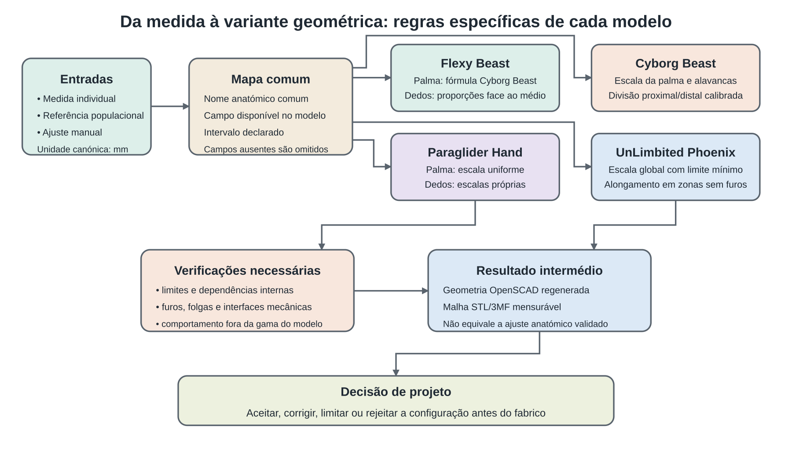

Figura C.1 - Fluxo entre dados de entrada, mapa comum, regras específicas dos modelos e geometria exportável. Produção própria.

### C.2.1 Campos antropométricos comuns

O serviço *profileMapping.js* estabelece as correspondências apresentadas na Tabela C.1. A origem é a árvore normalizada *profile.measurements*. O vetor *geometry_parameters* produzido pelo importador não é utilizado nesta passagem, porque foi concebido para outra organização geométrica e não partilha os nomes dos modelos ativos.

Tabela C.1 - Correspondência entre medidas normalizadas e parâmetros dos modelos.

|                             |                               |                                                                          |
|-----------------------------|-------------------------------|--------------------------------------------------------------------------|
| **Parâmetro da plataforma** | **Medida de origem**          | **Aplicação**                                                            |
| palm_breadth_mm             | palm.width_mm                 | Largura metacarpal usada na escala da palma ou da mão                    |
| palm_length_mm              | palm.length_mm                | Comprimento da palma; só tem efeito geométrico quando o modelo o utiliza |
| palm_thickness_mm           | palm.thickness_mm             | Espessura da palma; só tem efeito geométrico quando o modelo o utiliza   |
| index_finger_length_mm      | digits.index.total_length_mm  | Comprimento total do indicador                                           |
| middle_finger_length_mm     | digits.middle.total_length_mm | Comprimento total do dedo médio                                          |
| ring_finger_length_mm       | digits.ring.total_length_mm   | Comprimento total do anelar                                              |
| pinky_finger_length_mm      | digits.pinky.total_length_mm  | Comprimento total do mindinho                                            |
| thumb_length_mm             | digits.thumb.total_length_mm  | Comprimento total do polegar                                             |
| \*\_base_length_mm          | digits.\*.proximal_length_mm  | Comprimento do segmento proximal quando o modelo expõe esta divisão      |
| wrist_circumference_mm      | wrist.circumference_mm        | Dimensionamento da braçadeira nos modelos que aceitam esta medida        |

Uma medida em falta não é interpolada automaticamente: o campo é omitido, conservando o valor corrente, ou fica disponível para introdução manual. Os valores válidos são arredondados a uma casa decimal. Durante o mapeamento, são limitados ao mínimo e ao máximo declarados no catálogo de modelos, ficando registadas as limitações aplicadas. Os parâmetros mecânicos, as cores, a visibilidade e a lateralidade não são preenchidos a partir das medidas corporais.

Perante uma descrição livre, a plataforma pode selecionar uma referência populacional segundo uma pontuação baseada no sexo, na categoria etária, na proximidade da idade, no país e na qualidade descritiva do grupo. O perfil só é selecionado quando a pontuação atinge três. Esta regra permite escolher um ponto de partida, mas não mede a proximidade anatómica entre populações nem substitui uma medida individual.

### C.2.2 Tipos de parâmetros

Para efeitos de projeto, os parâmetros foram distribuídos por quatro classes:

\- **Diretos:** medidas ou decisões introduzidas no modelo, como largura metacarpal, comprimento de um dedo ou diâmetro de um pino;

\- **Derivados:** resultados calculados a partir de entradas, como fatores de escala, proporções entre dedos ou deslocamentos de segmentos;

\- **Fixos:** constantes herdadas ou calibradas que preservam a geometria-base e as interfaces mecânicas;

\- **Contextuais:** campos presentes na plataforma, mas sem transformação geométrica ativa no modelo em causa.

Esta distinção é necessária, pois o nome de um campo não garante, por si só, que a dimensão final da malha coincida numericamente com o valor introduzido. A transformação depende da geometria-base, da ordem das escalas e das restrições herdadas.

### C.2.3 Coerência dos controlos no estado final examinado

No estado final examinado, aplicou-se aos quatro modelos a mesma sequência de grupos, quando existentes: componente, antropometria, divisão de segmentos, componentes mecânicos, braçadeira, opções, visibilidade, cores e braço. Esta organização não acrescenta parâmetros nem demonstra uma melhoria da utilização; reduz as diferenças de apresentação entre modelos e torna mais previsível a localização de decisões equivalentes.

Foram também uniformizados dois nomes. No Phoenix, LeftRight foi substituído pelo campo booleano mirrored, já usado nos restantes modelos. No Paraglider, show_assembled passou a print_layout, com inversão da formulação para coincidir com o controlo usado no Cyborg Beast e no Phoenix: true corresponde à disposição plana destinada à exportação. Estas alterações incidem na correspondência entre os campos da configuração e os controlos da interface, sem alterar a escala da palma, os comprimentos digitais ou as interfaces mecânicas.

## C.3 Flexy Beast

### C.3.1 Origem e estratégia de adaptação

O Flexy Beast deriva do trabalho de daprice, que combina o Parametric Cyborg Beast com o Flexy Hand (daprice, n.d.). O ficheiro-fonte local indica a licença CC BY-SA 4.0. O modelo utiliza uma palma da linhagem Cyborg Beast e segmentos digitais ligados por conectores flexíveis. A adaptação procurou separar a escala da mão, os comprimentos relativos dos dedos e a braçadeira do antebraço.

### C.3.2 Entradas, limites e relações

Tabela C.2 - Parâmetros numéricos do Flexy Beast com efeito dimensional.

|             |                                         |                   |                         |                                                                                    |
|-------------|-----------------------------------------|-------------------|-------------------------|------------------------------------------------------------------------------------|
| **Família** | **Parâmetros e unidade**                | **Valor inicial** | **Intervalo declarado** | **Relação implementada**                                                           |
| Palma       | palm_breadth_mm (mm)                    | 83                | 55-110                  | xScaleFactor = (palm_breadth_mm + 5) / 55; os três eixos da mão usam o mesmo fator |
| Dedos       | middle_finger_length_mm (mm)            | 72                | 40-120                  | fingerLength = middle_finger_length_mm / (37 × xScaleFactor)                       |
| Dedos       | indicador e anelar (mm)                 | 68; 68            | 40-120                  | proporção local = comprimento do dedo / comprimento do médio                       |
| Dedos       | mindinho e polegar (mm)                 | 55; 65            | 30-100; 35-100          | proporção local = comprimento do dedo / comprimento do médio                       |
| Juntas      | joint_dia; joint_thick (mm)             | 7; 4              | 4-10; 1-6               | diâmetro do furo e espessura da ranhura do conector flexível                       |
| Braçadeira  | wrist_circumference_mm (mm)             | 160               | 110-260                 | profundidade da braçadeira derivada de circunferência/π mais 6 mm                  |
| Braçadeira  | gauntlet_tilt (graus)                   | 0                 | −10-40                  | rotação da braçadeira em torno do eixo do pino do punho                            |
| Braçadeira  | gauntlet_length_scale (razão)           | 0,7               | 0,7-1,5                 | multiplicador do comprimento nativo reconstruído                                   |
| Braçadeira  | gauntlet_rim_hole_d (mm)                | 2,5               | 1,5-6                   | diâmetro dos furos de correia no rebordo                                           |
| Punho       | wrist_pin_dia; wrist_pin_clearance (mm) | 7; 0,35           | 4-10; 0,10-0,80         | furo da braçadeira = diâmetro do pino + 2 × folga                                  |

À escala unitária, o alcance de referência dos segmentos digitais é 37 mm, resultante dos valores nativos de 20 mm para a base e 17 mm para a ponta. O comprimento do dedo médio define o multiplicador mestre, enquanto os restantes dedos recebem uma proporção relativa ao médio. Esta transformação permite variar os comprimentos digitais sem obrigar a largura da palma a aumentar na mesma proporção.

Os conectores flexíveis são derivados das interfaces mecânicas: a parede em torno do furo é fixada em 1,2 mm; o raio do lóbulo é joint_dia / 2 + 1,2; a espessura da ponte corresponde a joint_thick; o comprimento ao longo do pino é 9,5 × xScaleFactor; e a distância entre os centros dos lóbulos é 8 × xScaleFactor. Estes valores descrevem a geometria codificada e não resultam de um ensaio material realizado nesta investigação. As juntas flexíveis não foram produzidas nos protótipos físicos.

### C.3.3 Braçadeira e interfaces confirmáveis

O estado final reutiliza um componente de fixação ao punho, reconstruído a partir da geometria de referência da versão com tensionador. A forma orgânica principal está incorporada como malha poligonal reduzida, sendo os furos mecânicos novamente abertos de forma paramétrica. A largura nativa medida é 49,88 mm, e os centros dos furos das abas situam-se em X = ±22,6, Y = −58,3 e Z = −9,8 mm no referencial da peça.

As relações principais são:

|     |                                                                      |     |
|-----|----------------------------------------------------------------------|-----|
|     | g*hinge = (26,6 − 2,6) / 22,6*                                       |     |
|     | *g*depth = (wrist*circumference*mm / π + 6) / (49,88 × xScaleFactor) |     |
|     | g*pin*bore = wrist*pin*dia + 2 × wrist*pin*clearance                 |     |

O fator *g_depth* inclui a divisão por *xScaleFactor*, dado que a braçadeira volta a ser envolvida pela escala da mão durante a montagem. Assim, procura-se que a profundidade impressa permaneça dependente da circunferência do punho, e não da largura da palma. A posição é recalculada para fazer coincidir os furos das abas com o eixo do pino da palma, identificado no código por Y = −27 e Z = 5,5 mm.

O código confirma espessuras locais de 3,2 mm na zona dos furos médios e de 5 mm nas zonas dos furos do pino e do rebordo. Não confirma uma espessura uniforme da casca orgânica nem uma tolerância de fabrico validada para toda a braçadeira. A folga de 0,35 mm é um valor configurável de projeto e não foi estabelecida por ensaio sistemático de montagem.

### C.3.4 PROpagação paramétrica documentada no perfil de ensaio

O percurso numérico do perfil de ensaio de oito anos - valores aplicados, fatores derivados e métricas de três malhas - está preservado no Suplemento 3 - Parametrização e percurso numérico. Para evitar duplicação, este anexo não repete a Tabela 16 nem os 42 registos do dicionário histórico. Inclui apenas a alteração posterior do componente de fixação ao punho e os casos que evidenciam dependências ainda não descritas nesse suplemento.

O resultado central desse percurso mantém-se relevante: *palm_breadth_mm* alimenta uma fórmula herdada, mas não define diretamente a extensão transversal da malha. O caso documenta a propagação do valor no modelo paramétrico, sem demonstrar uma correspondência anatómica direta.

### C.3.5 Limitações específicas

\- A palma continua a usar escala uniforme;

\- Os comprimentos digitais controlam relações de alcance, mas não definem independentemente largura ou espessura dos dedos;

\- A espessura integral da braçadeira não é um parâmetro no estado final examinado;

\- Os conectores flexíveis e a folga do punho carecem de ensaios materiais e de montagem;

\- A configuração não contém afirmações assert() suficientes para impedir todas as combinações inválidas quando os valores são introduzidos fora da interface.

## C.4 Cyborg Beast

### C.4.1 Origem e estratégia de adaptação

O Cyborg Beast local preserva a palma e os segmentos digitais da linhagem MakerBlock/e-NABLE, aos quais acrescenta uma camada antropométrica, uma divisão proximal-distal, uma braçadeira dimensionada pelo punho, um revestimento termoformável e a disposição das peças para impressão.

### C.4.2 Entradas e escala da mão

Os seis parâmetros principais da palma e dos dedos mantêm os valores iniciais e os intervalos do Flexy Beast. A escala global é a seguinte:

overallscale = (palmbreadthmm + 5) / 55

Ao contrário do Flexy Beast, o comprimento de cada dedo é obtido pela inversão de curvas de alcance calibradas sobre a geometria original. A curva total adota 60,85 mm como alcance de referência local e duas inclinações: 1,584 para valores positivos da alavanca len e 1,328 para valores negativos. A alavanca é limitada ao intervalo interno de −22 a 50, para evitar extensões que o modelo classifica como inseguras para a geometria.

### C.4.3 Divisão proximal-distal

A divisão entre os segmentos proximais e distais é calculada segundo relações distintas para os quatro dedos longos e para o polegar. Nos dedos indicador, médio, anelar e mindinho, os valores iniciais dos segmentos proximais são, respetivamente, 22, 24, 22 e 16 mm. Os intervalos admissíveis são 12-60 mm nos três primeiros dedos e 10-55 mm no mindinho. No polegar, o valor inicial é 27 mm e o intervalo 12-45 mm.

Nos quatro dedos longos, o cálculo baseia-se numa relação linear entre a alavanca proximal lp e o alcance proximal local:

alcance_proximal_local(lp) = 23 + (2/3) × lp

O valor de lp é obtido, a partir do comprimento proximal pretendido, pela inversão dessa relação, considerando a escala global da mão:

lp = limitar ((((base_mm / overallscale) − 23) / (2/3)), −22, 50)

O alcance distal de referência corresponde à diferença entre o alcance total local e o alcance proximal de base:

alcance_distal_de_referência = 60,85 − 23 = 37,85

Após esta divisão, o segmento distal é calculado de modo a preencher a diferença entre o comprimento total pretendido e o comprimento proximal já atribuído. A operação recorre à inversão da curva distal correspondente, cuja inclinação depende do sinal da alavanca. O posicionamento da ponta é igualmente ajustado para manter a coincidência do eixo PIP.

No polegar, a relação não segue a decomposição linear aplicada aos restantes dedos. A calibração foi obtida por renderização sobre uma grelha de valores, da qual resultou uma relação geométrica específica entre o alcance local e as alavancas lp e ld:

alcance_local = 55,84 + 0,6185 × lp + 0,77 × ld

O deslocamento da junção é calculado mediante uma segunda relação:

deslocamento_da_junção = −(23,667 + lp/3 + ld/3)

O código declara um resíduo máximo de 0,74 mm para este ajuste. Estas expressões devem, por isso, ser entendidas como uma calibração geométrica da implementação, e não como um modelo anatómico do polegar.

### C.4.4 Componente de fixação ao punho, folgas e parâmetros fixos

O componente de fixação ao punho adota a lógica descrita para o Flexy Beast. É definido por um conjunto de parâmetros editáveis: circunferência do punho (wrist_circumference_mm) entre 110 e 260 mm; inclinação entre −10° e 40°; multiplicador de comprimento entre 0,7 e 1,5; diâmetro do pino entre 4 e 10 mm; folga entre 0,10 e 0,80 mm; e diâmetro dos furos de correia entre 1,5 e 6 mm.

O diâmetro final do furo do pino é calculado com base no diâmetro nominal e na folga definida:

furo_resultante = wrist_pin_dia + 2 × wrist_pin_clearance

A folga é aplicada em ambos os lados do pino, o que permite ajustar a relação entre o encaixe, a montagem e a tolerância de fabrico.

Além destes parâmetros editáveis, o modelo mantém constantes internas de referência associadas à palma: o raio de nó de 4,85 mm, a altura do punho de 10 mm, a altura da palma de 20 mm, a largura-base de 64 unidades e a espessura th = 3. Estes valores são herdados ou calibrados no modelo original e não devem ser interpretados como medidas antropométricas introduzidas pelo utilizador.

### C.4.5 Exemplo de propagação paramétrica

O exemplo seguinte apresenta a propagação dos valores no cálculo do comprimento do dedo médio. Considera-se uma configuração com uma largura da palma de 83 mm, um comprimento total do dedo médio de 72 mm e um segmento proximal de 24 mm.

A escala global da mão é calculada com base na largura da palma:

overallscale = (83 + 5) / 55 = 1,6

O valor da alavanca proximal lp é obtido pela inversão da relação proximal:

lp = ((24 / 1,6) − 23) / (2/3) = −12

A aplicação deste valor ao cálculo do alcance proximal resulta em:

alcance_proximal_impresso = 1,6 × \[23 + (2/3) × (−12)\] = 24 mm

Dado que o comprimento total pretendido é de 72 mm, o segmento distal deve preencher os 48 mm restantes. A inversão da curva distal produz:

ld ≈ −11,86996

O alcance distal impresso é de 48 mm, perfazendo o comprimento total pretendido:

comprimento_total_calculado = 24 + 48 = 72 mm

Este exemplo confirma a coerência interna das equações na configuração analisada. A correspondência entre o alcance calculado pelo modelo e uma medição corporal real exigiria, contudo, um protocolo dimensional próprio que relacionasse os pontos geométricos da malha com referências anatómicas verificáveis.

### C.4.6 Limitações específicas

\- As curvas dos dedos foram calibradas sobre a geometria original e não sobre uma amostra de mãos;

\- O limite interno das alavancas pode impedir que combinações extremas atinjam exatamente o comprimento pedido;

\- A calibração do polegar apresenta erro residual declarado;

\- O revestimento termoformável é uma possibilidade construtiva, não uma interface corporal avaliada;

\- O Cyborg Beast não integrou a comparação dimensional, os projetos de preparação ou as séries físicas descritas no estudo principal.

## C.5 Paraglider Hand

### C.5.1 Origem e estratégia de adaptação

O Paraglider Hand, também identificado como Flexible Flyer, deriva do trabalho de Marcus Mendenhall e encontra-se localmente associado à licença CC BY-SA 4.0. O conjunto inclui ainda dependências das linhagens Reborn Hand e UnLimbited Arm, com licenças próprias. A adaptação teve de permitir a variação digital de cada dedo, mantendo simultaneamente a palma sob escala uniforme para não deformar os furos dos pinos.

### C.5.2 Relações implementadas

Tabela C.3 - Relações dimensionais do Paraglider Hand.

|                         |                        |                                                             |
|-------------------------|------------------------|-------------------------------------------------------------|
| **Entrada**             | **Inicial; intervalo** | **Transformação ou estado**                                 |
| palm_breadth_mm         | 83; 55-110 mm          | overall_scale = palm_breadth_mm / 66,4                      |
| palm_length_mm          | 95; 60-140 mm          | campo contextual; não deforma a palma de modo independente  |
| palm_thickness_mm       | 32; 18-50 mm           | campo contextual; não deforma a palma de modo independente  |
| middle_finger_length_mm | 72; 40-120 mm          | global_scale = valor / 57,6                                 |
| indicador e anelar      | 68; 40-120 mm          | escala própria = valor / 57,6                               |
| mindinho                | 55; 30-100 mm          | escala própria = valor / 57,6                               |
| thumb_length_mm         | 65; 35-100 mm          | campo disponível, mas o polegar usa atualmente global_scale |
| string_channel_scale    | 0,9; 0,5-1,0           | razão aplicada ao canal de tração                           |
| elastic_channel_scale   | 0,9; 0,5-1,5           | razão aplicada ao canal de retorno                          |

A palma Reborn continha internamente o valor overall_scale = 1,25. Como o módulo é carregado através de use, este valor permanecia definido no âmbito do ficheiro de origem, sem ser substituído pela escala calculada no modelo principal. Para compensar este comportamento, a correção foi aplicada no ponto de chamada do módulo:

scale (overallscale / 1,25) × scaledpalm ()

O módulo continua, assim, a aplicar internamente o fator 1,25, mas o efeito final passa a corresponder à escala pretendida para a largura da palma. A transformação resultante equivale, na prática, a uma relação aproximada entre palm_breadth_mm e o valor de referência 66,4 mm. A variante UnLimbited V3 não exigiu a mesma correção, pois é carregada por include e recebe a escala definida no ficheiro principal.

Nos dedos indicador, anelar e mindinho, a escala é ajustada segundo uma razão própria em relação a global_scale. O dedo médio serve de referência de escala para os módulos. No estado examinado, o polegar ainda utiliza esta escala-base: embora thumb_length_mm seja apresentado na interface e possa ser preenchido pelo perfil, o parâmetro não controla autonomamente a geometria do polegar. Esta discrepância deverá ser corrigida no modelo ou explicitada na especificação dos parâmetros, para evitar que um campo visível sugira um grau de controlo geométrico ainda inexistente na implementação.

### C.5.3 *Hardware* e limites confirmáveis

O seletor pin_index permite escolher entre quatro famílias de pino. Os diâmetros nominais utilizados no código são 3,1 mm para parafuso de 3 mm, 1,5875 mm para pino de 1/16", aproximadamente 2,413 mm para prego de calibre 13 e 1,5875 mm para pino de 1/16" sem rolamento. O código estabelece também uma folga nominal de 0,5 mm para a aba, uma profundidade de 0,4 mm para o alojamento do rolamento e acréscimos locais de 0,25 ou 0,3 mm em algumas interfaces.

Estes valores são constantes ou opções de *hardware* e não foram comparados com medições sistemáticas das peças impressas. A ativação dos canais de cordão e de elástico acrescenta operações geométricas demoradas, pelo que a pré-visualização os mantém desligados por omissão. Uma malha gerada sem esses canais não representa, portanto, uma peça funcionalmente completa.

Os parâmetros ARM_HandLen, ARM_ForearmLen, ARM_BicepCircum, ARM_CuffLength e ARM_PinHoleDia pertencem à extensão opcional do braço. Não participaram na comparação da mão isolada e não devem ser apresentados como dados testados nos ensaios principais.

**C.5.4 Exemplo de propagação paramétrica**

O exemplo seguinte acompanha a propagação dos valores numa configuração com largura da palma de 64 mm, comprimento do dedo médio de 60 mm, indicador e anelar de 57 mm, mindinho de 46 mm e polegar declarado com 50 mm. A sua leitura requer a distinção entre a correção da escala da palma Reborn, a escala aplicada aos dedos longos e a limitação ainda existente no controlo do polegar.

A largura da palma começa por definir a escala global pretendida:

overallscale = 64 / 66,4 = 0,963855

Como a palma Reborn conserva internamente o fator 1,25, a chamada ao módulo aplica-lhe uma correção inversa:

correcção_no_ponto_de_chamada = 0,963855 / 1,25 = 0,771084

O efeito líquido da escala da palma regressa, assim, ao valor pretendido:

efeito_líquido_da_palma = 1,25 × 0,771084 = 0,963855

Os dedos longos são depois escalados a partir do valor de referência de 57,6 mm. O dedo médio define a escala-base dos módulos fingerator:

global_scale_do_médio = 60 / 57,6 = 1,041667

Os restantes dedos recebem escalas próprias, calculadas em relação ao mesmo valor de referência:

escala_do_indicador = 57 / 57,6 = 0,989583

escala_do_anelar = 57 / 57,6 = 0,989583

escala_do_mindinho = 46 / 57,6 = 0,798611

No estado examinado, o polegar ainda não possui uma escala autónoma derivada de thumb_length_mm. Embora o perfil declare 50 mm para o polegar, a escala aplicada continua a ser a escala-base do dedo médio:

escala_actualmente_aplicada_ao_polegar = 1,041667

Este último valor evidencia que o comprimento declarado para o polegar não é propagado como parâmetro independente. O exemplo deve, por isso, ser interpretado como diagnóstico de uma limitação do modelo, não como demonstração de correspondência anatómica individual.

### C.5.5 Limitações específicas

\- A palma é escalada uniformemente por decisão mecânica;

\- comprimento e espessura da palma são contextuais;

\- O parâmetro de comprimento do polegar não tem transformação geométrica independente;

\- A geometria completa dos canais pode exigir tempos de cálculo superiores e deve ser ativada na exportação funcional;

\- A extensão de braço contém parâmetros fora do âmbito dos ensaios da mão;

\- As malhas avaliadas revelaram corpos abertos ou faces degeneradas em algumas peças, pelo que a aceitação pelo programa de preparação não equivale a sólido geometricamente válido.

## C.6 UnLimbited Phoenix Hand

### C.6.1 Origem e estratégia de adaptação

O UnLimbited Phoenix Hand local deriva do trabalho da equipa UnLimbited/e-NABLE, e o ficheiro-fonte indica a licença CC BY-NC-SA 4.0. A geometria herdada é constituída sobretudo por malhas e poliedros de dimensão fixa. A adaptação preservou essas zonas e introduziu uma escala uniforme para o conjunto e um alongamento localizado dos segmentos digitais em faixas sem furos.

### C.6.2 Escala global e limite dimensional mínimo

O modelo Phoenix define a escala global da mão com base numa largura de referência da palma de 82 mm. A percentagem de escala pode ser determinada de duas formas. Se o parâmetro manual HandPerc_override for superior a zero, o sistema utiliza esse valor como percentagem de escala, limitada ao intervalo entre 100% e 160%:

HandPerc = limitar (HandPerc_override, 100, 160)

Se HandPerc_override for igual a zero, o valor é interpretado como uma instrução para calcular automaticamente a escala com base na largura da palma:

HandPerc = limitar ((palm_breadth_mm / 82) × 100, 100, 160)

palm_breadth_mm é, assim, declarado no intervalo entre 82 e 131 mm, que corresponde ao intervalo de escala admissível do modelo. Qualquer largura de palma inferior a 82 mm fica sujeita ao limite mínimo de 100%, produzindo o menor tamanho permitido pelo modelo, e não uma geometria proporcional à medida introduzida. De igual modo, os valores superiores ao limite máximo são restringidos pelo tecto de 160%.

Esta regra condiciona a interpretação antropométrica do modelo. Um perfil com largura de palma inferior a 82 mm não deve ser descrito como individualmente adaptado à medida indicada, mas rejeitado, assinalado como exterior à cobertura dimensional do modelo ou acompanhado de um aviso explícito sobre esta limitação.

### C.6.3 Comprimentos digitais e preservação dos furos

Os quatro dedos têm inicialmente 72 mm de comprimento total e 31 mm de segmento proximal. Os comprimentos totais variam entre 55 e 115 mm, e os proximais entre 18 e 55 mm. O polegar parte igualmente de 72 e 31 mm, com intervalos respetivos de 45-80 e 18-50 mm.

O modelo utiliza as referências locais de 31 mm para o segmento proximal e 41 mm para o distal:

bd = baselengthmm − 31  
td = (fingerlengthmm − baselengthmm) − 41

A função stretch_shaft () divide a malha em três zonas: a dobradiça permanece fixa, uma faixa sem furos é alongada ou encurtada e a extremidade oposta é deslocada pelo mesmo valor. No segmento proximal, essa faixa situa-se entre Y = 20 e Y = 42; no distal, entre Y = −48 e Y = −14. As zonas dos furos não são, portanto, sujeitas a escala não uniforme e mantêm a secção circular.

### C.6.4 Dependência entre comprimento dos dedos e escala global

No modelo Phoenix, o comprimento dos dedos resulta de duas operações sucessivas. Cada segmento é primeiro alterado localmente segundo os parâmetros definidos para o comprimento total e para a divisão proximal-distal. Em seguida, aplica-se a toda a montagem uma escala global através de scale (HandPerc/100).

Por esta razão, quando HandPerc é diferente de 100%, os parâmetros com o sufixo \*\_finger_length_mm não correspondem necessariamente ao comprimento final da peça impressa. Nesses casos, esse comprimento resulta da combinação da alteração local do dedo com a escala uniforme aplicada ao conjunto da mão.

Esta dependência condiciona a interpretação da documentação interna do modelo. A correspondência direta entre a alteração local e o comprimento final só pode ser confirmada quando a escala global é igual a 100%. Para outras larguras de palma, é necessário verificar a dimensão final na malha resultante ou reformular a transformação para compensar explicitamente o efeito da escala global.

### C.6.5 Exemplo de propagação paramétrica

O exemplo seguinte mostra a diferença entre o comprimento local nominal e o comprimento obtido após a aplicação da escala global. Considera-se primeiro uma configuração com um dedo médio de 100 mm, um segmento proximal de 40 mm e uma largura da palma de 82 mm.

Como a largura da palma coincide com a referência do modelo, a escala global corresponde a 100%:

HandPerc = 100%

A alteração local do segmento proximal calcula-se pela diferença entre o valor pretendido e a referência interna do modelo:

bd = 40 − 31 = 9 mm

O segmento distal corresponde ao comprimento restante, também calculado por diferença em relação à referência interna:

td = (100 − 40) − 41 = 19 mm

O comprimento local nominal antes da escala global é, portanto:

comprimento_local_nominal = 72 + 9 + 19 = 100 mm

Neste primeiro caso, sendo HandPerc = 100%, a escala global não altera o comprimento local nominal.

Mantendo os mesmos parâmetros de comprimento, mas aumentando a largura da palma para 100 mm, a escala global deixa de corresponder a 100%:

HandPerc = (100 / 82) × 100 = 121,951%

Antes da escala global, o comprimento local nominal do dedo mantém-se em 100 mm. Após a aplicação da escala uniforme à montagem, porém, esse valor é multiplicado por HandPerc/100:

comprimento_nominal_após_escala_global ≈ 100 × 1,21951 = 121,951 mm

Este segundo cálculo não substitui a medição direta da malha, da caixa envolvente ou do trajeto MCP-ponta. Mostra, contudo, que o parâmetro de comprimento do dedo é novamente afetado pela escala global da mão, pelo que a sua interpretação como medida final requer verificação geométrica posterior.

### C.6.6 Componentes fixos e tolerâncias confirmáveis

Os pinos, o bloco tensor e os pinos do tensor foram reconstruídos com base em medições do ficheiro STEP e mantêm-se como componentes fixos. Os ficheiros incluem os raios e as posições medidos para cada corpo, mas não contêm um parâmetro global de folga nem um ensaio dimensional consolidado que permita declarar tolerâncias de montagem. Estes componentes são também afetados pela escala uniforme da montagem.

A reconstrução preserva a circularidade dos furos durante o alongamento local dos dedos. Esta propriedade geométrica não demonstra, porém, que a folga final entre o pino e o furo seja adequada após a impressão, considerando o material e a escala escolhida.

### C.6.7 Limitações específicas

\- A palma não desce abaixo do tamanho de referência de 82 mm;

\- Os comprimentos digitais são afetados pela escala global;

\- As zonas dos furos são preservadas, mas a folga física não foi medida de forma sistemática;

\- Os componentes de *hardware* permanecem associados à arquitetura original e são escalados com o conjunto;

\- Algumas malhas originais apresentaram descontinuidades; a reparação ou aceitação pelo programa de preparação deve ser distinguida da validade geométrica do sólido.

## C.7 Síntese comparativa das estratégias

Tabela C.4 - Comparação das adaptações e exceções de escala.

|                    |                                     |                                                                       |                                                |                                                                                           |
|--------------------|-------------------------------------|-----------------------------------------------------------------------|------------------------------------------------|-------------------------------------------------------------------------------------------|
| **Modelo**         | **Escala da palma**                 | **Variação dos dedos**                                                | **Interface preservada**                       | **Limitação principal**                                                                   |
| Flexy Beast        | uniforme, pela fórmula Cyborg Beast | proporções próprias face ao médio                                     | furos e ranhuras dos conectores; eixo do punho | campo de largura da palma não coincide diretamente com a extensão da malha                |
| Cyborg Beast       | uniforme, pela fórmula Cyborg Beast | curvas calibradas e divisão proximal-distal                           | eixos MCP/PIP; abas e pino da braçadeira       | curvas internas e limites de alavanca não são relações anatómicas universais              |
| Paraglider Hand    | uniforme para preservar furos       | escalas próprias para quatro dedos; polegar ainda dependente do médio | furos cilíndricos dos pinos                    | comprimento do polegar e dimensões independentes da palma não estão plenamente propagados |
| UnLimbited Phoenix | uniforme, 100%-160%                 | alongamento de faixas sem furos                                       | zonas de dobradiça e furos                     | comprimentos digitais voltam a ser afetados pela escala global                            |

A crítica ao escalonamento uniforme mantém-se válida quando este constitui a única resposta à diversidade antropométrica. Nos modelos analisados, porém, a escala uniforme continuou a ser necessária em zonas cuja arquitetura herdada dependia de furos circulares, espaçamentos constantes ou componentes montados como um sistema indivisível. A opção de projeto consistiu, portanto, em limitar a escala uniforme aos elementos em que permanecia tecnicamente justificada e acrescentar parâmetros locais nas zonas cuja geometria permitia maior diferenciação dimensional.

Esta solução proporciona diferentes níveis de adaptação. O Flexy Beast e o Cyborg Beast separam a largura da mão, os comprimentos digitais e a braçadeira; o Paraglider separa a escala da palma de parte dos comprimentos digitais; o Phoenix preserva a escala global e introduz alongamentos localizados. Assim, os quatro modelos não são intercambiáveis nem oferecem o mesmo grau de configuração.

## C.8 Critérios de aceitação, limitação e rejeição

Uma configuração pode avançar para geração se contiver os campos necessários, apresentar valores numéricos positivos e os mantiver dentro dos intervalos declarados para o modelo. Nestas condições, a geometria pode ser gerada para inspeção, sem que isso implique validação funcional, clínica ou de fabrico.

A configuração deve ser assinalada como limitada quando o sistema consegue gerar a geometria, mas a relação entre os dados introduzidos e o resultado exige cautela. É o que sucede quando uma medida é fixada no limite mínimo ou máximo do modelo, um campo desempenha uma função apenas contextual ou a transformação paramétrica não estabelece uma correspondência direta entre o valor declarado e a dimensão final da malha.

A passagem direta para fabrico deve ser impedida ou, pelo menos, sujeita a revisão técnica quando o perfil se encontra fora da gama dimensional do modelo; o comprimento proximal é igual ou superior ao comprimento total do dedo; uma alteração faz um valor interno atingir os limites de uma alavanca calibrada; faltam componentes necessários à função, como juntas flexíveis ou canais de tração; a malha é aberta, não estanque ou contém faces degeneradas sem justificação construtiva; a folga ou a espessura não foi confirmada para a combinação de material, impressora e orientação; ou é introduzido no modelo, contornando os controlos da interface, um valor fora do intervalo declarado.

No estado atual, estas condições também não estão implementadas como bloqueios automáticos em cada ficheiro OpenSCAD. Algumas são tratadas por limites da interface, outras por funções *min/max* e outras permanecem critérios de revisão técnica. Esta distinção deve ser preservada na investigação, para que as restrições já implementadas não sejam confundidas com critérios metodológicos ainda dependentes de verificação externa.

## C.9 Relação com o Suplemento 3

O Suplemento 3 - Parametrização e percurso numérico preserva um estado histórico útil: contém 42 parâmetros numéricos dos três modelos comparados e o percurso do perfil de ensaio até às três malhas do Flexy Beast. Deve, contudo, ser identificado como uma fotografia do estado utilizado nesses ensaios.

Após esse estado, a estrutura paramétrica da braçadeira do Flexy Beast foi alterada. Por esse motivo, gauntlet_width_mm, gauntlet_length_mm, gauntlet_wall_mm, gauntlet_pos_adjust e strap_splay_adjust não descrevem o estado final examinado. Foram, no essencial, substituídos por wrist_circumference_mm, gauntlet_tilt, gauntlet_length_scale, gauntlet_rim_hole_d e uma colocação automática sobre o eixo do pino. Esta nota de evolução acompanha, no presente anexo, esse estado histórico.

## C.10 Limite de interpretação

As adaptações mostram como modelos abertos e heterogéneos podem ser reorganizados em torno de um conjunto comum de medidas e controlos. O contributo, de natureza técnica e projetual, explicita decisões, dependências, exceções e fragilidades que permanecem ocultas quando uma prótese é tratada apenas como um ficheiro STL escalável.

Não se conclui que as geometrias sejam anatomicamente adequadas a uma pessoa, que os intervalos sejam clinicamente seguros ou que as folgas assegurem a montagem e o funcionamento. Essas conclusões exigem medidas individuais, calibração dimensional, ensaios de fabrico, avaliação funcional e a participação de profissionais e utilizadores.

## C.11 Fontes técnicas consultadas

\- Relatório técnico de adaptação antropométrica da plataforma;

\- Catálogo de configuração dos modelos;

\- Serviços de correspondência e importação de perfis antropométricos;

\- Implementações OpenSCAD ativas das famílias Flexy Beast, Cyborg Beast, Paraglider Hand e UnLimbited Phoenix, incluindo as dependências de montagem;

\- Dicionário integral de parâmetros e percurso numérico do perfil de ensaio, conservados no Suplemento 3 - Parametrização e percurso numérico;

\- Capítulo 4 do manuscrito consolidado;

\- Relatório integral de revisão académica.

## C.12 Verificações executadas

\- Comparação dos quatro modelos registados com os parâmetros de catálogo de modelos;

\- Leitura das fórmulas e constantes nos ficheiros OpenSCAD ativos;

\- Confronto entre o Suplemento 3 e o estado final examinado;

\- Confirmação do mapa entre medidas normalizadas e nomes dos parâmetros;

\- Recálculo independente dos exemplos numéricos apresentados nas secções C.3 a C.6;

\- Verificação dos valores inicial, mínimo, máximo e incremento declarados;

\- Pesquisa de parâmetros contextuais sem efeito geométrico confirmado;

\- Identificação das relações que permanecem sem calibração dimensional ou ensaio físico.

# Anexo D - Preparação para fabrico e verificação dos protótipos

# Índice do Anexo D

D.1 Finalidade [197](#anchor-784)

D.2 Distinção entre estimativa e medição real [197](#anchor-785)

D.3 Variáveis, controlos e materiais [198](#anchor-786)

D.3.1 Série A - projetos de preparação digital para impressão 3D com configuração analisada [198](#anchor-787)

D.3.2 Série B - comparação digital controlada [198](#anchor-788)

D.4 Resultados [199](#anchor-789)

D.4.1 Série A [199](#anchor-790)

D.4.2 Série B (condição comum) [200](#anchor-791)

D.4.3 Geometria - tamanho do conjunto vs tamanho da peça [201](#anchor-792)

D.4.4 Comparação entre entrada, malha e peça física [202](#anchor-793)

D.4.5 Registo fotográfico dos protótipos [203](#anchor-794)

D.5 Compatibilidade com orientações de dimensionamento [204](#anchor-795)

D.6 Limites de comparabilidade [204](#anchor-796)

D.7 Campos que não puderam ser obtidos [205](#anchor-797)

D.8 O que pode e não pode ser afirmado na INVESTIGAÇÃO [205](#anchor-798)

Tabela D.1 - Projetos e configurações analisados na série A. [198](#anchor-799)

Tabela D.2 - Variáveis e condições da série B. [198](#anchor-800)

Tabela D.3 - Estimativas dos projetos de preparação digital para impressão 3D com configuração analisada. [199](#anchor-801)

Tabela D.4 - Estimativas de preparação para impressão na condição digital comum. [200](#anchor-802)

Tabela D.5 - Comparação dimensional da palma no eixo X em PLA e PETG. [202](#anchor-803)

Tabela D.6 - Escalas calculadas para o Phoenix e intervalo de dimensionamento de referência. [204](#anchor-804)

## D.1 Finalidade

Este anexo reúne evidência verificável sobre a preparação para impressão das mãos protésicas paramétricas geradas pela plataforma HandFab no contexto deste projeto. Caracteriza, sob condições documentadas, as exigências de fabrico digital que o sistema paramétrico coloca a jusante do projeto: a quantidade de material, o tempo, o número de placas de impressão e as condições de preparação decorrentes de cada modelo e dimensão antropométrica. Apresenta ainda a comparação entre entrada, malha e peça física e prepara a observação da montagem e da articulação. A comparação dimensional incide nos componentes de palma das próteses impressos em PLA e PETG. A montagem e a articulação continuam dependentes de observações sistemáticas nos protótipos correspondentes.

As duas séries apresentadas constituem verificações técnicas complementares da fase empírica prevista na metodologia aprovada.

A preparação para impressão é uma etapa própria do processo de desenvolvimento de produto, que liga a decisão de projeto, expressa na geometria paramétrica, ao meio de produção por impressão FFF. A estimativa do tempo, do material e do número de placas permite caracterizar as exigências de preparação e apoiar o planeamento do fabrico.

## D.2 Distinção entre estimativa e medição real

Os valores de tempo, comprimento de filamento, massa, volume e custo apresentados neste anexo são estimativas produzidas por programas de preparação para impressão 3D (Bambu Studio e PrusaSlicer). O subcapítulo D.4.4 apresenta separadamente medições físicas das extensões X, Y e Z das palmas produzidas em PLA e PETG, realizadas à temperatura ambiente e comparadas com as dimensões das malhas correspondentes.

Em consequência, e de forma explícita:

\- As estimativas de preparação não são medições de impressões reais. Uma impressão física difere por fatores de máquina, humidade do filamento, calibração e temperatura.

\- Não são indicadores de desempenho estrutural. O tempo ou a massa estimada nada dizem sobre a resistência da peça.

\- A verificação de malha é geométrica, não mecânica. «Estanque/*manifold*» e «faces degeneradas» descrevem a integridade do ficheiro 3D.

\- As estimativas dependem da versão e do perfil. Trocar de versão do programa, de perfil de processo ou de *firmware* altera os números.

As estimativas de tempo, material, volume e custo devem, pois, ser interpretadas como indicadores comparativos das exigências de preparação, e não como propriedades físicas do produto final. Esta restrição não abrange os valores dimensionais da Subcapítulo D.4.4, que correspondem a medições das palmas impressas.

## D.3 Variáveis, controlos e materiais

###  D.3.1 Série A - projetos de preparação digital para impressão 3D com configuração analisada

Quatro projetos de preparação digital para impressão 3D foram processados com a configuração específica de cada caso, mantendo-se a disposição e a orientação. Os projetos conservavam a geometria, as definições e a disposição na placa, mas não os resultados do processamento, pelo que foi necessário recalcular as trajetórias e as estimativas.

Tabela D.1 - Projetos e configurações analisados na série A.

|        |                    |           |              |                             |
|--------|--------------------|-----------|--------------|-----------------------------|
| **\#** | **Modelo**         | **Idade** | **Material** | **Programa / Impressora**   |
| 1      | Flexy Beast        | 15        | PLA          | Bambu Studio / Bambu Lab A1 |
| 2      | UnLimbited Phoenix | 15        | PLA          | Bambu Studio / Bambu Lab A1 |
| 3      | UnLimbited Phoenix | 15        | PETG         | Bambu Studio / Bambu Lab A1 |
| 4      | Paraglider Hand    | 15        | PLA          | PrusaSlicer / Prusa MINI    |

Nesta série, cada projeto conserva as suas próprias definições, que constituem variáveis não controladas entre casos. Os três casos Bambu usam camada de 0,24 mm e suportes em árvore orgânica, enquanto o caso PrusaSlicer usa camada de 0,20 mm e não utiliza suportes. A Série A documenta os projetos tal como foram preparados, sem os comparar entre si.

### D.3.2 Série B - comparação digital controlada

Três modelos (Flexy Beast, Paraglider Hand, UnLimbited Phoenix) × quatro perfis de ensaio (child_8, teen_15, adult_28, elderly_70), processados sob uma única condição comum para isolar o efeito do modelo e da dimensão:

Tabela D.2 - Variáveis e condições da série B.

|                                         |                             |                           |
|-----------------------------------------|-----------------------------|---------------------------|
| **Variável**                            | **Estatuto**                | **Valor**                 |
| Impressora                              | controlada                  | Bambu Lab A1, bico 0,4 mm |
| Filamento                               | controlada                  | Bambu PLA Basic           |
| Altura de camada                        | controlada                  | 0,20 mm                   |
| Paredes                                 | controlada                  | 2                         |
| Enchimento                              | controlada                  | 15%, grelha               |
| Suportes                                | controlada (política única) | desligados                |
| Aba                                     | controlada                  | automática                |
| Modelo e conjunto dimensional do perfil | variáveis de comparação     | 3 × 4                     |

A orientação de cada peça exportada foi mantida; o programa limitou-se a dispor as peças na placa e criou automaticamente uma segunda placa A1 quando não cabiam numa só. Esta série de ensaios permite comparar, de forma controlada, as exigências de preparação.

Na análise geométrica, n_corpos designa o número de objetos de malha encontrados no recipiente 3MF, não a contagem de componentes topológicos desligados. Uma face foi classificada como degenerada quando a sua área era inferior a 10⁻⁹ mm². A estanquidade foi examinada pela correspondência das arestas orientadas, sem fusão prévia de vértices coincidentes. Estes resultados descrevem, portanto, a codificação geométrica dos ficheiros e devem ser interpretados em conjunto com o resultado da preparação para impressão.

## D.4 Resultados

Os resultados quantitativos completos e os registos geométricos constam do Suplemento 4 - Preparação para impressão e protótipos.

### D.4.1 Série A

Tabela D.3 - Estimativas dos projetos de preparação digital para impressão 3D com configuração analisada.

|                              |              |                           |                                                                     |                    |                                |
|------------------------------|--------------|---------------------------|---------------------------------------------------------------------|--------------------|--------------------------------|
| **Modelo e perfil**          | **Material** | **Equipamento**           | **Configuração**                                                    | **Tempo estimado** | **Material e custo estimados** |
| Flexy Beast - teen_15        | PLA          | Bambu Lab A1; bico 0,4 mm | Camada 0,24 mm; enchimento 15%, grelha; suportes em árvore orgânica | 2 h 21 min 50 s    | 18 645,87 mm; 56,51 g; 2,05 €  |
| UnLimbited Phoenix - teen_15 | PLA          | Bambu Lab A1; bico 0,4 mm | Camada 0,24 mm; enchimento 15%, grelha; suportes em árvore orgânica | 5 h 12 min 44 s    | 40 756,68 mm; 123,52 g; 4,48 € |
| UnLimbited Phoenix - teen_15 | PETG         | Bambu Lab A1; bico 0,4 mm | Camada 0,24 mm; enchimento 15%, grelha; suportes em árvore orgânica | 5 h 51 min 52 s    | 39 094,09 mm; 117,54 g; 4,27 € |
| Paraglider Hand - teen_15    | PLA          | Prusa MINI; bico 0,4 mm   | Camada 0,20 mm; enchimento 15%, grelha; sem suportes                | 2 h 32 min 11 s    | 12 727,61 mm; 37,96 g; 1,38 €  |

Entre os projetos cuja configuração foi analisada, o Phoenix apresentou estimativas de tempo e de material superiores às do Flexy Beast para o perfil de 15 anos. No projeto Phoenix preparado com PETG, o tempo estimado foi superior ao do projeto preparado com PLA; estes resultados, porém, não constituem uma comparação experimental entre materiais, pois dependem dos perfis embebidos. No Paraglider preparado sem suportes nem aba, surgiu um aviso de baixa aderência, indicando a necessidade de rever a estratégia de adesão antes da impressão.

### D.4.2 Série B (condição comum)

Tabela D.4 - Estimativas de preparação para impressão na condição digital comum.

|                    |            |                    |                        |                    |                    |               |
|--------------------|------------|--------------------|------------------------|--------------------|--------------------|---------------|
| **Modelo**         | **Perfil** | **Tempo estimado** | **Filamento estimado** | **Massa estimada** | **Custo estimado** | **Placas A1** |
| Flexy Beast        | child_8    | 6 h 39 min 34 s    | 27 387,6 mm            | 83,00 g            | 3,01 €             | 1             |
| Flexy Beast        | teen_15    | 9 h 51 min 52 s    | 43 180,9 mm            | 130,87 g           | 4,75 €             | 1             |
| Flexy Beast        | adult_28   | 12 h 34 min 14 s   | 55 811,9 mm            | 169,15 g           | 6,14 €             | 2             |
| Flexy Beast        | elderly_70 | 10 h 52 min 57 s   | 47 602,0 mm            | 144,27 g           | 5,24 €             | 2             |
| Paraglider Hand    | child_8    | 4 h 22 min 47 s    | 16 522,2 mm            | 50,07 g            | 1,82 €             | 1             |
| Paraglider Hand    | teen_15    | 6 h 45 min 18 s    | 27 695,5 mm            | 83,94 g            | 3,05 €             | 1             |
| Paraglider Hand    | adult_28   | 8 h 55 min 41 s    | 38 449,4 mm            | 116,53 g           | 4,23 €             | 1             |
| Paraglider Hand    | elderly_70 | 7 h 09 min 05 s    | 29 627,5 mm            | 89,79 g            | 3,26 €             | 1             |
| UnLimbited Phoenix | child_8    | 7 h 29 min 44 s    | 30 673,7 mm            | 92,96 g            | 3,37 €             | 2             |
| UnLimbited Phoenix | teen_15    | 8 h 30 min 45 s    | 36 335,2 mm            | 110,12 g           | 4,00 €             | 2             |
| UnLimbited Phoenix | adult_28   | 8 h 56 min 20 s    | 38 179,8 mm            | 115,71 g           | 4,20 €             | 2             |
| UnLimbited Phoenix | elderly_70 | 7 h 49 min 09 s    | 32 412,0 mm            | 98,23 g            | 3,56 €             | 2             |

Os tempos estimados variaram entre 4 h 22 min (Paraglider, child_8) e 12 h 34 min (Flexy Beast, adult_28). O programa gerou trajetórias e estimativas nos 12 casos, mas assinalou regiões suspensas nos quatro casos Flexy Beast e no Paraglider elderly_70, uma consequência relevante da política comum sem suportes. Nos quatro casos Phoenix, não foram emitidos avisos. A conclusão do processamento não demonstra, por si só, que a impressão física possa ser realizada sem rever a orientação ou ativar suportes. Os dados completos - tempo, filamento, camadas, ocupação por placa e avisos - constam do ficheiro resultados_serie_b.csv do Suplemento 4.

Duas leituras de projeto sobressaem:

1\. A exigência de preparação variou com as dimensões de entrada, e não com a

idade considerada isoladamente. Na condição comum, a massa e o tempo aumentaram do perfil infantil para o adulto. O perfil adulto do Flexy Beast apresentou a maior massa estimada (169,2 g). O perfil de 70 anos produziu valores inferiores aos do adulto porque as suas dimensões de entrada eram menores; neste contexto, a idade funciona apenas como identificador do perfil de ensaio, tal como esperado.

2\. O número de placas depende da geometria, da orientação e da disposição

automática. Nas condições usadas pelo Bambu Studio, o Paraglider foi disposto numa placa; o Flexy ocupou duas placas nos dois perfis de maiores dimensões; e o Phoenix ocupou duas placas em todos os perfis. Estes resultados podem apoiar o planeamento das sessões de fabrico, embora possam alterar-se com uma orientação ou disposição manual diferente, ou com impressoras de maiores dimensões.

### D.4.3 Geometria - tamanho do conjunto vs tamanho da peça

A análise geométrica distingue três noções de tamanho que não devem ser confundidas. Os valores completos constam do ficheiro resultados_geometria.csv do Suplemento 4:

\- Montagem sólida (mão estendida): a caixa envolvente do corpo único do modelo

montado, com dedos e punho estendidos. É o *vão anatómico*.

\- Palma (peça): a caixa envolvente da palma isolada.

\- Placa disposta: a área ocupada pelas peças efetivamente colocadas na placa.

Na orientação analisada, uma das dimensões da caixa envolvente do modelo montado ultrapassa a dimensão nominal da placa. O corpo único do Flexy atinge 259 mm (*teen*), 296 mm (*adult*) e 273 mm (*elderly*), enquanto os conjuntos Paraglider medem 331-372 mm de comprimento. O ensaio não incluiu uma procura exaustiva de rotações ou disposições alternativas. Os resultados justificam, ainda assim, a exportação segmentada disponibilizada pela plataforma e mostram que a dimensão da montagem estendida não deve ser confundida com a ocupação efetiva das peças dispostas na placa.

Quanto à integridade de malha, os corpos do Flexy são estanques e não apresentam faces degeneradas; o Paraglider apresenta faces degeneradas residuais; e a palma do Phoenix apresenta pequenas arestas de fronteira (não totalmente estanque). Trata-se de propriedades geométricas dos ficheiros, relevantes para a robustez da preparação para impressão, mas não para o desempenho estrutural.

Na interpretação estrutural dos parâmetros, importa distinguir os resultados desta investigação do enquadramento fornecido pela literatura. As estimativas do programa não medem a resistência, e a integridade de malha é uma propriedade geométrica, não mecânica. Hsueh et al. (2021) observaram, nas condições ensaiadas, maior módulo de Young e resistência no PLA e maior resistência à deformação térmica no PETG. Martins et al. (2024) registaram maior deformação até à rotura no PETG, correspondente a um comportamento mais dúctil, mas maior resistência à fadiga no PLA nas condições específicas do respetivo ensaio. O PETG pode, portanto, ser caracterizado como mais dúctil e, nas condições estudadas, mais resistente à deformação térmica, mas não como um material universalmente mais resistente e durável. Nesta investigação, a observação física limita-se à constatação de que as peças em PETG foram impressas, manipuladas e medidas sem dificuldades impeditivas do procedimento. Não foi realizada uma comparação mecânica entre materiais.

### D.4.4 Comparação entre entrada, malha e peça física

A comparação dimensional abrangeu as doze combinações dos três modelos com os quatro perfis de ensaio. Em cada combinação, compararam-se as extensões X, Y e Z da malha isolada da palma com as dimensões das peças produzidas em PLA e PETG, à temperatura ambiente. Cada valor físico corresponde a uma medição registada no eixo e no material indicados, num total de 72 comparações: 36 em PLA e 36 em PETG.

Tabela D.5 - Comparação dimensional da palma no eixo X em PLA e PETG.

|                    |                   |             |            |                |            |                 |
|--------------------|-------------------|-------------|------------|----------------|------------|-----------------|
| **Modelo**         | **Perfil etário** | **Malha X** | **PLA X**  | **Desvio PLA** | **PETG X** | **Desvio PETG** |
| Flexy Beast        | 8 anos            | 97,385 mm   | 97,101 mm  | −0,284 mm      | 97,024 mm  | −0,361 mm       |
| Flexy Beast        | 15 anos           | 117,144 mm  | 116,798 mm | −0,346 mm      | 116,688 mm | −0,456 mm       |
| Flexy Beast        | 28 anos           | 134,081 mm  | 133,690 mm | −0,391 mm      | 133,554 mm | −0,527 mm       |
| Flexy Beast        | 70 anos           | 125,612 mm  | 125,214 mm | −0,398 mm      | 125,091 mm | −0,521 mm       |
| Paraglider Hand    | 8 anos            | 76,513 mm   | 76,277 mm  | −0,236 mm      | 76,204 mm  | −0,309 mm       |
| Paraglider Hand    | 15 anos           | 94,730 mm   | 94,431 mm  | −0,299 mm      | 94,377 mm  | −0,353 mm       |
| Paraglider Hand    | 28 anos           | 109,304 mm  | 108,972 mm | −0,332 mm      | 108,841 mm | −0,463 mm       |
| Paraglider Hand    | 70 anos           | 102,017 mm  | 101,690 mm | −0,327 mm      | 101,593 mm | −0,424 mm       |
| UnLimbited Phoenix | 8 anos            | 82,165 mm   | 81,940 mm  | −0,225 mm      | 81,839 mm  | −0,326 mm       |
| UnLimbited Phoenix | 15 anos           | 88,177 mm   | 87,908 mm  | −0,269 mm      | 87,807 mm  | −0,370 mm       |
| UnLimbited Phoenix | 28 anos           | 90,181 mm   | 89,914 mm  | −0,267 mm      | 89,832 mm  | −0,349 mm       |
| UnLimbited Phoenix | 70 anos           | 84,169 mm   | 83,929 mm  | −0,240 mm      | 83,831 mm  | −0,338 mm       |

A Tabela D.5 resume os dados do eixo X; o ficheiro comparacao_dimensional_72_medicoes.csv do Suplemento 4 conserva as 72 linhas correspondentes aos três eixos. Em todas as medições, a dimensão física foi inferior à extensão da malha. Os desvios percentuais variaram entre −0,321% e −0,274% em PLA e entre −0,425% e −0,369% em PETG. Estes intervalos descrevem os exemplares medidos e não demonstram uma taxa geral de contração dos materiais.

Nos casos Paraglider, os valores palm_length_mm e palm_thickness_mm são preservados como informação contextual do perfil, mas não controlam independentemente as extensões Y e Z da geometria. Nas configurações analisadas do Flexy Beast e do Phoenix, não existe um parâmetro de entrada que corresponda diretamente a esses dois eixos. Esta diferença está assinalada no campo estado_parametro da folha suplementar.

As colunas «Entrada» e «Malha» não representam o mesmo limite geométrico em todos os modelos. No Flexy Beast e no Paraglider, a medida antropométrica alimenta uma regra de escala aplicada a uma geometria-base cuja extensão final inclui abas, interfaces e margens associadas à montagem. No Phoenix, a largura de referência coincide aproximadamente com a extensão X da palma-base, razão pela qual os valores são mais próximos. A diferença entre entrada e malha descreve, assim, a transformação geométrica resultante das decisões de projeto e não deve ser interpretada, por si só, como erro dimensional.

O desvio dimensional foi calculado entre a malha digital e a peça física, com medidas obtidas no mesmo referencial:

desvio malha-peça = medida da peça física − medida da malha

desvio percentual = 100 × (medida da peça física − medida da malha) / medida da malha

Uma vez que existe apenas um valor registado por eixo e por peça, não foram calculadas médias entre repetições, amplitudes ou incertezas de medição. Esta limitação é considerada na interpretação descritiva dos resultados. Uma caracterização dimensional futura exigiria leituras independentes por eixo e a repetição das medições com o paquímetro; essa extensão, contudo, não é necessária para a comparação apresentada nesta investigação.

### D.4.5 Registo fotográfico dos protótipos

As Figuras 27 a 29 reúnem o registo fotográfico das peças produzidas: componentes separados e em montagem parcial, séries dimensionais de segmentos Paraglider Hand e Flexy Beast e sete vistas de uma UnLimbited Phoenix montada para o perfil de ensaio de 15 anos. Os 19 originais encontram-se na subpasta fotografias_originais/ do Suplemento 4. Os painéis apresentados foram compostos sem alteração do conteúdo visual. Três fotografias das séries dimensionais foram apenas rodadas 90° para permitir a leitura correta da orientação e das identificações manuscritas.

O registo confirma a existência material dos componentes fotografados e permite observar diferenças de escala, estados de montagem e relações visuais entre as peças.

Os desvios apresentados na Subcapítulo D.4.4 resultam dos valores medidos nas peças, não da interpretação das imagens.

## D.5 Compatibilidade com orientações de dimensionamento

Os referenciais de dimensionamento disponíveis permitem estabelecer duas comparações delimitadas. No Flexy Beast, a plataforma usa a fórmula de escala herdada da família Cyborg Beast, (palm_breadth_mm + 5) / 55. O gráfico etário do Cyborg Beast indica 126% aos 8 anos e 133% aos 15 anos; as larguras introduzidas nos perfis Flexy originaram, respetivamente, 125,5% e 150,9%. A proximidade do primeiro caso tem apenas valor contextual. A diferença observada no segundo mostra que uma regra baseada numa medida da mão não equivale a uma regressão baseada somente na idade.

No Phoenix, a regra palm_breadth_mm / 82 × 100, limitada a 100%-160%, produziu as seguintes escalas:

Tabela D.6 - Escalas calculadas para o Phoenix e intervalo de dimensionamento de referência.

|            |                         |                      |                           |
|------------|-------------------------|----------------------|---------------------------|
| **Perfil** | **Largura introduzida** | **Escala calculada** | **Gama da folha Phoenix** |
| child_8    | 82 mm                   | 100,0%               | 100%-165%                 |
| teen_15    | 88 mm                   | 107,3%               | 100%-165%                 |
| adult_28   | 90 mm                   | 109,8%               | 100%-165%                 |
| elderly_70 | 84 mm                   | 102,4%               | 100%-165%                 |

Os quatro valores inserem-se na gama de fatores da folha Phoenix. A largura-base de 65 mm indicada nessa folha não foi comparada diretamente com os 82 mm da plataforma, uma vez que os documentos não demonstram a equivalência dos pontos de medição. Não existe uma tabela específica para o Paraglider. O detalhe e os limites destas comparações encontram-se no ficheiro compatibilidade_dimensionamento.md do Suplemento 4. Os resultados são compatíveis com orientações de escala, mas não demonstram adequação anatómica individual nem funcionamento.

## D.6 Limites de comparabilidade

\- **Estimativas de preparação, não medições físicas** (ver D.2): os valores de tempo, filamento, massa, volume e custo não devem ser citados como propriedades medidas nas impressões.

\- **A Série A não permite comparação direta entre modelos/máquinas:** mistura

programas (Bambu Studio/PrusaSlicer), impressoras (A1/MINI), alturas de camada (0,24/0,20 mm) e políticas de suportes. Em particular, o Paraglider não é comparável com os casos Bambu. A única exceção **são** os dois projetos Phoenix (PLA e PETG), que partilham todas as condições exceto o material e, por isso, constituem um contraste de material válido.

\- **Série A e Série B:** condições de ensaio distintas (a Série A com suportes

e 0,24 mm; a B sem suportes e 0,20 mm).

\- **Só a Série B permite comparação entre modelos**, por partilharem condição.

\- **Assimetria de exportação:** a plataforma exporta Flexy e Paraglider também como

um único corpo montado, mas exporta o Phoenix apenas em peças soltas (não há 3MF de montagem por perfil, exceto teen_15). Para assegurar a homogeneidade, a comparação da Série B incidiu nos conjuntos de peças de cada modelo.

## D.7 Campos que não puderam ser obtidos

\- **Contagem de camadas do caso PrusaSlicer:** não reportada no cabeçalho de

G-code no mesmo formato do Bambu; deixada em branco.

\- **Montagem sólida do Phoenix por perfil:** inexistente na exportação da

plataforma, que contém apenas peças soltas, pelo que só está disponível para teen*15.*

\- **Repetições das medições dimensionais:** foi incorporado um valor por eixo e

por palma em PLA e PETG. Não foram registadas três leituras independentes por ponto, pelo que não se calculam a amplitude entre repetições nem a incerteza de reposicionamento do paquímetro.

\- **Verificação de montagem e articulação:** a folha contém uma observação da

UnLimbited Phoenix, correspondente ao perfil de ensaio de 15 anos e produzida em PLA. A montagem foi concluída; os pinos foram colocados sem dano ou correção; os cinco dedos apresentaram movimento livre; e foram observados o fecho por cabo e o retorno. Após ensaios repetidos, os elásticos das articulações alargaram e tiveram de ser substituídos. Não ficaram registados o número exato de ciclos nem os ensaios com cilindros, pelo que o resultado permanece parcial.

## D.8 O que pode e não pode ser afirmado na investigação

Pode afirmar-se:

\- Que os ficheiros foram aceites pelos programas de preparação e permitiram gerar trajetórias

e estimativas nos 4 projetos com a configuração analisada e em 12 casos controlados.

\- Que a exigência de preparação (material, tempo, número de placas) foi

estimada nas condições declaradas e variou consoante o modelo e as dimensões dos perfis de ensaio.

\- Que, na orientação analisada, uma dimensão da caixa envolvente de vários modelos

montados excedeu a dimensão nominal da placa, o que apoia a decisão de disponibilizar os componentes segmentados.

\- Que a Série B permite comparar os valores estimados dos modelos sob uma

condição digital comum.

\- Que o par Phoenix PLA vs PETG (Série A) constitui um contraste de material

controlado, pois partilha o modelo, a impressora, a geometria, a camada e o processo.

\- Que foram comparadas 72 dimensões físicas das palmas em PLA e PETG com as

extensões X/Y/Z das respetivas malhas e que, nos exemplares medidos, todos os desvios foram negativos e inferiores a 0,5% em valor absoluto.

\- Que as peças em PETG foram impressas, manipuladas e medidas sem dificuldades impeditivas do procedimento. Como enquadramento da literatura, o PETG apresentou maior resistência à deformação térmica no estudo de Hsueh et al. (2021) e maior ductilidade no estudo de Martins et al. (2024).

\- Que, num espécime UnLimbited Phoenix correspondente ao perfil de ensaio de 15 anos e produzido em PLA, a montagem foi concluída e foram observados o movimento livre dos cinco dedos, o fecho por cabo e o retorno; os elásticos das articulações alargaram durante os ensaios repetidos e tiveram de ser substituídos.

Não pode afirmar-se:

\- Que as estimativas de tempo, filamento, massa, volume e custo são medições reais das impressões, ou que as medições dimensionais demonstram valores absolutos de resistência, rigidez, durabilidade ou ajuste anatómico. (A leitura estrutural admissível é apenas qualitativa e relativa; valores absolutos exigem ensaio mecânico físico.)

\- Que o PETG é, de forma geral, mais resistente, mais durável ou mais resistente à fadiga do que o PLA; essas comparações dependem do tipo de solicitação e das condições de fabrico e exigem ensaios mecânicos comparáveis.

\- Que os casos da Série A são comparáveis entre modelos, programas ou impressoras (a única comparação válida na Série A é o par Phoenix PLA vs PETG, que difere apenas no material).

\- Que a integridade de malha implica qualidade mecânica da peça.

\- Que o processamento concluído demonstra sucesso de impressão, montagem, adequação

funcional ou utilização segura.

\- Que os custos são preços de mercado reais: assentam numa taxa única assumida de

36,29 €/kg (o PETG usa a mesma taxa do PLA); um preço real que varie consoante o fornecedor ou ao longo do tempo altera-os proporcionalmente.

[^1]:  Proprioceptiva indireta é a perceção parcial da posição, resistência ou esforço do dispositivo através de sinais transmitidos ao corpo por elementos mecânicos, como cabos, arnês ou tensão estrutural, sem recurso a sensores ou feedback sensorial activo.

[^2]:  PRISMA corresponde a *Preferred Reporting Items for Systematic Reviews and Meta Analyses*, um conjunto de orientações para a elaboração e apresentação transparente de revisões sistemáticas e meta-análises.

[^3]:  *File-to-factory* refere-se ao fluxo direto que liga o ficheiro digital à produção física do objeto, geralmente através de formatos compatíveis com fabrico digital, como STL ou 3MF, reduzindo etapas intermédias de redesenho manual.

[^4]:  A modelação estatística de forma consiste na análise de variações geométricas entre diferentes anatomias, permitindo identificar padrões recorrentes e estimar formas prováveis a partir de dados incompletos ou parciais.

[^5]:  Técnica estatística usada para reduzir a complexidade de conjuntos de dados com muitas variáveis, identificando os principais eixos de variação. No contexto da modelação estatística de forma, permite representar diferenças geométricas entre vários corpos, membros ou superfícies anatómicas através de um número reduzido de componentes principais.

[^6]:  Redes neuronais artificiais são modelos computacionais compostos por camadas de unidades interligadas, que ajustam os seus parâmetros internos durante o treino para identificar padrões nos dados.

[^7]:  *Em sistemas de IA generativa, um* prompt *corresponde à instrução, pergunta ou conjunto de condições fornecido pelo utilizador para orientar a resposta do modelo. Pode incluir texto, parâmetros, exemplos, restrições ou descrições do resultado pretendido.*

[^8]:  *Um* digital twin *pode ser entendido como uma representação digital dinâmica de um sistema físico, atualizada por dados recolhidos em tempo real ou quase real, permitindo simular, monitorizar e ajustar o seu comportamento. Em saúde, esta noção é aplicada a modelos personalizados que integram dados biométricos, sensores e métricas funcionais.*

[^9]: Virtual coaching *designa sistemas digitais de orientação e acompanhamento que fornecem instruções, recomendações ou* feedback *ao utilizador durante atividades de treino, reabilitação ou aprendizagem, apoiando a adaptação do programa ao seu desempenho e evolução.*

[^10]: Serious games *são jogos concebidos com uma finalidade principal para além do entretenimento, sendo aplicados em áreas como educação, saúde ou reabilitação para apoiar aprendizagem, treino funcional, motivação, adesão terapêutica ou avaliação de desempenho.*

[^11]:  O *Technology Readiness Level* (TRL) é uma escala de maturidade tecnológica, normalmente composta por nove níveis, que permite avaliar o desenvolvimento de uma tecnologia desde a formulação conceptual, até à sua demonstração e aplicação em contexto real.
